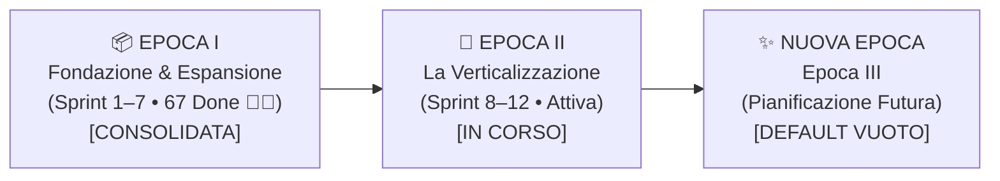

# 🏛️ Registro Ufficiale dell'Archivio per Epoche — Footlink

> **Documento Direzionale di Governance e Archiviazione Multi-Epoca**  
> **Versione:** `1.0` | **Data:** `26 Ottobre 2026` | **Stato:** `ATTIVO E VINCOLANTE`  
> **Autori:** C-Suite Footlink (CEO, CGO, CPO, CTO, CRO, CMO) & Founder  
> **Fonti di Verità Correlate:** [`Manifesto di Fondazione`](./Manifesto_Fondazione_Footlink.md) • [`ADR-011`](./adr/ADR-011-epoch-2-verticalization-governance-and-modular-depth.md) • [`Piano Strategico Epoca II`](./PIANO_PROSECUZIONE_STRATEGICO_EPOCA_2.md) • [`Compendio Epoca I`](./docs/governance/epoch-1-historical-consolidation-sprints-1-7.md)

---

## 1. Principi di Archiviazione per Epoche

Ai sensi di [`ADR-011`](./adr/ADR-011-epoch-2-verticalization-governance-and-modular-depth.md) e della direttiva esecutiva del Founder, la documentazione, i deliverable e i task operativi di Footlink sono rigorosamente partizionati per **Epoche Storiche ed Evolutive**:

1. **Consultabilità Indipendente per Epoca:** Ogni documento è censito e filtrabile per Epoca sia all'interno dell'albero documentale sia nell'Archivio del **Founder Control Center** (`http://127.0.0.1:8080`).
2. **Integrità Immutabile dei Contenuti:** I contenuti storici delle epoche chiuse sono congelati (*Frozen Baseline*) e permangono integri nei loro percorsi storici, garantendo la validità dei link relativi interni.
3. **Isolamento della Nuova Epoca (Default Vuoto):** All'apertura o selezione di una Nuova Epoca (es. Epoca III), l'archivio si presenta a **default vuoto**: nessun documento o task pregresso viene trascinato o visualizzato come attivo, garantendo un contesto pulito e focalizzato per la C-Suite e il Founder.
4. **Patrimonio Costituzionale Permanente (Core):** Il Manifesto di Fondazione, i Ruoli C-Suite, l'Identità e le direttive del Founder costituiscono il fondamento immutabile comune a tutte le epoche.

---

## 2. Mappatura Ufficiale delle Epoche

---

### 📦 Epoca I — Fondazione & Espansione Orizzontale (`Sprint 1 → Sprint 7`)
*Stato:* **CHIUSA, CONSOLIDATA E IMMUTABILE (Frozen Baseline 👑👑)**

L'Epoca I ha coperto la fase di bootstrap, la formalizzazione dei 3 Pilastri di Root, il modello di dominio 1:N PIM/PLM e la costruzione orizzontale dei primi 9 moduli della piattaforma.

#### Deliverable e Documenti Epoca I:
- **Compendio Storico Ufficiale:** [`Azienda/docs/governance/epoch-1-historical-consolidation-sprints-1-7.md`](./docs/governance/epoch-1-historical-consolidation-sprints-1-7.md)
- **Architecture Decision Records (ADR-000 .. ADR-010):**
  - [`ADR-000-template.md`](./adr/ADR-000-template.md) — Template Ufficiale ADR v1.0
  - [`ADR-001-antigravity-orchestration-and-task-schema.md`](./adr/ADR-001-antigravity-orchestration-and-task-schema.md) — Orchestrazione Antigravity & Schema v1.0
  - [`ADR-002-core-architecture-free-tier.md`](./adr/ADR-002-core-architecture-free-tier.md) — Stack Python/FastAPI/React e Free-Tier
  - [`ADR-003-domain-model-1-to-n-pim-plm.md`](./adr/ADR-003-domain-model-1-to-n-pim-plm.md) — Invariante 1 PIM (Vendita) ↔ N PLM (Produzione)
  - [`ADR-004-network-pricing-and-finops.md`](./adr/ADR-004-network-pricing-and-finops.md) — Pricing a Rete e Terzisti a 0 €
  - [`ADR-005-repository-three-pillars-restructuring.md`](./adr/ADR-005-repository-three-pillars-restructuring.md) — Ristrutturazione a 3 Pilastri (`Azienda/`, `Applicativo/`, `Portale_Founder_Control/`)
  - [`ADR-006-unified-design-system-and-l6-cost-segregation.md`](./adr/ADR-006-unified-design-system-and-l6-cost-segregation.md) — Design System v2.0 Nike-Inspired & Segregazione L6
  - [`ADR-007-flexible-data-model-seasons-collections-domain-registries.md`](./adr/ADR-007-flexible-data-model-seasons-collections-domain-registries.md) — Schema Dinamico e Anagrafiche
  - [`ADR-008-production-orders-tannery-traceability-subcontractor-lifecycle.md`](./adr/ADR-008-production-orders-tannery-traceability-subcontractor-lifecycle.md) — PaaS Distrettuale e Tracciabilità Conceria
  - [`ADR-009-pause-work-orders-hub-and-refocus-plm-pim-leather-vault.md`](./adr/ADR-009-pause-work-orders-hub-and-refocus-plm-pim-leather-vault.md) — Refocus su PLM/PIM/Vault Pellami
  - [`ADR-010-product-hierarchies-merchandising-classifiers-and-bom-cloning.md`](./adr/ADR-010-product-hierarchies-merchandising-classifiers-and-bom-cloning.md) — Tassonomia e Clonazione BOM
- **Product Requirements Documents (PRD-001 .. PRD-008):**
  - [`PRD-001-mvp-pim-plm.md`](./docs/prd/PRD-001-mvp-pim-plm.md)
  - [`PRD-002-visual-bridge-bom3-subcontractor-portal.md`](./docs/prd/PRD-002-visual-bridge-bom3-subcontractor-portal.md)
  - [`PRD-003-home-hub-vertical-specs-data-quality-export.md`](./docs/prd/PRD-003-home-hub-vertical-specs-data-quality-export.md)
  - [`PRD-004-pilot-validation-protocol-and-zero-training-ux.md`](./docs/prd/PRD-004-pilot-validation-protocol-and-zero-training-ux.md)
  - [`PRD-005-flexible-domain-model-seasons-collections-ui-simplification.md`](./docs/prd/PRD-005-flexible-domain-model-seasons-collections-ui-simplification.md)
  - [`PRD-006-work-orders-hub-and-leather-traceability-passport.md`](./docs/prd/PRD-006-work-orders-hub-and-leather-traceability-passport.md)
  - [`PRD-007-plm-products-pim-catalog-and-tannery-vault-evolution.md`](./docs/prd/PRD-007-plm-products-pim-catalog-and-tannery-vault-evolution.md)
  - [`PRD-008-product-hierarchies-and-fast-onboarding.md`](./docs/prd/PRD-008-product-hierarchies-and-fast-onboarding.md)
- **OKR & Direttive di Sprint Epoca I:**
  - `docs/okr/OKR-2026-Q4-2027-Q1.md`, `c-suite-kickoff-minutes.md`, `sprint-2-kickoff-and-governance-audit.md` .. `sprint-7-final-review-and-closure.md`
- **FinOps & Revenue Epoca I:**
  - `competitor-benchmark-and-unit-economics.md`, `design-partner-onboarding-kit-v1.md`, `pilot-loi-template-distretti.md`, `pilot-pipeline-tracking-and-loi-dossier.md`, `sales-playbook-v0.1.md`, `sprint-5-commercial-impact.md`, `sprint-6-commercial-and-finops-analysis.md`, `sprint-7-fast-onboarding-economic-impact.md`
- **Marketing & Brand Epoca I:**
  - `brand-guidelines-v1.md`, `dpp-espr-launch-campaign.md`, `editorial-plan-q1.md`, `go-live-launch-kit-and-founder-l5-package.md`, `landing-page-b2b-live.html`, `sprint-5-ui-ux-positioning.md` .. `sprint-7-merchandising-taxonomy-and-fast-onboarding-guide.md`
- **Technical Epoca I:**
  - `free-tier-deployment-and-pilot-readiness.md`
- **Governance Epoca I:**
  - `process_rules_v1.md`, `governance-risk-matrix-and-gatekeeping-sprint-6.md`, `governance-triage-and-compliance-matrix-ceo-009-012.md`, `audit-gdpr-and-l6-multi-tenant-data-segregation.md`
- **Task Object Epoca I (67 JSON):**
  - Archiviati in [`Azienda/tasks/archive_epoch_1/`](./tasks/archive_epoch_1/) (`FTL-CEO-001..016`, `FTL-GOV-001..007`, `FTL-PROD-001..011`, `FTL-TECH-001..020`, `FTL-REV-001..006`, `FTL-MKT-001..007`)
- **Memoria Sessioni Epoca I:**
  - [`Azienda/memory/archive/`](./memory/archive/) (`2026-10-18.md`, `2026-10-19.md`, `2026-10-20.md`, `EPOCH-1-2026-10-18_to_2026-10-20-summary.md`)
  - **Trascrizioni Chat Antigravity Epoca I:** [`Azienda/memory/archive/transcripts_epoca_1/`](./memory/archive/transcripts_epoca_1/) (`README.md`, 11 Sessioni Principali, 30 Sub-Agenti C-Suite)

---

### 🚀 Epoca II — La Verticalizzazione (`Sprint 8 → Sprint 12`)
*Stato:* **ATTIVA ED ESECUTIVA (Zero Horizontal Bloat / Deep Vertical Capabilities)**

L'Epoca II focalizza l'intero team sul conferimento di massima profondità funzionale, intelligenza di mestiere (colorimetria calzaturiera, albo fornitori centralizzato con rating) e automazioni batch ai moduli esistenti.

#### Deliverable e Documenti Epoca II:
- **Piano Strategico Master Epoca II:** [`Azienda/PIANO_PROSECUZIONE_STRATEGICO_EPOCA_2.md`](./PIANO_PROSECUZIONE_STRATEGICO_EPOCA_2.md)
- **Architecture Decision Record Epoca II:**
  - [`ADR-011-epoch-2-verticalization-governance-and-modular-depth.md`](./adr/ADR-011-epoch-2-verticalization-governance-and-modular-depth.md)
- **Product Requirements Document Epoca II:**
  - [`PRD-009-sprint-8-verticalization-intelligent-color-and-vendor-hub.md`](./docs/prd/PRD-009-sprint-8-verticalization-intelligent-color-and-vendor-hub.md)
- **OKR & Masterplan Epoca II:**
  - [`epoch-2-masterplan-and-sprint-8-kickoff.md`](./docs/okr/epoch-2-masterplan-and-sprint-8-kickoff.md)
- **FinOps & Unit Economics Epoca II:**
  - [`epoch-2-verticalization-unit-economics-and-sprint-8-finops.md`](./docs/finops/epoch-2-verticalization-unit-economics-and-sprint-8-finops.md)
- **Marketing & Posizionamento Epoca II:**
  - [`epoch-2-vertical-positioning-and-sprint-8-narrative.md`](./docs/marketing/epoch-2-vertical-positioning-and-sprint-8-narrative.md)
- **Technical Blueprint Epoca II:**
  - [`epoch-2-technical-optimization-and-sprint-8-blueprint.md`](./docs/technical/epoch-2-technical-optimization-and-sprint-8-blueprint.md)
- **Task Object Attivi Epoca II:**
  - In [`Azienda/tasks/`](./tasks/) (`FTL-CEO-017`, `FTL-CEO-018`, `FTL-CEO-019`, `FTL-GOV-008`, `FTL-PROD-012`, `FTL-PROD-013`, `FTL-TECH-021`, `FTL-TECH-022`, `FTL-TECH-023`, `FTL-REV-007`, `FTL-MKT-008`)
- **Memoria Sessioni Epoca II:**
  - [`Azienda/memory/2026-10-26.md`](./memory/2026-10-26.md)

---

### ✨ Epoca III — Nuova Epoca (Pianificazione Futura)
*Stato:* **DEFAULT VUOTO (Zero Documenti • Zero Task Pregressi)**

Quando il Founder o la C-Suite selezionano la **Nuova Epoca (Epoca III)** nel Founder Control Center:
- La vista documentale si presenta a **default vuoto** (`0 documenti`).
- Nessun task o deliverable delle Epoche I e II viene ereditato nello stato attivo.
- L'archivio è pulito e pronto ad accogliere i nuovi artefatti specifici della Nuova Epoca appena avviata.

---

### 🏛️ Patrimonio Costituzionale Permanente (Core)
*Documenti perenni e trasversali a tutte le Epoche:*
- [`Azienda/Manifesto_Fondazione_Footlink.md`](./Manifesto_Fondazione_Footlink.md) *(Fonte Primaria #1)*
- Specifiche di Ruolo C-Suite: [`Role_CEO`](./docs/roles/Role_CEO_Footlink.md), [`Role_CGO`](./docs/roles/Role_CGO_Footlink.md), [`Role_CPO`](./docs/roles/Role_CPO_Footlink.md), [`Role_CTO`](./docs/roles/Role_CTO_Footlink.md), [`Role_CRO`](./docs/roles/Role_CRO_Footlink.md), [`Role_CMO`](./docs/roles/Role_CMO_Footlink.md) *(Fonte #2)*
- [`Azienda/IDENTITY.md`](./IDENTITY.md), [`SOUL.md`](./SOUL.md), [`USER.md`](./USER.md), [`MEMORY.md`](./MEMORY.md), [`DREAMS.md`](./DREAMS.md)
- [`Azienda/ARCHIVIO_EPOCHE.md`](./ARCHIVIO_EPOCHE.md) *(Questo Registro)*
- [`README.md`](../README.md) e [`AGENTS.md`](../AGENTS.md)

---

## 3. Guida Operativa Founder Control Center (`http://127.0.0.1:8080`)

Nel **Founder Control Center**, la selezione dell'Epoca agisce simultaneamente su:
1. **Archivio Documentale (Knowledge Hub):** Mostra unicamente i documenti appartenenti all'Epoca selezionata. Selezionando **Nuova Epoca**, visualizza il default vuoto interattivo.
2. **C-Suite Task Board (Kanban):** Visualizza i task specifici dell'Epoca (storici per Epoca I, attivi per Epoca II, tabula rasa per Nuova Epoca).
3. **Contatori & Metriche per Ruolo:** I filtri C-Level ricalcolano i totali in tempo reale sulla base dell'Epoca attiva.
