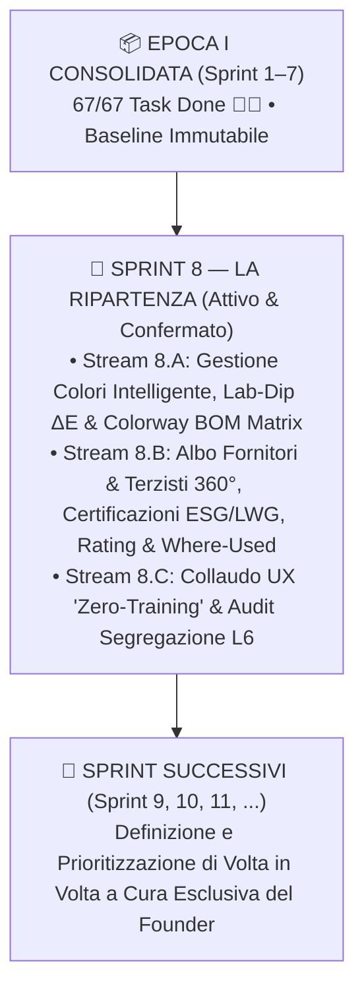

# 🎯 Piano di Prosecuzione Strategico dell'Epoca II — "La Verticalizzazione"

> **Documento Direzionale ed Esecutivo Master (Fonte Strategica Integrata C-Suite)**
> **Versione:** `1.1 (Pulizia Sprint Successivi & Definizione Riservata al Founder)` | **Data:** `28 Ottobre 2026` | **Stato:** `ATTIVO E VINCOLANTE`
> **Autori:** **CEO** (`footlink-ceo`), **CGO** (`footlink-cgo`), **CPO** (`footlink-cpo`), **CTO** (`footlink-cto`), **CRO** (`footlink-cro`), **CMO** (`footlink-cmo`)
> **Direttiva Founder:** *Sprint 8 confermato ed esecutivo; argomenti degli sprint successivi definiti di volta in volta dal Founder.*
> **Riferimenti Costituzionali:** [`Manifesto di Fondazione`](./Manifesto_Fondazione_Footlink.md) • [`ADR-011`](./adr/ADR-011-epoch-2-verticalization-governance-and-modular-depth.md) • [`Compendio Storico Epoca I`](./docs/governance/epoch-1-historical-consolidation-sprints-1-7.md)

---

## 1. Atto Formale di Chiusura, Sigillo e Ottimizzazione dell'Epoca I (`Sprint 1 – Sprint 7`)

Con la conclusione dello **Sprint 7** e il conferimento del **Doppio Riconoscimento del Founder (👑👑)**, la C-Suite di Footlink dichiara formalmente **chiusa, consolidata e ottimizzata l'Epoca I ("Fondazione & Espansione Orizzontale")**.

### 1.1 Operazioni di Ottimizzazione Fisica e Strutturale Eseguite
Per garantire alla **Nuova Epoca II** un workspace snello, ad altissimo rapporto segnale/rumore e a consumo minimo di contesto AI (ottimizzazione FinOps dei token su Google Antigravity), sono state completate le seguenti operazioni di consolidamento:

| Area Ottimizzata | Intervento Eseguito | Percorso / Artefatto di Riferimento | Stato |
|---|---|---|:---:|
| **Archivio Task Epoca I (`67 JSON`)** | Spostamento fisico dei 67 Task Object conclusi (`Sprint 1–7`) in una partizione dedicata, mantenendo nella root [`Azienda/tasks/`](./tasks/) solo i task attivi dell'**Epoca II (Sprint 8+)**. | [`Azienda/tasks/archive_epoch_1/`](./tasks/archive_epoch_1/) | ✅ Completato |
| **Compendio Storico Ufficiale Epoca I** | Redazione del documento omnicomprensivo che certifica i 7 Sprint, i 10 ADR (`ADR-000`..`ADR-010`), i 67 task `done` e l'inventario dei 3 Pilastri. | [`epoch-1-historical-consolidation-sprints-1-7.md`](./docs/governance/epoch-1-historical-consolidation-sprints-1-7.md) | ✅ Sigillato |
| **Archivio Memoria Giornaliera Epoca I** | Consolidamento dei diari di sessione dell'Epoca I in un sommario storico unico e archiviazione fisica dei log grezzi. | [`Azienda/memory/archive/`](./memory/archive/) • [`MEMORY.md`](./MEMORY.md) | ✅ Completato |
| **Partizionamento Indici Dipartimentali** | Riorganizzazione di tutti i registri dipartimentali (`adr/`, `okr/`, `prd/`, `finops/`, `marketing/`, `tasks/`) con separazione netta tra **Epoca II Attiva** e **Archivio Consolidato Epoca I**. | [`Azienda/docs/README.md`](./docs/README.md) • [`Azienda/adr/README.md`](./adr/README.md) | ✅ Completato |
| **Cabina di Regia Multi-Epoca (`v2.0`)** | Aggiornamento di `control_center.py` e della pipeline CI (`.github/workflows/ci.yml`) per leggere, validare e filtrare nativamente sia i task attivi in `Azienda/tasks/` sia l'archivio storico in `Azienda/tasks/archive_epoch_1/`. | [`Portale_Founder_Control/control_center.py`](../Portale_Founder_Control/control_center.py) | ✅ Operativo |

### 1.2 Baseline Congelata dell'Epoca I (*Frozen Baseline* — [`ADR-011`](./adr/ADR-011-epoch-2-verticalization-governance-and-modular-depth.md))
L'Epoca II eredita una fondazione solida e immutabile nei suoi principi cardine:
- **Architettura a 3 Pilastri di Root ([`ADR-005`](./adr/ADR-005-repository-three-pillars-restructuring.md)):** `🏢 Azienda/`, `💻 Applicativo/`, `🎛️ Portale_Founder_Control/`.
- **Invariante di Dominio (`Manifesto §3`):** `1 Articolo PIM (Vendita) ↔ N Articoli PLM (Produzione)`.
- **9 Moduli Orizzontali Presidiati:** Home Hub (`01`), PLM Engineering & BOM (`02`), PIM & Catalog (`03`), Tannery & Lot Vault (`04`), Stagioni & Collezioni (`05`), Anagrafiche & Tassonomia (`06`), Work Orders Hub (`07` — congelato da `ADR-009`), Subcontractor Portal (`08`), EU DPP Passports (`09`).
- **Qualità Ingegneristica & FinOps:** `26/26` test Pytest verdi, build React/TypeScript zero-errori, **0,00 € di spesa autonoma (Gate L2)** e accesso perpetuo a **0,00 € per i laboratori terzisti**.

---

## 2. I 5 Standard di Profondità Verticale dell'Epoca II ([`ADR-011`](./adr/ADR-011-epoch-2-verticalization-governance-and-modular-depth.md))

La direttiva strategica del Founder per l'Epoca II è **«La Verticalizzazione»**:
> *«La piattaforma Footlink è abbastanza ampia orizzontalmente a livello di numero di moduli, ma abbastanza limitata in termini di profondità funzionale all'interno di ogni modulo (inteso come numero di funzionalità disponibili per gli utenti).»*

In conformità ad [`ADR-011`](./adr/ADR-011-epoch-2-verticalization-governance-and-modular-depth.md), vige il **divieto di espansione orizzontale (Zero Nuovi Moduli Top-Level)** fino al raggiungimento della piena maturità verticale dei moduli esistenti. Ogni rilascio dell'Epoca II deve soddisfare **5 Standard Obbligatori di Profondità Verticale**:

1. **Modello Dati Specialistico Calzatura / Pelletteria:** Sostituzione di campi testuali generici con attributi strutturati di mestiere (es. Pantone TCX/TPG, coordinate colorimetriche CIELAB e $\Delta E$ per i Lab-Dip; tolleranze, spessori in `mm`, scelte `1ª/2ª/3ª` per i pellami; rating puntualità/qualità e certificazioni `LWG`/`REACH`/`EUDR` per i fornitori).
2. **Acceleratori Operativi *1-Click* & Azioni Batch:** Ogni schermata deve offrire strumenti che moltiplicano la velocità dell'operatore (es. *Colorway BOM Matrix* per declinare una distinta base su $N$ varianti colore in una sola vista a griglia; clonazione intelligente; simulazione costi istantanea).
3. **Guardrail Incrociati & Analisi d'Impatto (*Where-Used*):** Blocco preventivo o alert visivo automatico in caso di certificazioni fornitore scadute, ricette colore non approvate (`REJECTED` / `PENDING`) o componenti mancanti, con vista immediata di tutte le distinte base (`BOM`) e gli articoli `PLM`/`PIM` impattati.
4. **Segregazione Nativa L6 & Terzisti a 0 € Perpetuo:** Listini prezzi, costi industriali di fase, margini, formule di concia e contratti di fornitura sono protetti a livello di schema/DTO (**Gate L6**) e **mai** esposti nelle API o viste del *Subcontractor Portal* (che resta gratuito per sempre).
5. **UX "Zero-JSON / Zero-Training":** Nessun utente finale deve mai vedere o compilare campi tecnici grezzi; ogni interazione avviene tramite swatch visivi, badge semaforici, tabelle interattive e wizard guidati.

---

## 3. Matrice Strategica di Verticalizzazione Modulo per Modulo (`Moduli 01 → 09`)

La tabella seguente mappa le opportunità di verticalizzazione individuate per ciascuno dei **9 moduli** rispetto alla superficie orizzontale di fine Epoca I.

> [!IMPORTANT]
> **Direttiva Esecutiva del Founder sulla Definizione degli Sprint:**
> A eccezione dello **Sprint 8 ("La Ripartenza")**, i cui contenuti sono approvati e congelati per lo sviluppo immediato, **la pianificazione degli sprint successivi (Sprint 9, 10, 11, 12 e oltre) non è predeterminata**. Sarà il Founder a definire, prioritizzare e approvare di volta in volta gli argomenti di ogni nuovo sprint in funzione delle priorità aziendali e dei riscontri di fabbrica.

| # | Modulo Piattaforma | Stato Fine Epoca I (Profondità Attuale) | Potenziale Innesto Funzionale Verticale | Sprint Target | KPI di Profondità Utente |
|:---:|---|---|---|:---:|---|
| **06** | **Anagrafiche, Colori & Albo Fornitori** | `55%` (Tassonomia 3 livelli + 6 dizionari base) | **Libreria Colori Intelligente** (HEX, RGB, Pantone TCX, finitura, ciclo **Lab-Dip $\Delta E$** per substrato) + **Albo Fornitori & Terzisti 360°** (Scadenziario Certificazioni LWG/REACH/EUDR, Vendor Rating OTD/Qualità, Listini/MOQ L6, **Where-Used BOM**). | **Sprint 8** *(Attivo / Confermato)* | `-70%` tempo codifica colori/fornitori; `100%` tracciabilità Where-Used |
| **02** | **PLM Engineering, BOM & Costing** | `50%` (Split 1:N, BOM 3 livelli, Drag&Drop, Clonazione) | **Colorway BOM Matrix** (declinazione rapida varianti colore su righe BOM in **Sprint 8**) + Schede Tecniche Forma/Tacco/Suola/Fustelle, Ciclo di Lavorazione (fasi e tempi in min) e Simulatore Full-Costing Industriale L6. | **Sprint 8** *(Colorway Matrix)* *(Ulteriori evoluzioni: a cura Founder)* | `-65%` tempo esplosione varianti colore; calcolo costo industriale rapido |
| **05** | **Stagioni & Collezioni** | `45%` (CRUD gerarchico Stagione → Collezione) | **Merchandising Line Plan & Collection Matrix**: budget collezione per categoria/fascia prezzo, target margini L6, stato avanzamento prototipi/campionario per stagione e calendario milestone. | *A cura del Founder (Sprint 9+)* | Copertura piano collezione senza fogli Excel esterni |
| **03** | **PIM & Catalogo Omnicanale** | `40%` (CRUD SKU, Readiness %, Bulk Import, link N PLM) | **Omnichannel Enrichment Hub**: regole di completezza per canale (B2B Showroom, E-Commerce, Marketplace), gestione traduzioni multilingua (`IT/EN/FR/DE`), galleria media multi-angolo e listini B2B multi-valuta. | *A cura del Founder (Sprint 9+)* | Readiness media catalogo `> 95%`; export scheda B2B/Web in 1 click |
| **09** | **EU DPP Sustainability Passports** | `45%` (Generazione passaporto, QR SVG, punteggi base) | **Simulatore Eco-Design LCA Granulare**: calcolo automatico $\text{kg CO}_2\text{e}$ e consumo idrico dai pesi/consumi reali della BOM e dai certificati dei fornitori/lotti; validazione pre-audit ESPR e generazione batch QR. | *A cura del Founder (Sprint 9+)* | Calcolo impronta carbonica automatico da BOM |
| **04** | **Tannery & Lot Vault** | `50%` (Lotti GPS EUDR, SHA-256, Ricette segrete L6) | **Qualità Accettazione Pellami & Resa al Taglio**: verbale collaudo lotti in ingresso (spessore `mm`, difettosità, ripartizione scelte `1ª/2ª/3ª`), coefficiente di resa per scelta e scarico consumi reali su commessa. | *A cura del Founder (Sprint 9+)* | Tracciabilità scarto pelle per lotto e scelta |
| **08** | **Subcontractor Portal (`0 €`)** | `35%` (Vista card touch-friendly e cambio stato base) | **Shopfloor Mobile Operativo Zero-Training**: **Bolla di Lavorazione Digitale PDF**, conferma quantità buone/scartate per taglia in 1 tap, segnalazione anomalie con foto da smartphone (a costo **0 €** e con filtro L6 attivo). | *A cura del Founder (Sprint 9+)* | Adozione terzisti `> 85%` in `< 5 min` senza formazione |
| **07** | **Work Orders Hub & MRP** | `20%` *(Congelato in Epoca I da `ADR-009`)* | **Riattivazione Verticalizzata Commesse & MRP Fabbisogni**: lancio commesse di produzione per taglia/colore, esplosione automatica fabbisogni materiali (MRP) incrociata con MOQ/Lead Time fornitori e avanzamento fasi real-time. | *A cura del Founder (Sprint 9+)* | Sblocco `ADR-009` su fondamenta verticali mature |
| **01** | **Home Hub & Command Center** | `55%` (8 card KPI e quick-navigation) | **Centro Operativo Ruolo-Specifico & Alert Proattivi**: coda colli di bottiglia in tempo reale (Lab-Dip in attesa, certificazioni fornitori in scadenza, scostamenti costo BOM, ritardi fasi) per Modellista, Acquisti, Merchandiser e Titolare. | *Continuo (Sprint 8+)* | Riduzione tempi di reazione su anomalie di filiera |

---

## 4. Piano Operativo dell'Epoca II — Sprint 8 Attivo & Definizione Just-in-Time a Cura del Founder

Il percorso di verticalizzazione dell'Epoca II procede per sprint sequenziali guidati direttamente dal Founder. Lo **Sprint 8 ("La Ripartenza")** costituisce la prima pietra miliare esecutiva approvata, mentre i contenuti e le priorità degli sprint successivi verranno decisi volta per volta.

---

### 🚀 SPRINT 8 — "La Ripartenza": Gestione Colori Intelligente & Albo Fornitori 360° *(Sprint Attivo & Confermato)*

- **Obiettivo Strategico:** Verticalizzare i due pilastri fondanti di qualsiasi distinta base calzaturiera/pelletteria (**Colore/Variante** e **Fornitore/Terzista**), innestandoli direttamente nella distinta base (`BOM`) del modulo PLM.
- **Documenti Approvati di Riferimento:**
  - Governance: [`ADR-011`](./adr/ADR-011-epoch-2-verticalization-governance-and-modular-depth.md) (`FTL-GOV-008` — ✅ `done`)
  - Master Plan & OKR: [`epoch-2-masterplan-and-sprint-8-kickoff.md`](./docs/okr/epoch-2-masterplan-and-sprint-8-kickoff.md) (`FTL-CEO-017/018/019` — ✅ `done`)
  - Product Spec: [`PRD-009`](./docs/prd/PRD-009-sprint-8-verticalization-intelligent-color-and-vendor-hub.md) (`FTL-PROD-012` — ✅ `done`)
  - Technical Blueprint: [`epoch-2-technical-optimization-and-sprint-8-blueprint.md`](./docs/technical/epoch-2-technical-optimization-and-sprint-8-blueprint.md) (`FTL-TECH-021` — ✅ `done`)
  - Unit Economics FinOps: [`epoch-2-verticalization-unit-economics-and-sprint-8-finops.md`](./docs/finops/epoch-2-verticalization-unit-economics-and-sprint-8-finops.md) (`FTL-REV-007` — ✅ `done`)
  - Narrative & Microcopy: [`epoch-2-vertical-positioning-and-sprint-8-narrative.md`](./docs/marketing/epoch-2-vertical-positioning-and-sprint-8-narrative.md) (`FTL-MKT-008` — ✅ `done`)

#### Backlog Esecutivo Pronto per lo Sviluppo (Sprint 8):
1. **[`FTL-TECH-022`](./tasks/FTL-TECH-022.json) (`todo` — CTO):** *Sprint 8 Stream A — Sviluppo Full-Stack Gestione Colori Intelligente, Lab-Dip $\Delta E$ & Colorway BOM Matrix*.
   - **Backend & DB:** Tabelle `master_colors`, `color_substrate_recipes`, `variant_colorway_bom_mappings`; endpoint `/api/v1/colors` e `/api/v1/plm/styles/{id}/colorway-matrix`; DTO pubblici per terzisti privi di ricette chimiche e costi tintoria (**Gate L6**).
   - **Frontend (`ColorIntelligencePanel.tsx`):** Libreria cartelle colori stagionali con swatch visivi, codici Pantone TCX/TPG, workflow approvazione **Lab-Dip** (`PENDING` → `APPROVED` / `REJECTED` con $\Delta E$) e **Colorway BOM Matrix** interattiva per declinare in 1 click una BOM su $N$ varianti colore.
2. **[`FTL-TECH-023`](./tasks/FTL-TECH-023.json) (`todo` — CTO):** *Sprint 8 Stream B — Sviluppo Full-Stack Albo Fornitori & Terzisti Centralizzato 360°, Scadenziario Certificazioni ESG & Where-Used BOM*.
   - **Backend & DB:** Tabelle `vendors_registry`, `vendor_certifications`, `vendor_component_pricelists`; endpoint `/api/v1/vendors`, `/api/v1/vendors/{id}/certifications`, `/api/v1/vendors/{id}/where-used`; segregazione rigorosa L6 su listini/MOQ/contratti.
   - **Frontend (`VendorHub360Panel.tsx`):** Anagrafica 360° (Concerie, Suolifici, Tacchifici, Accessoristi, Tomaifici, Montaggi), semaforo automatico certificazioni (`VALID` Verde, `EXPIRING_SOON` Giallo $\le 30\text{gg}$, `EXPIRED` Rosso), scorecard **Vendor Rating** (Qualità, Puntualità OTD, Compliance ESG) e vista **Analisi d'Impatto (Where-Used BOM)**.
3. **[`FTL-PROD-013`](./tasks/FTL-PROD-013.json) (`backlog` → sbloccato al completamento di `022` e `023` — CPO):** *Sprint 8 Stream C — Collaudo End-to-End UX "Zero-Training", Verifica Where-Used & Audit Segregazione L6*.

---

### 👑 Sprint Successivi (Sprint 9+) — Presidio e Definizione Esclusiva del Founder

In piena conformità con le direttive del Founder, **nessun contenuto o modulo è pre-assegnato rigidamente agli sprint successivi**:

1. **Autonomia Decisionale del Founder:** Al completamento dello Sprint 8 (o di ogni sprint futuro), il Founder indicherà il tema strategico e il perimetro funzionale dello sprint successivo direttamente tramite il **Founder Control Center**.
2. **Ciclo di Avvio Sprint Just-in-Time:**
   - **Fase A (Direttiva Founder):** Il Founder immette la direttiva o il macro-obiettivo dello sprint.
   - **Fase B (Triage & Specifiche C-Suite):** CEO e CGO scompongono la direttiva; CPO redige il PRD; CTO elabora il blueprint tecnico e le DDL; CRO valida i vincoli FinOps e la politica a costo zero per i terzisti; CMO allinea narrativa e microcopy.
   - **Fase C (Creazione Task e Approvazione):** Generazione dei Task Object JSON conformi a Task Object Schema v1.0 e avvio dell'esecuzione tecnica.
3. **Presidio Invarianti di Governance:** Qualsiasi tema prescelto dal Founder per gli sprint futuri dovrà rispettare le regole di fondazione dell'Epoca II ([`ADR-011`](./adr/ADR-011-epoch-2-verticalization-governance-and-modular-depth.md)): **Zero Horizontal Bloat**, **Terzisti a 0 € perpetuo**, **Segregazione L6 By-Design** e **Zero Spesa Monetaria Autonoma (Gate L2)**.

---

## 5. Architettura Tecnica, Sostenibilità FinOps & Governance d'Epoca II

### 5.1 Regola Architetturale: *Sub-Module Decomposition* ([`Blueprint CTO Epoca II`](./docs/technical/epoch-2-technical-optimization-and-sprint-8-blueprint.md))
Per evitare che l'aumento della profondità funzionale appesantisca il codice sorgente:
- **Frontend Modulare (`Applicativo/frontend/src/components/`):** Ogni innesto verticale viene incapsulato in sotto-componenti dedicati e tipizzati (es. `plm/ColorIntelligencePanel.tsx`, `vendors/VendorHub360Panel.tsx`), mantenendo lo shell principale [`App.tsx`](../Applicativo/frontend/src/App.tsx) snello e manutenibile.
- **Backend & Database (`Applicativo/backend/app/`):** Tutte le nuove tabelle verticali sono additive (`CREATE TABLE IF NOT EXISTS`), indicizzate sulle chiavi esterne verso `plm_models`, `bom_lines` e `pim_products`, e coperte da test automatici Pytest di non-regressione e di segregazione L6.

### 5.2 Sostenibilità Economica & FinOps ([`Analisi CRO Epoca II`](./docs/finops/epoch-2-verticalization-unit-economics-and-sprint-8-finops.md))
La verticalizzazione profonda massimizza il valore percepito dalle PMI calzaturiere e dai Brand senza intaccare i vincoli FinOps del Manifesto:

| Metrica FinOps & Business | Baseline Fine Epoca I | Target Epoca II ("La Verticalizzazione") | Vincolo Manifesto |
|---|:---:|:---:|:---:|
| **Conversione Pilot → Paid (Distretti PMI)** | `~28%` | **`> 45%`** | Crescita organica product-led |
| **ARPA Medio Mensile (Uplift Tier Pro/Enterprise)** | `265 €/mese` | **`408 €/mese` (`+53,9%`)** | Sostenibilità ricavi ricorrenti |
| **Gross Margin SaaS Consolidato** | `84,2%` | **`87,06%`** | **Minimo obbligatorio `> 75%`** |
| **Costo Accesso Laboratori Terzisti (Modulo 08)** | `0,00 €` | **`0,00 € (Gratuito per Sempre)`** | **Invariante Effetto Rete (`§4`)** |
| **Spesa Monetaria Autonoma Agenti AI (Gate L2)** | `0,00 €` | **`0,00 €`** | **Zero Spesa Autonoma (`§6`)** |

---

## 6. Prossimo Passo Operativo Immediato

Con l'archiviazione fisica dell'Epoca I completata in [`Azienda/tasks/archive_epoch_1/`](./tasks/archive_epoch_1/) e il presente **Piano di Prosecuzione Strategico dell'Epoca II** attivo nel **Founder Control Center**, la C-Suite è pronta ad avviare immediatamente l'implementazione del codice dello **Sprint 8**:
1. **[`FTL-TECH-022`](./tasks/FTL-TECH-022.json)** — Sviluppo Full-Stack *Gestione Colori Intelligente, Lab-Dip $\Delta E$ & Colorway BOM Matrix*.
2. **[`FTL-TECH-023`](./tasks/FTL-TECH-023.json)** — Sviluppo Full-Stack *Albo Fornitori & Terzisti Centralizzato 360°, Scadenziario Certificazioni ESG & Where-Used BOM*.
3. **[`FTL-PROD-013`](./tasks/FTL-PROD-013.json)** — Collaudo End-to-End UX *"Zero-Training"*, Verifica *Where-Used* e Audit di Segregazione L6.
