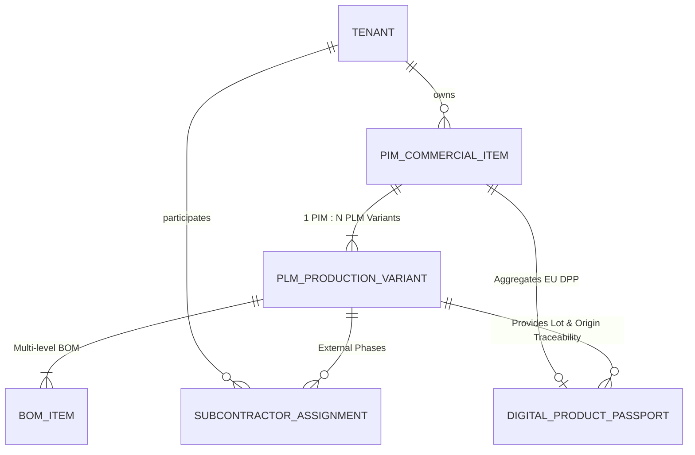

# ADR-002: Architettura Core (Python FastAPI / React TypeScript / PostgreSQL) e Strategia Hosting Free-Tier FinOps

- **Data:** 2026-10-18
- **Stato:** Proposta (In attesa di Approvazione L3 Founder)
- **Proponente:** CTO (`footlink-cto`)
- **Approvatore richiesto:** Founder (Livello L3 — Architettura irreversibile / Scelte strutturali; conformità Livello L2 — Zero Spesa Monetaria Autonoma)
- **Task di riferimento:** [`FTL-TECH-001`](../tasks/FTL-TECH-001.json)

## Contesto
Footlink ha l'obiettivo strategico (rif. [`OKR-2026-Q4-2027-Q1`](../docs/okr/OKR-2026-Q4-2027-Q1.md)) di costruire e validare sul campo la prima piattaforma integrata **PLM (fabbrica) + PIM (vendita)** per il settore calzaturiero, della pelletteria e dell'abbigliamento, basata sui seguenti cardini architetturali e di business:
1. **Modello di Dominio Core (`1 Articolo PIM ↔ N Articoli PLM`):** Un singolo articolo commerciale omnicanale (SKU/Modello PIM) governa molteplici varianti tecniche e produttive di fabbrica (Articoli PLM), ciascuna dotata di Distinta Base (BOM) multi-livello, ricette materiali, assegnazione lotti/fasi ai laboratori terzisti e generazione nativa del **Passaporto Digitale del Prodotto (DPP UE / ESPR)**.
2. **Effetto Rete "Terzisti a 0 €":** I laboratori terzisti accedono gratuitamente per sempre (`0 €`) tramite un'interfaccia mobile-first ("Zero-Training Terzista", completamento in < 5 minuti e ≤ 3 clic), mentre la monetizzazione avviene tramite abbonamenti SaaS per le **PMI produttive** e piani **Enterprise per i Brand capofila**.
3. **Vincolo L2 ("Zero Spesa Monetaria Autonoma") e Disciplina FinOps:** Durante la fase di bootstrap e validazione MVP, l'infrastruttura deve operare a **costo vivo 0 €/mese** sfruttando esclusivamente piani **Free-Tier** e tecnologie Open Source mature. A regime (post-approvazione L2 del Founder per lo scaling commerciale), l'architettura deve garantire un **Cost-to-Serve infrastrutturale < 12% dei ricavi SaaS**, abilitando un **Margine Lordo SaaS > 75%** (target ≥ 78%).

Serve quindi formalizzare lo stack applicativo, il paradigma di persistenza ibrido (relazionale + JSONB per il DPP UE), la pipeline CI/CD su GitHub Actions e la topologia di hosting Free-Tier.

## Opzioni Considerate

### Opzione A: Stack Moderno Modulare Python (FastAPI) + React (TypeScript/Vite) + PostgreSQL su Managed Free-Tier (Raccomandata)
- **Stack Applicativo:**
  - **Backend API & Domain Engine:** **Python 3.11+ con FastAPI**, **Pydantic v2** (validazione rigorosa e serializzazione ad alte prestazioni) e **SQLAlchemy 2.0** (ORM asincrono/sincrono con migrazioni Alembic). Generazione nativa specifica **OpenAPI 3.1**.
  - **Frontend Web & Portale Terzisti:** **React 18+ con TypeScript (strict mode)**, **Vite** (build ultraveloce) e **Tailwind CSS** (UI responsive mobile-first per i laboratori terzisti e dashboard tabellari dense per PMI/Brand).
  - **Database Primario:** **PostgreSQL 16** con schema relazionale forte per il grafo `1 PIM ↔ N PLM` e le BOM multi-livello, affiancato da colonne **JSONB** indicizzate GIN per gli attributi flessibili di categoria (calzatura, pelletteria, abbigliamento) e i payload normativi del **DPP UE**.
- **Topologia Hosting Free-Tier (0 €/mese):**
  - **Database & Auth:** **Supabase Free Tier** (PostgreSQL gestito fino a 500 MB storage, Row-Level Security multi-tenant nativa, autenticazione JWT/Magic Link per terzisti inclusa fino a 50.000 MAU).
  - **Backend Hosting:** **Render Free Web Service** o **Fly.io / Koyeb Free Tier** (container Docker/Python stateless a 0 €/mese per ambiente staging/MVP pilota).
  - **Frontend & Landing Hosting:** **Cloudflare Pages** o **Vercel Free Tier** (CDN globale, banda illimitata/generosa, deploy automatico da GitHub a 0 €/mese).
  - **CI/CD & Task Governance:** **GitHub Actions** (validazione automatica `tasks/*.json` contro schema CGO v1.0, linting e test `pytest` ad ogni push/PR).
- **Pro:**
  - Totale aderenza alle linee guida del Founder (`Role_CTO_Footlink.md`).
  - Costo infrastrutturale vivo pari a **0,00 €/mese** in fase MVP (100% conforme al vincolo L2).
  - Python + FastAPI garantisce latenza API P95 < 250 ms e predisposizione nativa per futuri moduli AI (estrazione automatica schede tecniche PDF/Excel tramite Google Antigravity / Gemini API).
  - PostgreSQL gestisce in un unico motore sia l'integrità referenziale delle BOM (`1 PIM : N PLM`) sia la flessibilità schema-less del Passaporto Digitale (JSONB), evitando i costi di un database NoSQL separato.
- **Contro:**
  - I piani Free-Tier per il compute backend (es. Render Free) possono avere cold-start dopo periodi di inattività (mitigabile con health-check leggeri o edge caching per gli endpoint pubblici DPP).
- **Impatto FinOps / Costi:** **0 €/mese** (Free-Tier) in Bootstrap; **~3,5% – 7,8% dell'ARPU** in fase di scaling commerciale (Margine Lordo > 85% sull'infrastruttura pura, > 78% incluso supporto e AI).
- **Effort stimato:** M (1-3gg per scaffolding e CI/CD; L per MVP completo).

### Opzione B: Architettura Enterprise Microservizi su Hyperscaler (AWS ECS / RDS Multi-AZ / Kubernetes)
- **Pro:** Isolamento estremo dei servizi, zero cold-start, SLA infrastrutturali 99.99% fin dal giorno 1.
- **Contro:**
  - **Violazione immediata del Principio L2 ("Zero Spesa Monetaria Autonoma"):** richiede carta di credito attiva e genera costi fissi minimi di 150–400 €/mese anche con zero clienti attivi.
  - Over-engineering massivo rispetto alla fase di validazione con i primi 3 Design Partner pilota e 9+ terzisti.
- **Impatto FinOps / Costi:** ~250+ €/mese fissi (Inaccettabile senza escalation L2 e controproducente per il bootstrap).
- **Effort stimato:** XL (>10gg).

### Opzione C: Stack Full-Stack JavaScript/NoSQL (Node.js + MongoDB Atlas)
- **Pro:** Unico linguaggio (TypeScript) tra frontend e backend.
- **Contro:**
  - Non allineato allo stack primario indicato dal Founder (Python + React + PostgreSQL).
  - Minore robustezza relazionale per distinte base (BOM) multi-livello, consumi taglia/colore e vincoli di integrità tra Articolo PIM e Varianti PLM.
  - Ecosistema AI/Data Engineering inferiore rispetto a Python.
- **Impatto FinOps / Costi:** 0 € iniziale, ma maggiore debito tecnico sulle query relazionali di filiera.
- **Effort stimato:** L (3-10gg).

---

## Analisi FinOps & Stima Cost-to-Serve per Tenant

Per garantire strutturalmente l'obiettivo aziendale di **Margine Lordo SaaS > 75%** (target **≥ 78%**) nonostante la gratuità perpetua per i laboratori terzisti (**"Terzisti a 0 €"**), l'architettura applica un design **Multi-Tenant Pooled con isolamento logico (`tenant_id` + PostgreSQL Row-Level Security)**.

### 1. Ottimizzazione Architetturale del Profilo "Terzista a 0 €"
Un laboratorio terzista non genera un database dedicato né job computazionali pesanti:
- Accede tramite link/credenziale leggera alle sole commesse/varianti PLM a lui assegnate dal Brand o dalla PMI capofila (`SubcontractorAssignment`).
- Esegue operazioni CRUD ad altissima efficienza (conferma presa in carico, inserimento codice lotto materiale, aggiornamento stato fase lavorazione).
- **Peso su Database:** ~50–150 KB per terzista/anno (righe testuali e JSONB).
- **Peso su Compute/Banda:** < 5.000 richieste API/mese per laboratorio, servite in < 50 ms.

### 2. Tabella FinOps del Cost-to-Serve Infrastrutturale per Tenant

| Categoria Tenant | Ruolo nella Filiera | Ricavo SaaS Mensile Target (Rif. CRO) | Cost-to-Serve Fase 1: Bootstrap Free-Tier (1–5 PMI + 15 Terzisti) | Cost-to-Serve Fase 2: Scaling Produttivo (50 PMI + 10 Brand + 200 Terzisti) | Incidenza % Cost-to-Serve su Ricavo |
|------------------|---------------------|:-------------------------------------:|:-----------------------------------------------------------------:|:---------------------------------------------------------------------------:|:-----------------------------------:|
| **Laboratorio Terzista** | Fornitore di fase (taglio, orlatura, montaggio, conceria) | **0,00 € / mese** *(Gratis per sempre)* | **0,00 € / mese** | **~0,08 € / mese** *(assorbito dalla PMI/Brand committente)* | **0% (Sussidiato < 0,3% ARPU PMI)** |
| **PMI Produttiva** *(Calzaturificio / Pelletteria)* | Gestisce ~100 SKU PIM, ~400 Varianti PLM, BOM e 3–5 Terzisti | **149 € – 299 € / mese** *(stima preliminare CRO)* | **0,00 € / mese** *(Supabase + Render + Cloudflare Free)* | **~4,20 € / mese** *(DB storage + API compute + 5 terzisti inclusi + QR DPP CDN)* | **~1,4% – 2,8%** |
| **Brand Capofila (Enterprise)** | Gestisce ~500+ SKU PIM, ~2.500+ Varianti PLM, DPP massivo, 15+ Terzisti | **799 € – 1.499 € / mese** *(stima preliminare CRO)* | **0,00 € / mese** *(Pilota su Free-Tier)* | **~18,50 € / mese** *(DB + compute + storage certificati PDF + 15 terzisti)* | **~1,2% – 2,3%** |

> **Conclusione FinOps:** Anche includendo i costi di inferenza AI opzionale e customer success tecnico, il Cost-to-Serve totale rimane ampiamente sotto la soglia del **12% dei ricavi**, garantendo un **Margine Lordo SaaS > 82%** a regime e **0,00 € di spesa viva** in tutta la fase di bootstrap.

---

## Architettura Tecnica del Dominio (`1 PIM ↔ N PLM` + BOM + DPP UE)

1. **`PimCommercialItem` (Vista Vendita - 1):** Rappresenta l'articolo commerciale a catalogo (SKU master, nome modello, stagione, categoria `footwear | leather_goods | apparel`, descrizione multilingua, attributi B2B/e-commerce).
2. **`PlmProductionVariant` (Vista Fabbrica - N):** Rappresenta ciascuna declinazione produttiva collegata tramite `pim_item_id` (variante colore/pellame, range taglie, forma/last, stabilimento, stato ciclo di vita `prototype | sample | industrialized | in_production`).
3. **`BomItem` (Distinta Base Multi-Livello):** Componenti e materie prime associate alla variante PLM (`upper`, `lining`, `sole`, `heel`, `hardware`, `packaging`), con coefficiente di consumo, scarto, unità di misura, fornitore, paese di origine (ISO-2) e certificazioni (es. LWG, GRS, REACH).
4. **`SubcontractorAssignment` (Tracciabilità Terzisti a 0 €):** Assegnazione di una fase produttiva (`cutting`, `stitching`, `lasting`, `finishing`, `quality_control`) a un laboratorio terzista con tracciamento lotto e stato in tempo reale.
5. **`DigitalProductPassport` (DPP UE / ESPR):** Oggetto calcolato dinamicamente e persistito in JSONB che unisce i dati commerciali dell'Articolo PIM con la catena di custodia reale (materiali, origini, terzisti, riciclabilità, impronta ambientale) delle N varianti PLM.

---

## Decisione
Si adotta l'**Opzione A**:
1. **Stack Ufficiale:** **Python 3.11+ (FastAPI, Pydantic v2, SQLAlchemy 2.0)** per il `backend/`, **React 18+ (TypeScript, Vite, Tailwind CSS)** per il `frontend/`, e **PostgreSQL 16** come unico database relazionale + JSONB.
2. **Governance & CI/CD:** Workflow GitHub Actions (`.github/workflows/ci.yml`) attivo su ogni push/PR per validare il 100% dei file `tasks/*.json` contro `tasks/schema/task-object-v1.schema.json` ed eseguire la test suite `pytest` sul dominio `1 PIM ↔ N PLM` e DPP.
3. **Politica Cloud Zero-Cost (L2 Compliance):** Sviluppo locale e test CI su GitHub Actions gratuiti; deploy di staging/MVP esclusivamente su piani Free-Tier a **0,00 €/mese** (Supabase Free + Render/Fly Free + Cloudflare Pages Free) senza inserimento di metodi di pagamento automatici.

## Conseguenze
- **Impatto positivo atteso:**
  - Avvio immediato dello sviluppo del motore core `1 PIM ↔ N PLM` e del generatore DPP UE senza alcun costo vivo.
  - Validazione automatica e continua della governance (`tasks/*.json`) e della qualità del codice (`pytest` coverage > 80%).
  - Allineamento nativo con i requisiti del CPO (`FTL-PROD-001`) e con il modello economico del CRO (`FTL-REV-001`).
- **Rischi residui e mitigazioni:**
  - *Limite 500 MB su Supabase Free:* Ampiamente sufficiente per oltre 50.000 schede tecniche testuali/JSONB. Gli allegati pesanti (es. CAD 3D o foto HD raw) useranno link esterni o storage compresso.
  - *Superamento soglie Free-Tier in caso di forte trazione:* Monitoraggio mensile FinOps CTO+CRO; eventuale passaggio a piani Pro (~25 €/mese) avverrà **solo** a fronte di clienti paganti e previa formale **Escalation L2 approvata ed eseguita dal Founder**.
- **Task derivati:**
  - Allineamento tecnico con [`FTL-PROD-001`](../tasks/FTL-PROD-001.json) (CPO) per recepire il set definitivo di attributi `PRD-001`.
  - Fornitura metriche Cost-to-Serve a [`FTL-REV-001`](../tasks/FTL-REV-001.json) (CRO) per il calcolo del Margine Lordo > 75%.

## Approvazione
- **Stato Attuale:** **In Revisione (`review`) — Richiede Approvazione L3 del Founder** nella Founder Control Dashboard.
- **Approvata da:** *[In attesa di firma Founder]*
- **Note di approvazione:** Nessuna spesa monetaria (> 0 €) è autorizzata o richiesta da questo ADR.
