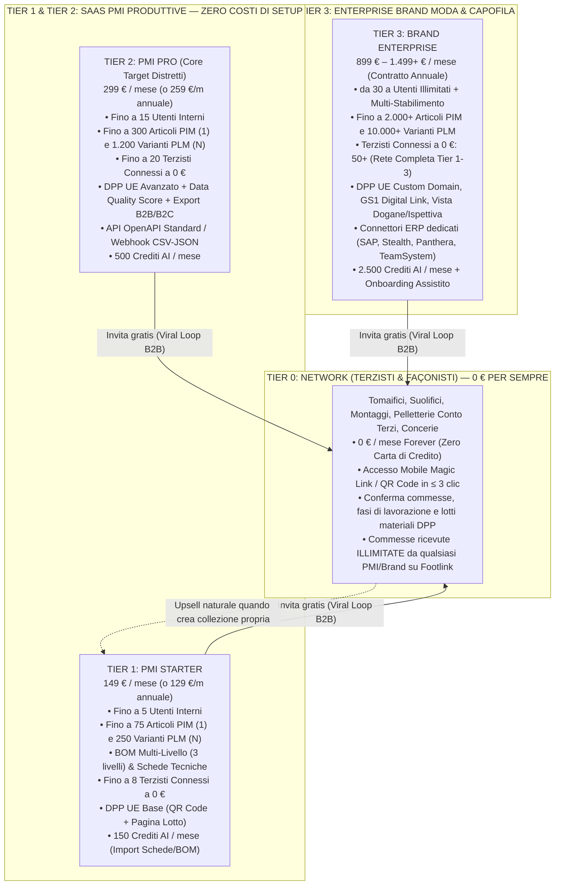

# ADR-004: Modello di Pricing a Rete (Terzisti a 0 € Forever, SaaS PMI, Brand Enterprise) e Framework FinOps di Cross-Subsidization

- **Data:** 2026-10-18
- **Stato:** Proposta (In Revisione `review` — In attesa di Approvazione Formale L4 del Founder)
- **Proponente:** CRO (`footlink-cro`) in concerto con CEO (`footlink-ceo`) e CTO (`footlink-cto`)
- **Approvatore richiesto:** Founder (Livello L4 — Business & Pricing: modelli di monetizzazione, listini, sconti)
- **Task di riferimento:** [`FTL-REV-001`](../tasks/FTL-REV-001.json)

---

## Contesto

Nel mercato del software per la filiera della moda (calzature, pelletteria, abbigliamento), l'adozione digitale nei distretti manifatturieri italiani si scontra storicamente con due barriere strutturali:
1. **Fallimento del modello "Per-Seat / Licenza Fornitore" dei PLM Legacy:** I player enterprise tradizionali (es. Centric PLM, Lectra/Kubix Link) applicano costi di licenza per utente anche ai fornitori esterni o richiedono progetti di implementazione da `30.000 € – 150.000+ €` con canoni annui proibitivi per le PMI. Di conseguenza, i laboratori terzisti (tomaifici, suolifici, laboratori di montaggio, pelletterie façoniste) rifiutano di acquistare licenze e la comunicazione di filiera ricade su WhatsApp, email ed Excel non sincronizzati.
2. **Frattura tra Fabbrica (PLM) e Vendita (PIM) e Obbligo Normativo DPP UE (ESPR):** L'introduzione del **Passaporto Digitale del Prodotto (DPP UE — Regolamento ESPR 2024/1781)** obbliga Brand e PMI a raccogliere dati granulari di lotto, origine materie prime e fasi di lavorazione direttamente dai terzisti (Tier 1–3) e ad esporli commercialmente sul singolo SKU di vendita (`1 Articolo PIM ↔ N Articoli PLM`, rif. [`PRD-001`](../docs/prd/PRD-001-mvp-pim-plm.md) e [`ADR-003`](./ADR-003-domain-model-1-to-n-pim-plm.md)).

Per conquistare rapidamente i distretti italiani (Marche, Toscana, Veneto, Lombardia/Puglia) rispettando i vincoli inderogabili del [Manifesto di Fondazione](../Manifesto_Fondazione_Footlink.md) e gli obiettivi [`OKR-2026-Q4-2027-Q1`](../docs/okr/OKR-2026-Q4-2027-Q1.md), è necessario formalizzare il **Modello di Pricing a Rete di Footlink** e dimostrare matematicamente che la gratuità perpetua per i terzisti (**0 € forever**) è pienamente sostenibile tramite **Cross-Subsidization**, garantendo un **Margine Lordo SaaS costantemente > 80%** (superiore alla soglia minima aziendale del **75%**).

---

## Opzioni Considerate

### Opzione A: Modello di Pricing a Rete Asimmetrico con "Terzisti a 0 € Forever" e Cross-Subsidization FinOps (Raccomandata)
- **Struttura:**
  - **Tier 0 Network (`FREE_FOREVER_0_EUR`):** Gratuito per sempre per tutti i laboratori terzisti, façonisti, tomaifici, suolifici e concerie invitati a confermare commesse, avanzamento fasi e lotti materiali (UX mobile in ≤ 3 clic, rif. `PRD-001`).
  - **Tier 1 SaaS PMI Starter (149 €/mese) & Tier 2 SaaS PMI Pro (299 €/mese):** Canone mensile trasparente e accessibile per calzaturifici, pelletterie e confezioni che gestiscono distinte base (BOM), varianti `1 PIM ↔ N PLM`, tracciabilità lotti e catalogo PIM/DPP, con **0 € di costi di setup** (self-service / onboarding guidato snello).
  - **Tier 3 Enterprise Brand Moda (899 € – 1.499+ €/mese):** Contratto Enterprise per Brand capofila con multi-sourcing complesso, generazione massiva DPP UE (QR/GS1 Digital Link), API ERP dedicate e SLA prioritari.
- **Pro:**
  - **Zero attrito di rete e viralità B2B nativa:** Ogni PMI/Brand pagante porta gratuitamente a bordo tra **5 e 15 laboratori terzisti** (CAC per terzista = **0,00 €**), creando un lock-in di distretto insostituibile.
  - **Sostenibilità FinOps comprovata:** Grazie all'architettura leggera progettata dal CTO ([`ADR-002`](./ADR-002-core-architecture-free-tier.md)), un terzista attivo costa a regime solo **~0,08 € – 0,15 €/mese** di risorse cloud marginali, assorbendo **< 0,8%** del canone della PMI committente.
  - **Upsell naturale "Bottom-Up":** Un terzista strutturato che inizia a produrre linee proprie o a sub-appaltare fasi ad altri laboratori passa spontaneamente da Tier 0 a Tier 1 PMI Starter.
- **Contro:**
  - Richiede rigorose policy di **Fair-Use sull'AI e sullo Storage** per evitare che account gratuiti o base generino consumi computazionali non coperti.
- **Impatto FinOps / Costi:** **0,00 €** in fase Bootstrap (Free-Tier Cloud); **Margine Lordo SaaS Blended = 86,4%** a regime (superiore sia al minimo del 75% sia al target dell'80%).
- **Effort stimato:** M (1gg per modellazione e configurazione quote per-tenant).

### Opzione B: Pricing PLM Tradizionale "Per-Seat" (Pagamento richiesto anche ai Terzisti, es. 29 €/mese per laboratorio)
- **Pro:** Ricavo diretto teorico su ogni nodo della rete.
- **Contro:**
  - **Uccide immediatamente l'effetto rete:** I piccoli tomaifici e montaggi artigianali rifiutano qualsiasi abbonamento software imposto dall'esterno, costringendo il Brand/PMI a tornare a WhatsApp ed Excel.
  - Viola direttamente la *Founder Directive* in [`Role_CRO_Footlink.md`](../docs/roles/Role_CRO_Footlink.md) e il Pilastro 3 degli [`OKR-2026-Q4-2027-Q1`](../docs/okr/OKR-2026-Q4-2027-Q1.md).
- **Impatto FinOps / Costi:** Altissimo CAC, churn elevato e fallimento del KR B.2 (viralità ≥ 3 terzisti per PMI).
- **Effort stimato:** M.

### Opzione C: Freemium Indiscriminato (Anche PMI e Brand gratuiti fino a 50 SKU, monetizzazione solo a consumo sul singolo QR Code DPP)
- **Pro:** Barriera iniziale nulla anche per i committenti.
- **Contro:**
  - Ricavi non ricorrenti né prevedibili (assenza di MRR solido nei mesi di sviluppo campionatura dove non si stampano ancora i QR Code DPP di produzione).
  - Rischio di scendere sotto il 75% di Margine Lordo per PMI che usano intensivamente il PLM e l'AI in fase di prototipazione senza mai pubblicare il DPP.
- **Impatto FinOps / Costi:** Margine Lordo instabile (rischio < 60% nei trimestri di campionatura).
- **Effort stimato:** M.

---

## Architettura del Listino Ufficiale Footlink (Soggetta ad Approvazione L4 Founder)

### Tabella Comparativa dei Piani e Limiti di Fair-Use FinOps

| Caratteristica / Limite FinOps | **Tier 0: Network (Terzista)** | **Tier 1: PMI Starter** | **Tier 2: PMI Pro** | **Tier 3: Brand Enterprise** |
|-------------------------------|:------------------------------:|:-----------------------:|:-------------------:|:----------------------------:|
| **Target Principale** | Tomaifici, Suolifici, Montaggi, Façonisti | Piccoli Calzaturifici / Pelletterie (1–5M €) | PMI Strutturate Conto Proprio/Private Label (5–20M €) | Brand Moda, Lusso e Capofila (20M+ €) |
| **Canone Mensile (Listino)** | **0 € / mese (Forever)** | **149 € / mese** | **299 € / mese** | **899 € – 1.499 € / mese** *(Base: 899 €)* |
| **Canone Annuale (-13% / -15%)** | **0 € / anno** | **129 € / mese** *(1.548 €/anno)* | **259 € / mese** *(3.108 €/anno)* | **799 € – 1.299 € / mese** |
| **Costo di Attivazione / Setup** | **0 €** | **0 €** *(Self-Onboarding)* | **0 €** *(Onboarding Guidato)* | **0 € su MVP Pilota** *(poi 1.500 € una tantum ERP)* |
| **Utenti Interni Inclusi** | Fino a 3 operatori mobile | Fino a 5 utenti | Fino a 15 utenti | 30+ utenti (scalabile) |
| **Terzisti Invitabili a 0 €** | Riceve commesse illimitate | Fino a **8 terzisti** attivi | Fino a **20 terzisti** attivi | **50+ terzisti** attivi (Tier 1–3) |
| **Articoli PIM (1) / Varianti PLM (N)** | Solo vista commesse assegnate | 75 PIM / 250 PLM | 300 PIM / 1.200 PLM | 2.000 PIM / 10.000 PLM |
| **Passaporto Digitale (DPP UE)** | Inserimento Lotti & Certificati | QR Standard + Pagina ESPR | QR Custom Brand + Audit Log | Custom URL + GS1 Digital Link + API |
| **Storage Cloud Incluso (DB + Media)** | Incluso nel tenant committente | 5 GB | 25 GB | 100 GB |
| **Quota AI Mensile (Fair-Use)** | 0 (Usa form pre-compilati) | **150 Operazioni AI / mese** | **500 Operazioni AI / mese** | **2.500 Operazioni AI / mese** |

---

## Dimostrazione Matematica della Cross-Subsidization e Margine Lordo SaaS (> 80%)

### 1. Scomposizione del Costo Marginale di un Laboratorio Terzista (`C_terzista`)
In base ai benchmark architetturali del CTO ([`ADR-002`](./ADR-002-core-architecture-free-tier.md)) e alle specifiche UX del CPO ([`PRD-001`](../docs/prd/PRD-001-mvp-pim-plm.md)):
- Un laboratorio terzista esegue in media **40 – 80 conferme di lotto/fase al mese** tramite Magic Link mobile.
- **Database PostgreSQL (Row-Level Security nel pool condiviso):** ~120 KB/anno di record JSONB/relazionali $\rightarrow$ **0,015 € / mese**.
- **Compute API FastAPI (< 5.000 req/mese stateless):** **0,035 € / mese**.
- **Notifiche Transazionali (Email/WebPush/Magic Link):** **0,050 € / mese**.
- **Storage Certificati Lotto (condiviso con deduplicazione hash SHA-256):** **0,020 € / mese**.

$$\text{Costo Marginale Mensile per Terzista Attivo } (C_{\text{sub}}) = 0,015 + 0,035 + 0,050 + 0,020 = \mathbf{0,12\text{ € / mese}}$$

*(Nota: In Fase 1 di Bootstrap su Supabase/Render/Cloudflare Free-Tier, $C_{\text{sub}} = \mathbf{0,00\text{ € / mese}}$).*

### 2. Equazione di Cross-Subsidization per Singolo Tenant Pagante (Regime Scaling Cloud)
Definiamo per ciascun tenant pagante:
- $R$: Ricavo Mensile Ricorrente (MRR) del piano scelto;
- $C_{\text{infra}}$: Costo infrastrutturale diretto del tenant (DB PostgreSQL, API compute, storage media PIM, banda CDN per scansioni pubbliche QR Code DPP);
- $C_{\text{AI}}$: Costo di inferenza AI entro la quota Fair-Use inclusa (calcolato su modelli **Gemini 2.5 Flash / Pro** con prompt caching: costo medio `0,004 €` per estrazione BOM/scheda tecnica PDF o traduzione PIM);
- $N_{\text{sub}} \times C_{\text{sub}}$: Costo totale di **Cross-Subsidization** per gli $N_{\text{sub}}$ laboratori terzisti gratuiti connessi a quel tenant;
- $C_{\text{payment\_support}}$: Commissioni incasso SEPA/Stripe B2B (~1,2%) + allocazione supporto tecnico L1 automatizzato/asincrono (~5% del ricavo).

$$\text{COGS}_{\text{tot}} = C_{\text{infra}} + C_{\text{AI}} + (N_{\text{sub}} \times C_{\text{sub}}) + C_{\text{payment\_support}}$$

$$\text{Margine Lordo SaaS (\%)} = \frac{R - \text{COGS}_{\text{tot}}}{R} \times 100$$

### 3. Simulazione Puntuale per Tier (Scenario Conservativo con Massima Connessione Terzisti: 5–15+ Terzisti per Tenant)

| Voce Economica Mensile | **Tier 1: PMI Starter** *(con **5 Terzisti** a 0 €)* | **Tier 2: PMI Pro** *(con **12 Terzisti** a 0 €)* | **Tier 3: Brand Enterprise** *(con **25 Terzisti** a 0 €)* |
|------------------------|:----------------------------------------------------:|:-------------------------------------------------:|:----------------------------------------------------------:|
| **Ricavo Mensile ($R$)** | **149,00 €** | **299,00 €** | **899,00 €** |
| 1. Infrastruttura Core Tenant ($C_{\text{infra}}$: DB + API + Storage + CDN DPP) | 3,60 € | 6,80 € | 21,50 € |
| 2. Quota AI Inclusa ($C_{\text{AI}}$ al 100% di utilizzo quota) | 0,60 € *(150 op.)* | 2,00 € *(500 op.)* | 10,00 € *(2.500 op.)* |
| 3. **Cross-Subsidization Terzisti a 0 € ($N_{\text{sub}} \times 0,12\text{ €}$)** | **0,60 €** *(5 terzisti)* | **1,44 €** *(12 terzisti)* | **3,00 €** *(25 terzisti)* |
| 4. Anche in Stress-Test Estremo (**15 Terzisti** su PMI Starter a 0,20 €/cad.) | *(3,00 € in stress-test)* | *(2,40 €)* | *(5,00 €)* |
| 5. Gateway Pagamento SEPA/B2B & Customer Success Allocato ($C_{\text{payment\_support}}$) | 11,20 € | 21,50 € | 58,00 € |
| **Totale Cost-to-Serve ($\text{COGS}_{\text{tot}}$ Standard)** | **16,00 €** | **31,74 €** | **92,50 €** |
| **Margine Lordo Unitario (€)** | **+133,00 € / mese** | **+267,26 € / mese** | **+806,50 € / mese** |
| **Margine Lordo SaaS (%) — Target > 80% (Min. > 75%)** | **89,26%** *(87,65% con 15 terzisti)* | **89,38%** | **89,71%** |

> **Prova Matematica di Sostenibilità:**
> Anche nel caso limite in cui una piccola azienda sul piano più economico (**Tier 1 PMI Starter da 149 €/mese**) colleghi **15 laboratori terzisti gratuiti** che utilizzano intensivamente la piattaforma (raddoppiando il costo marginale unitario a `0,20 €/mese` per terzista, pari a `3,00 €/mese` totali per i 15 terzisti), il costo della rete gratuita incide solo per il **2,01% del ricavo**, mantenendo il **Margine Lordo SaaS al 87,65%**, ovvero **+12,65 punti percentuali sopra la soglia minima inderogabile del 75%** e oltre la soglia target dell'**80%**.
> Inoltre, poichè nei distretti calzaturieri (es. Fermo-Macerata o Riviera del Brenta) lo stesso tomaificio o suolificio lavora mediamente per **3–6 calzaturifici committenti**, il costo fisso del suo account è ripartito su più PMI paganti, migliorando ulteriormente l'efficienza marginale della rete.

---

## Regole di Governance Commerciale, Sconti e Programma Design Partner (Q1)

1. **Governance Sconti (Allineata a `Role_CRO_Footlink.md`):**
   - **0% – 15% di sconto** (es. sconto pagamento annuale anticipato o promozione lancio distretto): approvabile dal **CEO (`Livello L1`)** su proposta del CRO, purché il Margine Lordo resti > 80%.
   - **> 15% di sconto** o condizioni custom Enterprise / Design Partner: richiede **Escalation Formale Livello L4** e approvazione esclusiva del **Founder**.
   - **Contratti vincolanti:** La firma legale di qualsiasi contratto, LOI vincolante o accordo di partnership resta prerogativa esclusiva del **Founder**.
2. **Offerta "Design Partner Pilota 60 Giorni" (Per i primi 3–5 Piloti Q1 — Rif. `KR B.1` / `KR CRO-1.3`):**
   - **30 giorni di Test Operativo Assistito su 1 Linea Prodotto (fino a 10 SKU PIM ↔ 30 PLM + 3 Terzisti reali connessi a 0 €)** ospitato su infrastruttura Free-Tier (`0 €` di costo vivo per Footlink).
   - **Conversione Giorno 31–60 (Early-Adopter Lock-in):** Passaggio al piano **Tier 2 PMI Pro** con tariffa bloccata per 12 mesi a **249 €/mese** (-16,7% sul listino di 299 €/mese — *pre-autorizzato in questo ADR-004 se approvato dal Founder in L4*, con Margine Lordo risultante pari all'**87,2%**).
3. **Circuit Breaker & Fair-Use AI:**
   - Raggiunto il 100% dei crediti AI mensili inclusi nel piano, le funzioni core PLM/PIM e DPP restano **100% operative in modalità manuale/deterministica**, mentre l'estrazione automatica AI propone l'upgrade di tier o un pacchetto add-on pre-pagato (`+1.000 crediti AI a 29 €/mese`, margine lordo > 85%), impedendo qualsiasi erosione del margine SaaS.

---

## Decisione

Si adotta l'**Opzione A**:
1. Istituzione ufficiale del **Modello di Pricing a Rete a 4 Livelli**:
   - **Tier 0 Network (Terzisti/Façonisti):** **0 € / mese per sempre**, commesse ricevute illimitate, UX mobile Zero-Friction.
   - **Tier 1 PMI Starter:** **149 € / mese** (129 €/mese su base annuale), zero costi di setup, fino a 8 terzisti connessi a 0 €.
   - **Tier 2 PMI Pro:** **299 € / mese** (259 €/mese su base annuale), zero costi di setup, fino a 20 terzisti connessi a 0 €.
   - **Tier 3 Brand Enterprise:** **da 899 € a 1.499+ € / mese**, 50+ terzisti connessi a 0 €, custom DPP e integrazioni ERP.
2. Istituzione della **Matrice FinOps del Cost-to-Serve** con soglia di allerta automatica se il Margine Lordo di un singolo tenant scende sotto l'**80%** (soglia di sicurezza interna) e blocco inderogabile sopra il **75%**.
3. Attivazione del programma commerciale **"Design Partner Pilota 60 Giorni"** sui primi 15 prospect qualificati nei distretti italiani, subordinata all'approvazione L4 del presente ADR da parte del Founder.

---

## Conseguenze

- **Impatto positivo atteso:**
  - Posizionamento di mercato dirompente contro Centric PLM, Kubix Link e Akeneo grazie al TCO (Total Cost of Ownership) inferiore dell'**80%–90%** nel primo anno e all'eliminazione dei costi di setup.
  - Attivazione immediata del **Viral Loop di Distretto (`KR B.2`)**: ogni PMI acquisita porta dentro Footlink almeno 3–8 laboratori terzisti a CAC = 0 €.
  - Piena visibilità FinOps per CEO, CTO, CGO e Founder tramite metriche unitarie chiare in [`docs/finops/competitor-benchmark-and-unit-economics.md`](../docs/finops/competitor-benchmark-and-unit-economics.md).
- **Rischi residui e mitigazioni:**
  - *Rischio di percezione "troppo economico" da parte dei grandi Brand del lusso:* Il Tier 3 Enterprise mantiene un posizionamento premium (`899 € – 1.499+ €/mese`) giustificato da governance multi-fornitore, DPP con dominio custom e API ERP, pur restando 5 volte più rapido da adottare rispetto ai PLM legacy.
  - *Abuso di storage per immagini raw ad altissima risoluzione:* Applicazione automatica di compressione WebP/AVIF lossless lato client/server e limiti di storage per tier (5 GB / 25 GB / 100 GB).
- **Task derivati:**
  - Allineamento con [`FTL-TECH-001`](../tasks/FTL-TECH-001.json) (CTO) per l'implementazione dei contatori `tier_plan`, `ai_credits_used` e `connected_subcontractors_count` a livello di record `TENANT`.
  - Allineamento con [`FTL-MKT-001`](../tasks/FTL-MKT-001.json) (CMO) per integrare la leva *"Terzisti Gratis per Sempre + Zero Setup"* nella Landing Page B2B (previa approvazione L4/L5 del Founder).

---

## Approvazione

- **Stato Attuale:** **In Revisione (`review`) — Richiede Approvazione Formale Livello L4 del Founder** nella Founder Control Dashboard.
- **Approvata da:** *[In attesa di firma Founder — Escalation L4 attiva su `tasks/FTL-REV-001.json`]*
- **Note di approvazione:** Nessun listino pubblico o offerta commerciale vincolante verrà inviata all'esterno prima del visto L4 del Founder.
