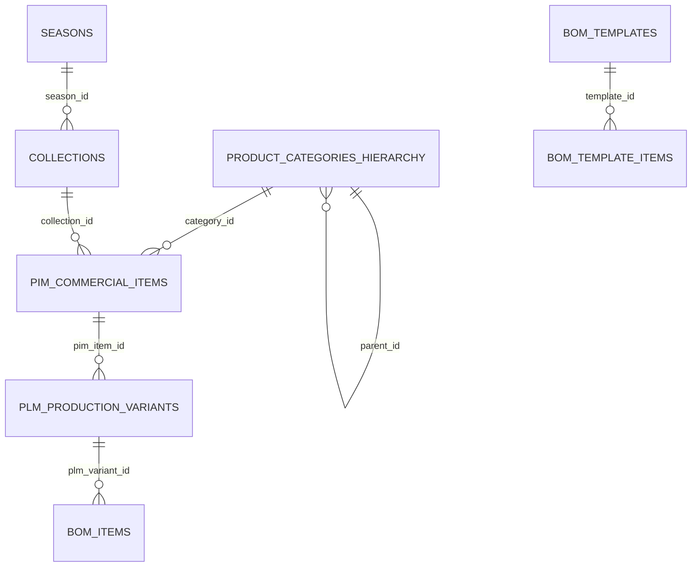

# ADR-010: Gerarchia Prodotti Multi-Livello, Classificatori Commerciali di Merchandising e Motore di Caricamento Rapido e Clonazione BOM

- **Data:** 2026-10-20
- **Stato:** Approvata (Direttiva Esecutiva Founder L1/L2/L3/L4/L6)
- **Proponenti:** Founder, CEO (`footlink-ceo`), CGO (`footlink-cgo`), CTO (`footlink-cto`), CPO (`footlink-cpo`), CRO (`footlink-cro`), CMO (`footlink-cmo`)
- **Approvatore:** Founder (Approvazione Strategica Sprint 7)
- **Task di Riferimento:** [`FTL-CEO-013`](../tasks/FTL-CEO-013.json), [`FTL-GOV-007`](../tasks/FTL-GOV-007.json), [`FTL-PROD-010`](../tasks/FTL-PROD-010.json), [`FTL-TECH-012`](../tasks/FTL-TECH-012.json), [`FTL-REV-006`](../tasks/FTL-REV-006.json), [`FTL-MKT-006`](../tasks/FTL-MKT-006.json)
- **Documenti Correlati:** [Manifesto di Fondazione](../Manifesto_Fondazione_Footlink.md), [`ADR-003`](./ADR-003-domain-model-1-to-n-pim-plm.md), [`ADR-007`](./ADR-007-flexible-data-model-seasons-collections-domain-registries.md), [`ADR-008`](./ADR-008-production-orders-tannery-traceability-subcontractor-lifecycle.md), [`ADR-009`](./ADR-009-pause-work-orders-hub-and-refocus-plm-pim-leather-vault.md)

---

## 1. Contesto & Motivazione

A valle del completamento di Sprint 6, la piattaforma Footlink dispone di moduli specializzati per la gestione delle varianti tecniche PLM con distinte basi a 3 livelli (`PlmProductsManager.tsx`), l'hub commerciale PIM con syndication feed (`PimCatalogManager.tsx`), le tabelle anagrafiche di dominio (`DomainRegistriesManager.tsx`) e il vault tracciabilità pellami (`TanneryVaultManager.tsx`).

Tuttavia, l'onboarding di campionari reali nei distretti moda e manifatturieri Made in Italy evidenzia tre attriti operativi critici:
1. **Categorie Piatte Monodimensionali:** La categorizzazione attuale si basa su un enum rigido a 3 valori (`footwear`, `leather_goods`, `apparel`). Nel settore lusso la classificazione merceologica si articola su almeno 3 o 4 livelli (Macro-Settore > Famiglia Merceologica > Sotto-Famiglia/Tipologia > Costruzione Tecnica), necessari sia per le schede tecniche di modelleria sia per i filtri di navigazione commerciale.
2. **Assenza di Classificatori di Merchandising:** Manca la rappresentazione nativa della piramide di collezione (in primis la distinzione fondamentale tra prodotti continuativi *Carryover / Iconici* e articoli *Seasonal* o *Capsule*), delle linee di marchio, delle occasioni d'uso e delle fasce prezzo.
3. **Attrito di Caricamento Articoli e Distinte Basi (BOM):** Creare ogni variante o distinta base riga per riga richiede tempi incompatibili con il ritmo delle collezioni. Occorrono strumenti ad altissima efficienza: clonazione ricorsiva atomica dell'albero BOM con sostituzione rapida materiali, applicazione di preset/template BOM standard e import/export massivo da file Excel/CSV con validazione preventiva (*Dry-Run*).

Tutto questo deve realizzarsi preservando il principio di **Zero Spesa Monetaria Autonoma (FinOps L2 — 0,00 €)** e la **Segregazione dei Costi Industriali Riservati (L6)** rispetto ai laboratori terzisti gratuiti a 0 €.

---

## 2. Decisioni Architetturali



### Decisione 1: Modello Dati Gerarchico delle Categorie (`product_categories_hierarchy`)
- Viene introdotta una tabella relazionale ad albero auto-referenziale per memorizzare la tassonomia merceologica:
  ```sql
  CREATE TABLE product_categories_hierarchy (
      id INTEGER PRIMARY KEY AUTOINCREMENT,
      category_id VARCHAR(64) NOT NULL UNIQUE,
      parent_id VARCHAR(64) REFERENCES product_categories_hierarchy(category_id) ON DELETE CASCADE,
      level INTEGER NOT NULL DEFAULT 1, -- 1=Macro-Settore, 2=Famiglia, 3=Sotto-Famiglia/Tipologia, 4=Costruzione
      code VARCHAR(64) NOT NULL,
      slug_path VARCHAR(255) NOT NULL, -- es. 'footwear/sneakers/low-top-cupsole'
      label_it VARCHAR(255) NOT NULL,
      label_en VARCHAR(255) NOT NULL,
      icon VARCHAR(32) DEFAULT '🏷️',
      is_active BOOLEAN NOT NULL DEFAULT 1,
      sort_order INTEGER NOT NULL DEFAULT 0,
      created_at VARCHAR(64) NOT NULL
  );
  ```
- **Query Ricorsive CTE:** L'albero completo e i breadcrumb di percorso vengono calcolati tramite Common Table Expressions ricorsive (`WITH RECURSIVE category_tree AS (...)`), compatibili nativamente al 100% sia con SQLite che con PostgreSQL, garantendo tempi di risposta sotto i 5ms.
- **Retro-compatibilità:** Il campo stringa `category` preesistente sulle tabelle PIM/PLM viene conservato e valorizzato automaticamente con il codice di primo livello (`footwear`, `leather_goods`, `apparel`) per preservare il funzionamento di tutti gli endpoint e test preesistenti.

---

### Decisione 2: Classificatori Commerciali & Matrice di Merchandising
Le tabelle `pim_commercial_items` e `plm_production_variants` vengono arricchite con campi espliciti di classificazione commerciale e merchandising:
1. `carryover_status`: Enum (`carryover` [Iconico Continuativo], `seasonal_core` [Volume Stagionale], `seasonal_trend` [Moda/Sfilata], `capsule_drop` [Edizione Limitata/Drop]).
2. `brand_line`: Stringa (es. *Main Line*, *Studio*, *Heritage*, *Lab / Special Project*).
3. `target_occasion`: Enum/Stringa (*Business Formal*, *Smart Casual*, *Evening / Gala*, *Urban Active*, *Outdoor Leisure*).
4. `price_tier`: Enum (*Entry Luxury*, *Core Luxury*, *High Luxury*, *Bespoke*).
5. `category_id`: Chiave esterna verso `product_categories_hierarchy`.
6. `sub_category_id`: Chiave esterna opzionale verso la sotto-famiglia specifica.
7. `construction_type`: Chiave esterna opzionale o codice anagrafico per il tipo di lavorazione tecnica (es. *Cassetta, Blake, Goodyear, Tubolare, Strobel, Ago*).

---

### Decisione 3: Motore di Deep Copy e Clonazione Atomica della Distinta Base (BOM)
- **Transazione Atomica Backend:** L'endpoint `POST /api/v1/plm-variants/{plm_variant_id}/deep-clone` clona un'intera variante tecnica duplicando ricorsivamente tutti i nodi di distinta base (Livelli 1, 2 e 3).
- **Mappa delle Sostituzioni Materiali:** Il payload di clonazione accetta un dizionario opzionale di sostituzioni (`material_replacements: {"mat_old_code": "mat_new_code"}`) che aggiorna automaticamente i componenti selezionati durante la duplicazione (es. passaggio rapido da Vitello a Camoscio su tomaia L1).
- **Rimappatura Gerarchica:** Gli identificatori univoci dei nodi BOM clonati (`bom_item_id`) vengono rigenerati preservando l'integrità referenziale `parent_bom_item_id` sui livelli L2 e L3.

---

### Decisione 4: BOM Templates & Presets Library
- Viene introdotto il concetto di distinta base modello (*BOM Template*): strutture standard riutilizzabili per tipologia di calzatura o pelletteria.
- All'atto della creazione di una nuova variante o nell'albero BOM, l'utente può cliccare *"Applica Template BOM"* per popolare istantaneamente la distinta base con tutti i componenti tipici (tomaia, fodera, soletto, suola, fili, minuteria, mastici), pronti solo per l'assegnazione di fornitore e certificazione.

---

### Decisione 5: Motore di Bulk Onboarding (Import/Export Massivo Excel/CSV) con Validazione Dry-Run
- **Flusso a Due Fasi:**
  1. `POST /api/v1/bulk-import/validate`: Il file caricato (CSV o Excel) viene analizzato in memoria senza commit su database. Il parser valida la coerenza referenziale, controlla la presenza delle chiavi genitore e delle collezioni, e restituisce una griglia di anteprima con il conteggio delle righe valide e la lista analitica degli errori riga per riga (*Dry-Run*).
  2. `POST /api/v1/bulk-import/commit`: Solo dopo che l'utente ha esaminato l'anteprima e confermato l'importazione, il backend esegue l'inserimento in un'unica transazione atomica (con rollback automatico in caso di errore imprevisto).
- **Presidio L6 di Segregazione Economica:** Il generatore di export verifica il ruolo dell'utente (`request.state.viewer_role`): se il richiedente appartiene a un terzista façonista (Tier 3 a 0 €), i campi di costo unitario e costing aggregato vengono omessi dai file CSV ed Excel generati.

---

## 3. Conformità ai Principi Fondanti e Red Lines

- **FinOps L2 (Zero Spesa Monetaria Autonoma):** L'intero stack di parsing CSV/Excel e di alberi gerarchici è implementato con standard library Python (`csv`, `sqlite3`, `io`) e librerie open-source permissive già presenti, senza costi cloud aggiuntivi (0,00 €/mese).
- **Gratuità Perpetua Terzisti:** I façonisti continuano a utilizzare la piattaforma a costo zero (0 €), beneficiando delle schede tecniche complete generate dai brand senza alcun onere.
- **Segregazione Dati L6:** Impossibile accedere o esportare dati industriali economici da account non autorizzati di filiera.

---

## 4. Conseguenze & Roadmap Esecutiva

### Conseguenze Positive
- **Drastica riduzione del Time-to-Value (TTV):** L'importazione di un catalogo con relative distinte basi passa da settimane di lavoro a meno di 2 ore.
- **Precisione Tassonomica:** Allineamento totale con il gergo della modelleria e del merchandising dei marchi di alta gamma.
- **Accelerazione Commerciale:** Possibilità di condurre demo persuasive con brand prospettici caricando istantaneamente i loro campionari.

### Rischi e Mitigazioni
- *Rischio di alberi orfani nella BOM:* Mitigato dalla validazione transazionale e dal check di parentela prima del salvataggio.
- *Performance su import di grandi file:* Mitigato dall'elaborazione in chunk e indici dedicati su `category_id`, `sku_code` e `variant_code`.

*Approvato e formalizzato per esecuzione immediata in SPRINT 7.*
