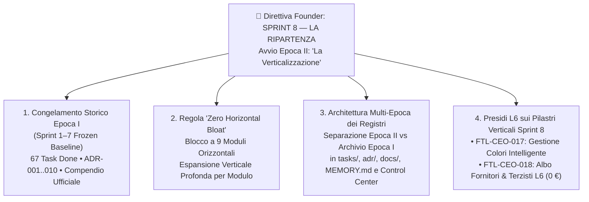

# ADR-011: Governance dell'Epoca II ("La Verticalizzazione"), Congelamento Storico dell'Epoca I e Presidi L6 per Gestione Colori Intelligente & Albo Fornitori Centralizzato

- **Data:** 2026-10-25
- **Stato:** 🟢 Approvata (`L1/L3/L6` — Direttiva Esecutiva Diretta del Founder *"SPRINT 8 - LA RIPARTENZA / La Verticalizzazione"*)
- **Proponenti:** Founder, CEO (`footlink-ceo`), CGO (`footlink-cgo`), CTO (`footlink-cto`), CPO (`footlink-cpo`), CRO (`footlink-cro`), CMO (`footlink-cmo`)
- **Approvatore:** **Founder** (Gate Strategico L1, Architetturale L3 e Sicurezza/Segregazione L6)
- **Task di Riferimento:** [`FTL-GOV-008`](../tasks/FTL-GOV-008.json), [`FTL-CEO-019`](../tasks/FTL-CEO-019.json), [`FTL-CEO-017`](../tasks/FTL-CEO-017.json), [`FTL-CEO-018`](../tasks/FTL-CEO-018.json)
- **Documenti Correlati:**
  - [Manifesto di Fondazione](../Manifesto_Fondazione_Footlink.md) (Fonte #1 di verità)
  - [Compendio Storico Ufficiale Epoca I (Sprint 1–7)](../docs/governance/epoch-1-historical-consolidation-sprints-1-7.md)
  - [`ADR-005`](./ADR-005-repository-three-pillars-restructuring.md) (Architettura a 3 Pilastri di Root)
  - [`ADR-006`](./ADR-006-unified-design-system-and-l6-cost-segregation.md) (Design System v2.0 & Segregazione Costi L6)
  - [`ADR-010`](./ADR-010-product-hierarchies-merchandising-classifiers-and-bom-cloning.md) (Tassonomia 4L & Fast Onboarding BOM)

---

## 1. Contesto & Motivazione

Al termine dello **Sprint 7** (coronato dal **Doppio Riconoscimento Esecutivo 👑👑** del Founder), la piattaforma **Footlink** ha completato la sua **Epoca I: Fondazione & Espansione Orizzontale** (Sprint 1–7, 17–20 Ottobre 2026), totalizzando **10 ADR approvate**, **67 Task Object completati (`done`)**, **57.147 SLOC** (**3.19 MB** di codice autoriale puro), **26/26 test backend Pytest passanti (100%)** e **0,00 € di spesa monetaria autonoma (FinOps L2)**.

Durante l'Epoca I è stata edificata l'intera struttura orizzontale della piattaforma attraverso **9 moduli applicativi attivi** (oltre al modulo Work Orders in stand-by ex `ADR-009`):
1. `00` Home Hub & Launchpad Telemetrico (`FootlinkHomeHub.tsx`)
2. `01` Calendario Moda Stagioni & Collezioni (`SeasonsCollectionsHub.tsx`)
3. `02` Area Prodotti PLM & Albero BOM a 3 Livelli (`PlmProductsManager.tsx`, `BomThreeLevelTree.tsx`)
4. `03` PIM Hub Commerciale & Syndication Feeds (`PimCatalogManager.tsx`, `PimToPlmBridge.tsx`)
5. `04` Vault Conceria & Tracciabilità Pellami EUDR/LWG (`TanneryVaultManager.tsx`)
6. `05` Passaporto Digitale del Prodotto DPP UE / ESPR (`LiveDppPassportGenerator.tsx`)
7. `06` Portale Mobile Terzista "3 Clic a 0 €" (`SubcontractorMobilePortal.tsx`)
8. `07` Anagrafiche di Dominio Master (`DomainRegistriesManager.tsx`)
9. `08` PaaS Distrettuale Multi-Company 3-Tier & Schema Studio (`DistrictPaasManager.tsx`, `DataModelSchemaStudio.tsx`)

Con la direttiva **"SPRINT 8 - LA RIPARTENZA"**, il Founder ha stabilito una svolta strategica netta:
- **Consolidare e sigillare in modo ordinato e immutabile tutto il patrimonio documentale, progettuale e di task prodotto tra lo Sprint 1 e lo Sprint 7**, evitando che i registri aziendali e il **Founder Control Center** diventino illeggibili all'aumentare degli sprint.
- **Aprire ufficialmente l'Epoca II ("La Verticalizzazione")**, il cui obiettivo non è più aggiungere nuovi moduli alla barra di navigazione, bensì **moltiplicare in profondità le capacità operative, le automazioni intelligenti e le funzioni ad alto valore aggiunto all'interno dei singoli moduli esistenti**, partendo dai due pilastri inseriti dal Founder in backlog:
  1. [`FTL-CEO-017`](../tasks/FTL-CEO-017.json) — **Gestione Colori Intelligente**;
  2. [`FTL-CEO-018`](../tasks/FTL-CEO-018.json) — **Gestione dei Fornitori ed Albo Centralizzata**.

---

## 2. Decisioni Architetturali e di Governance

### Decisione 1: Congelamento Storico ("Frozen Baseline") dell'Epoca I (Sprint 1–7)
1. L'insieme dei deliverable prodotti negli **Sprint 1–7** (`ADR-000`..`ADR-010`, `PRD-001`..`PRD-008`, i 67 Task Object JSON con stato `done` e tutti i report OKR, FinOps, Governance e Marketing dell'Epoca I) viene dichiarato **Frozen Baseline dell'Epoca I**.
2. Il documento ufficiale di riferimento e certificazione storica dell'Epoca I è [`Azienda/docs/governance/epoch-1-historical-consolidation-sprints-1-7.md`](../docs/governance/epoch-1-historical-consolidation-sprints-1-7.md).
3. **Regola di Immutabilità Storica:** Nessun file appartenente alla Frozen Baseline dell'Epoca I può essere cancellato, rinominato o alterato retroattivamente. Qualsiasi evoluzione funzionale o architetturale dell'Epoca II produce nuovi artefatti incrementali (a partire da `ADR-011`, `PRD-009`, e nuovi Task Object dello Sprint 8+).

---

### Decisione 2: Regola di Governance dell'Epoca II — *"Zero Horizontal Bloat / Deep Vertical Capabilities"*
1. **Blocco della Superficie Orizzontale:** A partire dallo Sprint 8, è fatto **divieto alla C-Suite di introdurre nuovi moduli top-level orizzontali** nella navigazione principale dell'applicativo senza un'esplicita deroga L1 del Founder. I **9 moduli attivi** costituiscono il perimetro strutturale completo della piattaforma.
2. **Obbligo di Profondità Verticale (*Deep Vertical Capabilities*):** Ogni nuovo requisito o direttiva del Founder deve essere progettato dal CPO e implementato dal CTO come **potenziamento verticale profondo** all'interno dei moduli esistenti, attraverso:
   - **Sotto-viste specializzate, tab operativi e drawer contestuali** privi di attrito;
   - **Automazioni di dominio** (es. generazione multi-variante da matrice colore, calcolo automatico fabbisogni, propagazione vincoli fornitore → BOM → Vault Conceria → DPP UE);
   - **Controlli di integrità referenziale e validazioni intelligenti** che riducano gli errori manuali dei modellisti e degli uffici acquisti/prodotto.
3. **KPI di Verticalizzazione C-Suite:** Ogni sprint dell'Epoca II viene misurato su:
   - Riduzione dei clic e del tempo operativo utente (*Time-to-Action*) nei flussi reali di calzaturifici, pelletterie e maison;
   - Aumento della densità funzionale per modulo senza degradare la pulizia visiva del Design System v2.0 (*Nike-Inspired Editorial Minimalism*).

---

### Decisione 3: Strutturazione Multi-Epoca dei Registri Aziendali e del Founder Control Center
Per garantire immediata leggibilità esecutiva al Founder e prevenire il sovraffollamento informativo:
1. **Registro Task (`Azienda/tasks/README.md`):**
   - La sezione superiore espone in primo piano **🚀 EPOCA II — LA VERTICALIZZAZIONE (Da Sprint 8)** con i task attivi e di backlog dello Sprint corrente.
   - I 67 task completati negli Sprint 1–7 sono raccolti nella sezione sottostante **📦 ARCHIVIO CONSOLIDATO EPOCA I — FONDAZIONE & ESPANSIONE ORIZZONTALE (Sprint 1–7 — 67 Task `done`)**, corredata dal link diretto al Compendio Storico Ufficiale.
2. **Registro ADR (`Azienda/adr/README.md`):**
   - L'indice distingue in alto **🚀 Epoca II — La Verticalizzazione (Da Sprint 8)** (da `ADR-011` in avanti) e in basso **📦 Archivio Consolidato Epoca I (Sprint 1–7)** (`ADR-000` .. `ADR-010`).
3. **Indice Documentale (`Azienda/docs/README.md`) e Memoria (`Azienda/MEMORY.md`):**
   - Strutturati per separare nitidamente la memoria storica consolidata dell'Epoca I dalle direttive e dai deliverable correnti dell'Epoca II.
4. **Cabina di Regia (`Portale_Founder_Control/control_center.py`):**
   - Il Founder Control Center supporta il filtraggio e il raggruppamento per **Epoca (`Epoca II — La Verticalizzazione` vs `Epoca I — Archivio Sprint 1-7`)**, mantenendo l'attenzione operativa del Founder focalizzata sullo Sprint 8 attivo pur conservando l'accesso istantaneo a tutti i 67 task e deliverable storici.

---

### Decisione 4: Architettura di Governance e Segregazione L6 per i Due Pilastri Verticali di Sprint 8

#### 4.1 Pilastro Verticale #1: Gestione Colori Intelligente (`FTL-CEO-017`)
- **Collocazione Modulare (Zero Horizontal Bloat):** Integrata verticalmente tra **Modulo 07 (`Anagrafiche di Dominio`)**, **Modulo 02 (`Prodotti PLM & BOM`)** e **Modulo 03 (`PIM Hub`)**.
- **Funzionalità Verticali Core:**
  1. **Master Color Library & Cartelle Colori Stagionali:** Anagrafica strutturata dei colori con codice interno, riferimento universale (`Pantone TCX/TPG`, codice `HEX`, `RGB`), famiglia cromatica, finitura superficiale (*Opaco, Vernice, Metallizzato, Scamosciato, Goffrato, Gommato*) e associazione alle **Stagioni/Collezioni**.
  2. **Colorway Generator & Abbinamento Cross-Materiale BOM:** Possibilità di definire su una variante PLM una *Colorway* strutturata (Colore Primario Tomaia, Colore Secondario/Dettaglio, Colore Fodera, Colore Suola/Fondo, Colore Fili/Accessori Metallici) che **propaga o valida automaticamente i colori sui nodi L1/L2/L3 della Distinta Base (BOM)**.
  3. **Spin-off Rapido Varianti Colore (Multi-Colorway Clone):** Generazione in un clic di $N$ varianti PLM a partire da un modello base selezionando una palette di colori stagionali, clonando l'albero BOM e sostituendo automaticamente i codici colore dei componenti.
- **Presidio FinOps & L6:** Calcolo e rendering cromatico interamente client/server nativo a **0,00 €**; i codici colore tecnici e le ricette tintoriali riservate della conceria/maison sono protetti secondo i profili di visibilità del tenant.

#### 4.2 Pilastro Verticale #2: Gestione dei Fornitori ed Albo Centralizzata (`FTL-CEO-018`)
- **Collocazione Modulare (Zero Horizontal Bloat):** Integrata verticalmente tra **Modulo 07 (`Anagrafiche di Dominio`)**, **Modulo 08 (`PaaS Distrettuale 3-Tier`)**, **Modulo 02 (`Prodotti PLM & BOM`)** e **Modulo 04 (`Vault Conceria`)**.
- **Funzionalità Verticali Core:**
  1. **Albo Fornitori & Terzisti Unificato (Single Source of Truth):** Sostituzione dei riferimenti testuali liberi (`supplier_name`) con un registro relazionale qualificato (`suppliers_registry`) che distingue:
     - **Fornitori di Materie Prime & Componenti:** Concerie, Tessiture, Suolifici, Tacchifici, Accessoristi/Minuteria, Scatolifici/Packaging;
     - **Laboratori Terzisti / Façonisti di Lavorazione (Tier 3 a 0 €):** Taglio, Orlatura/Aggiunteria, Montaggio, Finissaggio, Controllo Qualità.
  2. **Qualifica Compliance, ESG & Scadenziario Certificazioni:** Stato di omologazione del fornitore (*Qualificato, In Audit, Sospeso, Blacklisted*), rating di sostenibilità/qualità, tracciamento certificazioni (`LWG Gold/Silver`, `ICEC`, `REACH`, `EUDR`, `ISO 9001/14001`, `SA8000`) con alert di scadenza e collegamento diretto ai lotti del **Vault Conceria (`Modulo 04`)** e ai nodi **BOM (`Modulo 02`)**.
  3. **Condizioni Commerciali & Parametri Logistici di Fornitura:** Lead-time standard di approvvigionamento (giorni), Minimum Order Quantity (`MOQ`), valuta, termini di pagamento, listini negoziati e percentuali di sconto/sfrido contrattuale.
- **Presidio Tassativo di Segregazione L6 e Invarianza 0 € Terzisti:**
  - **Segregazione Economica e Valutativa L6:** Tutti gli attributi sensibili dell'Albo Fornitori — **listini prezzi, condizioni di pagamento, sconti contrattuali, MOQ negoziati, KPI di puntualità/difettosità e note di audit/vendor rating interni del Brand/PMI** — sono classificati come **Dati Industriali Riservati L6**. Essi vengono **rimossi server-side** da qualsiasi endpoint API, vista UI o file di export quando l'utente appartiene al ruolo `subcontractor` (Terzista) o `consumer` (vista pubblica DPP UE).
  - **Isolamento Multi-Tenant Orizzontale:** I termini commerciali e i rating assegnati da un Brand A a una conceria o a un façonista del distretto sono **totalmente invisibili** a un Brand B concorrente che operi sullo stesso distretto.
  - **Gratuità Perpetua Terzisti (0,00 €):** I laboratori terzisti censiti nell'Albo accedono e interagiscono con le schede tecniche e le fasi assegnate a **Costo Zero (0,00 € perpetuo)**, senza alcuna frizione burocratica.

---

## 3. Conformità al Manifesto di Fondazione (Audit CGO)

| Principio del Manifesto | Verifica di Conformità su ADR-011 | Stato |
|---|---|:---:|
| **1. Gerarchia delle Fonti** | Rispetta integralmente Manifesto (#1), Ruoli C-Suite v1.1 (#2), Registro ADR (#3) e Task Schema v1.0 (#4). | ✅ Conforme |
| **2. Dominio Core 1:N PIM ↔ PLM** | La Gestione Colori Intelligente e l'Albo Fornitori potenziano direttamente la generazione delle $N$ varianti PLM e dei nodi BOM collegati all'articolo PIM. | ✅ Conforme |
| **3. Terzisti a Costo Zero (0,00 €)** | I façonisti nell'Albo Fornitori mantengono accesso gratuito perpetuo a 0,00 € e UX "Zero-Training". | ✅ Conforme |
| **4. Zero Spesa Monetaria Autonoma (L2)** | Tutte le funzionalità di Epoca II (Sprint 8) sono sviluppate su stack open-source nativo (`FastAPI` + `React` + `SQLite/PostgreSQL`) con **spesa extra = 0,00 €**. | ✅ Conforme |
| **5. Segregazione Dati e Costi (L6)** | Listini fornitori, MOQ, vendor rating e costi BOM sono segregati server-side per ruolo e tenant. | ✅ Conforme |

---

## 4. Conseguenze

### Conseguenze Positive
- **Chiarezza Cognitiva ed Esecutiva per il Founder:** Separazione immediata tra il patrimonio storico consolidato (Sprint 1–7) e il fronte vivo di sviluppo (Sprint 8 — Epoca II).
- **Prevenzione dello "Sprawl" di Interfaccia:** La regola *"Zero Horizontal Bloat"* protegge l'eleganza minimale della piattaforma concentrando il valore dove gli utenti del lusso passano il 90% del tempo (Prodotti PLM, BOM, Anagrafiche, Conceria, PIM).
- **Maturità Enterprise del PLM:** Con la Gestione Colori Intelligente (`FTL-CEO-017`) e l'Albo Fornitori Centralizzato (`FTL-CEO-018`), Footlink acquisisce due pilastri imprescindibili per sostituire i fogli Excel nei calzaturifici e nelle maison.

### Vincoli Operativi per la C-Suite
- Ogni PR o modifica ai moduli esistenti deve mantenere **100% di retro-compatibilità** con i 26 test automatici della Frozen Baseline dell'Epoca I, aggiungendo nuovi test dedicati per ogni funzionalità verticale di Epoca II.
