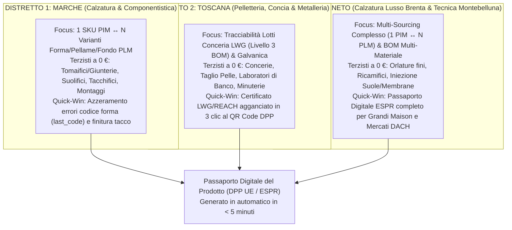
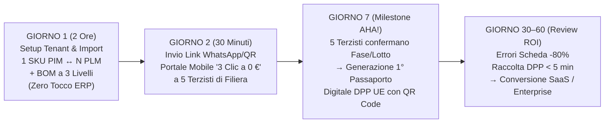

# Kit Operativo di Onboarding Design Partner Pilota (30–60 Giorni) — Distretti Marche, Toscana, Veneto

- **Documento ID:** `DESIGN-PARTNER-ONBOARDING-KIT-v1.0`
- **Task di Riferimento:** [`FTL-REV-002`](../../tasks/FTL-REV-002.json)
- **Decision Record Correlato:** [`ADR-004: Modello di Pricing a Rete e FinOps`](../../adr/ADR-004-network-pricing-and-finops.md)
- **Redatto da:** CRO (`footlink-cro`)
- **Allineato con:** [`SALES-PLAYBOOK-v0.1`](./sales-playbook-v0.1.md), [`PRD-001`](../prd/PRD-001-mvp-pim-plm.md) (CPO), [`ADR-002`](../../adr/ADR-002-core-architecture-free-tier.md) (CTO)
- **Data:** 18 Ottobre 2026
- **Stato:** In Revisione (`review` — Condizioni Early-Adopter e attivazione esterna subordinate ad Approvazione L4 del Founder)

---

## 1. Obiettivo Strategico del Kit di Onboarding Design Partner (Sprint 2)

Il presente **Kit Operativo di Onboarding Design Partner Pilota (30–60 Giorni)** traduce la strategia Go-To-Market di [`FTL-REV-001`](../../tasks/FTL-REV-001.json) in un protocollo di esecuzione sul campo standardizzato, ripetibile e a **zero attrito tecnico/commerciale**, progettato per attivare i primi **3–5 Design Partner Pilota** nei tre principali distretti manifatturieri italiani della moda:

1. **Distretto 1 — Marche** (*Fermo-Macerata / Civitanova Marche / Montegranaro / Monte Urano*): Calzaturifici conto proprio/terzi, giunterie, suolifici e tacchifici.
2. **Distretto 2 — Toscana** (*Santa Croce sull'Arno / Scandicci / Firenze*): Pelletteria conto terzi di primo livello, brand borse/accessori, concerie LWG e metallerie.
3. **Distretto 3 — Veneto** (*Riviera del Brenta / Montebelluna / Verona*): Calzatura Donna Lusso, Calzatura Tecnica/SportSystem e multi-sourcing complesso.

### Regole Auree Inviolabili del Programma Pilota (Conformità Manifesto & `ADR-004`)
- **Terzisti e Façonisti a 0 € per sempre (`FREE_FOREVER_0_EUR`):** Nessun laboratorio di taglio, giunteria, orlatura, montaggio, suolificio, tacchificio, conceria o pelletteria invitato dal Design Partner pagherà mai canoni, licenze per utente o costi di attivazione. Nessuna carta di credito richiesta.
- **Zero Tocco sull'ERP Contabile Legacy:** Il pilota opera in affiancamento leggero ("Overlay Non-Invasivo"). L'ERP aziendale (TeamSystem, Panthera, Zucchetti, Stealth, AS400) continua a gestire contabilità e fatturazione; Footlink governa il ponte **`1 Articolo PIM ↔ N Varianti PLM`**, la distinta base (BOM) a 3 livelli, l'avanzamento terzisti mobile e il **Passaporto Digitale del Prodotto (DPP UE / ESPR)**.
- **Zero Spesa Monetaria Autonoma (`0,00 €` — Limite L2):** Tutto il ciclo di onboarding di 30–60 giorni gira su infrastruttura Free-Tier / locale (`SQLite` / `PostgreSQL` Free-Tier) senza costi di cloud, advertising o trasferte non autorizzate.
- **Validazione L4/L5 del Founder:** Nessuna Lettera d'Intenti ([`pilot-loi-template-distretti.md`](./pilot-loi-template-distretti.md)) può essere firmata o inviata come impegno vincolante senza firma esplicita del Founder.

---

## 2. Configurazione Verticale per i 3 Distretti Industriali Target

Ogni distretto presenta una morfologia di filiera, un lessico tecnico di fabbrica e un punto di dolore primario differenti. Di seguito le matrici di configurazione verticale pronte per il setup del tenant pilota.

---

### 2.1 Distretto 1 — MARCHE (Fermo-Macerata / Civitanova Marche / Montegranaro / Monte Urano)

- **Profilo Design Partner Target:** Calzaturifici conto proprio e private label (`4 – 25 M€` di fatturato, cluster `P-01`, `P-02`, `P-03`, `P-04` del [`Sales Playbook v0.1`](./sales-playbook-v0.1.md)).
- **Pain Point Specifico di Distretto:**
  - Un singolo modello venduto in showroom (`1 Articolo PIM`, es. *Mocassino Uomo Fondo Cuoio* o *Sneaker Cassetta*) viene declinato in **3–6 varianti tecniche (`N Articoli PLM`)** che cambiano per codice forma (`last_code`), costruzione (`Blake`, `Goodyear`, `Strobel`, `Ago`), altezza tacco o mescola del fondo.
  - Le modifiche dell'ultimo minuto mandate via WhatsApp a giunterie, suolifici e tacchifici generano scarti di montaggio, tacchi con finitura errata e disallineamenti tra ciò che è stato prodotto e ciò che è scritto sul catalogo B2B.
- **Template BOM a 3 Livelli Pre-Configurato per il Pilota Marche:**
  - **Livello 1 (Prodotto Finito PLM):** Variante Tecnica Calzatura (Codice Forma, Calzata, Costruzione, Range Taglie `35–46`).
  - **Livello 2 (Semilavorati & Componenti Strutturali):** Tomaia orlata, Sottopiede strutturato, Suola/Fondo finito, Tacco fasciato/verniciato, Scatola & Packaging.
  - **Livello 3 (Materie Prime & Lotti Tracciati per DPP):** Pellame tomaia (Vitello/Camoscio + Lotto Conceria), Pellame fodera (Certificazione assenza Cromo VI / REACH), Cuoio suola o Mescola TPU/TR (% contenuto riciclato), Occhielli/Accessori metallici.
- **Mappa dei 5 Terzisti Pilota a `0 € Forever` da invitare nel Giorno 2:**
  1. **Laboratorio di Taglio** (Conferma ricezione Dima/Scheda + inserimento Lotto Pellame Tomaia/Fodera).
  2. **Giunteria / Tomaificio (Orlatura)** (Conferma versione scheda tecnica `v1.x` + completamento fase Orlatura).
  3. **Suolificio** (Conferma codice stampo/fondo + inserimento lotto mescola/cuoio).
  4. **Tacchificio / Sottopiedificio** (Conferma altezza/finitura tacco abbinata alla forma).
  5. **Laboratorio di Montaggio & Finissaggio** (Conferma accoppiamento Tomaia-Fondo e chiusura lotto per generazione QR Code DPP).

---

### 2.2 Distretto 2 — TOSCANA (Santa Croce sull'Arno / Scandicci / Firenze / Pontassieve)

- **Profilo Design Partner Target:** Pelletterie capofila conto terzi per il lusso e Brand indipendenti di borse/piccola pelletteria (`3 – 35 M€` di fatturato, cluster `P-05`, `P-06`, `P-07`).
- **Pain Point Specifico di Distretto:**
  - I grandi committenti del lusso e i buyer esteri pretendono la **tracciabilità granulare del lotto di conceria (`LWG Gold/Silver` o `Concia al Vegetale`)** e del bagno galvanico delle minuterie metalliche (fibbie, catene, chiusure, zip) fino al singolo lotto di borse consegnato, oltre alla certezza di quale laboratorio di banco di 2° livello ha eseguito preparazione, scarnitura, montaggio e tingibordo.
  - Oggi la raccolta dei certificati LWG/REACH per i dossier cliente richiede ore di rincorsa telefonica tra Santa Croce e Scandicci.
- **Template BOM a 3 Livelli Pre-Configurato per il Pilota Toscana:**
  - **Livello 1 (Prodotto Finito PLM):** Variante Tecnica Borsa / Piccola Pelletteria (Modello, Dimensioni, Variante Galvanica Oro/Palladio/Rutenio, Costruzione a Costola o Rovesciata).
  - **Livello 2 (Semilavorati & Componentistica):** Quadranti tagliati e scarniti, Manici/Tracolle assemblati, Kit Metalleria/Minuteria galvanizzata, Fodera interna e Rinforzi (Salpa/Microfibra).
  - **Livello 3 (Materie Prime & Lotti Tracciati per DPP):** Lotto Pelle Conciata (Codice Conceria Santa Croce, Certificato `LWG` / Consorzio Vera Pelle Conciata al Vegetale, origine grezzo), Lotto Bagno Galvanico (Conformità Nickel-Free / REACH), Zip/Cursori e Filato, Colla base acqua e Tingibordo.
- **Mappa dei 5 Terzisti Pilota a `0 € Forever` da invitare nel Giorno 2:**
  1. **Conceria / Fornitore Pellame (Santa Croce / Ponte a Egola)** (Inserimento codice lotto botte/rifinizione e upload PDF certificato LWG in 1 clic).
  2. **Metalleria / Galvanica (Scandicci / Arezzo)** (Conferma lotto bagno galvanico e test report Nickel-Free/REACH).
  3. **Laboratorio Taglio & Preparazione (Scarnitura/Spaccatura/Accoppiatura)** (Conferma utilizzo lotto pelle assegnato).
  4. **Laboratorio di Banco / Façonista Montaggio Borsa** (Conferma avanzamento cucitura, montaggio e tingibordo da smartphone in 3 clic).
  5. **Collaudo Finale & Confezionamento** (Validazione qualità e attivazione istantanea del Passaporto Digitale DPP UE).

---

### 2.3 Distretto 3 — VENETO (Riviera del Brenta / Montebelluna / Verona)

- **Profilo Design Partner Target:** Calzaturifici Décolleté/Gioiello Alta Moda in Riviera del Brenta e Produttori Calzatura Tecnica/Outdoor/Sneaker nello SportSystem di Montebelluna e Verona (`8 – 40 M€` di fatturato, cluster `P-09`, `P-10`, `P-11`).
- **Pain Point Specifico di Distretto:**
  - **Dual/Multi-Sourcing Complesso (`1 SKU PIM ↔ N Varianti PLM`):** Lo stesso modello commerciale viene prodotto in parallelo su più linee o stabilimenti (es. prima tiratura in Riviera del Brenta / Montebelluna, riassortimento in altro laboratorio veneto o marchigiano) o richiede **BOM tecniche multi-materiale** ad altissima complessità (membrane idrorepellenti, suole Vibram, scocche iniettate PU/TPU per Montebelluna; raso seta, ricami strass, tacchi scultura per la Riviera del Brenta).
  - Le grandi Maison del lusso (per il Brenta) e i grandi distributori DACH/Scandinavia (per Montebelluna) esigono il **Passaporto Digitale DPP UE (ESPR)** completo di indice di riparabilità/risuolabilità, composizione multi-materiale e impronta ambientale di lotto.
- **Template BOM a 3 Livelli Pre-Configurato per il Pilota Veneto:**
  - **Livello 1 (Prodotto Finito PLM):** Variante Tecnica Multi-Sourcing (`PLM-A` Linea Interna / `PLM-B` Linea Esterna, Codice Forma/Stampo, Specifica Tecnica o Sfilata).
  - **Livello 2 (Semilavorati & Moduli Tecnici):** Tomaia tecnica/ricamata, Membrana/Fodera termonastrata, Intersuola ammortizzante / Sottopiede con lamina, Battistrada tecnico o Suola cuoio di lusso, Accessori/Ganci/Ricami.
  - **Livello 3 (Materie Prime & Certificazioni ESPR):** Tessuto tecnico Cordura/Raso/Pellame certificato, Membrana PTFE/PU PFAS-free, Mescola gomma battistrada + % materiale riciclato, Strass/Minuteria certificata, Parametri di Riparabilità/Risuolabilità per DPP UE.
- **Mappa dei 5 Terzisti Pilota a `0 € Forever` da invitare nel Giorno 2:**
  1. **Ricamificio / Serigrafia / Taglio Tecnico** (Conferma variante disegno/piazzamento e lotto tessuto/pelle).
  2. **Orlatura Fine / Giunteria Tecnica Termonastrata** (Conferma fase su scheda tecnica digitale aggiornata).
  3. **Tacchificio Scultura / Stampaggio Componenti PU-TPU** (Conferma lotto stampata e codice componente).
  4. **Fornitore/Applicatore Suola (Cuoio Lusso o Battistrada Tecnico)** (Conferma lotto fondo e conformità tecnica).
  5. **Stabilimento di Montaggio / Linea Partner in Dual-Sourcing** (Chiusura commessa e alimentazione differenziata per lotto dello stesso SKU PIM).

---

## 3. Playbook di Attivazione in 48 Ore ("Protocollo 1 PMI → 5 Terzisti a 0 €")

Il cuore operativo di `FTL-REV-002` è la capacità di portare un Design Partner dal "primo login" alla **filiera connessa in 48 ore solari**, raggiungendo il primo Passaporto Digitale DPP UE completo entro il **Giorno 7**, senza interrompere il lavoro dell'ufficio modelli o della produzione.

---

### 3.1 GIORNO 1 (Durata: 2 Ore) — Importazione 1° Modello Campione PIM + N Varianti PLM e BOM a 3 Livelli (Senza Toccare l'ERP Legacy)

**Partecipanti lato Design Partner:** Responsabile Ufficio Tecnico / Modelleria (o Direttore Produzione) + 1 addetto Commerciale/Catalogo.

| Timebox | Step Operativo | Azione Eseguita su Footlink (`Applicativo/`) | Output Tangibile Fine Step |
|:-------:|----------------|----------------------------------------------|----------------------------|
| **00:00 – 00:20** *(20 min)* | **Creazione Tenant & Selezione Template Distretto** | Configurazione workspace aziendale con preset verticale (**Marche Calzatura**, **Toscana Pelletteria** o **Veneto Lusso/SportSystem**). Nessuna integrazione ERP richiesta. | Tenant attivo con attributi di dominio pre-caricati (`last_code`, `construction_type`, `bom_level_1..3`). |
| **00:20 – 00:50** *(30 min)* | **Creazione `1 Articolo PIM` (Vista Commerciale)** | Inserimento del modello campione di punta della stagione (es. foto campione, descrizione commerciale B2B/B2C, collezione, prezzo target, mercati di destinazione). | Scheda Catalogo `1 PIM` pubblicata in bozza con **Data Quality Score** iniziale calcolato in tempo reale. |
| **00:50 – 01:30** *(40 min)* | **Collegamento `N Varianti PLM` (Vista Fabbrica)** | Creazione di **2 o 3 varianti tecniche PLM** collegate allo stesso SKU PIM (es. `PLM-01` Pelle Nera Fondo Cuoio Lab A, `PLM-02` Camoscio Moro Fondo Gomma Lab B). | Relazione nativa **`1 Articolo PIM ↔ N Varianti PLM`** attiva senza duplicazione del codice articolo commerciale. |
| **01:30 – 02:00** *(30 min)* | **Importazione BOM a 3 Livelli** | Caricamento della distinta base a 3 livelli (Semilavorati, Componenti, Materie Prime soggette a tracciabilità DPP) a partire dal foglio Excel/PDF esistente del modellista. | Scheda Tecnica Digitale Unica v1.0 pronta per la condivisione controllata con i terzisti. |

> [!TIP]
> **Regola Anti-Attrito del Giorno 1:** Non chiedere mai di importare l'intero archivio storico aziendale il primo giorno. Si parte sempre con **1 modello reale in produzione (o campionatura avanzata)** che attraversa **5 fasi esterne** nella settimana corrente.

---

### 3.2 GIORNO 2 (Durata: 30 Minuti) — Invio Link WhatsApp/QR del Portale Mobile "3 Clic a 0 €" ai 5 Laboratori Terzisti della Filiera

**Partecipanti lato Design Partner:** Addetto Avanzamento Produzione / Ufficio Acquisti (con i 5 titolari di laboratorio raggiungibili su WhatsApp).

1. **Minuti 00–10 — Anagrafica Rapida dei 5 Terzisti (Zero Burocrazia):**
   - Inserimento di Ragione Sociale, Ruolo di Fase (*1. Taglio, 2. Orlatura/Giunteria, 3. Montaggio/Banco, 4. Suola/Metalleria, 5. Finissaggio/Collaudo*) e numero cellulare WhatsApp / email del referente di fabbrica.
   - Il sistema assegna automaticamente a tutti e 5 il profilo **`TIER_0_FREE_FOREVER_0_EUR`**.
2. **Minuti 10–20 — Generazione dei 5 Magic Link / QR Code di Commessa:**
   - Associazione di ciascuna delle 5 fasi della variante `PLM` al rispettivo laboratorio terzista.
   - Generazione automatica del messaggio pre-compilato con link diretto al **Portale Mobile Terzista "3 Clic"** (nessuna app da scaricare dagli store, nessuna password da inventare).
3. **Minuti 20–30 — Invio in Diretta su WhatsApp e Prima Conferma Live:**
   - Il Direttore di Produzione invia il messaggio WhatsApp standard ai 5 laboratori:
     > *"Ciao [Nome Laboratorio], per il modello [Codice Articolo] trovi qui la scheda tecnica aggiornata in tempo reale. È gratuito per sempre (0 €) e non devi installare nulla: apri il link dal telefono e con 3 tocchi confermi presa in carico e numero lotto materiale: [Magic Link Footlink]"*
   - L'interfaccia mobile mostra al terzista **solo la sua fase** e gli richiede **esattamente 3 clic** (< 45 secondi):
     - **Clic 1:** *"Conferma Presa in Carico Scheda Tecnica v1.0"*
     - **Clic 2:** *"Inserisci / Fotografa Codice Lotto Materia Prima o Semilavorato"* (es. Lotto Pelle LWG, Lotto Fondo, Lotto Galvanica)
     - **Clic 3:** *"Segna Fase Completata — Pronto per Ritiro/Fase Successiva"*

---

### 3.3 GIORNO 7 — Generazione del Primo Passaporto Digitale del Prodotto (DPP UE / ESPR) Completo con QR Code Navigabile

Al completamento dei "3 Clic" da parte dei 5 nodi della filiera:
1. **Aggregazione Automatica Tier 1–3:** Footlink consolida in tempo reale i lotti confermati dai 5 terzisti (Livello 2 e Livello 3 della BOM) dentro la variante `PLM` e li propaga all'articolo commerciale `PIM`.
2. **Calcolo Completezza DPP UE (100%):** Il semaforo di conformità ESPR passa a **Verde (`100% Campi Obbligatori Verificati`)** mostrando:
   - Identificativo univoco SKU PIM + Lotto di Produzione PLM;
   - Composizione materiali multi-livello (Tomaia/Esterno, Fodera, Suola/Fondo, Accessori Metallici);
   - Mappa di tracciabilità delle fasi manifatturiere (*Taglio, Orlatura, Componentistica, Montaggio, Finissaggio*) con indicazione del distretto Made in Italy;
   - Certificazioni ambientali e chimiche collegate ai lotti (LWG, Concia al Vegetale, REACH/SVHC, % riciclato);
   - Istruzioni di cura, riparabilità/risuolabilità e fine vita.
3. **Emissione QR Code Navigabile:** Il Design Partner scarica e stampa il primo **QR Code DPP UE** (pronto per etichetta scatola, cartellino pendente o timbro in soletta/fodera) e lo scansiona con lo smartphone in riunione vedendo la pagina pubblica del Passaporto Digitale.

---

### 3.4 GIORNO 30–60 — Review ROI Quantitativa e Conversione al Piano SaaS PMI / Enterprise Brand

Al Giorno 30 (Check-in intermedio) e al Giorno 60 (Executive Business Review di fine pilota), il CRO presenta al Titolare/CEO del Design Partner la **Scheda di Valutazione ROI su Dati Reali del Pilota**:

| KPI Operativo Misurato nel Pilota | Baseline Pre-Footlink (Excel + WhatsApp + PDF) | Risultato Misurato Giorno 30–60 su Footlink | Target Minimo Garantito per Conversione |
|-----------------------------------|:----------------------------------------------:|:-------------------------------------------:|:---------------------------------------:|
| **1. Errori di Scheda Tecnica / Disallineamento Versione con i Terzisti** | 3–6 contestazioni o rilavorazioni a stagione per linea | **Azzeramento versioni obsolete** (unica fonte di verità live) | **Riduzione errori scheda tecnica `-80%`** |
| **2. Tempo di Raccolta Dati e Certificati Lotti per 1 Passaporto DPP UE** | **4 – 6 ore** per articolo (telefonate, email, PDF sparsi) | **Automatizzato in tempo reale** tramite i 3 clic dei terzisti | **Tempo raccolta dati DPP `< 5 minuti`** |
| **3. Tempo di Creazione e Sincronizzazione `1 SKU PIM ↔ N Varianti PLM`** | Doppio inserimento manuale tra ufficio tecnico e commerciale | Sincronizzazione nativa `1-to-N` con propagazione attributi | **Risparmio tempo ufficio tecnico `-65%`** |
| **4. Tasso di Adozione Spontanea dei Laboratori Terzisti a 0 €** | `< 15%` sui portali legacy a pagamento/complessi | **5 su 5 laboratori attivi** da smartphone senza formazione | **Adozione terzisti invitati `≥ 80%`** |

#### Percorso di Conversione Commerciale al Giorno 60 (Previa Approvazione L4 Founder):
- **PMI Calzaturificio / Pelletteria (fino a 5 M€):** Conversione su **Tier 1 PMI Starter** (`149 €/mese` listino $\rightarrow$ **Condizione Early-Adopter Design Partner: `-20%` per i primi 12 mesi = `119 €/mese`** con fino a 8 terzisti inclusi a `0 € forever`).
- **PMI Strutturata / Private Label (5 – 20 M€):** Conversione su **Tier 2 PMI Pro** (`299 €/mese` listino $\rightarrow$ **Condizione Early-Adopter Design Partner: `-20%` per i primi 12 mesi = `239 €/mese`** con fino a 20 terzisti inclusi a `0 € forever`).
- **Brand Moda / Capofila Lusso o SportSystem (20 M€+):** Conversione su **Tier 3 Brand Enterprise** (`899 €/mese` listino $\rightarrow$ **Condizione Early-Adopter Design Partner: `719 €/mese` per il primo anno + waiver del fee di setup ERP** con 50+ terzisti inclusi a `0 € forever`).

---

## 4. Unit Economics & Controllo FinOps del Programma Pilota (`ADR-004`)

In conformità con i vincoli del [Manifesto di Fondazione](../../Manifesto_Fondazione_Footlink.md) (**Margine Lordo SaaS > 75%** e **Zero Spesa Autonoma > 0 € senza Approvazione L2**), il programma Design Partner Pilota è ingegnerizzato per avere **costo vivo zero durante la prova** e **marginalità superiore all'88% a regime**.

### 4.1 Costo Infrastrutturale Durante il Pilota (Giorni 1–60): `0,00 €`
- Durante i 30–60 giorni di prova, i Design Partner Pilota e i relativi terzisti operano sull'infrastruttura **Bootstrap Free-Tier** definita dal CTO in [`ADR-002`](../../adr/ADR-002-core-architecture-free-tier.md) (`SQLite` locale / `PostgreSQL` Supabase Free-Tier + Hosting Free-Tier + CDN Cloudflare Free).
- **Esborso monetario per Footlink durante il pilota:** **`0,00 €`** (100% conforme al blocco L2).

### 4.2 Analisi del Cost-to-Serve per Design Partner Pilota (Inclusi 10 Terzisti Collegati a 0 €) a Regime Scaling

Anche simulando il passaggio all'infrastruttura cloud a pagamento post-seed/revenue e raddoppiando il numero di terzisti invitati da 5 a **10 laboratori terzisti attivi a 0 €** per singolo Design Partner, il **Cost-to-Serve tecnico mensile** rimane **inferiore a `1,50 €/mese`**:

| Voce di Costo Tecnico Diretto (Simulazione 1 Design Partner + 10 Terzisti a 0 €) | Consumo Mensile Stimato (50 SKU PIM / 150 PLM) | Costo Unitario Cloud / API | Costo Mensile (`€ / mese`) |
|----------------------------------------------------------------------------------|------------------------------------------------|----------------------------|:--------------------------:|
| **1. Database & Storage Tenant Principale (`PostgreSQL` + JSONB BOM/DPP)** | ~1,2 GB dati + 35.000 query/mese | Pool multi-tenant RLS | **0,32 €** |
| **2. Compute API Backend (`FastAPI`) & Generazione QR Code DPP UE** | ~45.000 richieste API stateless / mese | Container condiviso | **0,28 €** |
| **3. Cross-Subsidization di 10 Laboratori Terzisti Attivi a `0 € Forever`** | `10 terzisti` $\times$ ~60 conferme mobile/mese | `0,055 €` / terzista (DB + API + WebPush) | **0,55 €** |
| **4. Inferenza AI Assistita (Fair-Use Pilota: ~60 estrazioni BOM/schede/mese)** | ~60 chiamate Gemini Flash con prompt caching | `0,004 €` / operazione AI | **0,24 €** |
| **TOTALE COST-TO-SERVE TECNICO MENSILE (1 Design Partner + 10 Terzisti a 0 €)** | **Soglia massima garantita: `< 1,50 € / mese`** | — | **1,39 € / mese** |

### 4.3 Verifica del Margine Lordo SaaS Post-Conversione (Anche con Sconto Early-Adopter `-20%`)

Includendo oltre al **Cost-to-Serve tecnico (`1,39 €/mese`)** anche i costi di incasso B2B SEPA/Stripe (`~1,2%`) e l'allocazione di supporto Customer Success asincrono/template (`~8%` del canone scontato Early-Adopter):

| Piano di Conversione Post-Pilota | Canone Listino | Canone Early-Adopter (`-20%` Anno 1) | Cost-to-Serve Tecnico (incl. 10 Terzisti a 0 €) | Fee Incasso (1,2%) + Supporto CS (8%) | COGS Totale Mensile | **Margine Lordo SaaS Effettivo (%)** | Conformità Manifesto (`> 75%`) |
|----------------------------------|:--------------:|:------------------------------------:|:-----------------------------------------------:|:-------------------------------------:|:-------------------:|:------------------------------------:|:------------------------------:|
| **Tier 1: PMI Starter** | 149,00 € | **119,00 € / mese** | **1,39 €** | 10,95 € | **12,34 €** | **89,6%** | ✅ **SUPERATO (+14,6 pt)** |
| **Tier 2: PMI Pro (Target Core)** | 299,00 € | **239,00 € / mese** | **1,39 €** | 21,99 € | **23,38 €** | **90,2%** | ✅ **SUPERATO (+15,2 pt)** |
| **Tier 3: Brand Enterprise** | 899,00 € | **719,00 € / mese** *(incl. 30 terzisti = 2,49 €)* | **2,49 €** | 66,15 € | **68,64 €** | **90,5%** | ✅ **SUPERATO (+15,5 pt)** |

> [!IMPORTANT]
> **Certificazione FinOps CRO (`FTL-REV-002`):**
> - **Costo Infrastrutturale durante il Pilota (60 giorni):** **`0,00 €`** (Free-Tier).
> - **Cost-to-Serve Tecnico per Design Partner (+10 terzisti a 0 €):** **`1,39 € / mese` (`< 1,50 €/mese`)**.
> - **Margine Lordo SaaS a Regime (anche applicando il diritto di prelazione Early-Adopter `-20%`):** **`89,6% – 90,5%`** (costantemente **`> 88%`**, ben oltre la soglia minima del Manifesto `> 75%`).

---

## 5. Checklist Operativa di Qualificazione e Go-Live per il CRO

Prima di sottoporre la Lettera d'Intenti ([`pilot-loi-template-distretti.md`](./pilot-loi-template-distretti.md)) alla firma L4/L5 del Founder per ciascun Design Partner, il CRO verifica i seguenti **5 criteri di qualificazione**:

- [x] **1. Appartenenza ai 3 Distretti Target:** Azienda calzaturiera, pellettiera o abbigliamento/accessori attiva nelle **Marche**, in **Toscana** o in **Veneto** con produzione reale multi-variante (`1 PIM ↔ N PLM`).
- [x] **2. Rete Minima di 5 Terzisti Coinvolgibili a 0 €:** Il Direttore di Produzione ha identificato i 5 laboratori esterni (es. taglio, orlatura, suola/metalleria, montaggio, finissaggio) da collegare nel Giorno 2.
- [x] **3. Campione / Linea Pilota Individuata:** È stato scelto almeno 1 articolo campione (con 2–3 varianti tecniche PLM) su cui generare il primo Passaporto Digitale DPP UE entro il Giorno 7.
- [x] **4. Sponsor Interno Esecutivo:** Il Titolare o il Direttore Operativo/Produzione partecipa alla sessione di 2 ore del Giorno 1 e alla Review ROI del Giorno 30/60.
- [x] **5. Approvazione L4/L5 del Founder sulla LOI:** Il documento [`pilot-loi-template-distretti.md`](./pilot-loi-template-distretti.md) compilato con i dati del Design Partner è stato approvato dal Founder nella Founder Control Dashboard.
