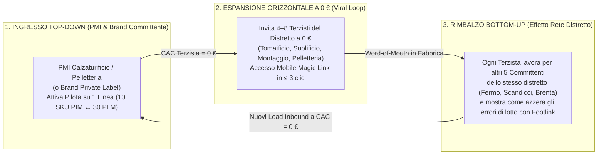

# Sales Playbook v0.1 — Strategia Go-To-Market Distretti, Target List 15 Prospect Pilota & Script Commerciali

- **Documento ID:** `SALES-PLAYBOOK-v0.1`
- **Task di Riferimento:** [`FTL-REV-001`](../../tasks/FTL-REV-001.json)
- **Decision Record Correlato:** [`ADR-004: Modello di Pricing a Rete e FinOps`](../../adr/ADR-004-network-pricing-and-finops.md)
- **Redatto da:** CRO (`footlink-cro`)
- **Allineato con:** [`PRD-001`](../prd/PRD-001-mvp-pim-plm.md) (CPO), [`OKR-2026-Q4-2027-Q1`](../docs/okr/OKR-2026-Q4-2027-Q1.md) (CEO), `FTL-MKT-001` (CMO)
- **Data:** 18 Ottobre 2026
- **Stato:** In Revisione (`review` — L'utilizzo esterno dei listini è subordinato ad Approvazione L4 del Founder)

---

## 1. Strategia Go-To-Market: Motore Virale "Bottom-Up & Top-Down" di Distretto

A differenza dei software PLM tradizionali che vendono con cicli di 9–12 mesi passando per gare IT aziendali, Footlink adotta una strategia **"Land & Expand Distrettuale"** basata su tre leve simultanee a **costo pubblicitario zero (`0 €` — Conformità L2)**:

### I 3 Principi Cardine della Vendita Footlink:
1. **Non vendiamo "un altro gestionale ERP":** L'ERP contabile della PMI (es. TeamSystem, Panthera, Zucchetti, AS400) resta dov'è per fare fatture e contabilità. Footlink si posiziona come il **"Ponte Operativo tra Ufficio Tecnico/Terzisti (PLM) e Catalogo Vendita/Passaporto Digitale (PIM)"**, sostituendo il caos di Excel + PDF + WhatsApp.
2. **La leva psicologica del "Terzista a 0 € Forever":** La prima obiezione di ogni direttore di produzione è *"I miei tomaifici e i miei façonisti non useranno mai un software né pagheranno una licenza"*. La risposta immediata di Footlink disarma l'obiezione: **per i terzisti è gratis per sempre (0 €), non richiede installazione né password, si apre da WhatsApp sul cellulare e bastano 3 tocchi in meno di 5 minuti**.
3. **L'urgenza normativa ed economica del Passaporto Digitale (DPP UE / ESPR):** I buyer internazionali e i grandi gruppi del lusso chiedono già oggi la tracciabilità di lotto Tier 1–3. Footlink trasforma un obbligo burocratico (il DPP UE) in un automatismo gratuito generato mentre la fabbrica lavora.

---

## 2. Mappatura Strutturata dei Primi 15 Archetipi/Cluster di Prospect Pilota nei Distretti Italiani (`KR B.1` & `KR CRO-1.2`)

Di seguito la lista operativa dei **15 profili/cluster aziendali target qualificati** per la campagna di outreach Q1 (3–5 Design Partner da contrattualizzare entro la Settimana 10, ciascuno con ≥ 3 laboratori terzisti connessi a 0 €).

### 2.1 Distretto 1: MARCHE — Calzature & Suolifici/Tomaifici (Fermo, Monte Urano, Montegranaro, Civitanova Marche, Sant'Elpidio a Mare)

| ID | Cluster / Archetipo Prospect | Localizzazione Distretto | Fatturato & Dipendenti | Struttura Filiera & Terzisti Connessi | Pain Point Critico (`1 PIM ↔ N PLM` / DPP) | Tier Target & Potenziale ARR |
|:--:|------------------------------|--------------------------|------------------------|---------------------------------------|--------------------------------------------|:----------------------------:|
| **P-01** | **Calzaturificio Uomo Classico & Goodyear/Blake (Marchio Proprio + Private Label)** | Montegranaro / Fermo (FM) | 8 – 15 M€ (45 dip.) | 6–8 terzisti (3 tomaifici, 2 suolifici cuoio, 2 montaggi esterni) | Gestisce 120 SKU a catalogo ma ognuno ha 3 varianti di fondo/pellame per mercati diversi (`1 PIM ↔ 3 PLM`) su fogli Excel disallineati. | **Tier 2: PMI Pro** (299 €/m → 3.588 €/a + 7 terzisti a 0 €) |
| **P-02** | **Calzaturificio Sneaker Premium & Lavorazione Strobel/Cassetta** | Civitanova Marche / Sant'Elpidio (FM/MC) | 12 – 22 M€ (60 dip.) | 10+ terzisti (taglio laser, serigrafie, giunterie, fondi gomma/TPU) | I buyer Nord-Europei richiedono il **DPP UE** con tracciabilità LWG dei pellami e % gomma riciclata dei fondi per ogni lotto di produzione. | **Tier 2 Pro / Tier 3 Ent.** (299–899 €/m + 10 terzisti a 0 €) |
| **P-03** | **Calzaturificio Donna Fashion & Riassortimento Veloce** | Porto Sant'Elpidio / Monte San Giusto (FM/MC) | 4 – 9 M€ (28 dip.) | 5 terzisti (tacchifici, sottopiedifici, tomaifici locali) | Errori frequenti sulle altezze tacco e finiture galvaniche nei riassortimenti in-season mandati via WhatsApp ai terzisti. | **Tier 2: PMI Pro** (299 €/m + 5 terzisti a 0 €) |
| **P-04** | **Calzaturificio Bambino & Comfort Certificato** | Monte Urano (FM) | 3 – 6 M€ (20 dip.) | 4 terzisti (tomaifici e iniezione/fondi flessibili) | Necessità di certificare assenza sostanze SVHC/REACH e Cromo VI su ogni singolo lotto di fodera e tomaia per il passaporto digitale. | **Tier 1: PMI Starter** (149 €/m + 4 terzisti a 0 €) |

---

### 2.2 Distretto 2: TOSCANA — Pelletteria, Concia & Tessile Circolare (Scandicci, Firenze, Santa Croce sull'Arno, Arezzo, Prato)

| ID | Cluster / Archetipo Prospect | Localizzazione Distretto | Fatturato & Dipendenti | Struttura Filiera & Terzisti Connessi | Pain Point Critico (`1 PIM ↔ N PLM` / DPP) | Tier Target & Potenziale ARR |
|:--:|------------------------------|--------------------------|------------------------|---------------------------------------|--------------------------------------------|:----------------------------:|
| **P-05** | **Pelletteria Capofila Conto Terzi / Primo Livello per Brand Lusso** | Scandicci / Signa (FI) | 15 – 35 M€ (85 dip.) | 15+ façonisti di 2° livello (preparazione, scarnitura, montaggio borse, tingibordo) | Riceve commesse dai grandi Brand del lusso che esigono tracciabilità totale di quale sotto-laboratorio ha cucito quale lotto e con quale bagno di galvanica. | **Tier 3: Brand/Capofila Enterprise** (899 €/m + 15 terzisti a 0 €) |
| **P-06** | **Brand Indipendente Borse & Piccola Pelletteria Made in Tuscany** | Firenze / Pontassieve (FI) | 5 – 12 M€ (30 dip.) | 6 laboratori pellettieri + 4 concerie LWG + 2 produttori metalleria | Vende su e-commerce B2C e showroom B2B (necessita PIM pulito + QR Code DPP in borsa), ma fa produrre lo stesso modello `PIM` da 3 pelletterie diverse (`3 PLM`). | **Tier 2: PMI Pro** (299 €/m + 8 terzisti a 0 €) |
| **P-07** | **Azienda Pelletteria & Cinturificio Concia al Vegetale** | Santa Croce sull'Arno / Fucecchio (PI/FI) | 3 – 8 M€ (22 dip.) | 5 terzisti (taglio, accoppiatura salpa, fibbie ottone) | Vuole valorizzare il certificato di Concia al Vegetale e il lotto di botte/conceria dentro il QR Code DPP di ogni borsa e cintura venduta. | **Tier 1 Starter / Tier 2 Pro** (149–299 €/m + 5 terzisti a 0 €) |
| **P-08** | **Lanificio / Confezione Abbigliamento Sostenibile & Cashmere Riciclato** | Prato (PO) | 10 – 25 M€ (50 dip.) | 8 terzisti (roccatura, tessitura, tintoria in pezza, confezione esterna) | Deve tracciare la `% di fibra riciclata GRS` e il numero di bagno di tintoria dal filo al capo finito per il DPP UE tessile. | **Tier 2: PMI Pro** (299 €/m + 8 terzisti a 0 €) |

---

### 2.3 Distretto 3: VENETO — Calzatura Lusso, Tecnica/Outdoor & Abbigliamento (Stra, Fiesso d'Artico, Montebelluna, Verona, Vicenza)

| ID | Cluster / Archetipo Prospect | Localizzazione Distretto | Fatturato & Dipendenti | Struttura Filiera & Terzisti Connessi | Pain Point Critico (`1 PIM ↔ N PLM` / DPP) | Tier Target & Potenziale ARR |
|:--:|------------------------------|--------------------------|------------------------|---------------------------------------|--------------------------------------------|:----------------------------:|
| **P-09** | **Calzaturificio Décolleté & Gioiello Alta Moda (Riviera del Brenta)** | Stra / Fiesso d'Artico / Vigonza (VE/PD) | 12 – 30 M€ (70 dip.) | 10+ laboratori specializzati (ricamifici, tacchifici fasciati, orlatura fine) | BOM estremamente complessa (strass, raso, tacchi metallici, suole cuoio); una singola variante colore/materiale errata in orlatura blocca le consegne sfilata. | **Tier 2 Pro / Tier 3 Ent.** (299–899 €/m + 10 terzisti a 0 €) |
| **P-10** | **Produttore Calzatura Outdoor, Trekking & Scarponi Tecnici (Sportsystem)** | Montebelluna / Asolo (TV) | 15 – 40 M€ (90 dip.) | 8–12 fornitori/terzisti (membrane Gore/idrorepellenti, suole Vibram, iniezione PU) | Forte pressione dai retailer DACH/Scandinavia su indice di riparabilità/risuolabilità, impronta CO2 e passaporto digitale ESPR. | **Tier 3: Brand Enterprise** (899 €/m + 12 terzisti a 0 €) |
| **P-11** | **Calzaturificio Casual / Sneaker Strutturato (Distretto Veronese)** | Bussolengo / Villafranca (VR) | 6 – 14 M€ (35 dip.) | 6 terzisti (tomaifici e montaggio stringate/stivaletti) | Dual-sourcing continuo tra laboratori veneti e marchigiani per lo stesso SKU commerciale (`1 PIM ↔ 2 PLM`), oggi gestito duplicando i codici sull'ERP. | **Tier 2: PMI Pro** (299 €/m + 6 terzisti a 0 €) |
| **P-12** | **Brand Abbigliamento Sportswear & Capispalla Tecnici** | Treviso / Vicenza (TV/VI) | 10 – 25 M€ (45 dip.) | 7 façonisti (taglio, termonastratura, confezione piumini, lavanderia) | Tabelle misure POM, tolleranze taglie e certificazioni piuma/tessuto tecnico da sincronizzare tra scheda PLM di confezione e scheda e-commerce PIM. | **Tier 2: PMI Pro** (299 €/m + 7 terzisti a 0 €) |

---

### 2.4 Distretto 4: LOMBARDIA & PUGLIA — Brand Moda, Maglieria & Poli Calzaturieri del Sud (Milano, Vigevano, Parabiago, Barletta, Casarano)

| ID | Cluster / Archetipo Prospect | Localizzazione Distretto | Fatturato & Dipendenti | Struttura Filiera & Terzisti Connessi | Pain Point Critico (`1 PIM ↔ N PLM` / DPP) | Tier Target & Potenziale ARR |
|:--:|------------------------------|--------------------------|------------------------|---------------------------------------|--------------------------------------------|:----------------------------:|
| **P-13** | **Brand Moda Contemporaneo Multiprodotto (Abbigliamento + Accessori/Scarpe)** | Milano / Bergamo (MI/BG) | 20 – 50 M€ (65 dip.) | 20+ produttori esterni distribuiti tra Lombardia, Marche, Toscana e Puglia | Ufficio stile e merchandising a Milano disconnesso dalle fabbriche nei distretti; necessita di un unico hub `1 PIM ↔ N PLM` + DPP pronto per l'omnicanalità. | **Tier 3: Brand Enterprise** (899–1.499 €/m + 20 terzisti a 0 €) |
| **P-14** | **Calzaturificio Artigianale Lusso Storico (Polo Parabiago / Vigevano)** | Parabiago / Vigevano (MI/PV) | 5 – 11 M€ (32 dip.) | 5 laboratori artigiani di altissima specializzazione | Vuole digitalizzare l'archivio storico delle forme (`last_code`) e delle distinte base senza imporre software complessi ai maestri artigiani esterni. | **Tier 2: PMI Pro** (299 €/m + 5 terzisti a 0 €) |
| **P-15** | **Polo Calzaturiero / Tomaificio Industriale Strutturato (Distretto Barletta / Salento)** | Barletta (BT) / Casarano (LE) | 8 – 18 M€ (75 dip.) | 8 laboratori satellite di giunteria e iniezione suole | Produce sia a marchio proprio sia in private label per brand europei; l'adozione di Footlink con **DPP UE nativo** diventa il suo vantaggio competitivo per vincere commesse dai brand del Nord Europa. | **Tier 2: PMI Pro** (299 €/m + 8 terzisti a 0 €) |

> **Sintesi Potenziale Pipeline dei 15 Cluster Pilota:**
> - **Totale Potenziale Annualizzato (15 Prospect):** `~72.000 € ARR` + **~120 laboratori terzisti connessi a 0 €** nei 4 macro-distretti italiani.
> - **Target Conversione Q1 (`KR B.1` / `KR CRO-1.3`):** `≥ 8 Demo qualificate` $\rightarrow$ `≥ 3 Design Partner Pilota attivi` + `≥ 9–15 Terzisti attivi a 0 €`.

---

## 3. Script di Outbound & Discovery Call (30 Minuti)

### 3.1 Messaggio di Primo Contatto (LinkedIn / Email Diretta al Titolare o Direttore Produzione)

> **Oggetto:** Schede tecniche ai tomaifici/terzisti e Passaporto Digitale UE — senza cambiare il vostro gestionale
>
> *"Buongiorno [Nome],*
> *vedo ogni settimana nei calzaturifici e nelle pelletterie di [Distretto: es. Fermo / Scandicci / Brenta] lo stesso paradosso: avete un gestionale per le fatture, ma quando c'è da mandare una variante di distinta base al tomaificio o raccogliere i lotti dei pellami per il nuovo Passaporto Digitale Europeo (DPP), finisce tutto su Excel, PDF e gruppi WhatsApp.*
>
> *Con **Footlink** abbiamo creato il primo ponte diretto tra **Fabbrica (PLM)** e **Catalogo Vendita (PIM)** pensato per i nostri distretti:*
> *1. Collegate **1 codice articolo di vendita a N schede tecniche di produzione** (senza duplicare gli SKU);*
> *2. I vostri **laboratori terzisti accedono GRATIS PER SEMPRE (0 €)** dal cellulare tramite un link WhatsApp e confermano fase e lotto pellame in **3 clic**;*
> *3. Il **QR Code del Passaporto Digitale UE** si genera da solo dai dati di fabbrica.*
>
> *Stiamo selezionando **3 aziende pilota** nel distretto per una prova operativa guidata su una singola linea di campioni/produzione (zero costi di setup). Ha 15 minuti giovedì mattina per vedere dal vivo come funziona la schermata mobile del terzista?"*

---

### 3.2 Traccia di Discovery Call (Framework SPIN Adattato ai Distretti Moda)

1. **Situation (Mappatura Filiera — 5 min):**
   - *"Quanti modelli/SKU commerciali sviluppate a stagione e con quanti laboratori esterni (tomaifici, suolifici, montaggi, façonisti) lavorate abitualmente?"*
   - *"Vi capita di far produrre lo stesso articolo commerciale da due laboratori diversi o con materiali alternativi in riassortimento?"*
2. **Problem (Emersione Dolore Operativo — 7 min):**
   - *"Quando il modellista aggiorna uno spessore, un codice forma o un accessorio metallico all'ultimo minuto, come siete sicuri al 100% che il terzista esterno stia guardando l'ultima versione e non il PDF della settimana prima?"*
   - *"Oggi quanto tempo impiegate a ricostruire a ritroso quale lotto di pellame LWG o quale conceria è finita dentro uno specifico lotto di scarpe/borse?"*
3. **Implication (Quantificazione del Costo dell'Inazione — 5 min):**
   - *"Quanto vi costa anche un solo lotto di 100 paia/borse cucito con il filo o la fodera sbagliata? (Spesso 3.000–5.000 €, più del canone annuo di Footlink)."*
   - *"Quando i vostri clienti esteri o i brand per cui producete vi chiederanno il Passaporto Digitale (DPP UE) per lotto, quante ore uomo vi costerebbe compilarlo a mano su Excel?"*
4. **Need-Payoff & Live Demo Mirata (10 min):**
   - Mostrare in **3 minuti** sul desktop la relazione `1 Articolo PIM ↔ N Articoli PLM` con BOM a 3 livelli;
   - Inviare in diretta sul telefono dell'imprenditore il **Magic Link del Terzista a 0 €** e fargli fare i **3 clic** di conferma lotto;
   - Mostrare il **QR Code DPP UE** aggiornato in tempo reale un secondo dopo il suo terzo clic.
5. **Next Step (3 min):**
   - Proporre il **Programma Design Partner Pilota 60 Giorni** su 1 famiglia di prodotti reale.

---

## 4. Matrice di Gestione delle Obiezioni Tipiche di Distretto

| # | Obiezione del Prospect (PMI / Brand) | Risposta Strutturata CRO Footlink | Prova Tecnica / FinOps a Supporto |
|---|--------------------------------------|-----------------------------------|-----------------------------------|
| **1** | *"I miei tomaifici e montaggi sono artigiani di 60 anni, non useranno mai un software."* | *"Ed è esattamente per questo che i vecchi PLM falliscono. Su Footlink il terzista **non installa nulla, non paga nulla (0 € per sempre) e non usa il computer**: riceve un link su WhatsApp, vede la foto della scarpa/borsa e tocca 3 bottoni giganti in meno di 2 minuti. Se sa usare WhatsApp, sa usare Footlink."* | Rif. [`PRD-001 Sez. 5`](../prd/PRD-001-mvp-pim-plm.md): regola `≤ 3 clic e < 5 minuti`, touch target ≥ 56px. |
| **2** | *"Abbiamo già il gestionale ERP per magazzino e fatture."* | *"Ottimo, non dovete toccarlo! L'ERP serve al commercialista e alle fatture dopo che il prodotto esiste. Footlink vive **prima e durante la produzione**: gestisce le varianti tecniche (`1 PIM ↔ N PLM`), parla coi terzisti gratis e genera il catalogo B2B e il Passaporto Digitale, esportando i dati puliti al vostro ERP via CSV/API."* | Architettura API-first OpenAPI 3.1 (`ADR-002`). |
| **3** | *"Non vogliamo che il terzista veda i nostri costi o i prezzi dei fornitori."* | *"In Footlink la riservatezza è blindata nel database: il terzista vede **solo** le note di lavorazione, le quantità per taglia e i codici lotto da confermare. I prezzi dei materiali e i vostri margini sono fisicamente invisibili al suo profilo."* | Rif. `PRD-001 Sez. 4.4`: Segregazione costi multi-tenant RLS (Compliance L6). |
| **4** | *"I software PLM costano 50.000 € di avvio e bloccano l'azienda per 8 mesi."* | *"Quello è il vecchio mondo enterprise. Footlink costa **0 € di setup**, ha un canone mensile chiaro da **149 € o 299 €/mese** (meno di un singolo errore di giunteria su 20 paia di scarpe) e andate live sulla prima linea in **48 ore**."* | Rif. [`ADR-004`](../../adr/ADR-004-network-pricing-and-finops.md): TCO inferiore del 90% rispetto a Centric/Lectra. |
| **5** | *"Il Passaporto Digitale UE (DPP) diventerà obbligatorio più avanti, possiamo aspettare."* | *"La legge entra a regime a scaglioni, ma i **grandi brand e i buyer europei** stanno già selezionando i fornitori per le stagioni 2027 in base a chi è pronto a fornire i dati di lotto digitali. Chi si attrezza adesso vince le commesse di chi resta coi fogli di carta."* | Mappatura nativa dei 10 blocchi ESPR in `PRD-001 Sez. 6`. |

---

## 5. Struttura del Programma "Design Partner Pilota 60 Giorni"

Per massimizzare il tasso di conversione `Trial → Paid (> 20%)` e centrare il **KR B.1 (≥ 3 Design Partner pilota)** e il **KR B.2 (≥ 3 terzisti per PMI)** senza costi vivi di acquisizione:

| Fase del Pilota | Durata | Attività Chiave & Deliverable | Impegno Cliente | Costo per Footlink (FinOps) |
|-----------------|:------:|-------------------------------|-----------------|:---------------------------:|
| **Settimana 1: Kick-off & Importazione 1 Linea** | Giorni 1–7 | Caricamento assistito (con AI Footlink) di **5–10 Articoli PIM** e relative **15–30 Varianti PLM + BOM** da vecchi fogli Excel/PDF della PMI. | 1 ora del Modellista / Resp. Produzione | **0,00 €** *(Free-Tier Cloud + AI inclusa)* |
| **Settimana 2–4: Attivazione Rete Terzisti a 0 €** | Giorni 8–30 | Invito di **almeno 3 laboratori terzisti reali** (es. 1 tomaificio, 1 suolificio, 1 montaggio) via Magic Link su un lotto reale in avanzamento e generazione del **primo QR Code DPP UE**. | Uso quotidiano naturale sui lotti pilota (5 min/giorno) | **0,00 €** |
| **Settimana 5–8: Valutazione ROI & Conversione SaaS** | Giorni 31–60 | Misurazione tempi risparmiati ed errori azzerati (Target SUS ≥ 80/100); attivazione abbonamento **Tier 2 PMI Pro con tariffa Design Partner bloccata a 249 €/mese** *(previa approvazione L4 Founder)*. | Firma accordo SaaS (con Founder) ed estensione a tutta la collezione | Margine Lordo post-conversione **> 87%** |

---

## 6. Governance CRM & Pipeline (100% Free-Tier Policy)

In conformità al vincolo **Zero-Budget (`Livello L2`)** definito in [`Role_CRO_Footlink.md`](../roles/Role_CRO_Footlink.md):
- Il tracciamento dei 15 prospect pilota e delle metriche di conversione (`MQL → SQL → Demo → Pilota → Paid` + `Terzisti Invitati`) viene gestito a **costo 0,00 €** combinando tabelle Markdown versionate su GitHub in `docs/finops/` e il piano gratuito di HubSpot CRM Free.
- Ogni venerdì entro le ore 16:00, il CRO aggiorna lo stato della pipeline per alimentare l'Executive Summary settimanale del CEO verso il Founder (`KR CEO-1.2`).
