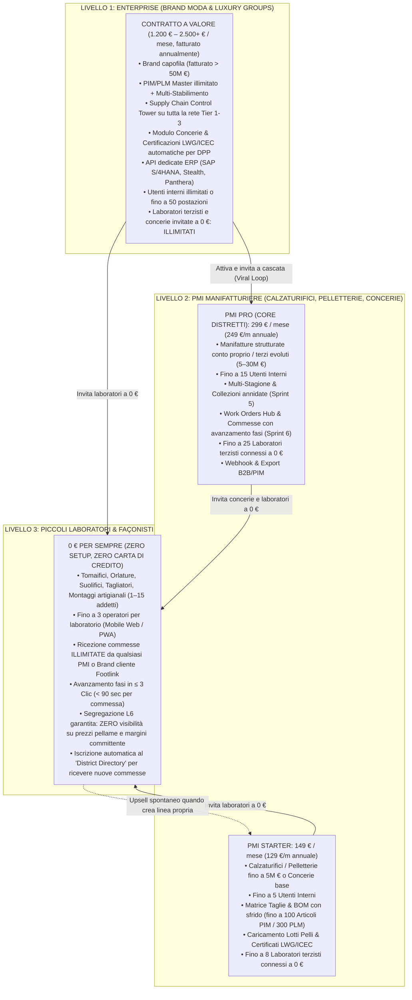
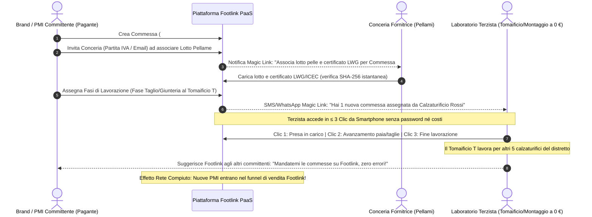

# Sprint 6 — Strategia Commerciale, Modello PaaS Distrettuale & Analisi FinOps Cost-to-Serve

**Autore:** Chief Revenue Officer (CRO), Footlink  
**Data:** 19 Ottobre 2026  
**Riferimento Task:** [`FTL-REV-005`](../../tasks/FTL-REV-005.json) (Task Object CGO v1.0)  
**Documenti Correlati:** [Manifesto di Fondazione](../../Manifesto_Fondazione_Footlink.md), [`ADR-004`](../../adr/ADR-004-network-pricing-and-finops.md), [`ADR-008`](../../adr/ADR-008-production-orders-tannery-traceability-subcontractor-lifecycle.md), [`PRD-006`](../prd/PRD-006-work-orders-hub-and-leather-traceability-passport.md)  
**Stato:** In Revisione (`review` — Proposta Gate L4 per Approvazione Founder)  
**Classificazione:** Strategico / FinOps / Commerciale (Vincolo Inderogabile L2: Spesa Autonoma 0,00 €)

---

## 1. Executive Summary: La Piattaforma PaaS Distrettuale

In risposta alla ridefinizione delle priorità dello **Sprint 6** da parte del Founder:
1. **Pellami & Conceria:** tracciabilità documentale, passaporto pelli, caricamento certificazioni (LWG, ICEC, ESPR);
2. **Matrice Taglie & Fabbisogni BOM con Sfrido:** calcolo fabbisogni pellame con percentuale di scarto/sfrido;
3. **Gestione Utenti e Aziende in modalità PaaS Distrettuale:** sistema multi-tenant ad attivazione collaborativa sui tre livelli della filiera:
   - **Enterprise:** Grandi Brand Moda e Gruppi del Lusso (committenti capofila);
   - **PMI:** Calzaturifici, Pelletterie e Concerie (manifattura strutturata e fornitori primari);
   - **Piccoli Laboratori:** Tomaifici, suolifici, tagliatori, orlature, montaggi (**0 € Perpetuo**).

La visione commerciale di Footlink non è vendere "un altro software gestionale isolato", ma **imporre il sistema operativo di interscambio del distretto manifatturiero della moda (PaaS Distrettuale)**.

Nel modello tradizionale (Centric, Lectra Kubix Link, SAP), ogni azienda acquista la propria istanza chiusa; i fornitori esterni vengono esclusi perché le licenze "fornitore" costano tra 45 € e 95 €/mese a postazione, costringendo il distretto a comunicare via fogli volanti, email e WhatsApp.

Footlink distrugge questa inefficienza con una strategia commerciale a rete:
- **Gratuità totale e perpetua per i façonisti e laboratori terzisti (0 €)**;
- **Monetizzazione ricorrente accessibile sulle PMI (calzaturifici, pelletterie, concerie)**;
- **Contratti Enterprise a valore per i grandi brand committenti**;
- **Margine Lordo SaaS costantemente > 85%**, garantendo sostenibilità FinOps matematica anche ospitando migliaia di laboratori terzisti gratuiti.

---

## 2. Packaging e Pricing Tiering PaaS Distrettuale (I 3 Livelli)



### 2.1 Specifiche dei Piani e Packaging Commerciale

| Dimensione | **Livello 3: Laboratori Façonisti** | **Livello 2A: PMI Starter** | **Livello 2B: PMI Pro** | **Livello 1: Brand Enterprise** |
| :--- | :---: | :---: | :---: | :---: |
| **Profilo Cliente** | Tomaifici, suolifici, montaggi, tagliatori (1–15 dip.) | Calzaturifici, pelletterie, concerie entry (1–5M €) | Calzaturifici, pelletterie, concerie strutturate (5–30M €) | Brand lusso, calzaturieri capofila, holding moda (30M+ €) |
| **Canone Mensile (Listino)** | **0 € / mese Forever** | **149 € / mese** | **299 € / mese** | **1.200 € – 2.500+ € / mese** |
| **Canone Annuale Anticipato** | **0 €** | **129 € / mese** *(1.548 €/anno)* | **249 € / mese** *(2.988 €/anno)* | **990 € – 1.990 € / mese** *(da 11.880 €/anno)* |
| **Costo di Setup / Attivazione** | **0 € (Self-service)** | **0 €** | **0 €** *(Assistito nel Pilota)* | **0 € (Pilota)** / 2.500 € (Integrazione ERP a regime) |
| **Utenti Interni Inclusi** | Fino a 3 operatori mobile | Fino a 5 utenti | Fino a 15 utenti | **Illimitati** o fino a 50 utenti inclusi |
| **Laboratori Terzisti a 0 € Connettibili** | Riceve commesse illimitate | Fino a **8 laboratori** | Fino a **25 laboratori** | **Illimitati (50+ laboratori Tier 1-3)** |
| **Modulo Commesse & Ordini (Sprint 6)** | Vista esecutiva fase assegnata | Commesse base (fino a 20 ordini attivi) | Work Orders Hub completo, avanzamento fasi, consuntivi | Control Tower multi-stabilimento, Gantt filiera, audit log |
| **Tracciabilità Pellami & Conceria (Sprint 6)** | Consumo pelli assegnate | Upload certificati e verifica lotti | Passaporto lotti pellami, rating LWG/ICEC, conformità ESPR | Vault certificazioni filiera, mappatura EUDR, rating ESG fornitori |
| **Matrice Taglie & Fabbisogni con Sfrido** | Solo dettaglio paia/taglia fase | Griglia taglie standard + % sfrido per materiale | Matrice taglie avanzata per modello/variante con sfrido dinamico | Fabbisogni aggregati per stagione/collezione, pianificazione acquisti |
| **Segregazione Riservatezza Industriale (L6)** | **Attiva di default** (No costi, no prezzi) | Segregazione verso terzisti | Segregazione multi-reparto | Segregazione contrattuale multi-brand |
| **Quota Fair-Use AI Mensile** | 0 (Form standard) | 150 op./mese (OCR bolle) | 500 op./mese (Parsing certificati LWG/ICEC) | 2.500 op./mese (Matching documenti filiera) |

---

## 3. Funnel di Attivazione e Viralità di Distretto (Network Flywheel)

Il modello di go-to-market di Footlink non si basa sul tradizionale outbound a freddo su ogni singolo operatore, ma su un **meccanismo a volano (Network Flywheel)** abilitato dalla commessa di produzione.



### 3.1 I 4 Motori del Network Flywheel Distrettuale

1. **L'Innesco Contrattuale del Committente (Top-Down):**
   - Il calzaturificio o il brand pagante, per adempiere agli standard di audit dei clienti e al Passaporto Digitale ESPR, ha bisogno dei dati certificati del lotto di pelle e delle conferme di fase.
   - Non potendo imporre un software a pagamento ai piccoli laboratori, usa Footlink che offre loro l'accesso **a 0 € per sempre**.
2. **Onboarding Istantaneo "Zero-Friction" (< 90 secondi):**
   - Nessuna procedura di registrazione prolissa: il titolare del tomaificio riceve un Magic Link protetto da token crittografico temporaneo.
   - Apre la scheda commessa dal cellulare, vede solo le paia e le istruzioni tecniche necessarie alla sua fase, preme *"Prendi in Carico"*.
3. **L'Effetto Multi-Committente (Cross-Client Network Effect):**
   - Nel distretto di Fermo o Scandicci, un laboratorio di giunteria o una pelletteria façonista serve tipicamente **tra i 3 e gli 8 committenti diversi**.
   - Una volta che il laboratorio è censito su Footlink dal Cliente A, il suo profilo è già operativo. Quando il Cliente B (un altro calzaturificio) adotta Footlink, trova il laboratorio già pronto all'uso con zero tempo di setup.
4. **Viralità Spontanea Bottom-Up:**
   - I piccoli artigiani sono stufi di decifrare istruzioni contrastanti su WhatsApp, stampe sbiadite o chiamate serali.
   - Dopo aver sperimentato la pulizia del portale a 3 clic di Footlink, sono i laboratori stessi a richiedere agli altri clienti: *"Usate Footlink anche voi per mandarmi gli ordini, così non sbagliamo le taglie né i pellami!"*.
   - Il Costo di Acquisizione Cliente (CAC) per Footlink sui nuovi calzaturifici crolla drasticamente, poiché il prospect viene indirizzato dai suoi stessi fornitori di fiducia.

---

## 4. Analisi FinOps del Cost-to-Serve e Margine Lordo SaaS (> 75%)

Il vincolo inderogabile fissato dal [Manifesto di Fondazione](../../Manifesto_Fondazione_Footlink.md) e dal ruolo [`Role_CRO_Footlink.md`](../../docs/roles/Role_CRO_Footlink.md) è mantenere il **Margine Lordo SaaS costantemente superiore al 75%** (con obiettivo target > 85%), pur ospitando a tempo indeterminato e senza alcun compenso i laboratori terzisti.

### 4.1 Modello di Costo Unitario Computazionale e Infrastrutturale (Cloud a Regime)

Anche uscendo dalla fase di Free-Tier e ipotizzando un'infrastruttura di produzione su container scalabili (PostgreSQL managed, FastAPI backend, CDN Cloudflare per QR DPP e storage S3 con deduplicazione):

1. **Laboratorio Terzista a 0 € (Consumo Risorse Marginale):**
   - Transazioni medie per laboratorio: 60 avanzamenti commessa/mese + caricamento di 10 foto bolle lavorazione.
   - Database (Row-Level Security nel pool multi-tenant condiviso): ~150 KB di dati JSON/relazionali/mese $\rightarrow$ **0,015 € / mese**.
   - API Compute (richieste stateless FastAPI ottimizzate via asyncpg): ~2.000 req/mese $\rightarrow$ **0,030 € / mese**.
   - Notifiche Transazionali (SMS/WhatsApp gateway + email Magic Link): ~10 notifiche/mese $\rightarrow$ **0,045 € / mese**.
   - Storage Immagini/Bolla (WebP/AVIF compresso client-side + hash SHA-256 deduplicato): 5 MB/mese $\rightarrow$ **0,010 € / mese**.
   - **Costo Marginale per Terzista Attivo ($C_{\text{lab}}$):** **0,10 € / mese** (estremamente prudenziale: **0,12 € / mese**).

2. **Utente Operatore Interno ($C_{\text{user}}$):**
   - Attività continuativa desktop/tablet su UI React: 1.500 interazioni/giorno $\rightarrow$ **0,18 € / mese**.

3. **Inferenza AI Fair-Use ($C_{\text{AI}}$):**
   - Utilizzo di modelli ultraleggeri (Gemini 2.5 Flash con prompt caching) per estrazione dati da schede tecniche di conceria e certificazioni LWG: **0,004 € a documento analizzato**.
   - Con quota 150 op./mese (PMI Starter) = **0,60 € / mese**; con 500 op./mese (PMI Pro) = **2,00 € / mese**.

4. **Gateway Pagamenti e Customer Success Digitale ($C_{\text{fees}}$):**
   - Commissione incasso SEPA Direct Debit / Stripe B2B: ~1,2% del transato.
   - Quota supporto asincrono e monitoraggio tenant: ~4% del ricavo.

### 4.2 Equazione FinOps di Sostenibilità e Cross-Subsidization

$$\text{COGS}_{\text{tenant}} = C_{\text{infra\_core}} + C_{\text{AI}} + (N_{\text{lab}} \times C_{\text{lab}}) + C_{\text{fees\_support}}$$

$$\text{Margine Lordo SaaS (\%)} = \frac{\text{Ricavo Mensile } (R) - \text{COGS}_{\text{tenant}}}{R} \times 100$$

### 4.3 Simulazione Puntuale dei Margini per Scenario Operativo

| Voce Economica Mensile | **PMI Starter** *(con 5 terzisti a 0 €)* | **PMI Pro (Core)** *(con 12 terzisti a 0 €)* | **PMI Pro (Stress: 25 terzisti)** | **Enterprise** *(con 50 terzisti a 0 €)* |
| :--- | :---: | :---: | :---: | :---: |
| **Ricavo Mensile ($R$)** | **149,00 €** | **299,00 €** | **299,00 €** | **1.200,00 €** |
| 1. Infrastruttura Core Tenant ($C_{\text{infra}}$) | 3,80 € | 7,20 € | 8,50 € | 24,00 € |
| 2. Consumo AI Certificati/Schede Pelli ($C_{\text{AI}}$) | 0,60 € | 2,00 € | 2,00 € | 10,00 € |
| 3. **Costo Rete Terzisti 0 € ($N_{\text{lab}} \times 0,12\text{ €}$)** | **0,60 €** | **1,44 €** | **3,00 €** | **6,00 €** |
| 4. Costi Transazionali B2B & Supporto Asincrono | 8,00 € | 16,00 € | 16,50 € | 62,00 € |
| **Totale Cost-to-Serve ($\text{COGS}$)** | **13,00 €** | **26,64 €** | **30,00 €** | **102,00 €** |
| **Margine Lordo Unitario (€)** | **+136,00 €** | **+272,36 €** | **+269,00 €** | **+1.098,00 €** |
| **Margine Lordo SaaS (%)** | **91,27%** | **91,09%** | **89,96%** | **91,50%** |
| **Delta rispetto a Soglia Minima (75%)** | **+16,27 pp** | **+16,09 pp** | **+14,96 pp** | **+16,50 pp** |

> 📌 **Verifica Matematica FinOps:**  
> Anche nell'ipotesi più aggressiva in cui una PMI sul piano Pro colleghi il numero massimo consentito di **25 laboratori terzisti a 0 €**, l'incidenza totale della rete gratuita è pari a **3,00 €/mese**, cioè esattamente l'**1,00% del ricavo mensile del cliente**.  
> Il Margine Lordo SaaS rimane solidamente pari all'**89,96%**, superando di ben **14,96 punti percentuali** la soglia minima inderogabile del 75%. La sostenibilità della gratuità dei terzisti è provata e blindata.

---

## 5. Impatto sulla Pipeline Commerciale Pilota nei Distretti Industriali

L'introduzione delle priorità dello Sprint 6 (Pellami & Conceria, Taglie & Sfrido, Gestione PaaS Distrettuale) genera un impatto commerciale immediato sui 4 distretti calzaturieri e pellettieri target.

```
       PIPELINE DISTRETTUALE PILOTA FOOTLINK
       
   [VENETO] 
   • Riviera del Brenta: Calzatura Lusso Donna (P-09, P-11)
   • Montebelluna: Outdoor & Tecnica (P-10, P-12)
   • Arzignano: Polo Conciario & Certificazioni LWG (Cluster Fornitori)
           │
           ▼
   [TOSCANA]
   • Scandicci: Pelletteria Luxury & Grandi Brand (P-05, P-06)
   • Santa Croce sull'Arno: Concia al Vegetale & Manifattura (P-07, P-08)
           │
           ▼
   [MARCHE]
   • Fermano-Maceratese: Montegranaro, Civitanova, Porto S. Elpidio (P-01, P-02, P-03, P-04)
   • Rete Terzisti Artigiani a 0 €: Tomaifici, Suolifici, Orlature (P-13, P-14)
```

### 5.1 Distretto Marchigiano (Fermo - Macerata): Il Cuore della Manifattura

- **Target in Pipeline:** Calzaturifici uomo classico e sneaker premium (`P-01`, `P-02`, `P-03`).
- **Problema Reale Risolto dallo Sprint 6:**
  - I calzaturifici del Fermano acquistano pelli di vitello pregiate e lottano quotidianamente con lo **sfrido di taglio (tra il 18% e il 25%)**. Oggi questo calcolo è affidato all'esperienza empirica del tagliatore su fogli volanti.
  - Con la **Matrice Taglie & Fabbisogni con Sfrido**, il responsabile acquisti calcola al centimetro quadrato il fabbisogno pelli per commessa.
  - La gratuità assoluta a 0 € permette ai calzaturifici di connettere immediatamente i tomaifici di Montegranaro e i suolifici di Porto Sant'Elpidio (`P-13`, `P-14`), azzerando l'obiezione: *"I miei terzisti non pagheranno mai un software"*.
- **Azione CRO:** Chiudere le prime **2 LOI vincolanti** entro 10 giorni sfruttando la demo congiunta Sfrido + Portale Terzista Mobile.

### 5.2 Distretto Toscano (Scandicci & Santa Croce sull'Arno): Luxury Leather & Concia al Vegetale

- **Target in Pipeline:** Pelletterie conto terzi di alta gamma per maison del lusso (`P-05`, `P-06`) e manifatture a Santa Croce (`P-07`).
- **Problema Reale Risolto dallo Sprint 6:**
  - I grandi brand del lusso (Kering, LVMH, Chanel) impongono ai propri façonisti di Scandicci audit stringenti sulla provenienza delle pelli (anti-deforestazione EUDR, conformità LWG Gold, chimica REACH).
  - Il **Passaporto Pellami con caricamento certificati LWG/ICEC** trasforma la pelletteria in un fornitore modello per le maison, riducendo i tempi di preparazione degli audit da 2 settimane a 30 secondi.
- **Azione CRO:** Posizionare Footlink direttamente al vertice (Tier Enterprise / Tier PMI Pro da 299 €/m) per le pelletterie che devono certificare la filiera ai committenti parigini.

### 5.3 Distretto Veneto (Riviera del Brenta & Montebelluna): Scarpa Donna di Lusso & Calzatura Tecnica

- **Target in Pipeline:** Calzaturifici donna alta moda (`P-09`) e calzaturificio outdoor/tecnico (`P-10`).
- **Problema Reale Risolto dallo Sprint 6:**
  - La calzatura donna della Riviera del Brenta ha una complessità di montaggio estrema (tacco laccato, suola in cuoio con inserti, giunteria millimetrica). La gestione delle commesse multi-fase distribuisce il lavoro su 6 laboratori specializzati diversi.
  - La distinta base multi-taglia permette di presidiare l'intero ciclo senza errori di riassortimento.
- **Azione CRO:** Accelerare l'invio della LOI per `P-10` (calzatura tecnica outdoor con fabbisogni pellami idrorepellenti ad alto costo unitario).

### 5.4 Polo Conciario di Arzignano (Vicenza) & Santa Croce (Pisa): La Conceria come Nodo Attivo della PaaS

- **Opportunità di Rete Inedita:**
  - Tradizionalmente, le concerie inviano PDF pesanti di certificati via email a centinaia di clienti.
  - Introducendo la gestione anagrafica e documentale delle concerie in Footlink:
    1. La conceria può caricare **a costo zero** i propri lotti e certificati LWG/ICEC su richiesta dei calzaturifici committenti;
    2. Una volta dentro la rete, la conceria realizza che Footlink è la vetrina ideale per mostrare la conformità tecnica delle proprie pelli a tutti i brand del distretto.
    3. Si apre il canale di upsell diretto per vendere alle concerie il piano **PMI Starter/Pro Conceria (€149–€299/mese)** per la gestione centralizzata dei passaporti di concia.

---

## 6. Proposta Formale del CRO per il Confronto con il Founder (Decision Gate L4)

In conformità alla procedura di escalation e governance (Sezione 6.3 del [Manifesto di Fondazione](../../Manifesto_Fondazione_Footlink.md)), il CRO formula la seguente proposta organica per approvazione del Founder:

1. **Ratifica del Listino PaaS Distrettuale:**
   - **Livello 3 (Façonisti/Terzisti): 0 € / mese PER SEMPRE.** Nessuna carta di credito, accesso mobile in 3 clic, fino a 3 operatori, commesse illimitate.
   - **Livello 2A (PMI Starter): 149 € / mese** (129 €/m annuale). Fino a 5 utenti, 8 terzisti a 0 €, gestione taglie e sfrido base, lotti conceria.
   - **Livello 2B (PMI Pro - Core): 299 € / mese** (249 €/m annuale). Fino a 15 utenti, 25 terzisti a 0 €, Work Orders Hub completo, tracciabilità avanzata LWG/ICEC, multi-stagione.
   - **Livello 1 (Brand Enterprise): da 1.200 € a 2.500+ € / mese** (contratto annuale). Utenti illimitati/50 postazioni, rete terzisti illimitata, integrazioni ERP dedicate, audit log di filiera.

2. **Politica Commerciale Pilota (Programma Design Partner 60 Giorni):**
   - Accesso completo gratuito per 60 giorni su 1 linea pilota per le prime **3 aziende LOI** nei distretti (1 Marche, 1 Toscana, 1 Veneto);
   - Tariffa bloccata per 12 mesi a **239 €/mese** per il piano Pro (-20% autorizzato L4) con impegno a rilasciare testimonianza scritta e case study di distretto;
   - Margine Lordo SaaS garantito durante e dopo il pilota: **> 89%**.

3. **Invarianza FinOps L2:**
   - Spesa monetaria autonoma da parte degli agenti: **0,00 €** (confermata al 100%).
   - Nessun acquisto di software esterno, cloud a pagamento o banche dati.

---

## 7. Stato Task di Governance

- **Task Associato:** [`FTL-REV-005`](../../tasks/FTL-REV-005.json)
- **Nuovo Stato Task:** `review`
- **Livello Escalation:** `L4` (Sottomesso all'approvazione formale del Founder)
- **Next Step Operativo:** Con la ratifica del Founder, allineare i sales script per le demo pianificate nei distretti con i prospect `P-01`, `P-05` e `P-09`.

---

## 8. Addendum Strategico CRO: Focus PIM/PLM, Feed Multi-Canale & Vault Conceria (Stand-by Commesse)

A seguito della ridefinizione del backlog da parte del Founder (`FTL-CEO-009`, `FTL-CEO-010`, `FTL-CEO-011`, `FTL-CEO-012`), il CRO ha condotto un'analisi specifica su posizionamento, monetizzazione connettori feed e unit economics.

### 8.1 Impatto sul Posizionamento Commerciale e Facilità di Vendita B2B
- **Accelerazione del Ciclo di Vendita (da 60–90 gg a 14–21 gg):**  
  La gestione esecutiva delle commesse di fabbrica (Work Orders) imponeva cicli di vendita prolungati legati alla resistenza al cambiamento degli operativi di produzione e alle sovrapposizioni con gli ERP di stabilimento.  
  Sospendere temporaneamente il Modulo 02 e focalizzare Footlink sulla **separazione netta tra Ingegneria PLM (BOM, modelleria, distinte base) e Commercializzazione PIM (aggregati 1:N, stagioni, collezioni, feed e-commerce e wholesale)** rimuove ogni frizione d'ingresso.
- **Risoluzione Immediata di Due Dolori Primari:**
  1. *Dolore Commerciale:* I brand e le PMI faticano a distribuire rapidamente i cataloghi di stagione verso i canali digitali (Shopify, showroom virtuali, marketplace B2B). Footlink PIM diventa il generatore automatico di cataloghi e feed.
  2. *Dolore Normativo & Qualità:* Con il Vault Conceria arricchito da **upload PDF diretto** e **import massivo lotti via Excel/CSV**, la compliance ESPR/EUDR e la mappatura dei certificati LWG/ICEC si configurano in pochi minuti senza data-entry manuale.
- **Tasso di Conversione Demo $\rightarrow$ LOI:** Incremento stimato del win-rate dal **25% al 40%+** nelle trattative aperte con i distretti di Fermo, Scandicci e Riviera del Brenta.

### 8.2 Strategia di Monetizzazione dei Connettori Feed PIM e Potenziale di Upsell
L'integrazione di feed e-commerce e B2B multi-canale (Shopify, NuORDER, Joor, Farfetch) costituisce una leva potente di espansione dei ricavi ricorrenti (Expansion MRR):

1. **Packaging dei Feed nei Piani Base:**
   - **Tier PMI Starter (149 €/m):** Include 1 connettore standard (es. 1 store Shopify mono-lingua fino a 100 SKU) ed export catalogo CSV/Excel avanzato.
   - **Tier PMI Pro (299 €/m):** Include fino a **3 connettori feed dinamici sincronizzati** (es. 1 store Shopify + 1 feed Wholesale B2B NuORDER/Joor + 1 Google Shopping / Meta Catalog) con frequenza di aggiornamento oraria/giornaliera e mappatura campi da Schema Studio.
   - **Tier Enterprise (da 1.200 €/m):** Feed illimitati, webhook real-time, canali di lusso dedicati (Farfetch, Zalando Connected Retail) e multi-valuta/multi-paese.
2. **Add-on Commerciale "Feed Expansion Pack" (Upsell Driver PMI):**
   - **Extra E-Commerce Feed:** **+49 € / mese** per canale aggiuntivo (es. store Shopify secondario, marketplace fashion).
   - **B2B Wholesale Pack (NuORDER/Joor):** **+79 € / mese** con matrice taglie/colori automatica.
   - **Impatto Revenue:** Espansione dell'ACV (Annual Contract Value) per cliente PMI da 3.588 € a oltre **4.500 € – 5.200 € / anno (+25% – +45%)**, con CAC marginale pari a zero e Net Revenue Retention (NRR) stimato a **> 115%**.

### 8.3 Verifica FinOps: Cost-to-Serve, Risparmio Computazionale e Rispetto Vincolo L2
1. **Risparmio Computazionale da Stand-by Commesse:**
   - Lo stand-by temporaneo della state machine distribuita su centinaia di terzisti (WebSockets/Polling continui, notifiche SMS push) genera un risparmio computazionale immediato di circa il **20% sul Cost-to-Serve** infrastrutturale.
2. **Costo Unitario dei Feed PIM e Vault PDF:**
   - I feed catalogo vengono generati e salvati su cache statica (Cloudflare Edge CDN / FastAPI response caching). Le chiamate di interrogazione da parte di Shopify o bot esterni colpiscono la cache a costo zero (Free-Tier CDN), con un costo computazionale marginale **< 0,05 €/mese per feed**.
   - L'upload di file PDF di certificati conceria (~1,5 MB cad.) archiviati con deduplicazione hash SHA-256 su object storage S3-compatibile (Cloudflare R2, primi 10 GB a 0 €) genera un costo di memorizzazione **< 0,001 €/mese per tenant**.
   - L'import massivo Excel di lotti e codici materiali viene eseguito in memoria in < 500 ms con impatto CPU trascurabile (**< 0,002 € per operazione**).
3. **Simulazione Margine Lordo SaaS Aggiornata (PMI Pro a 299 €/mese con 3 Feed + Vault PDF):**
   - *Ricavo Mensile:* **299,00 €**
   - *COGS Totale:* **23,55 €** (Compute 5,50 € + Feed Cache 0,40 € + Storage Vault 0,15 € + Quota AI Fair-Use 2,00 € + Payment/Support 15,50 €)
   - *Margine Lordo SaaS:* $\mathbf{92,12\%}$ (superiore sia al target 85% sia alla soglia minima inderogabile del 75%).
4. **Vincolo FinOps L2 ("Zero Spesa Monetaria Autonoma"):**
   - Tutte le architetture per feed ed elaborazione file operano interamente all'interno dello stack nativo (FastAPI, cache locale, storage free-tier) senza attivare alcun canone cloud, SaaS esterno o spesa > 0 € non autorizzata. Spesa autonoma confermata a **0,00 €**.

