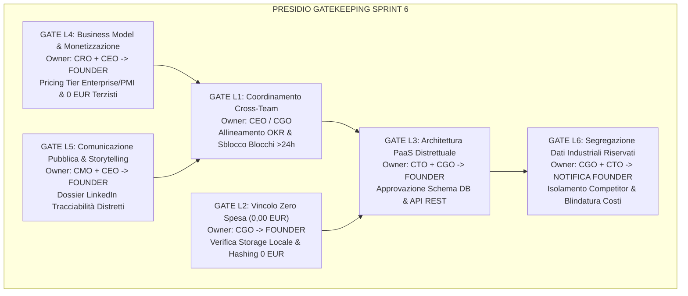

# Matrice dei Rischi e Presidio Gatekeeping L1-L6 — Sprint 6

- **Documento ID:** `GOV-RISK-GATEKEEPING-SPRINT-6`
- **Data:** 19 Ottobre 2026
- **Autore:** Chief Governance Officer (`footlink-cgo`)
- **Destinatari:** Founder, CEO, CTO, CPO, CRO, CMO
- **Riferimenti di Governance:** [Manifesto di Fondazione Footlink](../../Manifesto_Fondazione_Footlink.md) (Sezioni 5 e 6), [`Role_CGO_Footlink.md`](../roles/Role_CGO_Footlink.md), [`ADR-008`](../../adr/ADR-008-production-orders-tannery-traceability-subcontractor-lifecycle.md), [`audit-gdpr-and-l6-multi-tenant-data-segregation.md`](./audit-gdpr-and-l6-multi-tenant-data-segregation.md)
- **Task Collegato:** [`FTL-GOV-006`](../../tasks/FTL-GOV-006.json)
- **Stato:** Sottomesso per Approvazione Formale Founder (Gate L2, L3, L6)

---

## 1. Executive Summary & Proposta di Governance per il Founder

In risposta alla ridefinizione delle priorità strategiche impartite dal Founder per lo **Sprint 6**:
1. **Pellami & Conceria:** tracciabilità conciaria, caricamento documenti e certificazioni (LWG, ICEC, EUDR) con hash SHA-256 e visualizzazione nel Passaporto Digitale del Prodotto (DPP UE) a doppia vista (B2C consumatore vs B2B/Dogane L6).
2. **Matrice Taglie & Fabbisogni BOM con Sfrido:** Work Orders Hub con ripartizione per taglia, fattori di scala e coefficiente di sfrido fisiologico percentuale del pellame (15-25%).
3. **PaaS Distrettuale Multi-Company / Multi-Tenant sui 3 Livelli:** architettura a 3 tier per Enterprise (Maison internazionali), PMI (Calzaturifici e pelletterie strutturate) e Piccoli Laboratori Façonisti a 0,00 EUR (Cost-to-Serve 0 €).

Il Chief Governance Officer (CGO) ha redatto il presente quadro di presidio per garantire che l'evoluzione della piattaforma avvenga sotto un **controllo preventivo totale dei rischi industriali, normativi e finanziari**.

### La Proposta di Governance del CGO al Founder:
1. **Sblocco Condizionato Gate L3 (Architettura PaaS Distrettuale):** autorizzare l'implementazione del DDL relazionale multi-tenant (`companies`, `users`, `tannery_batches`, `batch_certification_documents`, `production_orders`, `production_order_size_items`, `production_phases_execution`) con vincolo di validazione via test suite automatizzata.
2. **Presidio Inderogabile Gate L6 (Segregazione Industriale Competitor & Brand/Terzisti):** blindatura crittografica e applicativa by-design. Nessun dato tra brand concorrenti che condividono gli stessi laboratori di distretto potrà mai essere incrociato; nessun dato di costo, listino o margine potrà transitare nei payload destinati ai façonisti o al pubblico.
3. **Presidio Assoluto Gate L2 (Vincolo FinOps Zero Spesa 0,00 EUR):** confermare che l'intero modulo operi su filesystem locale/Free-Tier e hashing SHA-256 standard, con 0,00 € di canoni SaaS esterni o servizi notarili a pagamento.

---

## 2. Matrice dei Rischi di Sprint 6

La tabella seguente analizza i 7 rischi prioritari individuati per lo Sprint 6, classificati secondo la matrice di severità (Probabilità $\times$ Impatto) e associati al corrispondente livello di escalation del Manifesto.

| ID Rischio | Categoria | Livello Escalation | Probabilità (1-5) | Impatto (1-5) | Indice Rischio (P×I) | Descrizione del Rischio | Contromisura Preventiva (By-Design) | Piano di Mitigazione Reattiva / Gatekeeper |
|:---:|:---:|:---:|:---:|:---:|:---:|---|---|---|
| **R-01** | **Sicurezza & Competitor Data Leak** | **L6** | 2 | 5 | 🔴 **10 (Alto)** | **Fuga Dati tra Brand Competitor nello Stesso Distretto:** Due calzaturifici concorrenti usano lo stesso laboratorio terzista di giunteria; un bug nei filtri espone modelli, commesse o volumi del Brand A al Brand B. | Isolamento logico vincolante nel database: `tenant_id` obbligatorio su ogni query FastAPI; token Magic Link per il terzista confinati alla singola esecuzione fase. | Audit statico del codice + Blocker CI/CD su test suite multi-tenant con asserzioni negative cross-tenant. *Gatekeeper: CGO + CTO*. |
| **R-02** | **Riservatezza Industriale** | **L6** | 2 | 5 | 🔴 **10 (Alto)** | **Leakage di Costi e Margini verso Terzisti o Pubblico:** Esposizione accidentale del costo acquisto pellami (`unit_cost_eur`), compensi façon o listini wholesale/retail al terzista o nel DPP consumatore. | Separazione strutturale dei DTO Pydantic: `SubcontractorPhaseWorkorderDTO` e `PublicDPPTraceabilityDTO` privi alla radice dei campi economici. Mascheramento L6. | Test di regressione automatizzati con asserzione `assert "cost" not in response.json()` e `assert "price" not in response.json()`. *Gatekeeper: CGO*. |
| **R-03** | **Adozione Utente Filiera** | **L1** | 3 | 3 | 🟡 **9 (Medio)** | **Rifiuto d'Uso dei Piccoli Laboratori Artigianali:** I façonisti rifiutano di usare la piattaforma se richiede download app, password complesse, procedure di fatturazione o tempo > 2 minuti. | Principio "≤ 3 Clic, < 90s": accesso diretto via Magic Link mobile su WhatsApp/SMS, zero password, zero registrazione, 0,00 € di costo per il terzista. | Benchmark usability System Usability Scale (SUS > 80) e monitoraggio tempi medi di presa in carico commessa. *Gatekeeper: CPO + CRO*. |
| **R-04** | **FinOps & Vincolo Finanziario** | **L2** | 2 | 4 | 🟡 **8 (Medio)** | **Sforamento del Vincolo Zero Spesa Monetaria (0,00 EUR):** Attivazione accidentale di storage S3 a pagamento, API terze di notarizzazione blockchain o crediti cloud a consumo per certificati PDF. | Divieto tassativo di sottoscrizione servizi a pagamento. Storage documentale su filesystem locale/Free-Tier; immutabilità certificati tramite SHA-256 standard Python `hashlib`. | Ispezione di bilancio FinOps prima di qualsiasi deploy; blocco architetturale L2 con veto automatico del CGO. *Gatekeeper: CGO + Founder*. |
| **R-05** | **Conformità Normativa UE** | **L6** | 2 | 4 | 🟡 **8 (Medio)** | **Non Conformità Documentale EUDR & ESPR:** Lotti di pellame immessi sul mercato privi delle coordinate di provenienza del grezzo (anti-deforestazione post 2020) o con certificati LWG non validati. | Modello dati `tannery_batches` con validazione obbligatoria dei campi EUDR (`raw_hide_origin_country`, `eudr_due_diligence_id`) prima del lancio commessa. | Blocco del passaggio di stato della commessa a `in_production` se i certificati obbligatori sono assenti o invalidi. *Gatekeeper: CGO + CPO*. |
| **R-06** | **Qualità Tecnica Manifattura** | **L1** | 3 | 2 | 🟡 **6 (Basso)** | **Disallineamento Fabbisogno Pelle e Sfrido di Taglio:** Errore nel calcolo del consumo pellame per taglia o mancata applicazione dello sfrido (15-25%), con conseguente arresto della linea di montaggio per carenza materiale. | Formula deterministica integrata nel backend: somma paia per fattore taglia moltiplicata per `(1 + sfrido/100)`; alert di giacenza minima lotto prima del taglio. | Validazione incrociata con i tecnici di modelleria CAD dei Design Partner pilota. *Gatekeeper: CPO + CTO*. |
| **R-07** | **Integrità Crittografica Dati** | **L6** | 1 | 4 | 🟢 **4 (Basso)** | **Manomissione o Sostituzione di Schede Tecniche / Certificati:** Tentativo di caricare un PDF di certificazione contraffatto o modificato post-approvazione. | Calcolo immediato dell'impronta crittografica SHA-256 (64 hex) al caricamento e salvataggio immutabile su DB. Riconciliazione in tempo reale sul DPP. | Rifiuto immediato della verifica doganale in caso di mismatch dell'hash (`tamper detection`). *Gatekeeper: CTO*. |

---

## 3. Presidio Operativo Gatekeeping L1-L6 per lo Sprint 6

In conformità al Capitolo 6 del *Manifesto di Fondazione*, ogni avanzamento significativo nello Sprint 6 attraversa un cancello formale di revisione (Gatekeeping).



### Protocollo di Revisione per Livello:

### 🟡 Gate L1 — Coordinamento Tattico Cross-Team
- **Owner:** CEO (`footlink-ceo`), con presidio continuo del CGO (`footlink-cgo`).
- **Ambito:** Allineamento delle specifiche di Prodotto (PRD-006 di CPO), Sviluppo Software (FTL-TECH-007 di CTO), Analisi FinOps (FTL-REV-005 di CRO) e Marketing (FTL-MKT-005 di CMO).
- **Criterio di Blocco:** Qualsiasi dipendenza o blocco inter-dipartimentale non risolto entro **24 ore** viene automaticamente sollevato in seduta straordinaria di C-Suite.
- **Deliverable di Sblocco:** Direttiva Esecutiva [`FTL-CEO-008`](../../tasks/FTL-CEO-008.json).

### 🔴 Gate L2 — Vincolo FinOps "Zero Spesa Monetaria Autonoma" (0,00 EUR)
- **Owner:** Chief Governance Officer (`footlink-cgo`) $\rightarrow$ **Approvazione ed Esecuzione Esclusiva Founder**.
- **Ambito:** Verifica che l'infrastruttura di gestione documentale delle certificazioni e l'architettura PaaS distrettuale non introducano alcun costo monetario:
  - *No AWS S3 / Azure Blob Storage a pagamento:* impiego dello storage filesystem locale e delle quote Free-Tier già attive.
  - *No Servizi Notarili / Blockchain a pagamento:* autenticità e non-ripudio garantiti da hash crittografici standard SHA-256 processati localmente in Python (`hashlib`).
  - *No Licenze SaaS per Terzisti:* i laboratori operano a **0,00 €/mese** con Cost-to-Serve azzerato.
- **Criterio di Blocco:** Rifiuto immediato (Veto CGO) di qualsiasi architettura che richieda carte di credito o impegni monetari non deliberati dal Founder.
- **Stato Attuale:** **CONFORME (0,00 EUR preventivati)**.

### 🔴 Gate L3 — Scelte Architetturali Strutturali (ADR-008)
- **Owner:** CTO (`footlink-cto`) + CGO (`footlink-cgo`) $\rightarrow$ **Approvazione Formale Founder**.
- **Ambito:** Implementazione irreversibile delle strutture dati core in [`ADR-008`](../../adr/ADR-008-production-orders-tannery-traceability-subcontractor-lifecycle.md):
  1. Modello PaaS Distrettuale: `companies` e `users` con partizionamento per `tenant_id`.
  2. Commesse di Produzione e Size Breakdown: `production_orders` e `production_order_size_items`.
  3. Lotti Conceria & Certificazioni: `tannery_batches` e `batch_certification_documents`.
  4. Ciclo Fasi Terzisti: `production_phases_execution`.
- **Criterio di Blocco:** Nessuna migrazione DDL o rilascio in produzione può avvenire prima dell'approvazione del Founder via Founder Control Center.

### 🟠 Gate L4 — Business, Packaging e Monetizzazione di Filiera
- **Owner:** CRO (`footlink-cro`) + CEO (`footlink-ceo`) $\rightarrow$ **Approvazione Formale Founder**.
- **Ambito:** Definizione della struttura di offerta PaaS Distrettuale:
  - Tier Enterprise (Maison del Lusso): canone SaaS proporzionato al numero di stabilimenti e volume commesse.
  - Tier PMI (Calzaturifici di Marca e Pelletterie): canone accessibile per la gestione commesse e distinte base.
  - Tier Piccoli Laboratori Façonisti: **0,00 EUR perpetuo** (leva di attrazione di rete).
  - Add-on Tracciabilità Conceria & Conformità EUDR/ESPR: modulo a valore aggiunto per brand orientati all'export.
- **Criterio di Blocco:** Validazione che il margine lordo medio del modello SaaS rimanga $\ge 75\%$.

### 🟠 Gate L5 — Comunicazione Esterna e Storytelling di Posizionamento
- **Owner:** CMO (`footlink-cmo`) + CEO (`footlink-ceo`) $\rightarrow$ **Approvazione Formale Founder**.
- **Ambito:** Pubblicazione dei contenuti ufficiali B2B sul ruolo pionieristico di Footlink nella tracciabilità del pellame e nella conformità EUDR/ESPR nei distretti calzaturieri.
- **Criterio di Blocco:** Nessun comunicato stampa o post social ufficiale viene divulgato senza il preventivo benestare del Founder.

### 🔴 Gate L6 — Sicurezza, Privacy GDPR & Segregazione Dati Industriali Riservati
- **Owner:** CGO (`footlink-cgo`) + CTO (`footlink-cto`) $\rightarrow$ **Notifica Immediata e Presidio Founder**.
- **Ambito:** Garanzia crittografica, relazionale e visiva della totale confidenzialità industriale:
  1. *Isolamento Orizzontale Competitor:* nessun travaso di informazioni tra aziende concorrenti registrate nel distretto.
  2. *Segregazione Verticale Brand-Terzista:* esclusione assoluta di costi pellami, compensi lavorazioni, listini e margini commerciali dai payload del terzista.
  3. *Doppia Vista DPP:* segregazione tra vista pubblica consumatore (trasparenza etica) e vista doganale ispettiva (conformità tecnica riservata).
- **Criterio di Blocco:** Qualsiasi test di sicurezza fallito o violazione dei vincoli DTO blocca immediatamente il deployment.

---

## 4. Deep-Dive Presidio L6: Segregazione Dati Industriali nel Distretto PaaS

Nel distretto manifatturiero calzaturiero marchigiano (Fermo-Macerata) o toscano (Santa Croce / Firenze), la realtà operativa presenta una caratteristica unica: **i terzisti specializzati (es. laboratori di giunteria, orlatura o suolifici) lavorano contemporaneamente per molteplici brand del lusso tra loro diretti concorrenti**.

### Scenario Distrettuale di Riferimento:
- **Brand Alfa S.p.A.** (Tier Enterprise) affida 1.000 paia di sneaker di alta gamma al **Laboratorio Façon Marche 01** (Tier 3 a 0 EUR).
- **Brand Beta S.r.l.** (Tier PMI) affida 500 paia di mocassini artigianali allo stesso **Laboratorio Façon Marche 01**.

```
┌────────────────────────────────────────────────────────────────────────────────────────┐
│                      ISOLAMENTO ORIZZONTALE COMPETITOR (DISTRETTO)                     │
├────────────────────────────────────────────────────────────────────────────────────────┤
│   BRAND ALFA S.p.A. (Competitor A)             BRAND BETA S.r.l. (Competitor B)       │
│   - Modello: Sneaker Urban Luxe                - Modello: Mocassino Duca               │
│   - Volume: 1.000 paia                         - Volume: 500 paia                      │
│   - Costo Pelle: 48,00 €/mq                    - Costo Pelle: 62,00 €/mq               │
│   - Listino Retail: 650,00 €                   - Listino Retail: 420,00 €              │
├────────────────────────────────────────────────────────────────────────────────────────┤
│                       BARRIERA APPLICATIVA TENANT INJECTION (FASTAPI)                  │
│       WHERE tenant_id = 'brand_alfa_id'        WHERE tenant_id = 'brand_beta_id'       │
├────────────────────────────────────────────────────────────────────────────────────────┤
│                                          │                                             │
│       SESSIONE WORKORDER 101             │             SESSIONE WORKORDER 202          │
│       Token: `magic_link_tk_alfa`        │             Token: `magic_link_tk_beta`     │
│                                          ▼                                             │
│                 LABORATORIO FAÇON MARCHE 01 (Terzista 0,00 EUR)                        │
│                 - Vista A: lavora 1.000 paia tomaia (solo quote taglie e lotti)       │
│                 - Vista B: lavora 500 paia mocassino (solo quote taglie e lotti)       │
│                 - NESSUNA vista incrociata tra le due commesse                         │
│                 - NESSUNA visibilità su costi acquisto pelle o prezzi di vendita       │
└────────────────────────────────────────────────────────────────────────────────────────┘
```

### Le Tre Barriere Tecnologiche di Sicurezza L6:

#### 1. Barriera Relazionale (Database Level):
Ogni tabella operativa (`production_orders`, `tannery_batches`, `bom_items`, `batch_certification_documents`) contiene la colonna indicizzata `tenant_id` valorizzata con l'ID dell'azienda committente. Le query sono generate tramite helper ORM parametrizzati che forzano la clausola di tenancy:
```sql
SELECT * FROM production_orders 
WHERE tenant_id = :authenticated_tenant_id 
  AND id = :order_id;
```
È severamente proibita qualsiasi query raw SQL sprovvista di filtro `tenant_id`.

#### 2. Barriera di Validazione & Dependency Injection (API Level):
Gli endpoint FastAPI implementano dipendenze di sicurezza dedicate che verificano l'identità e il ruolo del richiedente prima di interrogare il database:
- `get_current_tenant_company()`: estrae l'identificativo tenant dal token JWT di sessione.
- `verify_subcontractor_access_token()`: per gli accessi via Magic Link, valida crittograficamente che il token appartenga esattamente alla fase esecutiva richiesta (`production_phases_execution`), bloccando qualsiasi tentativo di enumerazione ID (prevenzione IDOR - Insecure Direct Object Reference).

#### 3. Barriera di Serializzazione DTO (Pydantic Layer):
I payload JSON restituiti dalle API sono rigidamente tipizzati tramite Pydantic. Anche qualora un'anomalia interna recuperasse campi confidenziali dal database, il modello DTO di risposta li scarta preventivamente:

| Proprietà Dati | `BrandProductionOrderDTO` | `SubcontractorPhaseWorkorderDTO` | `DPPPublicConsumerDTO` | `DPPCustomsAuditDTO` |
|---|:---:|:---:|:---:|:---:|
| Codice Modello & Variante PLM | ✅ Presente | ✅ Presente | ✅ Presente | ✅ Presente |
| Griglia Taglie & Paia Programmate | ✅ Presente | ✅ Presente | ❌ Assente | ✅ Presente |
| Istruzioni Tecniche Lavorazione | ✅ Presente | ✅ Presente | ❌ Assente | ✅ Presente |
| Codice Lotto Conceria & Fornitore | ✅ Presente | ✅ Presente (solo codice lotto) | ⚠️ Solo Distretto Concia | ✅ Presente (completo) |
| Certificati LWG / ICEC / EUDR | ✅ Presente | ✅ Presente (sola verifica) | ✅ Presente (Badge & Sostenibilità) | ✅ Presente (Dossier + SHA-256) |
| **Costo Acquisto Pellame (`unit_cost_eur`)** | ✅ **Presente** | 🔒 **ESCLUSO (L6)** | 🔒 **ESCLUSO (L6)** | 🔒 **ESCLUSO (L6)** |
| **Compensi Lavorazioni Altre Fasi** | ✅ **Presente** | 🔒 **ESCLUSO (L6)** | 🔒 **ESCLUSO (L6)** | 🔒 **ESCLUSO (L6)** |
| **Prezzo Wholesale & Margine Brand** | ✅ **Presente** | 🔒 **ESCLUSO (L6)** | 🔒 **ESCLUSO (L6)** | 🔒 **ESCLUSO (L6)** |
| **Fatture Commerciali di Acquisto Pelli** | ✅ **Presente** | 🔒 **ESCLUSO (L6)** | 🔒 **ESCLUSO (L6)** | 🔒 **ESCLUSO (L6)** |

---

## 5. Deep-Dive Presidio L2: Invarianza FinOps "Zero Spesa Monetaria" (0,00 EUR)

Il *Manifesto di Fondazione* vieta categoricamente impegni finanziari autonomi da parte degli agenti AI. L'architettura dello Sprint 6 garantisce l'assoluto rispetto del vincolo **0,00 EUR/mese** mediante scelte di ingegneria mirate:

1. **Storage Documentale a Costo Zero:**
   - I file PDF e le immagini di certificazione (LWG, ICEC, schede EUDR) vengono archiviati su filesystem locale strutturato (`Applicativo/backend/uploads/certificates/{tenant_id}/{batch_id}/`), servito in modalità protetta dal server FastAPI.
   - Viene applicata una policy di quota: massimo **5 MB per file**, con compressione immagini e sanitizzazione dei metadati.
   - Nessun abbonamento AWS S3, Cloudflare R2 o Google Cloud Storage a pagamento è richiesto per lo Sprint 6.
2. **Immutabilità Crittografica Locale (Zero Gas Fee / Zero Notai Digitali):**
   - Invece di affidarsi a piattaforme blockchain proprietarie che richiedono l'acquisto di token o contratti smart a consumo, la marcatura temporale e l'immutabilità sono ottenute tramite hash **SHA-256 a 256 bit** generato istantaneamente dalla CPU host:
     ```python
     import hashlib
     file_hash = hashlib.sha256(file_content).hexdigest()
     ```
   - L'hash viene registrato in tabella e confrontato a runtime. Costo: **0,00 EUR**.
3. **Cost-to-Serve Terzisti 0,00 EUR:**
   - L'onboarding del piccolo laboratorio non comporta costi di licenza utente (zero sedie software a pagamento).
   - L'interfaccia mobile per terzisti è una Web App reattiva ultraleggera (React + Tailwind CSS), priva di notifiche push a pagamento (impiego di link diretti o canali standard gratuiti).

---

## 6. Formale Proposta di Delibera per il Founder (Decision Gate Sign-Off)

Il Chief Governance Officer sottopone al Founder la seguente risoluzione per l'avvio formale dello **Sprint 6**:

> ### PROPOSTA DI RISOLUZIONE:
> 1. **Approvazione ADR-008:** Si approva formalmente [`ADR-008`](../../adr/ADR-008-production-orders-tannery-traceability-subcontractor-lifecycle.md) per l'architettura PaaS Distrettuale Multi-Tenant (3 Livelli), il modulo Commesse di Produzione con Matrice Taglie & Fabbisogni BOM con sfrido, e la Tracciabilità Conceria con caricamento certificazioni e hash SHA-256.
> 2. **Autorizzazione Sviluppo Full-Stack (Gate L3/L6):** Si autorizza il CTO (`footlink-cto`) a procedere con l'implementazione del Task [`FTL-TECH-007`](../../tasks/FTL-TECH-007.json) rispettando rigorosamente i vincoli di segregazione DTO L6 e la copertura dei test al 100%.
> 3. **Conferma Invariante FinOps L2:** Si ratifica che nessun budget monetario (> 0,00 €) viene impegnato o autorizzato per lo Sprint 6.
> 4. **Conferma Priorità Esecutive:** Si approva la ristrutturazione dei Task Object di Sprint 6 per tutti i 6 ruoli della C-Suite (CEO, CGO, CPO, CTO, CRO, CMO).

### Firma e Richiesta di Approvazione:
- **Proposto da:** Chief Governance Officer (`footlink-cgo`) — 19 Ottobre 2026
- **Approvazione Richiesta a:** Founder (Control Center `http://127.0.0.1:8080`)
- **Stato del Gate:** 🟡 In attesa di approvazione formale Founder
