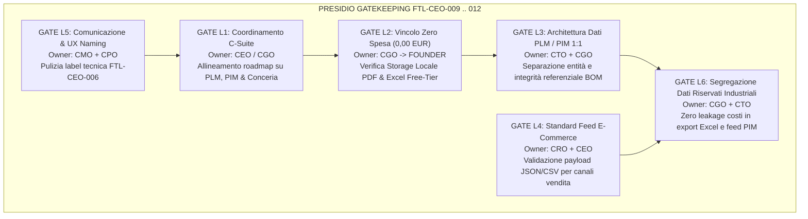

# Piano di Governance, Presidio FinOps L2 / Segregazione L6 e Matrice di Conformità (FTL-CEO-009 — FTL-CEO-012)

- **Documento ID:** `GOV-TRIAGE-COMPLIANCE-CEO-009-012`
- **Data:** 19 Ottobre 2026
- **Autore:** Chief Governance Officer (`footlink-cgo`)
- **Destinatari:** Founder, CEO, CTO, CPO, CRO, CMO
- **Riferimento Primario:** [Manifesto di Fondazione](../../Manifesto_Fondazione_Footlink.md) (Sez. 5 e 6) · [`Role_CGO_Footlink.md`](../roles/Role_CGO_Footlink.md)
- **Decision Record di Riferimento:** [`ADR-009`](../../adr/ADR-009-pause-work-orders-hub-and-refocus-plm-pim-leather-vault.md)
- **Task Oggetto di Triage:** [`FTL-CEO-009`](../../tasks/FTL-CEO-009.json), [`FTL-CEO-010`](../../tasks/FTL-CEO-010.json), [`FTL-CEO-011`](../../tasks/FTL-CEO-011.json), [`FTL-CEO-012`](../../tasks/FTL-CEO-012.json)
- **Stato:** Approvato ed Esecutivo per la C-Suite

---

## 1. Executive Summary: La Svolta di Semplificazione del Founder

In data 19 Ottobre 2026, il Founder ha inserito nel **Founder Control Center** quattro nuove direttive esecutive strategiche, formalizzate dal CGO in [`ADR-009`](../../adr/ADR-009-pause-work-orders-hub-and-refocus-plm-pim-leather-vault.md):

1. **Sospensione Temporanea Modulo 02 (FTL-CEO-011):** Stand-by del *Work Orders Hub & Size Matrix* per concentrare l'effort di rilascio su usabilità, velocità e completezza dei moduli prodotto e commerciale.
2. **Nuova Area "PRODOTTI PLM" (FTL-CEO-009):** Scorporo della gestione tecnica dal vecchio Modulo 04; nuova area ad-hoc con editing rapido, incorporamento nativo della Distinta Base (BOM), griglia avanzata ed export Excel.
3. **Riconfigurazione Modulo 04 in "PIM Hub" (FTL-CEO-010):** Default 1:1 tra PIM e PLM, aggregazione 1:N opzionale, filtri per Stagioni/Collezioni, export cataloghi e generazione di feed multicanale e-commerce (JSON/CSV).
4. **Revisione Modulo 03 "Vault Conceria & LWG" (FTL-CEO-012):** Pulizia label visuale (eliminazione "FTL-CEO-006"), vincolo referenziale obbligatorio su materiali BOM pelle, caricamento reale di file PDF/JPG su filesystem locale con hash SHA-256 e import massivo lotti da file Excel con template scaricabile.

Il presente documento istituisce il quadro di conformità normativa, il presidio dei cancelli **L1–L6** e il piano operativo per guidare i C-Level nello smarcamento ordinato dei task.

---

## 2. Matrice di Conformità Task Object Schema v1.0

Tutti e quattro i task sono stati verificati e validati rispetto a [`task-object-v1.schema.json`](../../tasks/schema/task-object-v1.schema.json) tramite test automatico di conformità:

| Campo Schema | `FTL-CEO-009` | `FTL-CEO-010` | `FTL-CEO-011` | `FTL-CEO-012` | Esito Validazione |
|---|---|---|---|---|:---:|
| `task_id` | `FTL-CEO-009` | `FTL-CEO-010` | `FTL-CEO-011` | `FTL-CEO-012` | ✅ Conforme |
| `title` | Nuova Area Prodotti PLM... | Revisione Modulo 04 in PIM... | Sospensione Temporanea Modulo 02... | Revisione Modulo 03: Vault Conceria... | ✅ Conforme |
| `status` | `todo` | `todo` | `review` | `todo` | ✅ Conforme |
| `priority` | `high` | `high` | `high` | `high` | ✅ Conforme |
| `assignee_role` | `CEO` | `CEO` | `CEO` | `CEO` | ✅ Conforme |
| `created_by` | Founder (Control Center) | Founder (Control Center) | Founder (Control Center) | Founder (Control Center) | ✅ Conforme |
| `estimated_effort`| `M (1-3gg)` | `L (3-10gg)` | `M (1-3gg)` | `M (1-3gg)` | ✅ Conforme |
| `dependencies` | `["FTL-CEO-011"]` | `["FTL-CEO-009", "FTL-CEO-011"]`| `[]` | `["FTL-CEO-011"]` | ✅ Conforme |
| `decision_record_id`| `ADR-009` | `ADR-009` | `ADR-009` | `ADR-009` | ✅ Conforme |
| `tags` | `["PLM", "product"]` | `["product", "PIM", "sales"]` | `["governance", "product"]` | `["product", "PLM", "finops"]` | ✅ Conforme |
| `acceptance_criteria`| 5 criteri verificabili | 6 criteri verificabili | 4 criteri verificabili | 5 criteri verificabili | ✅ Conforme |

---

## 3. Presidio Gatekeeping L1-L6 e Vincoli Invarianti



### 3.1 Presidio FinOps L2 — Invarianza Spesa Monetaria (0,00 EUR)

Il *Manifesto di Fondazione* (Sez. 6.1) vieta agli agenti impegni finanziari autonomi. I requisiti introdotti dal Founder (upload file PDF/JPG ed export/import Excel) sono presidiati come segue:

1. **Storage File PDF Locale a Costo Zero (FTL-CEO-012):**
   - **Nessun Bucket Cloud a Pagamento:** È severamente vietato attivare abbonamenti AWS S3, Google Cloud Storage o Cloudflare R2 a canone.
   - **Filesystem Strutturato Protetto:** I file PDF dei certificati (LWG, ICEC, EUDR) e i template Excel risiedono sul filesystem locale dell'host in cartelle protette:
     `Applicativo/backend/uploads/certificates/{tenant_id}/{batch_id}/`
   - **Policy di Quota & Limiti:** Dimensione massima per singolo file impostata a **10 MB**, con validazione estensione (`.pdf`, `.jpg`, `.jpeg`, `.png`, `.xlsx`, `.csv`).
   - **Immutabilità a Costo Zero:** L'impronta crittografica SHA-256 viene generata in-memory tramite la libreria standard Python `hashlib.sha256()`. Nessuna spesa per notarizzazioni o blockchain a pagamento.
2. **Export ed Import Excel a Costo Zero (FTL-CEO-009, FTL-CEO-010, FTL-CEO-012):**
   - **Nessuna Licenza Commerciale:** L'elaborazione dei file Excel avviene mediante librerie open-source standard a licenza permissiva (MIT/BSD/Apache-2.0) lato backend o tramite parser client-side React/TypeScript.
   - **Zero Canoni per Feed E-Commerce:** La syndication multicanale avviene tramite endpoint REST FastAPI interni che serializzano in tempo reale i cataloghi in formati aperti (JSON/CSV).

### 3.2 Presidio L6 — Segregazione Dati Riservati Industriali

La separazione tra area tecnica PLM e hub commerciale PIM rafforza la protezione dei segreti industriali Made in Italy:

1. **Protezione nei File Excel Esportati dall'Area PLM (FTL-CEO-009):**
   - L'export Excel per l'officina e la modelleria deve contenere codici sagoma, descrizioni materiali, unità di misura e parametri di calzata.
   - **Vincolo L6:** I costi unitari d'acquisto delle materie prime (`unit_cost_eur`), i costi orari di lavorazione e i margini del brand devono essere mascherati o rimossi dai report generati per profili non autorizzati.
2. **Protezione nei Feed E-Commerce del Modulo PIM (FTL-CEO-010):**
   - I feed destinati a piattaforme e-commerce esterne (Shopify, Magento, showroom digitali) espongono prezzi retail (prezzo al pubblico), prezzi wholesale (se canale B2B), descrizioni commerciali e foto.
   - **Vincolo L6:** È strutturalmente vietata la presenza nei feed di: distinte base di produzione esplose, costi industriali standard (COGS), compensi pattuiti con i laboratori façonisti o anagrafiche dei terzisti sub-fornitori.
3. **Isolamento Multi-Tenant nell'Import Massivo Excel (FTL-CEO-012):**
   - Il caricamento massivo di lotti conceria tramite file Excel deve validare che ogni riga appartenga inderogabilmente al `tenant_id` dell'utente autenticato, impedendo qualsiasi collisione o sovrascrittura di cataloghi di altri brand.

---

## 4. Piano Operativo di Smarcamento e Assegnazione C-Suite

Per consentire lo smarcamento dei 4 task nel **Founder Control Center**, la C-Suite opera secondo la seguente scomposizione operativa:

```
┌────────────────────────────────────────────────────────────────────────────────────────┐
│               PIANO DI SMARCAMENTO OPERATIVO DIRETTIVE FOUNDER (SPRINT 6)              │
├────────────────────────────────────────────────────────────────────────────────────────┤
│  1. FTL-CEO-011: Stand-by Modulo 02 Work Orders Hub (ADR-009)                          │
│     • CGO: Formalizzazione ADR-009 e allineamento registri ADR/Tasks                   │
│     • CTO: Occultamento Modulo 02 dalla barra di navigazione in App.tsx                │
│     • Stato: REVIEW -> Pronto per chiusura formale Founder                             │
├────────────────────────────────────────────────────────────────────────────────────────┤
│  2. FTL-CEO-009: Nuova Area Prodotti PLM                                               │
│     • CPO: PRD-007 (Specifica UX griglia avanzata, editor rapido, BOM nativa)          │
│     • CTO: Componente PlmProductsManager.tsx, integrazione BOM, export Excel a 0 €    │
│     • CGO: Verifica assenza leak costi L6 nei file Excel scaricati                     │
├────────────────────────────────────────────────────────────────────────────────────────┤
│  3. FTL-CEO-010: Revisione Modulo 04 in PIM Hub                                        │
│     • CPO: PRD-008 (Specifica default 1:1, aggregatore 1:N, filtri stagioni)           │
│     • CTO: Componente PimCatalogManager.tsx, endpoint feed e-commerce JSON/CSV         │
│     • CRO: Validazione schemi feed commerciali per partner e canali e-commerce         │
├────────────────────────────────────────────────────────────────────────────────────────┤
│  4. FTL-CEO-012: Revisione Modulo 03 Vault Conceria                                    │
│     • CMO/CPO: Rimozione label FTL-CEO-006, nuova etichetta 'Passaporto Pellami'      │
│     • CTO: Validatore selezione materiale BOM pelle obbligatoria                       │
│     • CTO: Upload reale multipart/form-data PDF con SHA-256 locale (0,00 EUR)          │
│     • CTO: Template Excel scaricabile e parser import massivo lotti                    │
│     • CGO: Audit FinOps L2 storage locale e presidio integrità non-ripudio             │
└────────────────────────────────────────────────────────────────────────────────────────┘
```

---

## 5. Deliverable di Governance Prodotti

1. [`ADR-009: Sospensione Temporanea Work Orders Hub e Focalizzazione Architetturale`](../../adr/ADR-009-pause-work-orders-hub-and-refocus-plm-pim-leather-vault.md) — Approvata ed Esecutiva.
2. [Indice Ufficiale ADR (`Azienda/adr/README.md`)](../../adr/README.md) — Sincronizzato con ADR-009.
3. [Task Object Ufficiali (`Azienda/tasks/`)](../../tasks/) — `FTL-CEO-009`, `FTL-CEO-010`, `FTL-CEO-011`, `FTL-CEO-012` validati e strutturati.
4. [Dashboard Task Founder (`Azienda/tasks/README.md`)](../../tasks/README.md) — Sezione direttive Founder aggiornata.

---

## 6. Conclusioni e Raccomandazione del CGO

Il Chief Governance Officer raccomanda:
- **Chiusura immediata di `FTL-CEO-011`** a livello di governance (ADR-009 deliberata e registri allineati).
- **Via libera al CTO e al CPO** per avviare le attività esecutive su `FTL-CEO-009`, `FTL-CEO-010` e `FTL-CEO-012`.
- **Riconferma del vincolo Zero Spesa L2:** Nessun esborso economico né canoni cloud; adozione rigorosa di storage locale cifrato e strumenti aperti.
