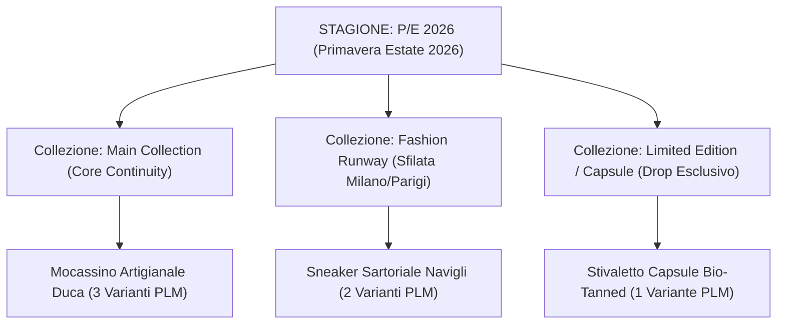

# Sprint 5 — Brand Positioning, UI/UX Simplification & Fashion Calendar Narrative (CMO Deliverable)

**Autore:** Chief Marketing Officer (CMO), Footlink  
**Data:** 19 Ottobre 2026  
**Riferimento Task:** `FTL-MKT-004` (Task Object CGO v1.0)  
**Stato:** Approvato per Revisione Founder  
**Classificazione:** Comunicazione Interna / Linee Guida di Posizionamento (Conforme Escalation L5)

---

## 1. Il Riposizionamento Strategico di Brand: "Dalla Burocrazia alla Bellezza del Processo"

Prima dello Sprint 5, il posizionamento di Footlink rischiava di apparire troppo tecnico e focalizzato unicamente sull'adempimento normativo del Passaporto Digitale UE (ESPR 2024/1781). I calzaturieri e i brand del lusso italiano, tuttavia, non comprano "burocrazia": comprano **controllo, eleganza operativa e velocità di campionamento**.

Con i quattro pilastri dello Sprint 5, Footlink perfeziona la propria promessa di valore:
> **"FOOTLINK OS: POTENZA INDUSTRIALE, SEMPLICITÀ SARTORIALE."**  
> *L'unico sistema operativo che unisce il ritmo delle collezioni moda all'ingegneria di fabbrica, con la purezza di un'interfaccia progettata per chi crea.*

---

## 2. Analisi della Trasformazione UI/UX: Il Principio Nike Design System v2.0

La direttiva del Founder (*"Semplificazione della UI che al momento risulta troppa piena di elementi a volte non utili al processo"*) ha guidato una rigorosa revisione estetica ed ergonomica:

### 2.1 Prima vs. Dopo la Semplificazione

```
[PRIMA - Sprint 4]                                   [DOPO - Sprint 5 (Semplificato)]
------------------------------------------------------------------------------------------------------
• Schermata affollata con tab multiple sovrapposte    • Header pulito con selettore globale Stagione
• Dati commerciali e industriali mescolati            • 7 Moduli chiari e dedicati al flusso reale
• Mancanza del contesto temporale di collezione       • Calendario Moda integrato (1 Stagione ↔ N Collezioni)
• Impossibilità di personalizzare i campi scheda      • Data Model Schema Studio in self-service
• Difficoltà per l'utente non tecnico                 • Spazio visivo respirabile, tipografia ad alto contrasto
```

### 2.2 I 7 Moduli di Processo Chiave

1. **Home Launchpad:** Cruscotto esecutivo con 5 KPI essenziali (SKU Master, Varianti PLM, Data Quality Score, Terzisti a 0 €, Stato DPP).
2. **01 Prodotti & Ponte 1:N:** Il cuore dell'architettura: 1 articolo commerciale in vendita governa N varianti di produzione con Distinta Base a scomparsa.
3. **02 Stagioni & Collezioni:** Il calendario temporale del campionario moda (P/E 2026, A/I 2026-27) con le linee di prodotto collegate.
4. **03 Anagrafiche di Dominio:** Tabelle master centralizzate per standardizzare canali, categorie, certificazioni e fornitori.
5. **04 Modello Dati Flessibile (Schema Studio):** Libertà totale per il Founder di estendere gli attributi di prodotto senza costi di sviluppo.
6. **05 Portale Terzisti 0 €:** L'interfaccia mobile per la filiera artigiana a costo zero.
7. **06 Passaporto Digitale DPP:** La destinazione finale: il cartellino QR conforme alla normativa europea.

---

## 3. Il Calendario Moda come Leva Emozionale di Marketing

La moda vive di ritmo e stagionalità. L'introduzione della logica **1 Stagione ↔ N Collezioni** risponde al modo naturale in cui lavorano Uffici Stile, Uffici Prodotto e Showroom:



### 3.1 I Vantaggi Narrativi per la Comunicazione B2B
- **Per il Direttore Creativo:** *"Il tuo campionario non è una lista di file Excel, ma una storia visiva organizzata per drop e sfilate."*
- **Per il Responsabile di Produzione:** *"Ogni variante tecnica di fabbrica sa esattamente a quale collezione appartiene e quali scadenze deve rispettare."*
- **Per il Buyer Showroom:** *"Esporta le schede prodotto omnicanale filtrate per stagione con prezzi wholesale corretti in un clic."*

---

## 4. Copywriting & Pacchetto Lancio L5 (Per Approvazione Founder)

In conformità con il protocollo **L5 (Nessuna pubblicazione esterna senza approvazione del Founder)**, si sottopone la bozza del comunicato LinkedIn e della newsletter per i distretti partner:

### Bozza Post LinkedIn B2B (Draft L5):
> **Perché i PLM tradizionali falliscono nella moda artigianale?**
>
> Perché pretendono di catalogare una scarpa o una borsa di lusso come se fosse un bullone o un pezzo meccanico. E ogni volta che vuoi aggiungere un campo — come l'altezza del tacco o la certificazione del pellame — devi pagare un consulente IT.
>
> In Footlink abbiamo ripensato tutto partendo dalla bottega e dalla sfilata:
> 1. **Gestione nativa di Stagioni e Collezioni:** Dalla P/E 2026 alla capsule di sfilata in un unico calendario fluido.
> 2. **Modello dati flessibile:** Aggiungi e correggi attributi in 30 secondi, senza toccare una riga di codice.
> 3. **Interfaccia essenziale:** Meno bottoni, più processo. Ispirata alla chiarezza visiva del Nike Design System.
> 4. **Rete terzisti a 0 €:** Perché la tracciabilità della filiera funziona solo se non costa un euro agli artigiani.
>
> Dal laboratorio artigiano al Passaporto Digitale UE. Senza attrito.
> 
> *Richiedi l'accesso anticipato al programma Design Partner Footlink per i distretti di Fermo, Scandicci e Riviera del Brenta.*

---

## 5. Sintesi Operativa CMO
La combinazione di un'interfaccia ripulita, del calendario moda strutturato e della flessibilità del modello dati consolida Footlink come **benchmark di categoria (Category Creator)** nel software manifatturiero del lusso sostenibile.
