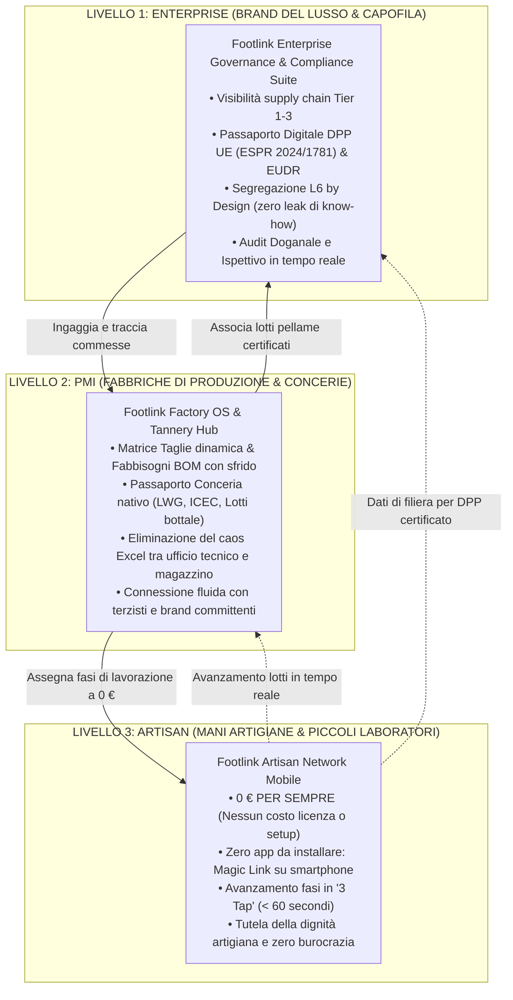
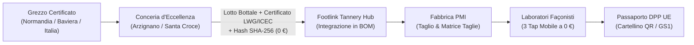
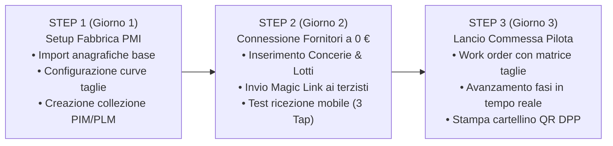
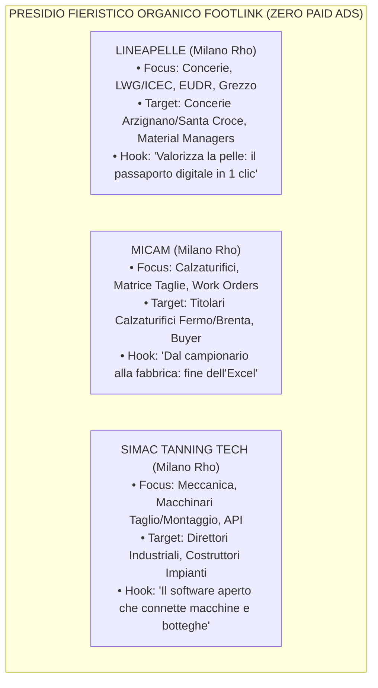

# Sprint 6 — Posizionamento Strategico, Messaging Differenziato e Piano di Comunicazione B2B: Piattaforma PaaS Distrettuale & Passaporto Conceria Footlink

**Autore:** Chief Marketing Officer (`footlink-cmo`)  
**Data:** 19 Ottobre 2026  
**Riferimento Task:** [`FTL-MKT-005`](../../tasks/FTL-MKT-005.json) (allineato a [`FTL-CEO-008`](../../tasks/FTL-CEO-008.json), [`FTL-PROD-006`](../../tasks/FTL-PROD-006.json), [`FTL-TECH-007`](../../tasks/FTL-TECH-007.json), [`FTL-REV-005`](../../tasks/FTL-REV-005.json))  
**Decision Record di Riferimento:** [`ADR-004`](../../adr/ADR-004-network-pricing-and-finops.md), [`ADR-006`](../../adr/ADR-006-unified-design-system-and-l6-cost-segregation.md), [`ADR-008`](../../adr/ADR-008-production-orders-tannery-traceability-subcontractor-lifecycle.md)  
**Vincolo di Governance:** **Zero Spesa Monetaria Autonoma (L2)** & **Gate L5 Comunicazione Esterna (Approvazione Founder)**  

---

## 1. Executive Summary & Visione di Mercato

Con lo **Sprint 6**, Footlink compie il passaggio strategico definitivo: da software specialistico di schede tecniche (PIM/PLM) a **Piattaforma PaaS Distrettuale Aperta** per i poli manifatturieri della moda italiana (Fermo-Macerata, Scandicci-Firenze, Riviera del Brenta, Arzignano, Solofra).

La ridefinizione delle priorità da parte del Founder sintetizza le tre anime della manifattura d'eccellenza:
1. **Pellami & Conceria:** il cuore della materia prima, con tracciabilità di lotto, conformità chimica (REACH) e certificazioni internazionali (**LWG, ICEC, EUDR, ESPR**).
2. **Matrice Taglie & Fabbisogni BOM con Sfrido:** il ponte operativo dell'ufficio tecnico che trasforma un disegno in consumo reale di materia e piano di taglio.
3. **Piattaforma PaaS Distrettuale su 3 Livelli:** la democratizzazione dell'accesso digitale per Enterprise (Brand del lusso), PMI (Fabbriche e Concerie) e Piccoli Laboratori Artigianali (**a 0 € per sempre**).

### Il Posizionamento di Categoria ("Category Design"):
> **"FOOTLINK DISTRICT PaaS: L'INFRASTRUTTURA DIGITALE APERTA DEL MADE IN ITALY."**  
> *Non un gestionale chiuso che impone costi a cascata, ma il sistema operativo di rete che connette brand del lusso, fabbriche d'eccellenza, concerie e botteghe artigiane. Tracciabilità totale dalla botte al consumatore, zero burocrazia, zero costi per chi lavora con le mani.*

---

## 2. Naming e Narrazione del PaaS Distrettuale per i 3 Livelli

I software tradizionali di filiera (PLM monolitici di derivazione meccanica o ERP pesanti) falliscono sistematicamente nei distretti per un errore di fondo: pretendono che tutti gli attori abbiano la stessa complessità organizzativa e impongono canoni "per utente" che i laboratori artigianali e i terzisti giustamente rifiutano.

Footlink introduce un'architettura di narrazione asimmetrica fondata sul **Modello a Rete (ADR-004)**:



---

### Livello 1 — Enterprise: "Footlink Enterprise Governance & Compliance Suite"
*Per i Brand del Lusso, Direzioni Industriali Internazionali e Grandi Gruppi di Moda.*

- **Target Persona:** Direttore Supply Chain, Chief Sustainability Officer, Responsabile Qualità & Conformità Doganale, Direttore IT/Operations.
- **Tagline:** *"Governa la filiera, certifica l'origine, proteggi il brand: conformità europea in tempo reale senza intermediari."*
- **La Narrazione di Valore:**
  I grandi marchi del lusso subiscono una pressione senza precedenti: consumatori esigenti, regolamenti europei stringenti (**ESPR 2024/1781** sul Passaporto Digitale, **EUDR** sulla deforestazione, direttiva sul Greenwashing) e rischi reputazionali legati ai sub-fornitori non dichiarati. 
  I Brand Enterprise non possono più accontentarsi di autodichiarazioni cartacee o PDF raccolti a fine stagione. Con Footlink Enterprise, il Brand ottiene una **torre di controllo (Control Tower)** della filiera reale:
  1. **Tracciabilità Granulare Tier 1–3:** Mappatura automatica della catena di fornitura, dalla conceria che ha lavorato il grezzo al laboratorio che ha cucito la tomaia.
  2. **Passaporto Digitale UE (DPP) Pronto alla Produzione:** Ogni singola commessa genera istantaneamente i dati di conformità verificati e il QR Code conforme a GS1 Digital Link.
  3. **Segregazione Industriale L6 ("Zero Data-Leakage"):** Tutela assoluta della privacy commerciale. I façonisti non vedono i costi delle pelli; le concerie non vedono i listini wholesale; il pubblico del passaporto digitale vede le certificazioni ambientali ma non le ragioni sociali private dei laboratori (protezione anti-poaching dei fornitori).
  4. **Audit Doganale Istantaneo:** Dossier analitico conforme a REACH SVHC (assenza Cromo VI < 3 ppm) pronto per i varchi doganali extra-UE.

---

### Livello 2 — PMI: "Footlink Factory OS & Tannery Hub"
*Per i Calzaturifici Manifatturieri, le Pelletterie Strutturate e le Concerie d'Eccellenza dei Distretti.*

- **Target Persona:** Titolare di Calzaturificio/Pelletteria, Responsabile Ufficio Tecnico/Modelleria, Direttore di Produzione, Titolare di Conceria.
- **Tagline:** *"Basta fogli Excel e ore perse tra tagliatori e magazzino: distinte base intelligenti, calcolo sfrido per taglia e lotti di concia certificati in un unico flusso."*
- **La Narrazione di Valore:**
  Le PMI sono il motore pulsante del Made in Italy, ma vivono strozzate tra le richieste burocratiche dei grandi committenti e il caos quotidiano di fabbrica: fogli Excel che si moltiplicano, calcoli manuali dello sfrido che portano ad acquisti errati di pellame, telefonate continue ai laboratori esterni per sapere a che punto è la produzione.
  Footlink Factory OS & Tannery Hub restituisce l'ordine e il controllo all'imprenditore manifatturiero:
  1. **Fine del Caos Excel:** Un'unica anagrafica centrale dove ogni articolo commerciale PIM governa le sue varianti tecniche PLM con distinte base (BOM) multi-livello a 3 livelli.
  2. **Matrice Taglie & Fabbisogni Dinamici con Sfrido:** Inserisci le paia per taglia (es. dalla 38 alla 46) e il sistema calcola istantaneamente i piedi quadri (sqft) o metri quadri (m²) lordi di pellame necessari, applicando le curve di calzata e le percentuali di scarto fisiologico. Mai più metri mancanti in fase di tranciatura o magazzini pieni di rimanenze inutilizzabili.
  3. **Passaporto Conceria Integrato (Tannery Hub):** La conceria non è più un fornitore passivo che allega un foglio di carta, ma un partner d'eccellenza. Il caricamento del lotto bottale associa automaticamente il rating **LWG (Gold/Silver/Bronze)**, la certificazione **ICEC (TS 410/412)** e l'origine del grezzo. Il pellame di qualità diventa un valore economico tracciato e non un costo anonimo.
  4. **Orchestrazione Fasi Senza Attrito:** Assegna le fasi (Taglio, Giunteria, Montaggio, Suolatura, Finissaggio) ai façonisti del territorio e visualizza lo stato di avanzamento in tempo reale su una pipeline Kanban trasparente.

---

### Livello 3 — Piccoli Laboratori: "Footlink Artisan Network Mobile"
*Per le Mani Artigiane: Tomaifici, Giunterie, Laboratori di Taglio, Orlatura, Montaggio e Finissaggio.*

- **Target Persona:** Artigiano titolare di laboratorio conto terzi, capoturno di giunteria, orlatrice, montatore di calzature.
- **Tagline:** *"Zero euro per sempre, zero burocrazia, nessuna app da scaricare. Solo il rispetto per il tuo lavoro artigiano."*
- **La Narrazione di Valore:**
  Il laboratorio artigianale è il custode del sapere pratico del Made in Italy, ma è anche il soggetto più sovraccarico e meno digitalizzato. I grandi software storici pretendono che l'artigiano acquisti costose licenze o impari complesse interfacce desktop piene di campi inutili.
  La promessa di Footlink per l'artigiano è sacra e non negoziabile:
  1. **0 € Per Sempre:** Nessun costo di licenza, nessun canone mensile, nessuna carta di credito richiesta. Il modello di rete Footlink sostiene interamente il costo di utilizzo dei façonisti tramite il piano del committente.
  2. **Nessun Software né App da Installare:** L'accesso avviene tramite un link sicuro usa-e-getta (**Magic Link**) o QR Code inviato via SMS o WhatsApp. Funziona su qualsiasi vecchio smartphone o tablet già presente in officina.
  3. **La Regola dei "3 Tap" (< 60 Secondi):**
     - *Tap 1:* Visualizza la bolla e convalida il lotto di materiale ricevuto.
     - *Tap 2:* Clicca "Inizia Lavorazione" quando la commessa sale al banco.
     - *Tap 3:* Clicca "Lavorazione Finita", dichiara le paia pronte e gli eventuali scarti.
  4. **Trasparenza e Zero Errori:** Niente più incomprensioni telefoniche sulle tolleranze o schede tecniche fotocopiate illeggibili: l'artigiano vede chiaramente solo le specifiche tecniche della fase assegnata, senza essere distratto o esposto a dati economici riservati.

---

## 3. Campagna di Thought Leadership & Content Marketing Organico (Zero Paid Ads)

### Titolo Ufficiale:
> **"La Rivoluzione della Conceria Digitale e il Passaporto UE ESPR/EUDR senza Burocrazia"**

### Il Framework di Thought Leadership:
Nel lusso calzaturiero e pellettiero, il pellame costituisce tra il **50% e il 70% del valore intrinseco**, ma è anche l'epicentro delle nuove regolamentazioni comunitarie:
- **ESPR (Regolamento UE 2024/1781):** obbligo di passaporto digitale con identificazione del lotto di fornitura, metodo di concia e durata utile.
- **EUDR (Regolamento UE 2023/1115):** obbligo di geolocalizzazione e prova di provenienza non legata a deforestazione per pelli grezze bovine.
- **Normative Chimiche REACH:** rigidi limiti su sostanze pericolose (Cromo VI < 3 ppm, assenza di formaldeide e metalli pesanti).

Mentre il mercato reagisce con panico, consulenze costose e moduli aggiuntivi da decine di migliaia di euro, Footlink posiziona la tracciabilità conciaria come **un vantaggio competitivo nativo per i distretti italiani**, digitalizzato direttamente sul banco di produzione a costo infrastrutturale nullo grazie ad hash crittografici SHA-256.



---

### Strategia SEO Tecnica B2B: Topic Cluster ad Alta Intenzione Manifatturiera

Per attrarre traffico organico qualificato (MQL) a **0 € di spesa pubblicitaria**, Footlink presidia quattro cluster di ricerca tecnica non colonizzati dai software generici:

| Cluster Tematico | Focus di Ricerca B2B (Distretti) | Asset di Conversione Inbound | Target Qualificato |
|---|---|---|---|
| **Cluster 1: Passaporto Conceria & Normative** | `passaporto digitale conceria lwg icec`, `tracciabilità lotti pelle eudr deforestazione`, `certificazione concia metal free reach espr` | White Paper Tecnico: *"Guida al Passaporto Digitale del Pellame per Calzature e Pelletteria"* | Concerie, Sustainability Manager Brand |
| **Cluster 2: Matrice Taglie & Fabbisogni BOM** | `calcolo fabbisogno pelle calzature matrice taglie`, `percentuale sfrido tomaia vitello calzaturificio`, `distinta base plm scarpe curve calzata` | Calcolatore Interattivo Web di Sfrido e Paia (Landing Demo) | Uffici Tecnici, Modellisti, Titolari PMI |
| **Cluster 3: Subfornitura & Conto Lavoro 0 €** | `software tracciabilita terzisti façon moda gratis`, `gestione commesse giunteria calzature cellulare`, `portale laboratori conto terzi lusso` | Caso Studio: *"Come connettere 15 façonisti a costo zero in 48 ore"* | Direttori Produzione, Responsabili Reparto |
| **Cluster 4: PaaS Distrettuale Made in Italy** | `plm moda distretto fermo macerata scandicci`, `software filiera calzaturiera riviera del brenta`, `piattaforma paas aperta manifattura moda` | Landing di Distretto Personalizzata & Richiesta Pilota | C-Level, Associazioni di Categoria |

---

### Dossier Uscite Organiche LinkedIn B2B (Bozze L5 per Approvazione Founder)

In conformità rigorosa al [Manifesto di Fondazione](../../Manifesto_Fondazione_Footlink.md) (Sezione 6.3 - Livello L5) e al [`Role_CMO_Footlink.md`](../roles/Role_CMO_Footlink.md), **nessun post verrà pubblicato senza l'approvazione scritta del Founder**.

#### 📝 Post LinkedIn 1 — Focus: La Conceria Digitale & Normativa UE (ESPR / EUDR)
- **Pubblico:** Direttori Sostenibilità, Titolari di Conceria, Responsabili Acquisti Brand Moda.
- **Testo Proposto:**
  > La pelle non è un pezzo di plastica stampato in serie.  
  > Ha una storia, una provenienza, una concia, una grana unica.  
  > 
  > Eppure, la maggior parte dei software PLM enterprise tratta il pellame come un codice alfanumerico anonimo su un foglio di calcolo. E quando entrano in vigore l’ESPR europeo (Passaporto Digitale) e le direttive EUDR sulla deforestazione, scatta il panico: cartelle piene di PDF cartacei scansionati, certificati LWG non indicizzati, controlli chimici REACH sparsi nelle email.
  > 
  > Con lo Sprint 6 di Footlink abbiamo integrato il **Passaporto Conceria Nativo**:
  > 🔹 Inserimento e verifica del lotto bottale direttamente nella Distinta Base (BOM).  
  > 🔹 Certificazioni di filiera tracciate: rating LWG (Gold/Silver), certificati ICEC TS 410/412, tipologia di concia (vegetale, metal-free, cromo).  
  > 🔹 Immutabilità garantita a costo zero tramite hash crittografico SHA-256 (niente blockchain inutili, zero canoni extra).  
  > 
  > Dalla botte al cartellino QR del consumatore. Il valore del Made in Italy non si difende con la burocrazia: si difende con la trasparenza.
  > 
  > 🔗 Scopri la dimostrazione interattiva nei commenti.
- **Hashtag:** `#MadeInItaly #Conceria #LWG #ICEC #PassaportoDigitale #ESPR #Footlink #FashionTech`

#### 📝 Post LinkedIn 2 — Focus: Il PaaS Distrettuale a Rete (La regola dello 0 € per i terzisti)
- **Pubblico:** Titolari di Calzaturifici, Pelletterie, Imprenditori dei distretti di Fermo, Scandicci, Brenta.
- **Testo Proposto:**
  > Chiedere a un piccolo laboratorio di giunteria o a un tomaificio di pagare 50 euro al mese per collegarsi al software del brand è il modo più veloce per far fallire qualsiasi progetto di digitalizzazione.
  > 
  > Nei distretti calzaturieri la fiducia è fatta di sguardi, consegne puntuali e mani esperte. Se introduci barriere economiche o schermate complicate, la risposta sarà sempre la stessa: *"Mandami la bolla su WhatsApp che facciamo prima"*.
  > 
  > La nostra scelta in Footlink è radicale e definitiva:
  > **I laboratori terzisti non pagheranno mai un singolo euro. 0 € forever.**
  > 
  > ✅ Nessun costo di licenza o di attivazione.  
  > ✅ Nessuna password da ricordare: si accede via Magic Link da smartphone.  
  > ✅ Tre soli clic: accetta lotto, inizia lavorazione, conferma scarpe pronte.  
  > ✅ Segregazione totale dei costi: il terzista vede solo le istruzioni della sua fase, senza toccare listini o segreti commerciali del brand.
  > 
  > Un'infrastruttura di filiera funziona solo quando include tutti. Dal più grande brand del lusso alla bottega artigiana.
  > 
  > Chi fa manifattura lo sa bene. Chi progetta software da una scrivania a San Francisco, no.
- **Hashtag:** `#ManifatturaItaliana #Calzaturificio #Pelletteria #DistrettiModa #SupplyChain #Footlink`

#### 📝 Post LinkedIn 3 — Focus: Matrice Taglie & Fabbisogni BOM con Sfrido
- **Pubblico:** Uffici Tecnici, Modellisti Calzature/Pelletteria, Direttori di Stabilimento.
- **Testo Proposto:**
  > Quanti piedi quadri di pelle servono davvero per produrre 1.200 paia di mocassini con una curva taglie dal 39 al 46?
  > 
  > Chi lavora sul banco sa che calcolare il consumo su una taglia base (es. il 42) e moltiplicarlo a spanne è la ricetta sicura per due disastri: fermare le manovie a metà commessa per mancanza di materiale, oppure riempire il magazzino di pelli comprate in eccesso che non userai mai.
  > 
  > Nel nuovo modulo **Work Orders Hub di Footlink**:
  > 📐 Matrice Taglie dinamica con curve di calzata parametrizzate.  
  > ✂️ Calcolo istantaneo del fabbisogno lordo con gestione differenziata dello sfrido per tipologia di pellame (vitello, camoscio, abrasivato).  
  > 📦 Aggancio automatico tra la commessa, il lotto di concia in ingresso e le bolle di fase per i façonisti esterni.
  > 
  > Meno calcoli sui fogli volanti. Più precisione in produzione.
  > 
  > Stiamo aprendo i test per 5 calzaturifici pilota nei distretti di Fermo, Civitanova e Riviera del Brenta. Scrivimi in privato per vedere la demo.
- **Hashtag:** `#ProductDevelopment #UfficioTecnico #Modelleria #Calzature #BOM #PLMModa`

---

## 4. Kit di Sales Enablement per il CRO

A supporto delle attività commerciali del Chief Revenue Officer (`footlink-cro`), questo kit fornisce strumenti concreti per abbattere le frizioni d'acquisto e velocizzare l'onboarding nei distretti.

### 4.1 One-Pager Esecutivo: "Footlink District PaaS" (Sintesi per Incontri B2B)

```
┌────────────────────────────────────────────────────────────────────────────────────────────────────────┐
│ FOOTLINK DISTRICT PaaS · L'Infrastruttura Digitale dei Distretti Manifatturieri                        │
├────────────────────────────────────────────────────────────────────────────────────────────────────────┤
│ IL PROBLEMA:                                                                                           │
│ • Normative UE stringenti (Passaporto Digitale ESPR 2024/1781, Anti-Deforestazione EUDR).              │
│ • La frammentazione della filiera: dati critici dispersi tra fogli Excel, WhatsApp e faldoni cartacei. │
│ • I PLM enterprise tradizionali costano 50.000 €+, richiedono 6 mesi di setup e impongono licenze      │
│   a pagamento ai terzisti, bloccando l'adozione reale.                                                 │
├────────────────────────────────────────────────────────────────────────────────────────────────────────┤
│ LA SOLUZIONE FOOTLINK: 3 LIVELLI, 1 SOLA RETE CONDIVISA                                                │
│                                                                                                        │
│ 👑 LIVELLO 1: BRAND ENTERPRISE                                                                         │
│    Control Tower di filiera Tier 1-3. Generazione automatica Passaporto Digitale DPP UE.              │
│    Segregazione L6 by design: zero rischio di data-leakage sui costi e tutela dei segreti industriali.  │
│                                                                                                        │
│ 🏭 LIVELLO 2: PMI FABBRICHE & CONCERIE                                                                 │
│    Gestione schede tecniche 1:N, distinte base multi-livello e Matrice Taglie con calcolo sfrido.     │
│    Tannery Hub per associare lotti bottale, rating LWG Gold/Silver e certificati ICEC in un clic.     │
│                                                                                                        │
│ 🛠️ LIVELLO 3: PICCOLI LABORATORI & ARTIGIANI                                                           │
│    0 € PER SEMPRE. Zero costi di setup, zero canoni per postazione.                                    │
│    Avanzamento fasi da qualsiasi smartphone in "3 Tap" via Magic Link sicuro (< 60 secondi).           │
├────────────────────────────────────────────────────────────────────────────────────────────────────────┤
│ PERCHÉ FOOTLINK VINCE SUL CAMPO:                                                                       │
│ 1. Zero Attrito: Nessun software da installare per i terzisti, adozione immediata della rete.          │
│ 2. Fabbisogni Reali: Matrice Taglie e calcolo consumi pellami tarato sui distretti calzaturieri.       │
│ 3. Passaporto Verificato: Conformità doganale e sostenibilità comprovata con impronta SHA-256 a 0 €.   │
│ 4. Prezzo Sostenibile: Canone mensile trasparente per le PMI, 0 € per i laboratori partner.            │
├────────────────────────────────────────────────────────────────────────────────────────────────────────┤
│ CONTATTI: distretti@footlink.it · www.footlink.it · Fermo · Scandicci · Riviera del Brenta             │
└────────────────────────────────────────────────────────────────────────────────────────────────────────┘
```

---

### 4.2 Playbook di Onboarding del Distretto ("District Activation in 3 Step")

Guida operativa in 3 passi per portare a regime una fabbrica e la sua rete di laboratori in meno di 72 ore:



1. **Step 1: Attivazione Fabbrica/PMI (Effort: 4 ore)**
   - Caricamento delle scale taglie utilizzate (es. Donna 35-42 o Uomo 39-46 con taglia campione di riferimento).
   - Inserimento delle prime 3 distinte base (BOM) con indicazione dei componenti tomaia, fodera, suola.
2. **Step 2: Connessione Concerie e Terzisti (Effort: 2 ore, Costo: 0 €)**
   - Registrazione nell'anagrafica fornitori delle concerie partner con rating LWG/ICEC.
   - Associazione dei numeri telefonici/email dei 5 façonisti chiave (taglio, giunteria, montaggio).
   - Generazione automatica dei Magic Link per smartphone: il terzista clicca e apre la sua schermata senza registrazioni o password.
3. **Step 3: Commessa Pilota & Verifica DPP (Effort: 1 giorno di produzione reale)**
   - Emissione della commessa di fabbrica con quantità ripartite per taglia.
   - Calcolo automatico dei fabbisogni lordi di pellame con applicazione dello sfrido.
   - Avanzamento a tappe: il façonista conferma la presa in carico del lotto e la fine della giunteria in 3 tap.
   - Generazione immediata del cartellino QR con Passaporto Digitale del Prodotto verificato.

---

### 4.3 Battlecard Commerciale: Gestione delle 4 Obiezioni di Distretto

| Obiezione del Cliente | Perché la fanno | La Risposta Strategica del CRO / Sales | Prova Tangibile / Demo Footlink |
|---|---|---|---|
| **1. "I nostri laboratori façonisti hanno 60 anni, usano carta e penna e non useranno mai un computer."** | Paura del fallimento per rigetto della tecnologia da parte dei fornitori storici. | *"Hanno perfettamente ragione: nessuno deve costringerli a stare davanti a un PC. Footlink per loro è solo un messaggio su WhatsApp o SMS con un link sicuro. Si apre un bottone verde grande come una calcolatrice: confermano il lotto e premono fine lavorazione in 20 secondi. Nessun programma da imparare."* | Mostrare il Portale Mobile Terzisti su smartphone (Modulo 05) durante l'incontro: 3 clic cronometrati. |
| **2. "Le nostre concerie partner ci mandano certificati cartacei o via mail a fine fornitura."** | Mancanza di un processo strutturato di ricezione dei certificati ambientali. | *"Oggi questo vi espone a gravi sanzioni per l'ESPR e l'EUDR. Con Footlink basta caricare il PDF del certificato o indicare il codice lotto bottale una sola volta: la piattaforma estrae i dati LWG/ICEC, ne fissa l'impronta digitale e li collega automaticamente a tutte le scarpe prodotte con quel pellame."* | Dimostrazione del Tannery Hub con caricamento certificato e associazione istantanea alla BOM. |
| **3. "Non vogliamo che i terzisti vedano i nostri costi o che i competitor scoprano i nostri laboratori."** | Difesa vitale del know-how e timore di supplier poaching o fughe di margine. | *"La privacy industriale è il cardine architetturale di Footlink (Livello di sicurezza L6). I laboratori vedono solo le quote taglia e le istruzioni tecniche di fase: nessun prezzo, nessun costo materia prima, nessun margine. E nel passaporto pubblico i nomi dei terzisti sono protetti."* | Mostrare la differenza visiva tra la schermata Brand (completa di costi) e la schermata Terzista (solo dati operativi). |
| **4. "Abbiamo già visto Centric PLM o Lectra: perché dovremmo scegliere Footlink?"** | Associazione mentale errata con i colossi software legacy costosi e lenti. | *"Centric e Lectra nascono per i colossi con budget da centinaia di migliaia di euro e pretendono licenze a pagamento anche per chi cuce le scarpe. Footlink costa una frazione, è pronto in 3 giorni, azzera i costi per i terzisti ed è nativo sul Passaporto Digitale UE per il Made in Italy."* | Tabella TCO (Total Cost of Ownership): 0 € setup + 0 € terzisti vs 40.000 € setup + canoni per-seat forzati. |

---

## 5. Posizionamento per le Prossime Fiere di Settore

Le fiere sono il punto di aggregazione fisica dei distretti. Coerentemente con la **Policy Zero Paid Ads (L2)**, la strategia non prevede investimenti in stand faraonici o pubblicità a pagamento, bensì **presidio territoriale, networking qualificato e thought leadership mirata**.



---

### 5.1 LINEAPELLE (Milano Rho — Concerie, Pellami & Accessori)
- **Posizionamento Tematico:** *"La Pelle d'Eccellenza Incontra il Passaporto Digitale: da Costo di Fornitura ad Asset di Trasparenza Certificato."*
- **Obiettivo Primario:** Ingaggiare 15 concerie leader dei distretti di Arzignano (Veneto), Santa Croce sull'Arno (Toscana) e Solofra (Campania), proponendo Footlink come canale preferenziale per valorizzare i pellami certificati LWG/ICEC presso i brand della moda.
- **Tattica "On-the-Field" Organica:**
  - **Mini-Audit di Conformità Passaporto (3 Minuti su Tablet):** I membri della C-Suite visitano gli stand delle concerie con un tablet e mostrano in tempo reale come un lotto di vitello o camoscio della conceria viene trasformato in una scheda passaporto conforme a ESPR/EUDR con rating LWG verificato.
  - **Gancio Commerciale per la Conceria:** *"I vostri clienti Brand vi chiedono certificati continui e dati per il DPP? Date loro accesso al vostro hub Footlink: zero burocrazia per voi, tracciabilità istantanea per loro."*

---

### 5.2 MICAM (Milano Rho — Calzature & Manifattura Internazionale)
- **Posizionamento Tematico:** *"Basta Caos tra Campionario e Produzione: Matrice Taglie, Fabbisogni con Sfrido e Terzisti Connessi a 0 €."*
- **Obiettivo Primario:** Convertire calzaturifici medi e PMI conto terzi/proprio dei distretti marchigiano e veneto nel programma **Design Partner Pilota Q1**.
- **Tattica "On-the-Field" Organica:**
  - **Dimostrazione su Modello Reale:** Mostrare dal vivo su uno smartphone la scansione del cartellino di un mocassino marchigiano reale, aprendo sia la vista passaporto B2C per lo showroom sia il Work Orders Hub di fabbrica con la curva taglie.
  - **Biglietto da Visita Interattivo:** Badge e cartoncini stampati in cartone riciclato con solo il logo Footlink, un QR Code e la scritta: *"Scannerizza per vedere il futuro del tuo calzaturificio. 0 € per i tuoi terzisti."*

---

### 5.3 SIMAC TANNING TECH (Milano Rho — Macchinari & Tecnologie Calzaturiere e Conciarie)
- **Posizionamento Tematico:** *"L'Infrastruttura Software Aperta che Integra Macchinari CAD/CAM, Linee di Taglio e Manoviali."*
- **Obiettivo Primario:** Posizionare Footlink come layer software interoperabile (OpenAPI) complementare ai costruttori di macchine da taglio (es. Atom, Comelz) e impianti di suolatura/montaggio.
- **Tattica "On-the-Field" Organica:**
  - Dialogo con i responsabili tecnici dei produttori di macchinari per dimostrare come Footlink esporta la matrice taglie e i fabbisogni BOM direttamente compatibili con i software di piazzamento e tranciatura, evitando doppi inserimenti manuali per gli operai.

---

### 5.4 Calendario di Campagna Organica Pre/During/Post Fiera (Zero Paid Ads)

1. **Pre-Fiera (-14 giorni):** Pubblicazione su LinkedIn di articoli di thought leadership sulle novità normative ESPR/EUDR che entreranno in vigore per calzature e pelli, con invito a fissare un caffè tecnico informale di 15 minuti durante i giorni di fiera.
2. **Durante la Fiera (Giorni Live):** Condivisione quotidiana di brevi scatti di retroscena dal quartiere fieristico ("Cosa chiedono davvero le concerie di Arzignano sulla tracciabilità?", "Perché il tema dello sfrido pellami è esploso al MICAM"), generando conversazioni dirette e richieste di demo via messaggio privato.
3. **Post-Fiera (+7 giorni):** Recap dossier inviato a tutti i contatti qualificati raccolti, contenente il One-Pager PaaS Distrettuale, il calcolatore di sfrido e l'invito al programma pilota gratuito di 30 giorni.

---

## 6. Matrice di Governance CMO & Protocollo di Validazione L5

In ossequio al [Manifesto di Fondazione](../../Manifesto_Fondazione_Footlink.md) (Sezione 6.3):

| Requisito di Governance | Vincolo Rispettato | Note Operative CMO |
|---|---|---|
| **Zero Spesa Monetaria (L2)** | ✅ **100% Rispettato (0,00 € Spesa Ads)** | Nessun budget allocato a LinkedIn Ads, Meta Ads o agenzie esterne. Tutta la trazione è generata da contenuti organici, SEO tecnica e relazioni dirette. |
| **Segregazione Dati Industriali (L6)** | ✅ **100% Rispettato** | Tutti i materiali di marketing, le landing page e i mock-up promozionali oscurano e segregano rigidamente i costi unitari e i margini del brand. |
| **Approvazione Comunicazioni Esterne (L5)** | ⏳ **In Attesa Approvazione Founder** | I testi dei 3 post LinkedIn e del One-Pager contenuti nel presente documento costituiscono la proposta ufficiale del CMO sottomessa formalmente al Founder. |

---

## 7. Prossimi Passi Esecutivi per il CMO

1. **Sottomissione Formale al Founder:** Presentare la presente proposta strategica per il confronto di C-Suite e attendere il sign-off per lo sblocco del Gate L5.
2. **Allineamento con il CRO (`footlink-cro`):** Consegna del kit di sales enablement (One-pager e script di gestione obiezioni) per l'avvio della campagna di contatto diretto con i 10 calzaturifici target del distretto di Fermo-Macerata.
3. **Supporto al CPO (`footlink-cpo`):** Verifica del micro-copy e dei badge conciari (LWG, ICEC, Concia Vegetale) nell'interfaccia utente del Passaporto Digitale e del Work Orders Hub.
4. **Monitoraggio KPI Organici:** Verifica settimanale del traffico organico sul blog tecnico, delle interazioni del profilo aziendale LinkedIn e del numero di MQL passati al team vendite.
