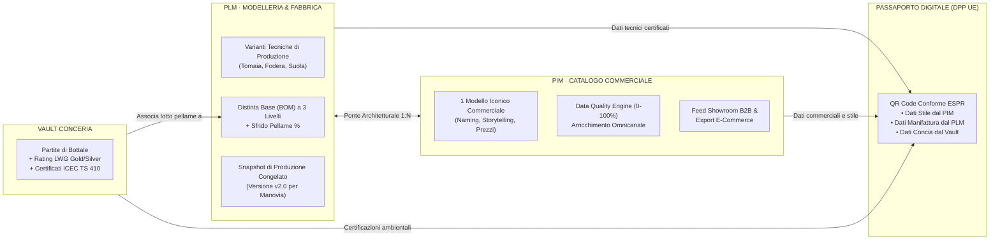

# Sprint 6 — Naming System, Microcopy per il Lusso Manifatturiero e Narrazione Integrata "PLM Fabbrica + PIM Omnicanale"

**Autore:** Chief Marketing Officer (`footlink-cmo`)  
**Data:** 19 Ottobre 2026  
**Destinatari:** Founder, CEO, CPO, CTO, CGO, CRO  
**Riferimento Strategico:** Direttive del Founder per la riorganizzazione dello Sprint 6 · [Manifesto di Fondazione](../../Manifesto_Fondazione_Footlink.md) · [`ADR-003`](../../adr/ADR-003-domain-model-1-to-n-pim-plm.md) · [`ADR-006`](../../adr/ADR-006-unified-design-system-and-l6-cost-segregation.md) · [`ADR-008`](../../adr/ADR-008-production-orders-tannery-traceability-subcontractor-lifecycle.md)  
**Governance:** Gate L5 (Approvazione Founder) · Vincolo L2 (Zero Paid Ads) · Segregazione L6  

---

## 1. Executive Summary: La Riorganizzazione dell'Applicazione

In attuazione delle 4 direttive impartite dal Founder:
1. **Creazione dell'area autonoma `PLM · PRODOTTI & INGEGNERIA BOM`:** separazione netta dello spazio di ingegneria, modelleria, distinte base multi-livello e calcolo sfrido.
2. **Ristrutturazione del Modulo 04 come `PIM · CATALOGO COMMERCIALE & FEED MULTI-CANALE`:** focalizzazione sulla gestione commerciale di stile, arricchimento attributi, data quality score e syndication omnicanale (Showroom B2B, E-Commerce, Passaporto Digitale DPP).
3. **Revisione del Vault Conceria con terminologia professionale di lusso:** adozione del lessico conciario reale dei distretti (Arzignano, Santa Croce, Solofra), upload documentale effettivo di certificazioni PDF (LWG, ICEC, REACH) e importazione lotti da file Excel/bolle fornitore.
4. **Stand-by temporaneo del Modulo 02 Work Orders Hub:** congelamento della vista commesse in attesa del completamento del binomio PLM/PIM e del Vault Conceria.

Il presente documento definisce:
- L'impianto di **naming e vocabolario di lusso manifatturiero** per ciascun modulo.
- La **narrazione di posizionamento B2B sul valore combinato `PLM + PIM`** per i brand della moda e i calzaturifici.
- Le **linee guida di copy ed ergonomia UI** per guidare CPO e frontend engineering nell'aggiornamento dell'interfaccia.

---

## 2. Nuovo Impianto di Naming & Vocabolario del Lusso Manifatturiero

I software generici falliscono nei distretti della moda perché usano termini astratti mutuati dal software gestionale aziendale o dall'ingegneria meccanica ("Articoli", "Magazzino", "Entità", "Allegati", "Distinte generiche"). Footlink adotta il linguaggio nobile, rigoroso e concreto dei **maestri calzaturieri, modellisti e conciatori italiani**.

### 2.1 Mappa di Navigazione Riorganizzata (Navigation Bar)

```
┌────────────────────────────────────────────────────────────────────────────────────────────────────────────────────────┐
│ FOOTLINK OS · DESIGN SYSTEM V2.0                                                                                      │
├────────────────────────────────────────────────────────────────────────────────────────────────────────────────────────┤
│ [Home Launchpad]                                                                                                       │
│ [01 PaaS Distretto & Utenti]                                                                                           │
│ [02 Work Orders Hub] ➔ Badge: [STAND-BY SPRINT 6.2]                                                                   │
│ [03 Vault Conceria & Tracciabilità Pellami]                                                                            │
│ [04 PIM · Catalogo Commerciale & Feed Canali]                                                                          │
│ [05 PLM · Modelleria & Ingegneria BOM] ➔ [NUOVA AREA AUTONOMA]                                                         │
│ [06 Stagioni & Collezioni]                                                                                             │
│ [07 Anagrafiche di Dominio]                                                                                            │
│ [08 Modello Dati Flessibile]                                                                                           │
│ [09 Portale Terzisti 0 €]                                                                                              │
│ [10 Passaporto Digitale DPP]                                                                                           │
└────────────────────────────────────────────────────────────────────────────────────────────────────────────────────────┘
```

---

### 2.2 Area Autonoma: `PLM · MODELLERIA & INGEGNERIA BOM`

- **Denominazione Estesa UI:** `PLM · Modelleria, Varianti & Distinta Base (BOM)`
- **Sottotitolo / Header Description:**  
  *"Dalla forma di legno al banco di taglio. Ingegnerizzazione delle varianti tecniche di fabbrica, distinta base a 3 livelli, calcolo consumi al millimetro e snapshot di produzione congelati."*
- **Sezioni Interne & Vocabolario:**
  1. **Selettore Variante di Modelleria (SKU PLM):**  
     - *Invece di "Codice variante":* `Codice Forma & Variante Tecnica` (es. `PLM-DUCA-NERO-SUOLA-CUOIO`)
     - *Invece di "Stato":* `Stato di Industrializzazione` (`Prototipo in Sviluppo`, `Campione Approvato`, `Ingegnerizzato per Manovia`, `BOM Congelata v2.0`)
  2. **Ingegneria di Calzata & Specifiche di Reparto:**  
     - Campi guidati: `Codice Forma / Tronchetto`, `Spessore Soletto di Montaggio`, `Altezza Tacco (mm)`, `Calzata Manifatturiera (Regular / Wide / Slim)`, `Fattore di Gradazione Sfrido (%)`.
  3. **Struttura Distinta Base (BOM) a 3 Livelli:**  
     - *Livello 1 — Anatomia del Manufatto:* Tomaia, Fodera, Soletto, Intersuola, Battistrada, Tacco, Minuterie, Confezionamento.
     - *Livello 2 — Materie Prime Selezionate:* Vitello Pieno Fiore Concia Vegetale, Nappa Fodera Traspirante, Cuoio Suola Lenta Concia, Ottone Massiccio Anti-Tarnish.
     - *Livello 3 — Partite Conceria & Tracciabilità di Botte:* Associazione univoca al lotto registrato nel Vault Conceria con verifica analitica.
  4. **Costing Industriale Riservato (Segregazione L6):**  
     - Etichetta chiara: `Costo Industriale di Fabbricazione (Riservato Committente · Segregato L6)`.

---

### 2.3 Ristrutturazione Modulo 04: `PIM · CATALOGO COMMERCIALE & FEED MULTI-CANALE`

- **Denominazione Estesa UI:** `PIM · Catalogo Commerciale, Stile & Syndication Feed`
- **Sottotitolo / Header Description:**  
  *"La voce del brand sui mercati globali. Scheda stile omnicanale, pricing wholesale/retail, data quality score e generazione feed automatici per showroom B2B, e-commerce e Passaporto Digitale."*
- **Sezioni Interne & Vocabolario:**
  1. **Anagrafica Stile & Identità Commerciale:**  
     - *Invece di "Nome Prodotto":* `Modello Commerciale & Linea di Stile` (es. *"Mocassino Tradizione Marche - Linea Duca"*)
     - *Campi di Comunicazione:* `Storytelling di Collezione`, `Famiglia Merceologica`, `Codice Doganale Internazionale TARIC (HS Code 6403.59.95)`, `Codice EAN / GTIN Univoco`.
  2. **Listini & Condizioni Commerciali:**  
     - `Prezzo Wholesale Valuta Base (€)`, `Prezzo Retail Suggerito Showroom (€)`, `Mercati di Distribuzione Attivi (EU, USA, APAC, UK)`.
  3. **PIM Data Quality Engine (Score 0–100%):**  
     - Indicatore di completezza: `Indice di Prontezza Commerciale & Normativa (Data Quality Score)`.
     - Checklist qualitativa: Immagini Lookbook HD, Descrizione Bilingue (IT/EN), Istruzioni di Cura & Risuolatura, Collegamento ad almeno 1 Variante PLM con BOM completa.
  4. **Syndication Hub & Esportazione Feed:**  
     - Pulsanti export: `Genera Feed Showroom B2B (PDF Lookbook)`, `Esporta Catalogo E-Commerce (Shopify / Farfetch JSON)`, `Invia Dati al Passaporto Digitale UE (DPP API)`.

---

### 2.4 Vault Conceria: Vocabolario Professionale, Upload PDF & Import Excel

Per allinearsi alla realtà delle concerie italiane (Arzignano, Santa Croce, Solofra) e superare la terminologia generica:

| Termine Generico (Precedente) | Nuovo Termine Professionale Footlink | Rationale di Lusso & Filiera Conciaria |
|---|---|---|
| *Fornitore* | **Conceria Partner d'Eccellenza** | Valorizza il ruolo primario della conceria come partner artigianale e non semplice fornitore. |
| *Codice Lotto* | **Partita di Concia / Lotto di Bottale** | Nel gergo conciario il lotto è legato alla "bottalata" chimica specifica, determinante per nuance e mano. |
| *Materiale* | **Tipologia Grezzo, Selezione & Grana** | Identifica il tipo di pelle reale (*Vitello Pieno Fiore*, *Vitellone Francese*, *Camoscio Rovesciato*, *Agnello Plongé*). |
| *Concia* | **Metodo Conciario & Chimica di Processo** | Distinzione rigorosa tra *Concia al Vegetale Slow-Tanned (Tannini di Castagno)*, *Wet-White Metal-Free*, *Al Cromo Selezionato*. |
| *Certificato* | **Audit Leather Working Group (LWG) & Rating** | Presenza del livello ufficiale (*Gold*, *Silver*, *Bronze*, *Audited*) con numero identificativo verificabile. |
| *Tracciabilità* | **Certificazione di Filiera ICEC (TS 410 / TS 412)** | Lo standard italiano d'eccellenza per la tracciabilità delle pelli dal macello alla calzatura finita. |
| *Sicurezza* | **Capitolato Chimico REACH & Assenza Cromo VI** | Conferma analitica di laboratorio: Cromo VI < 3 ppm, assenza SVHC, formaldeide libera < 20 mg/kg. |
| *Allegati* | **Dossier Documentale PDF con Hash SHA-256** | Caricamento effettivo del file PDF originale con calcolo locale dell'impronta crittografica a costo zero. |
| *Importazione* | **Import Partite da Bolla Conceria (Excel / CSV)** | Acquisizione massiva delle bolle di consegna della conceria senza digitazione manuale di ogni partita. |

#### Microcopy per le 2 Nuove Funzionalità del Vault Conceria:
1. **Upload Reale Certificato PDF (Drag & Drop):**  
   - Header Box: `Carica Certificato Ufficiale di Concia (.PDF)`
   - Helper text: *"Trascina qui il certificato LWG, il certificato di tracciabilità ICEC o il test report chimico rilasciato dal laboratorio accreditato. Il sistema calcolerà l'impronta crittografica SHA-256 per garantire l'immutabilità del documento nel Passaporto Digitale senza costi di blockchain."*
   - Pulsante: `Seleziona Documento PDF da Archivio`
2. **Import Partite Conceria da Bolla Excel (.XLSX / .CSV):**  
   - Header Box: `Importazione Automatica Partite da Bolla di Consegna (.XLSX / .CSV)`
   - Helper text: *"Carica il file Excel o CSV inviato dalla conceria. Il parser Footlink mapperà automaticamente codice partita, mq forniti, spessore mm, paese d'origine del grezzo e rating LWG."*
   - Pulsante: `Importa File Bolla Fornitore`

---

### 2.5 Gestione Visiva & Microcopy per lo Stand-By del Modulo 02

In conformità con la direttiva del Founder di mettere in **stand-by temporaneo il Modulo 02 Work Orders Hub**:

- **Etichetta nel Navigation Menu:**  
  `02 Work Orders Hub` accompagnato da un badge pill visibile: `[STAND-BY TEMPORANEO · ROADMAP SPRINT 6.2]`
- **Comportamento al Clic / Schermata di Cortesia (Stand-by State):**  
  Se l'utente naviga sul Modulo 02, l'applicazione mostra una schermata ordinata ed elegante (non un errore 404):
  - *Icona:* Clessidra minimalista o ingranaggio di precisione fermo.
  - *Titolo:* **"Work Orders Hub & Matrice Taglie · Stand-by Temporaneo di Allineamento"**
  - *Corpo del Messaggio:*  
    *"In accordo con le direttive di ingegnerizzazione di Sprint 6, il modulo di pianificazione commesse è temporaneamente in stand-by per completare l'autonomia del PLM di Fabbrica e la tracciabilità delle partite nel Vault Conceria.*  
    *I dati delle scale taglie e delle lavorazioni restano preservati e saranno riattivati nello Sprint 6.2 con l'integrazione del lancio commesse."*
  - *Call to Action secondaria:* `Vai all'Ingegneria PLM ➔` oppure `Torna al Catalogo Commerciale PIM ➔`

---

## 3. Narrazione di Marketing: Il Valore Combinato "PLM Fabbrica + PIM Omnicanale"

### 3.1 La Frattura Storica nei Brand della Moda

Nel mondo calzaturiero e della pelletteria di alta gamma esiste da sempre una **frattura invisibile e dannosa** tra due dipartimenti aziendali:

```
[UFFICIO COMMERCIALE, SHOWROOM & E-COMMERCE]            [UFFICIO TECNICO, MODELLERIA & FABBRICA]
              (MONDO PIM)                                              (MONDO PLM)
• Guarda all'emozione, allo stile, alle vendite         • Guarda alla forma, alle fustelle, alle tolleranze
• Vuole immagini editoriali e descrizioni seducenti     • Vuole consumi in piedi quadri e tolleranze millimetriche
• Vende "1 Modello Unico" ai buyer globali              • Produce "N Varianti Diverse" su stabilimenti diversi
• Ignora le complessità delle normative di filiera      • È sommerso da schede tecniche cartacee e fogli Excel
```

**La conseguenza disastrosa:** Quando entra in vigore il Passaporto Digitale Europeo (Reg. ESPR 2024/1781), l'Ufficio Commerciale non sa dove recuperare i dati dei lotti di concia, mentre l'Ufficio Tecnico non ha il tempo di compilare file burocratici. Il risultato è il caos operativo, ritardi nelle consegne e sanzioni doganali.

---

### 3.2 Il Posizionamento Footlink: "Due Stanze Dedicate, Una Sola Sorgente di Verità"

Footlink elimina questa frattura senza costringere nessuno dei due mondi ad adattarsi al linguaggio dell'altro:

> **"DALLA FORMA AL FEED. DALLA BOTTE ALLO SHOWROOM."**  
> *Footlink separa ciò che deve essere separato e unisce ciò che deve essere tracciato. Il PLM dà ai tecnici lo spazio rigoroso per ingegnerizzare il prodotto; il PIM dà ai commerciali la potenza di distribuirlo nel mondo. Il Passaporto Digitale UE nasce al centro, perfetto e automatico, senza che nessuno debba fare straordinari."*



---

### 3.3 I Vantaggi Competitivi per i 3 Livelli Decisionali del Brand

1. **Per il Direttore Creativo & Commerciale (Chief Commercial Officer / CCO):**  
   *"Non verrai mai distratto da codici fustella o formule di consumo pellame. Il tuo catalogo PIM gestisce immagini, prezzi wholesale, descrizioni in 4 lingue e ti dice con una barra verde se il prodotto è pronto per essere venduto negli showroom o online."*
2. **Per il Direttore Industriale & Modellista (Head of Manufacturing):**  
   *"Nessun ufficio commerciale potrà più modificare per errore una distinta base approvata. La tua area PLM ti consente di prototipare, congelare gli snapshot di produzione, calcolare lo sfrido e collegare i lotti di conceria in totale autonomia."*
3. **Per il Direttore Sostenibilità & Legal (Chief Sustainability Officer / CSO):**  
   *"Il Passaporto Digitale UE (ESPR) non richiede una task force dedicata: eredita la bellezza dallo stile del PIM, la verità dai materiali del PLM e la conformità dai certificati LWG del Vault Conceria."*

---

## 4. Linee Guida di Copy per la Nuova Interfaccia Utente

In coerenza con il **Design System v2.0 (Nike-Inspired Editorial Minimalism)**, l'interfaccia deve parlare un italiano autorevole, conciso, privo di ambiguità e orientato all'azione.

### 4.1 Principi Cardine di Microcopy
1. **Verbi all'Infinito o Imperativi Chiari nei Pulsanti:**  
   - ❌ *No:* "Nuovo elemento", "Fatto", "Aggiorna", "Clicca qui"  
   - ✅ *Sì:* `Crea Variante di Modelleria`, `Importa Partite da Bolla (.xlsx)`, `Carica Certificato Ufficiale (.pdf)`, `Congela Snapshot BOM`, `Genera Cartellino DPP`.
2. **Tipografia High-Contrast & Lessico Tecnico Preciso:**  
   - Uso di font Display Condensed per titoli e codici di modello.  
   - Mai usare "Pelle" generica: specificare sempre grana e lavorazione (*Vitello Pieno Fiore*, *Camoscio Velour*, *Nappa Fodera*, *Cuoio Naturale*).
3. **Trasparenza sulla Sicurezza L6:**  
   - Laddove sono presenti dati di costo o margini, inserire sempre l'indicatore discreto ma rassicurante:  
     `🔒 DATO RISERVATO BRAND · SEGREGAZIONE INDUSTRIALE L6 ATTIVA`

---

### 4.2 Tabella Operativa del Microcopy UI (Pulsanti, Badge, Helper Text)

| Contesto Schermata | Elemento UI | Testo Esatto di Microcopy Raccomandato | Colore / Stile Nike v2.0 |
|---|---|---|---|
| **Area PLM** | Bottone Primario | `+ Nuova Variante Tecnica di Modelleria` | Pill `#111111` testo bianco |
| **Area PLM** | Bottone Azione BOM | `🔒 Congela Snapshot di Produzione (v2.0)` | Border `#111111` hover fill |
| **Area PLM** | Badge Stato Modelleria | `PROTOTIPO IN SVILUPPO` / `BOM INDUSTRIALIZZATA` | Pill grigio `#F5F5F5` / Verde `#10B981` |
| **Area PLM** | Helper Text Calzata | *"Specificare la forma e la tolleranza di montaggio per il calcolo consumi per taglia."* | Testo `#707072` 11px |
| **Area PIM** | Bottone Primario | `+ Aggiungi Modello Commerciale a Catalogo` | Pill `#111111` testo bianco |
| **Area PIM** | Badge Data Quality | `QUALITÀ DATI: 100% · PRONTO PER FEED SHOWROOM` | Pill verde chiaro + dot `#10B981` |
| **Area PIM** | Bottone Syndication | `Esporta Feed Omnicanale (Showroom / E-Commerce)` | Pill `#F5F5F5` testo `#111111` |
| **Vault Conceria** | Area Upload PDF | `Trascina qui il Certificato Ufficiale LWG / ICEC (.PDF)` | Box tratteggiato `#E5E5E5` hover `#111` |
| **Vault Conceria** | Area Import Excel | `Importa Bolla di Consegna Partite (.XLSX / .CSV)` | Box tratteggiato `#E5E5E5` hover `#111` |
| **Vault Conceria** | Badge Certificazione | `LWG GOLD CERTIFIED` · `ICEC TS 410 VERIFICATO` | Badge dorato/verde certificato |
| **Vault Conceria** | Toast Upload Success | `Certificato caricato con successo · Hash crittografico generato a 0 €` | Toast nero `#111111` testo bianco |
| **Modulo 02** | Badge Navigation Tab | `02 Work Orders Hub [STAND-BY SPRINT 6.2]` | Pill arancio chiaro / text `#D97706` |
| **Modulo 02** | Header Schermata Stand-by | `Work Orders Hub in Stand-by Temporaneo` | Display Condensed H2 |
| **Modulo 02** | Testo Esplicativo Stand-by | *"Modulo temporaneamente sospeso per concentrare le risorse su PLM e Vault Conceria. Ripresa programmata nello Sprint 6.2."* | Testo `#707072` corpo 14px |

---

### 4.3 Gestione degli "Empty State" (Stati Vuoti)

Quando un'area non contiene ancora dati, la schermata deve guidare l'utente con tono rassicurante e orientato al mestiere:

1. **Empty State Area PLM:**  
   - *Titolo:* **"Nessuna variante di modelleria associata a questo modello commerciale."**  
   - *Descrizione:* *"L'ufficio commerciale ha definito lo stile. Ora tocca all'ufficio tecnico: crea la prima variante di fabbrica per definire forma, colori e distinta base dei componenti."*  
   - *Pulsante:* `Ingegnerizza Prima Variante PLM ➔`
2. **Empty State Vault Conceria:**  
   - *Titolo:* **"Nessuna partita di concia presente nel registro."**  
   - *Descrizione:* *"Collega le pelli dei migliori distretti italiani. Carica la bolla di fornitura Excel oppure inserisci manualmente la prima partita di botte con certificazione LWG."*  
   - *Pulsanti:* `Importa Bolla Excel (.xlsx)` | `Nuova Partita Conceria Manuale`
3. **Empty State PIM Feed:**  
   - *Titolo:* **"Nessun feed omnicanale configurato."**  
   - *Descrizione:* *"I tuoi prodotti sono pronti per essere distribuiti. Attiva i canali B2B Showroom, E-Commerce o Passaporto Digitale per sincronizzare i dati."*  
   - *Pulsante:* `Configura Canali di Vendita ➔`

---

## 5. Piano di Allineamento e Prossimi Passi

1. **Revisione Collegiale di C-Suite:**  
   Sottomissione del presente documento al Founder e al CEO per validazione finale del naming e del microcopy prima dell'aggiornamento dei componenti React da parte del CTO/CPO.
2. **Consegna al CPO & CTO:**  
   Fornitura delle etichette esatte, dei badge di stato e del comportamento di stand-by del Modulo 02 per l'immediata applicazione nei componenti `App.tsx`, `PimToPlmBridge.tsx`, `TanneryVaultManager.tsx` e nella nuova vista `PlmEngineeringView.tsx`.
3. **Sincronizzazione con il CRO:**  
   Utilizzo della nuova narrazione a doppio binario (*"PLM Rigoroso per la Fabbrica + PIM Fluido per lo Showroom"*) come script primario nelle demo commerciali con i calzaturifici strutturati del distretto marchigiano e veneto.

---

*Documento strategico predisposto dal Chief Marketing Officer (CMO) per l'approvazione formale del Founder.*
