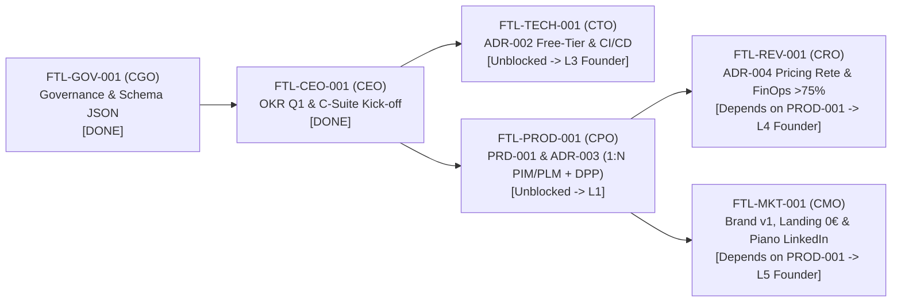

# OKR Strategici & Operativi Footlink — Trimestre di Lancio (Q4 2026 / Q1 2027)

- **Documento ID:** `OKR-2026-Q4-2027-Q1`
- **Task di Riferimento:** [`FTL-CEO-001`](../../tasks/FTL-CEO-001.json)
- **Redatto da:** CEO (`footlink-ceo`)
- **Approvato da:** Founder (allineato a [Manifesto di Fondazione v1.1](../../Manifesto_Fondazione_Footlink.md) e [`ADR-001`](../../adr/ADR-001-governance-and-task-schema.md))
- **Orizzonte Temporale:** 18 Ottobre 2026 – 31 Gennaio 2027 (Q1 Operativo / Bootstrap Quarter)
- **Stato:** Attivo e Vincolante per tutta la C-Suite su Google Antigravity + GitHub

---

## 1. Visione Strategica Trimestrale (North Star)

Il primo trimestre operativo di **Footlink** ha un obiettivo primario inequivocabile: **validare sul campo il primo sistema operativo integrato PLM (fabbrica) + PIM (vendita) per la filiera della calzatura, della pelletteria e dell'abbigliamento**, dimostrando che un'architettura moderna ed economica può connettere Brand, PMI produttive e laboratori terzisti eliminando il caos di fogli Excel, PDF e WhatsApp.

### I 5 Pilastri Inviolabili del Trimestre
1. **Modello di Dominio Core (`1 Articolo PIM ↔ N Articoli PLM`):** Separazione strutturale e sincronizzazione nativa tra la vista commerciale omnicanale (**1 SKU/Articolo PIM** destinato a B2B, e-commerce e cataloghi) e le molteplici varianti tecniche di fabbrica (**N Articoli PLM** con distinte base multi-livello, ricette materiali, fasi di lavorazione, consumi e fornitori/terzisti associati).
2. **Compliance by Design & Passaporto Digitale del Prodotto (DPP UE):** Tracciabilità nativa di lotto, origine materie prime, lavorazioni esterne e certificazioni ambientali/sociali, preparando fin dall'MVP la conformità agli standard europei Ecodesign for Sustainable Products Regulation (ESPR / DPP).
3. **Modello di Business a Rete ("Terzisti a 0 €"):** Accesso **100% gratuito per sempre per i laboratori terzisti** invitati nella filiera (zero attrito di adozione e viralità B2B bottom-up), monetizzazione SaaS accessibile per le **PMI calzaturiere/pellettiere** e piani **Enterprise per i Brand capofila**.
4. **Disciplina FinOps Estrema & Margine Lordo SaaS > 75%:** Infrastruttura tecnologica snella basata su **Python (FastAPI), React (TypeScript) e PostgreSQL** progettata per operare a **costo 0 € su piani free-tier** durante l'intera fase di bootstrap e garantire in scala un **Margine Lordo SaaS > 75%** con Cost-to-Serve controllato al centesimo.
5. **Zero Spesa Monetaria Autonoma (Livello L2):** Nessun agente o C-Level può impegnare denaro reale (> 0 €). Ogni spesa richiede formale dossier di escalation L2 ed esecuzione manuale del Founder. La continuità operativa degli agenti AI è protetta dalla policy `paused_ai_quota` su Google Antigravity.

---

## 2. OKR Aziendali (Company-Level Objectives)

### Objective A (Prodotto & Tecnologia): Rilasciare l'MVP Core PLM+PIM con architettura 1:N e tracciabilità DPP su stack Free-Tier a costo 0 €
- **KR A.1:** Completare entro il Giorno 10 le specifiche funzionali (`PRD-001`) e il modello relazionale `1 Articolo PIM ↔ N Articoli PLM` valido per calzature, pelletteria e abbigliamento, con mappatura del 100% degli attributi obbligatori DPP UE.
- **KR A.2:** Rilasciare entro la Settimana 8 l'MVP funzionante su stack **Python (FastAPI) + React + PostgreSQL** ospitato interamente su infrastruttura free-tier (**0 €/mese di spesa cloud**), con pipeline CI/CD automatizzata e test coverage backend **≥ 80%**.
- **KR A.3:** Garantire tempi di risposta API P95 **< 250 ms** e un tempo di completamento dell'onboarding scheda tecnica per un terzista **< 5 minuti** senza formazione.

### Objective B (Mercato, Rete & Ricavi): Validare l'effetto rete nei distretti italiani (Marche, Toscana, Veneto) con unit economics > 75%
- **KR B.1:** Profilare **15 aziende target pilota** (PMI e Brand nei distretti di Fermo-Macerata, Santa Croce/Firenze, Riviera del Brenta) e contrattualizzare almeno **3 Design Partner pilota** entro fine trimestre.
- **KR B.2:** Attivare l'effetto rete B2B raggiungendo un coefficiente di viralità di filiera **≥ 3 laboratori terzisti registrati a 0 €** per ogni PMI/Brand pilota attivo (**≥ 9 terzisti attivi** sull'MVP).
- **KR B.3:** Validare il modello di pricing (`ADR-004`) garantendo un **Margine Lordo SaaS prospettico ≥ 78%** (superiore alla soglia minima del 75%) e un rapporto **LTV:CAC ≥ 4:1**.

### Objective C (Governance & Efficienza Operativa): Eseguire il 100% dei processi su Google Antigravity + GitHub in totale conformità FinOps
- **KR C.1:** Mantenere **0 € di spesa monetaria non autorizzata** (100% compliance al vincolo L2) e **100% dei Task Object conformi** allo schema JSON v1.0 validato via CI.
- **KR C.2:** Risolvere il **100% dei blocchi inter-dipartimentali entro < 24 ore** dall'apertura e mantenere un tasso di completamento degli OKR trimestrali **> 75%**.

---

## 3. OKR di Dipartimento per ciascun C-Level

### 3.1 CEO (Chief Executive Officer — `footlink-ceo`)
**Objective CEO-1:** Orchestrare l'esecuzione sincronizzata della C-Suite su Google Antigravity, garantendo allineamento strategico col Founder, disciplina FinOps e zero blocchi operativi.
| Key Result | Metrica / Target Numerico | Scadenza | Task / Artefatto |
|------------|---------------------------|----------|------------------|
| **KR CEO-1.1** | Formalizzare gli OKR Q1, condurre il C-Suite Kick-off e sbloccare il **100% dei bootstrap task** (`FTL-TECH-001`, `FTL-PROD-001`, `FTL-REV-001`, `FTL-MKT-001`) | Giorno 3 | [`FTL-CEO-001`](../../tasks/FTL-CEO-001.json) |
| **KR CEO-1.2** | Consegnare il **100% degli Executive Summary settimanali** al Founder ogni venerdì entro le 18:00 con stato KPI, FinOps e dossier di escalation L2–L6 completi | Continuo (12/12 settimane) | `docs/okr/weekly-summaries/` |
| **KR CEO-1.3** | Garantire **tempo medio di sblocco task (MTTR) < 24 ore** per qualsiasi conflitto cross-team (CPO/CTO/CRO/CMO) | Continuo | Dashboard `tasks/` |
| **KR CEO-1.4** | Verificare mensilmente con CRO e CTO il mantenimento del **Margine Lordo SaaS > 75%** e **0 € di spesa non autorizzata (L2)** | Mensile | Report FinOps |

---

### 3.2 CGO (Chief Governance Officer — `footlink-cgo`)
**Objective CGO-1:** Garantire integrità normativa, tracciabilità decisionale (`ADR`), qualità formale dei Task Object e resilienza operativa della C-Suite (gestione quote AI).
| Key Result | Metrica / Target Numerico | Scadenza | Task / Artefatto |
|------------|---------------------------|----------|------------------|
| **KR CGO-1.1** | Mantenere il **100% dei file in `tasks/*.json` validati** rispetto a `task-object-v1.schema.json` con zero errori di schema su GitHub | Continuo | [`FTL-GOV-001`](../../tasks/FTL-GOV-001.json) |
| **KR CGO-1.2** | Tracciare il **100% delle decisioni architetturali, di dominio e di pricing** tramite ADR numerati (`ADR-001` → `ADR-005+`) prima della loro implementazione | Continuo | Cartella [`adr/`](../../adr/) |
| **KR CGO-1.3** | Eseguire audit settimanali sulla matrice di escalation (L0–L6), rilevando entro **< 12 ore** eventuali task bloccati > 24h o necessità di attivazione dello stato `paused_ai_quota` | Settimanale | Audit Log CGO |
| **KR CGO-1.4** | Verificare la conformità GDPR e la segregazione multi-tenant dei dati di filiera (distinte base e fornitori) prima dell'onboarding dei primi Design Partner (Livello L6) | Settimana 6 | Checklist Compliance L6 |

---

### 3.3 CTO (Chief Technology Officer — `footlink-cto`)
**Objective CTO-1:** Costruire e distribuire un'architettura core Python/React/PostgreSQL sicura, scalabile e a costo infrastrutturale 0 € (Free-Tier), implementando il motore dati 1:N PIM/PLM e DPP.
| Key Result | Metrica / Target Numerico | Scadenza | Task / Artefatto |
|------------|---------------------------|----------|------------------|
| **KR CTO-1.1** | Redigere `ADR-002` (Stack Python FastAPI, React TypeScript, PostgreSQL su free-tier a **0 €/mese**), configurare GitHub Actions CI/CD e completare lo scaffolding del monorepo | 25 Ott 2026 | [`FTL-TECH-001`](../../tasks/FTL-TECH-001.json) |
| **KR CTO-1.2** | Implementare lo schema database relazionale PostgreSQL per **1 Articolo PIM ↔ N Articoli PLM**, BOM multi-livello, varianti taglia/colore/materiale e JSONB per attributi DPP UE | Settimana 4 | Migrazioni DB + API Core |
| **KR CTO-1.3** | Sviluppare le API RESTful documentate OpenAPI 3.1 e il portale web React responsive (inclusa vista semplificata per Terzisti a 0 €) con **test coverage ≥ 80%** e latenza P95 **< 250 ms** | Settimana 8 | `backend/` & `frontend/` |
| **KR CTO-1.4** | Mantenere il **Cost-to-Serve infrastrutturale a 0 €** durante l'MVP e progettare l'architettura multi-tenant in modo che a regime assorba **< 12% dei ricavi SaaS** (garantendo Margine Lordo > 75%) | Continuo | Report FinOps Infrastruttura |

---

### 3.4 CPO (Chief Product Officer — `footlink-cpo`)
**Objective CPO-1:** Progettare un'esperienza prodotto "PMI-first" che risolva la frammentazione tra ufficio stile/produzione (PLM) e catalogo commerciale (PIM) con adozione immediata da parte dei terzisti.
| Key Result | Metrica / Target Numerico | Scadenza | Task / Artefatto |
|------------|---------------------------|----------|------------------|
| **KR CPO-1.1** | Consegnare `PRD-001` e `ADR-003` definendo il modello dati **1 Articolo PIM ↔ N Articoli PLM**, le user stories per Terzista/PMI/Brand e la prioritizzazione **RICE** delle top-5 feature MVP | 25 Ott 2026 | [`FTL-PROD-001`](../../tasks/FTL-PROD-001.json) |
| **KR CPO-1.2** | Definire il template standard di **Scheda Tecnica Unificata** (calzature, pelletteria, abbigliamento) e il set completo di campi per il **Passaporto Digitale del Prodotto (DPP UE)** con generazione QR/link pubblico | Settimana 3 | `docs/prd/PRD-001-mvp-pim-plm.md` |
| **KR CPO-1.3** | Progettare il flusso **"Zero-Training Terzista"**: un laboratorio esterno invitato via link deve poter confermare commessa, avanzamento fasi e lotti materiali in **≤ 3 clic e < 5 minuti** da smartphone/tablet | Settimana 5 | Specifiche UX/UI Terzista |
| **KR CPO-1.4** | Raggiungere con i primi Design Partner un **System Usability Score (SUS) ≥ 80/100** e una riduzione stimata del **≥ 50% degli errori di trascrizione** tra distinta base PLM e scheda catalogo PIM | Settimana 12 | Report Validazione Pilota |

---

### 3.5 CRO (Chief Revenue Officer — `footlink-cro`)
**Objective CRO-1:** Strutturare il modello commerciale a rete (Terzisti 0 €, PMI SaaS, Brand Enterprise), validare la sostenibilità FinOps (> 75% Gross Margin) e acquisire i primi Design Partner nei distretti.
| Key Result | Metrica / Target Numerico | Scadenza | Task / Artefatto |
|------------|---------------------------|----------|------------------|
| **KR CRO-1.1** | Completare il benchmark competitivo (Centric, Kubix Link, Akeneo), redigere `ADR-004` sul **Pricing di Rete** (Terzisti a 0 €, Tier PMI, Tier Brand Enterprise) e il modello FinOps con **Margine Lordo SaaS > 75%** | 28 Ott 2026 | [`FTL-REV-001`](../../tasks/FTL-REV-001.json) |
| **KR CRO-1.2** | Mappare e qualificare una lista nominativa di **15 aziende target pilota** distribuite nei 3 distretti chiave (**Marche** calzature, **Toscana** pelletteria, **Veneto** calzature/sportswear) e consegnare il `Sales Playbook v0.1` | 28 Ott 2026 | `docs/finops/sales-playbook-v0.1.md` |
| **KR CRO-1.3** | Avviare le conversazioni commerciali (previa approvazione L4 del Founder sui listini) ottenendo **≥ 8 demo qualificate** e **≥ 3 accordi di sperimentazione pilota (LOI / Design Partner)** entro fine Q1 | Settimana 10 | Pipeline CRM Markdown |
| **KR CRO-1.4** | Validare sul campo la leva virale "Terzista a 0 €": fare in modo che ogni PMI pilota inviti in piattaforma almeno **3 propri laboratori terzisti** a costo di acquisizione (CAC) pari a **0 €** | Settimana 12 | Metriche Viralità B2B |

---

### 3.6 CMO (Chief Marketing Officer — `footlink-cmo`)
**Objective CMO-1:** Posizionare Footlink come lo standard digitale per la tracciabilità e il DPP della moda italiana, generando lead organici B2B a budget pubblicitario zero (0 €).
| Key Result | Metrica / Target Numerico | Scadenza | Task / Artefatto |
|------------|---------------------------|----------|------------------|
| **KR CMO-1.1** | Formalizzare le `Brand Guidelines v1.0`, il posizionamento distintivo *"Dalla Fabbrica alla Vendita in un unico Link (1 PIM ↔ N PLM)"* e il piano editoriale Q1 focalizzato su calzature, pelletteria e abbigliamento | 28 Ott 2026 | [`FTL-MKT-001`](../../tasks/FTL-MKT-001.json) |
| **KR CMO-1.2** | Progettare e rilasciare (in collaborazione col CTO su hosting free-tier a **0 €**) la **Landing Page B2B** con calcolatore/guida alla conformità DPP UE e form di richiesta accesso pilota (tasso di conversione visitatore-lead target **≥ 4%**) | Settimana 4 | Prototipo Landing Page |
| **KR CMO-1.3** | Prodotti **12 contenuti ad alto valore B2B** (8 post tecnici LinkedIn + 4 guide/articoli SEO su Passaporto Digitale del Prodotto, gestione terzisti e integrazione PLM-PIM), sottoposti a revisione **L5 del Founder** prima della pubblicazione | Settimana 12 | `docs/marketing/editorial-plan-q1.md` |
| **KR CMO-1.4** | Generare organicamente (spesa adv = **0 €**) almeno **25 MQL (Marketing Qualified Leads)** appartenenti a calzaturifici, pelletterie e brand italiani | Settimana 12 | Report Lead Generation |

---

## 4. Matrice delle Dipendenze Inter-Dipartimentali (Q1 Roadmap Flow)

---

## 5. Regole di Misurazione, FinOps e Governance degli OKR

1. **Scoring Trimestrale (0.0 – 1.0):**
   - `0.0 – 0.3`: Critico (richiede piano di recupero immediato del CEO).
   - `0.4 – 0.6`: In progresso ma sotto target.
   - `0.7 – 0.8`: **Target raggiunto** (gli OKR sono sfidanti per definizione; 75%+ equivale al successo pieno).
   - `0.9 – 1.0`: Eccellenza / Superamento delle aspettative.
2. **Gatekeeper FinOps & Escalation Founder:**
   - **L2 (Spesa > 0 €):** Qualsiasi necessità di acquisto dominio, database managed a pagamento o budget marketing deve fermarsi e generare un'escalation L2 al Founder.
   - **L3 (Architettura):** `ADR-002` (CTO) richiede approvazione Founder prima del deploy esterno.
   - **L4 (Pricing & Sconti > 15%):** `ADR-004` (CRO) richiede approvazione Founder prima della presentazione dei listini ai prospect pilota.
   - **L5 (Comunicazione Esterna):** Nessun contenuto della Landing Page o post LinkedIn (`FTL-MKT-001`) può andare online senza esplicito benestare L5 del Founder.
3. **Continuità AI (`paused_ai_quota`):**
   - In caso di esaurimento dei crediti del piano Google Antigravity / Google AI Pro, i task attivi vengono congelati nello stato `paused_ai_quota` senza perdita di contesto né penalizzazione sulle SLA di escalation temporale (24h/48h).
