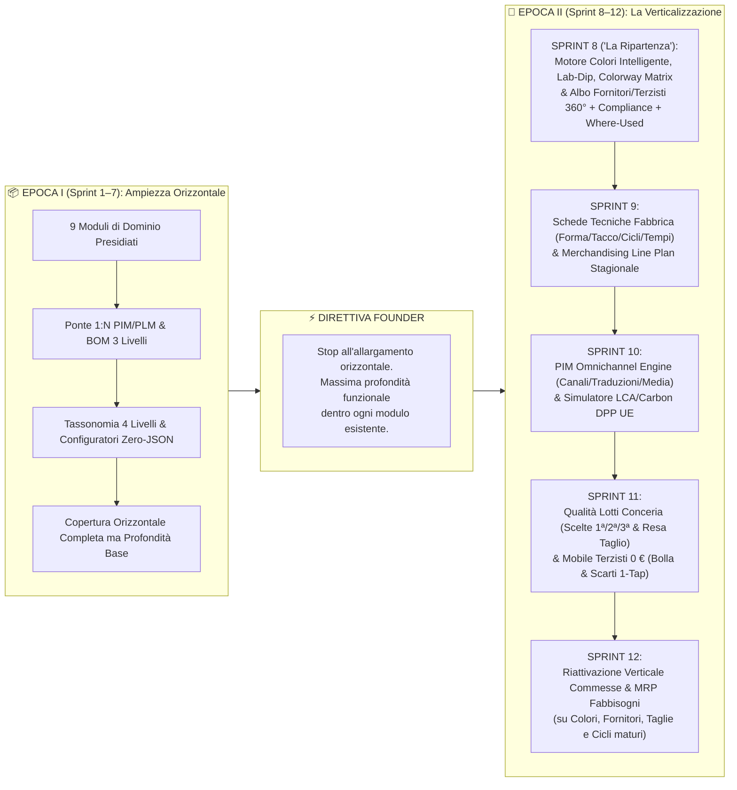
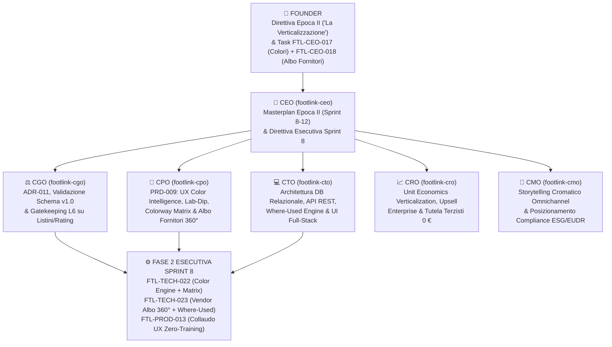

# 🏛️ Footlink C-Suite Summit — Master Plan EPOCA II ("La Verticalizzazione") & Kickoff SPRINT 8 ("La Ripartenza")

- **Documento ID:** `EPOCH-II-MASTERPLAN-SPRINT-8-2026-10-26`
- **Data Sessione Plenaria:** 26 Ottobre 2026
- **Presidenza:** **Founder & Presidente Esecutivo** con **CEO (`footlink-ceo`)**
- **C-Suite Convocata al Completo:**
  - **CEO** — Chief Executive Officer (`footlink-ceo`)
  - **CGO** — Chief Governance Officer (`footlink-cgo`)
  - **CTO** — Chief Technology Officer (`footlink-cto`)
  - **CPO** — Chief Product Officer (`footlink-cpo`)
  - **CRO** — Chief Revenue Officer (`footlink-cro`)
  - **CMO** — Chief Marketing Officer (`footlink-cmo`)
- **Stato:** ✅ **DELIBERATO ALL'UNANIMITÀ DALLA C-SUITE — AVVIO ESECUTIVO SPRINT 8**
- **Riferimenti Fondativi:** [Manifesto di Fondazione](../../Manifesto_Fondazione_Footlink.md), [`ADR-005`](../../adr/ADR-005-repository-three-pillars-restructuring.md), [`ADR-007`](../../adr/ADR-007-flexible-data-model-seasons-collections-domain-registries.md), [`ADR-008`](../../adr/ADR-008-production-orders-tannery-traceability-subcontractor-lifecycle.md), [`ADR-009`](../../adr/ADR-009-pause-work-orders-hub-and-refocus-plm-pim-leather-vault.md), [`ADR-010`](../../adr/ADR-010-multilevel-taxonomy-merchandising-matrix-and-deep-clone.md), [`ADR-011`](../../adr/ADR-011-epoch-2-verticalization-color-engine-and-vendor-albo-360.md)
- **Direttive Founder Incorporate (Control Center):** [`FTL-CEO-017`](../../tasks/FTL-CEO-017.json) (*Gestione Colori Intelligente*), [`FTL-CEO-018`](../../tasks/FTL-CEO-018.json) (*Gestione dei fornitori ed albo centralizzata*)

---

## 1. Cambio d'Epoca: Dalla Fondazione Orizzontale (Epoca I) alla Verticalizzazione Profonda (Epoca II)

### 1.1 Il Bilancio Consolidato dell'Epoca I (Sprint 1 – Sprint 7)
Con la chiusura dello **Sprint 7** — insignito dal Founder del **Doppio Riconoscimento 👑👑** ([`sprint-7-final-review-and-closure.md`](./sprint-7-final-review-and-closure.md)) — si conclude ufficialmente l'**Epoca I di Footlink ("La Fondazione Orizzontale")**.

Attraverso sette sprint consecutivi ad altissima intensità ingegneristica e strategica, Footlink ha costruito un perimetro funzionale completo a **9 moduli operativi**, poggiato su invarianti architetturali e di business inattaccabili:
1. **Ponte Invariante di Dominio (`1 Articolo PIM ↔ N Varianti PLM`):** separazione rigorosa ma sincronizzata tra identità commerciale di vendita e distinta tecnica di fabbrica.
2. **Distinta Base Gerarchica a 3 Livelli (`L1/L2/L3`):** modellazione ricorsiva di Tomaia/Suola/Accessori con drag & drop nativo, duplicazione atomica di sotto-alberi, BOM Presets e Deep Copy.
3. **Ecosistema a 9 Moduli di Dominio:** `01 PaaS Distrettuale`, `02 Prodotti PLM & BOM`, `03 PIM Catalogo & Feed`, `04 Vault Conceria`, `05 Stagioni & Collezioni`, `06 Anagrafiche di Dominio`, `07 Schema Studio`, `08 Portale Terzisti 0 €`, `09 Passaporto DPP UE`.
4. **Governance & FinOps:** Spesa autonoma `€ 0,00` (Presidio L2), **Terzisti a `€ 0,00` perpetuo**, Segregazione ermetica dei costi industriali (Livello L6), Margine Lordo SaaS prospettico `> 85%`.

### 1.2 La Direttiva Strategica del Founder: Diagnosi ed Entrata nell'Epoca II
In apertura di sessione plenaria, il Founder ha condiviso la diagnosi chirurgica che segna lo spartiacque evolutivo della piattaforma:

> *"La piattaforma Footlink è abbastanza ampia orizzontalmente a livello di numero di moduli, ma abbastanza limitata in termini di profondità funzionale all'interno di ogni modulo (inteso come numero di funzionalità disponibili per gli utenti)."*
> — **Founder Footlink**, Direttiva d'Avvio Epoca II & Sprint 8 ("La Ripartenza")

La C-Suite recepisce integralmente questa analisi come **legge fondamentale dell'Epoca II ("La Verticalizzazione")**:
- **Divieto di Espansione Orizzontale Superflua:** Non verranno aperti nuovi moduli vetrina o contenitori superficiali.
- **Mandato di Scavo Verticale ("Enterprise Depth"):** Ogni modulo esistente deve trasformarsi da un *registro anagrafico/CRUD* a una **workstation operativa specialistica**, dotata degli strumenti verticali che i modellisti, i tecnici del colore, gli uffici acquisti pellami, i responsabili qualità e i merchandiser delle maison calzaturiere utilizzano ogni giorno in produzione reale.

---

## 2. Audit di Profondità Funzionale (Orizzontale vs Verticale) sui 9 Moduli

La tabella seguente mappa puntualmente lo stato attuale di ciascuno dei **9 moduli** al termine dell'Epoca I, il **Gap di Profondità Verticale** rilevato rispetto ai flussi industriali reali del distretto calzaturiero/pelletteria e le **Feature Verticali Profonde** pianificate nell'Epoca II:

| # | Modulo Piattaforma | Stato Attuale — Fine Epoca I (Orizzontale) | Gap di Profondità Funzionale Rilevato | Feature Verticali Profonde — Target Epoca II | Sprint Target |
|:---:|---|---|---|---|---|
| **01** | **PaaS Distrettuale** (`PaaSDistrictOverview`) | Scelta del tier (`Brand Enterprise`, `PMI Factory`, `Terzista 0 €`), telemetria base e filtro visibilità L6. | Manca una vista di governance multi-stabilimento dei fornitori/terzisti collegati e degli alert di conformità distrettuale. | **Mappa Rischi & Compliance di Filiera:** monitoraggio attivo scadenze certificazioni (DURC, LWG, ISO, EUDR) dei nodi del distretto, semaforo affidabilità partner e audit trail inter-aziendale. | **Sprint 8 & 11** |
| **02** | **Prodotti PLM & BOM** (`PlmProductsManager`) | Creazione Varianti PLM, albero BOM a 3 livelli con drag & drop, duplicazione nodi, preset BOM e import CSV. | I componenti BOM hanno colore e fornitore come semplice testo libero; mancano una **Matrice Varianti Colore (Colorway Matrix)** e i parametri tecnici di calzatura (Forma, Tacco, Fustella, Ciclo Tempi/Minuti). | **1) Colorway BOM Matrix (Sprint 8):** griglia incrociata Nodi BOM × Varianti Colore con ereditarietà e propagazione automatica. **2) Where-Used Fornitori/Colori (Sprint 8):** impatto istantaneo sulle BOM. **3) Scheda Tecnica Calzaturiera & Costing L6 (Sprint 9):** parametri Forma/Tacco/Suola, Ciclo Operazioni con tempi in minuti e calcolo costo industriale completo. | **Sprint 8 & 9** |
| **03** | **PIM Catalogo & Feed** (`PimCatalogManager`) | Creazione Articolo PIM, ponte 1:N con varianti PLM, tassonomia a 4 livelli, piramide di collezione e export JSON/CSV base. | Il colore commerciale è una stringa slegata dalla codifica tecnica; mancano regole di completezza per canale, traduzioni strutturate e gestione asset multi-angolo. | **1) Mapping Colore Tecnico ↔ Naming Commerciale Luxury (Sprint 8):** es. *Cod. `VIT-402` → IT: "Nero Ossidian" / EN: "Obsidian Black"* + filtro per famiglia cromatica. **2) Omnichannel Completeness & Localization Engine (Sprint 10):** punteggio di prontezza per canale (Farfetch, Shopify, B2B Showroom), traduzioni multilingua e media gallery per angolo di scatto. | **Sprint 8 & 10** |
| **04** | **Vault Conceria** (`TanneryVaultManager`) | Registrazione lotti pellame con certificato LWG, origine geografica, spessore, metratura in Piedi Quadri (`pq`) e hash SHA-256. | Il lotto non è collegato all'anagrafica strutturata della Conceria (Albo Fornitori) né al ciclo di approvazione del colore (**Lab-Dip** / bagno di tintura) o alla resa di taglio per scelta (1ª/2ª/3ª). | **1) Lab-Dip & Bagni Colore su Pelle + Link Albo Concerie (Sprint 8):** tracciamento approvazioni cromatiche per substrato, tolleranza $\Delta E$, stato *Pending/Approved/Rejected* e verifica automatica LWG/EUDR del fornitore. **2) Grading Scelte (1ª/2ª/3ª) & Calcolatore Resa Taglio (Sprint 11):** coefficiente di sfrido su tomaia e scarico piedaggio reale. | **Sprint 8 & 11** |
| **05** | **Stagioni & Collezioni** (`SeasonsCollectionsManager`) | Creazione Stagioni (`SS26`, `FW26`) e Collezioni con date di lancio e conteggio articoli collegati. | Manca la pianificazione cromatica di stagione (**Cartella Colori Stagionale**) e il piano numerico di collezione (**Merchandising Line Plan**). | **1) Cartella Colori Stagionale & Palette Builder (Sprint 8):** definizione dei colori autorizzati per stagione (*Continuativi*, *Seasonal Core*, *Flash Accent*) con blocco colori fuori cartella. **2) Merchandising Line Plan & Target Margini (Sprint 9):** placeholder numerici per categoria/fascia prezzo vs avanzamento reale modelli sviluppati. | **Sprint 8 & 9** |
| **06** | **Anagrafiche di Dominio** (`DomainRegistriesManager`) | Registri tabellari per Taglie, Categorie, Piramide di Collezione, Tipi Costruzione e anagrafiche base di Colori e Fornitori. | Colori e Fornitori sono oggi tabelle piatte elementari prive di intelligenza di dominio (nessun valore HEX/RGB/Pantone, finitura, Lab-Dip; nessuno scadenziario certificazioni, vendor rating, listini L6 o analisi *Where-Used*). | **1) Motore Gestione Colori Intelligente (`FTL-CEO-017` - Sprint 8):** libreria master con HEX/RGB/CMYK, Pantone TCX/TPG, finitura, cartelle stagionali, armonie e sostituzione massiva. **2) Albo Fornitori & Terzisti Centralizzato 360° (`FTL-CEO-018` - Sprint 8):** workflow qualifica, scadenziario certificazioni con semaforo, Vendor Rating 4 KPI, listini L6 con MOQ/Lead Time e *Where-Used BOM*. | **Sprint 8 (Focus Primario)** |
| **07** | **Schema Studio** (`DataModelSchemaStudio`) | Creazione campi custom JSONB (`custom_attributes`) per estendere i modelli dati senza migrazioni SQL. | I campi custom sono piatti: mancano regole di validazione condizionale, formule calcolate e aggancio ai nuovi dizionari Colori e Fornitori. | **Custom Reference Fields & Validation Rules:** possibilità di creare attributi custom tipizzati come riferimenti diretti all'Albo Fornitori o alla Libreria Colori, con obbligatorietà per categoria merceologica. | **Sprint 8 & 10** |
| **08** | **Portale Terzisti 0 €** (`SubcontractorPortal`) | Vista semplificata "Zero-Training" delle lavorazioni assegnate e conferma cambio stato con segregazione L6 (costi occultati). | Non è collegato ai profili qualificati dell'Albo Terzisti (capacità produttiva, specializzazione fase, stato DURC) e manca la gestione mobile di bolle e scarti. | **1) Integrazione Albo Terzisti Qualificati (Sprint 8):** allineamento anagrafico con capacità (paia/giorno), specializzazione (*Taglio, Orlatura, Montaggio, Suolificio*) e blocco assegnazione se non qualificato. **2) Mobile Shopfloor 1-Tap (Sprint 11):** generazione DDT/Bolla digitale e segnalazione rapida difetti/riparazioni. | **Sprint 8 & 11** |
| **09** | **Passaporto DPP UE** (`DppPassportViewer`) | Generazione Passaporto Digitale con hash crittografico SHA-256, QR code SVG e riepilogo tracciabilità lotto pelle. | La catena di fornitura nel passaporto non legge automaticamente le certificazioni reali e lo stato di compliance dall'Albo Fornitori centralizzato; manca un simulatore d'impatto CO₂. | **1) Validazione Automatica Filiera da Albo Fornitori (Sprint 8):** estrazione live dei certificati LWG/EUDR/ISO validi dei fornitori presenti nella BOM. **2) Simulatore LCA & Carbon Footprint Granulare (Sprint 10):** calcolo emissioni `kg CO₂e` per paio basato su pesi BOM, materiali e distanza chilometrica dei fornitori. | **Sprint 8 & 10** |

---

## 3. Master Plan & Roadmap dell'Epoca II (Sprint 8 Attivo & Definizione Flessibile Sprint Successivi)

L'Epoca II è guidata direttamente dalle direttive del Founder. Lo **Sprint 8 ("La Ripartenza")** costituisce la prima tappa obbligata e confermata della verticalizzazione, mentre **i contenuti e le priorità di ciascuno sprint successivo (Sprint 9, 10, 11, 12 e oltre) saranno decisi e approvati dal Founder di volta in volta**, consentendo un governo agile e reattivo basato sulle evidenze industriali.

### 🚀 SPRINT 8 ("La Ripartenza" — Esecuzione Immediata Confermata)
**Tema Strategico:** *Verticalizzazione Profonda Anagrafiche, PLM/BOM, Conceria & PIM: Motore Colori Intelligente (`FTL-CEO-017`) & Albo Fornitori e Terzisti Centralizzato a 360° (`FTL-CEO-018`).*
- **Perché è il fondamento dell'Epoca II:** Nella calzatura e nella pelletteria, ogni singolo articolo e ogni riga di distinta base sono determinati da due coordinate fisiche: **il Colore applicato a un substrato** e **il Fornitore/Terzista che produce o lavora il materiale**. Finché Colori e Fornitori restano stringhe di testo scollegate, né la BOM, né la Conceria, né il PIM, né le future Commesse possono esprimere profondità industriale.
- **Pilastro A (`FTL-CEO-017` — Color Intelligence Engine):**
  1. **Anagrafica Colori Multi-Dimensionale:** Codice univoco, naming bilingue (IT/EN), coordinate cromatiche reali (`HEX`, `RGB`, `CMYK`), riferimenti standard internazionali (`Pantone TCX/TPG`, `RAL`, Codice Colore Fornitore), Famiglia Cromatica e **Finitura / Aspetto Superficiale** (*Opaco/Matte, Lucido/Patent, Metallizzato, Scamosciato/Suede, Goffrato/Embossed, Vernice, Glitter, Fluo*).
  2. **Cartelle Colori Stagionali & Palette Builder:** Associazione dei colori alle Stagioni (`SS26`, `FW26`, `Continuativi Permanent`), stato del colore in collezione (*bozza, confermato in cartella, annullato*) e validazione che segnala o blocca l'uso di colori fuori cartella.
  3. **Gestione Lab-Dip & Approvazioni Cromatiche su Substrato:** Uno stesso colore (es. *Rosso Valentino / Bordeaux*) reagisce diversamente su Vitello Liscio, Camoscio, Nappa, Gomma Fondo o Metallo Fibbia. Tracciamento delle prove tintura (**Lab-Dip**) per coppia `(Colore × Materiale × Fornitore)` con indice di scostamento $\Delta E$, numero bagno, data approvazione e stato (`Pending`, `Approved`, `Rejected with Notes`).
  4. **Colorway BOM Matrix (Matrice Varianti Colore in PLM):** Vista a matrice che permette di visualizzare e compilare in un'unica griglia come cambiano i colori di Tomaia (L1), Fodera (L1), Suola (L1), Lacci (L2) e Minuteria (L2) attraverso tutte le varianti colore di uno stesso articolo PIM, con **propagazione rapida** e sostituzione cromatica massiva (*Where-Used Color*).
  5. **Ponte Colore Tecnico ↔ Colore Commerciale PIM:** Separazione e mappatura automatica tra il codice/nome tecnico di fabbrica (es. `CAM-884 Tabacco Scuro`) e lo storytelling commerciale omnichannel (es. `IT: Marrone Sigaro Toscano / EN: Tuscan Cigar Brown`), più filtro per famiglia cromatica base per gli e-commerce (`Marrone / Brown`).
- **Pilastro B (`FTL-CEO-018` — Centralized Vendor & Subcontractor Albo 360°):**
  1. **Albo Unificato Fornitori di Materiali & Terzisti di Lavorazione:** Classificazione granulare per ruolo nella filiera calzaturiera (*Conceria, Suolificio, Tacchificio, Accessorificio/Minuteria, Tessitura/Lacci, Scatolificio/Packaging, Tomaificio/Orlatura, Calzaturificio Montaggio, Finitura/Stireria*), dati fiscali/distretto geografico, referenti tecnici/commerciali e capacità produttiva (`paia/giorno` o `pq/mese`).
  2. **Workflow di Qualifica & Stato Semaforico:** Ciclo di vita formale del fornitore (`Candidato / In Onboarding` → `Qualificato Attivo` → `Sospeso / Watchlist Alert` → `Blacklisted / Revocato`) con blocco automatico o warning in distinta base se si tenta di assegnare un nodo BOM a un fornitore sospeso/revocato.
  3. **Scadenziario Certificazioni ESG, Sicurezza & Compliance:** Gestione documentale con date di emissione/scadenza e calcolo automatico dei giorni residui per `LWG (Gold/Silver/Bronze)`, `EUDR Deforestation-Free`, `REACH Chemical Compliance`, `ISO 9001/14001`, `SA8000` e `DURC Regolarità Contributiva`. Alert visivi (🟢 Valido, 🟡 In Scadenza < 30gg, 🔴 Scaduto).
  4. **Motore di Vendor Rating Ponderato:** Valutazione oggettiva multi-criterio su scala `0–100` basata su 4 indicatori: **Qualità Merce/Lavorazione (35%)**, **Puntualità Consegne OTD (30%)**, **Conformità ESG & Documentale (20%)**, **Competitività Economica (15%)**, con badge di classe (`Classe A Excellence`, `Classe B Standard`, `Classe C Rischio`).
  5. **Listini Materiali/Lavorazioni Segregati (L6) & Analisi d'Impatto *Where-Used BOM*:** Gestione di `MOQ` (Lotto Minimo d'Ordine), `Lead Time` (giorni di approntamento), scaglioni di prezzo riservati (visibili solo al Brand in virtù della **Segregazione L6**) e pannello interattivo **Where-Used BOM** che risponde in tempo reale alla domanda: *"Se questo fornitore ha un ritardo o un'anomalia chimica, quali Articoli PIM, quali Varianti PLM e quali Nodi BOM della collezione sono impattati?"*.

---

### 👑 Definizione degli Sprint Successivi (Sprint 9+) — Riservata al Founder

Come da direttiva del Founder, **gli argomenti di ogni sprint successivo verranno definiti di volta in volta**:
- **Nessuna pre-assegnazione vincolante:** Gli ambiti (es. Ingegneria di fabbrica e Tempi & Metodi, PIM Omnichannel, Collaudo e Scelte Conceria, Shopfloor Terzisti, Commesse MRP) costituiscono un catalogo di opportunità verticali che il Founder attiverà secondo le priorità di business.
- **Workflow Just-in-Time:** Al termine dello Sprint 8, il Founder indicherà gli obiettivi per lo Sprint 9; la C-Suite provvederà tempestivamente al triage, alla redazione del PRD/Blueprint e alla scomposizione in Task conformi al Task Object Schema v1.0.

---

## 4. Tavola Rotonda C-Suite & Definizione Puntuale dello SPRINT 8 ("La Ripartenza")

### 4.1 Interventi Esecutivi dei Membri della C-Suite

#### 🎯 CEO — Chief Executive Officer (`footlink-ceo`)
> *"L'intuizione del Founder coglie il punto esatto che separa una demo software brillante da una piattaforma mission-critical insostituibile. Nell'Epoca I abbiamo tracciato la mappa completa del territorio calzaturiero con 9 moduli; nell'Epoca II scaviamo i pozzi petroliferi dentro ciascun modulo.
>
> Partire nello **Sprint 8 ('La Ripartenza')** dalle due direttive del Founder — **Gestione Colori Intelligente (`FTL-CEO-017`)** e **Albo Fornitori e Terzisti Centralizzato (`FTL-CEO-018`)** — è una mossa strategicamente perfetta: invece di essere due isole anagrafiche, Colori e Fornitori agiscono come **moltiplicatori trasversali di profondità** che arricchiscono simultaneamente **6 dei 9 moduli** (`06 Anagrafiche`, `02 PLM & BOM`, `03 PIM`, `04 Vault Conceria`, `05 Stagioni`, `08/09 Terzisti & DPP`). Dichiaro aperta l'Epoca II e dispongo l'esecuzione immediata dello Sprint 8."*

#### ⚖️ CGO — Chief Governance Officer (`footlink-cgo`)
> *"Dal punto di vista della Governance e della Sicurezza Industriale, la verticalizzazione dello Sprint 8 introduce dati ad altissima sensibilità competitiva che richiedono il presidio ferreo del **Manifesto di Fondazione**:
> 1. **Formalizzazione [`ADR-011`](../../adr/ADR-011-epoch-2-verticalization-color-engine-and-vendor-albo-360.md):** Tracciamo formalmente il passaggio architetturale all'Epoca II e lo schema relazionale del Color Intelligence Engine e del Vendor Albo 360°.
> 2. **Segregazione Ermetica L6 su Albo Fornitori:** I listini negoziati (`unit_cost_eur`, scaglioni di sconto), i punteggi interni di Vendor Rating e le note di audit ispettivo sono **patrimonio riservato esclusivo del Brand/Calzaturificio**. Quando il sistema viene consultato con profilo Terzista (`0,00 €`), ogni informazione economica o valutativa riservata viene rimossa a livello API e UI.
> 3. **Audit di Conformità Task Object Schema v1.0:** Tutti gli 11 task dello Sprint 8 (8 di Fase 1 e 3 di Fase 2) rispettano al 100% i vincoli JSON Schema v1.0 e la regola **Zero Spesa Monetaria Autonoma (`€ 0,00` - L2)**."*

#### 🎨 CPO — Chief Product Officer (`footlink-cpo`)
> *"Nel documento di specifica funzionale [`PRD-009`](../prd/PRD-009-smart-color-engine-and-centralized-vendor-albo.md) abbiamo progettato un'esperienza utente che elimina ogni frizione da foglio Excel:
> - **Per i Colori (`FTL-CEO-017`):** L'utente non vede più una tabella muta, ma uno **Studio Cromatico Luxury** con swatch visivo live (`HEX/RGB`), badge Pantone TCX, filtro per Finitura (*Suede, Patent, Matte, Metallic*), gestione delle **Cartelle Colori di Stagione**, registro **Lab-Dip** con semaforo $\Delta E$ per approvare i bagni di tintura su specifici pellami, e soprattutto la **Colorway BOM Matrix** dentro il PLM, che permette di creare e confrontare 5 varianti colore di una scarpa in un'unica vista tabellare.
> - **Per l'Albo Fornitori (`FTL-CEO-018`):** Abbiamo disegnato una **Workstation di Qualifica e Controllo Filiera** con schede a 360°, barra circolare del **Vendor Rating Ponderato (0-100)**, **Scadenziario Certificazioni (LWG, EUDR, REACH, DURC)** con alert cromatici automatici e il potente pulsante **'🔍 Where-Used BOM'**, che mostra istantaneamente su quali modelli e componenti della collezione è impiegato quel fornitore o quel colore."*

#### 💻 CTO — Chief Technology Officer (`footlink-cto`)
> *"Sul piano architetturale ([`sprint-8-architecture-color-engine-and-vendor-albo.md`](../architecture/sprint-8-architecture-color-engine-and-vendor-albo.md)), implementiamo un modello dati normalizzato e retro-compatibile al 100% con i 26 test esistenti:
> 1. **Color Engine Schema & Endpoints:** Estensione di `ColorRegistryORM` e nuove entità/strutture per `SeasonalColorPalette`, `ColorLabDip` (legato a colore, materiale/pellame e fornitore con stato approvazione e $\Delta E$) e API `ColorwayMatrix` (`/api/v1/pim-items/{pim_id}/colorway-matrix`) più sostituzione cromatica massiva (`POST /api/v1/colors/{color_id}/replace-in-boms`) e analisi d'impatto (`GET /api/v1/colors/{color_id}/where-used`).
> 2. **Vendor Albo 360° Schema & Endpoints:** Evoluzione profonda di `SupplierRegistryORM` con qualifica formale (`qualification_status`), specializzazione di filiera, capacità produttiva, certificazioni strutturate con calcolo dinamico di scadenza (`certifications_json` / endpoint compliance), calcolo deterministico del `vendor_rating_score` sui 4 KPI, listini L6 (`moq`, `lead_time_days`, `reference_unit_cost_eur` filtrato per ruolo L6) e query relazionale `GET /api/v1/suppliers/{supplier_id}/where-used` che attraversa Nodi BOM, Lotti Conceria e Varianti PLM.
> 3. **Zero Debito Tecnico & Costo Zero:** Tutto gira nativamente su FastAPI + SQLAlchemy 2.0 + React 18 TypeScript senza dipendenze a pagamento (`€ 0,00` L2)."*

#### 📈 CRO — Chief Revenue Officer (`footlink-cro`)
> *"L'analisi economica e commerciale ([`sprint-8-verticalization-roi-and-vendor-network-economics.md`](../finops/sprint-8-verticalization-roi-and-vendor-network-economics.md)) conferma che la verticalizzazione è il vero driver di **Willingness-to-Pay (WTP)** per i clienti paganti:
> - Un Brand Enterprise o una PMI strutturata paga volentieri il canone SaaS quando Footlink gli evita **1 solo errore di bagno colore in produzione** (che su 500 paia costa oltre `€ 18.000` di rilavorazioni e resi) o **1 blocco doganale/audit per certificato LWG/EUDR scaduto**.
> - Allo stesso tempo, ribadiamo il pilastro del Manifesto: **tutti i Terzisti e Laboratori censiti nell'Albo accedono al Portale Terzisti a `€ 0,00` perpetuo**. Questo azzera la resistenza all'onboarding della filiera e mantiene il **Margine Lordo SaaS > 85%**."*

#### 📣 CMO — Chief Marketing Officer (`footlink-cmo`)
> *"Sul fronte del posizionamento di mercato ([`sprint-8-vertical-positioning-color-intelligence-and-esg-albo.md`](../marketing/sprint-8-vertical-positioning-color-intelligence-and-esg-albo.md)), lo Sprint 8 ci permette di lanciare due messaggi potentissimi verso i Direttori Prodotto e i Sustainability Manager del lusso:
> 1. **'From Pantone & Lab-Dip to Omnichannel Luxury Naming':** coerenza cromatica assoluta tra il bagno di tintura in conceria, la distinta base di fabbrica e il nome evocativo sullo store online.
> 2. **'Audit-Ready Supply Chain in 1 Click':** grazie all'Albo Fornitori 360° con scadenziario LWG/EUDR/DURC e analisi *Where-Used*, il Brand è pronto in qualsiasi istante a superare le ispezioni normative europee."*

---

### 4.2 Scomposizione Formale delle Direttive Founder (`FTL-CEO-017` & `FTL-CEO-018`) e Piano Task Sprint 8

Le due iniziative inserite dal Founder nel Control Center (`FTL-CEO-017` e `FTL-CEO-018`) sono state analizzate, scomposte e trasformate nel piano operativo completo dello **Sprint 8**, articolato in **Fase 1 (Governance, Strategia e Specifiche C-Suite)** e **Fase 2 (Implementazione Verticale Full-Stack e Validazione UX)**:

#### Tabella 1 — Task di Governance, Strategia e Specifica (Fase 1 - Elaborazione & Setup Epoca II)

| Task ID | Ruolo | Titolo del Task | Deliverable Ufficiale | Stato Target |
|---|:---:|---|---|:---:|
| [`FTL-CEO-017`](../../tasks/FTL-CEO-017.json) | **CEO** | Direttiva Founder: Triage Strategico e Strutturazione "Gestione Colori Intelligente" (Cartelle Stagionali, Pantone/TCX, Lab-Dip & Colorway BOM Matrix) | [`epoch-2-masterplan-and-sprint-8-kickoff.md`](./epoch-2-masterplan-and-sprint-8-kickoff.md) | ✅ `done` |
| [`FTL-CEO-018`](../../tasks/FTL-CEO-018.json) | **CEO** | Direttiva Founder: Triage Strategico e Strutturazione "Gestione Fornitori ed Albo Centralizzato 360°" (Qualifica ESG/LWG/EUDR, Scadenziario, Rating, Listini L6 & Where-Used) | [`epoch-2-masterplan-and-sprint-8-kickoff.md`](./epoch-2-masterplan-and-sprint-8-kickoff.md) | ✅ `done` |
| [`FTL-CEO-019`](../../tasks/FTL-CEO-019.json) | **CEO** | Master Plan Epoca II ("La Verticalizzazione" Sprint 8–12) e Direttiva Esecutiva Sprint 8 ("La Ripartenza") | [`epoch-2-masterplan-and-sprint-8-kickoff.md`](./epoch-2-masterplan-and-sprint-8-kickoff.md), [`README.md`](./README.md) | ✅ `done` |
| [`FTL-GOV-008`](../../tasks/FTL-GOV-008.json) | **CGO** | `ADR-011`: Architettura di Verticalizzazione Epoca II, Color Intelligence Engine, Albo Fornitori 360° e Presidio Segregazione L6 | [`ADR-011-epoch-2-verticalization-color-engine-and-vendor-albo-360.md`](../../adr/ADR-011-epoch-2-verticalization-color-engine-and-vendor-albo-360.md) | ✅ `done` |
| [`FTL-PROD-012`](../../tasks/FTL-PROD-012.json) | **CPO** | `PRD-009`: Specifiche Funzionali Verticali — Motore Colori Intelligente (Lab-Dip, Colorway Matrix) e Albo Fornitori/Terzisti 360° (Compliance, Rating, Where-Used) | [`PRD-009-smart-color-engine-and-centralized-vendor-albo.md`](../prd/PRD-009-smart-color-engine-and-centralized-vendor-albo.md) | ✅ `done` |
| [`FTL-TECH-021`](../../tasks/FTL-TECH-021.json) | **CTO** | Specifica Architetturale & Data Model Sprint 8: Schema Relazionale Colori/Lab-Dip/Colorway Matrix e Albo Fornitori 360°/Where-Used Engine | [`sprint-8-architecture-color-engine-and-vendor-albo.md`](../architecture/sprint-8-architecture-color-engine-and-vendor-albo.md) | ✅ `done` |
| [`FTL-REV-007`](../../tasks/FTL-REV-007.json) | **CRO** | Analisi FinOps & ROI di Verticalizzazione: Riduzione Errori Campionatura/Compliance, Retention Enterprise e Garanzia Terzisti `0,00 €` | [`sprint-8-verticalization-roi-and-vendor-network-economics.md`](../finops/sprint-8-verticalization-roi-and-vendor-network-economics.md) | ✅ `done` |
| [`FTL-MKT-008`](../../tasks/FTL-MKT-008.json) | **CMO** | Posizionamento B2B Epoca II: Storytelling Cromatico Omnichannel e Comunicazione "Audit-Ready Supply Chain" (LWG/EUDR) | [`sprint-8-vertical-positioning-color-intelligence-and-esg-albo.md`](../marketing/sprint-8-vertical-positioning-color-intelligence-and-esg-albo.md) | ✅ `done` |

#### Tabella 2 — Task Esecutivi di Sviluppo Full-Stack dello Sprint 8 (Fase 2 - Implementazione Verticale)

| Task ID | Ruolo | Titolo del Task Esecutivo | Ambito Tecnico & Moduli Coinvolti | Dipendenze | Priorità |
|---|:---:|---|---|:---:|:---:|
| [`FTL-TECH-022`](../../tasks/FTL-TECH-022.json) | **CTO** | **Full-Stack Color Intelligence Engine & Colorway BOM Matrix** | **Backend (FastAPI/SQLAlchemy):** Estensione modello Colori (HEX/RGB/CMYK, Pantone TCX, Finitura, Cartelle Stagionali), gestione Lab-Dip su substrato (`ΔE`, stato approvazione), endpoint `Colorway BOM Matrix`, `Where-Used Color` e sostituzione cromatica massiva. **Frontend (React/TS):** Studio Colori Intelligente in Anagrafiche, Tab Lab-Dip & Cartelle Stagionali, e vista **Colorway BOM Matrix** in PLM/PIM. | `FTL-CEO-017`, `FTL-PROD-012`, `FTL-TECH-021`, `FTL-GOV-008` | 🔴 `critical` |
| [`FTL-TECH-023`](../../tasks/FTL-TECH-023.json) | **CTO** | **Full-Stack Centralized Vendor & Subcontractor Albo 360°, Compliance & Where-Used BOM** | **Backend (FastAPI/SQLAlchemy):** Evoluzione Albo Fornitori/Terzisti (Stato Qualifica, Ruolo Filiera, Capacità, Scadenziario Certificazioni LWG/EUDR/REACH/DURC con alert, calcolo Vendor Rating 4 KPI, Listini L6 con MOQ/Lead Time e filtro ruolo, query `Where-Used BOM`). **Frontend (React/TS):** Workstation Albo Fornitori 360°, Cruscotto Scadenze Certificazioni, Scheda Vendor Rating, selettori intelligenti in BOM/Conceria e modal **Where-Used Analysis**. | `FTL-CEO-018`, `FTL-PROD-012`, `FTL-TECH-021`, `FTL-GOV-008` | 🔴 `critical` |
| [`FTL-PROD-013`](../../tasks/FTL-PROD-013.json) | **CPO** | **Validazione UX/UI Verticale Colori & Albo Fornitori, Test Zero-Training e Audit Segregazione L6** | Verifica end-to-end dei flussi verticali su browser, controllo ergonomia luxury dark, validazione occultamento listini/rating per il profilo Terzista `0 €` e certificazione suite Pytest + build TypeScript. | `FTL-TECH-022`, `FTL-TECH-023` | 🟠 `high` |

---

## 5. Conformità Inderogabile al Manifesto di Fondazione

La C-Suite certifica che l'intero impianto dell'**Epoca II ("La Verticalizzazione")** e dello **Sprint 8 ("La Ripartenza")** rispetta senza alcuna deroga i pilastri del [Manifesto di Fondazione](../../Manifesto_Fondazione_Footlink.md):

1. **Modello di Dominio Invariante (`1 PIM ↔ N PLM`):** La Colorway BOM Matrix e il mapping Colore Tecnico ↔ Colore Commerciale rafforzano direttamente il ponte `1:N` tra l'Articolo di Vendita PIM e le Varianti di Produzione PLM.
2. **Network Pricing & Terzisti a `€ 0,00` Perpetuo:** L'inclusione dei Terzisti nell'Albo Centralizzato a 360° serve a qualificare la filiera e ad automatizzare l'assegnazione delle lavorazioni, mantenendo l'accesso al Portale Terzisti **gratuito in perpetuo (`0,00 €`)**.
3. **FinOps & Zero Spesa Monetaria Autonoma (Livello L2):** L'intero sviluppo di Sprint 8 e della roadmap Epoca II utilizza esclusivamente codice proprietario su stack open-source locale/free-tier (`FastAPI`, `SQLAlchemy`, `React`, `Vite`, `SQLite/PostgreSQL`), con spesa autonoma pari a **`€ 0,00`** e **Margine Lordo SaaS > 85%** (ampiamente superiore alla soglia minima del `75%`).
4. **Segregazione dei Dati Industriali (Livello L6):** I listini di acquisto materiali/lavorazioni, gli scaglioni MOQ economici e i punteggi interni di Vendor Rating sono rigorosamente segregati e inaccessibili ai profili esterni o terzisti.

---
*Firmato digitalmente e ratificato in seduta plenaria da:*  
**CEO (`footlink-ceo`) · CGO (`footlink-cgo`) · CTO (`footlink-cto`) · CPO (`footlink-cpo`) · CRO (`footlink-cro`) · CMO (`footlink-cmo`)**
