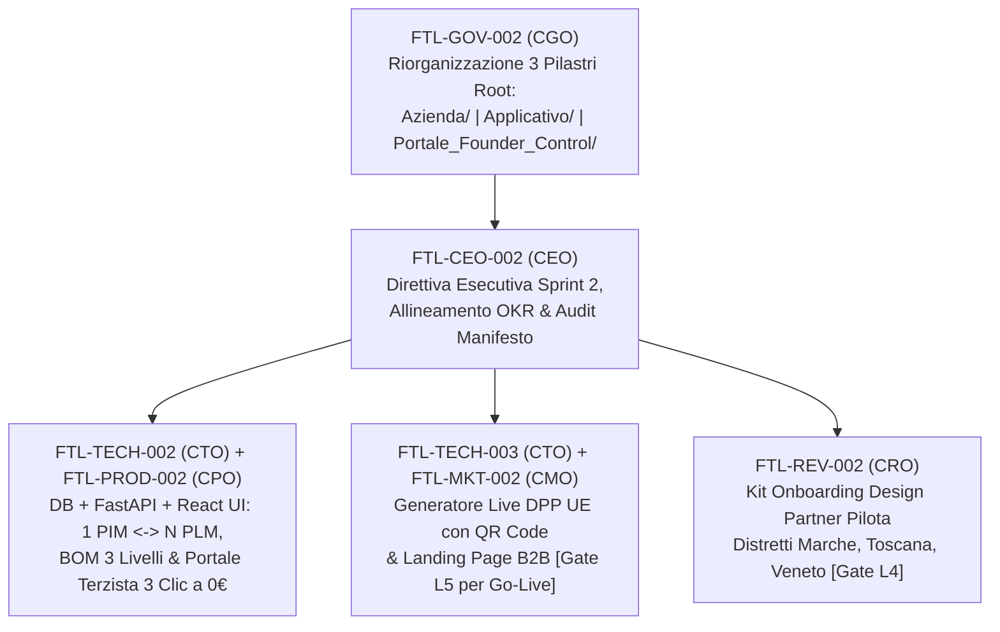

# Direttiva Esecutiva Sprint 2, Allineamento OKR e Audit di Governance Manifesto

- **Documento ID:** `SPRINT-2-EXEC-DIR-2026-10-18`
- **Task di Riferimento:** [`FTL-CEO-002`](../../tasks/FTL-CEO-002.json)
- **Redatto e Firmato da:** CEO (`footlink-ceo`)
- **Riferimenti Normativi Interni:** [Manifesto di Fondazione v1.1](../../Manifesto_Fondazione_Footlink.md), [`OKR-2026-Q4-2027-Q1`](./OKR-2026-Q4-2027-Q1.md), [`ADR-001`](../../adr/ADR-001-governance-and-task-schema.md), [`ADR-002`](../../adr/ADR-002-tech-stack-and-free-tier-architecture.md), [`ADR-003`](../../adr/ADR-003-pim-plm-domain-model-and-dpp.md), [`ADR-004`](../../adr/ADR-004-network-pricing-and-finops-model.md)
- **Data di Emissione:** 18 Ottobre 2026
- **Stato:** Esecutivo — Vincolante per l'intera C-Suite (CGO, CTO, CPO, CRO, CMO)

---

## 1. Executive Summary & Mandato dello Sprint 2

Con la chiusura al 100% dello **Sprint 1 di Bootstrap** (`FTL-GOV-001`, `FTL-CEO-001`, `FTL-TECH-001`, `FTL-PROD-001`, `FTL-REV-001`, `FTL-MKT-001`), Footlink ha consolidato le fondamenta architetturali, di prodotto, FinOps e go-to-market.

Lo **Sprint 2** segna il passaggio **dalla progettazione strategica al rilascio del codice funzionante dell'MVP e degli asset operativi di acquisizione nei distretti**. Parallelamente, recepisce la direttiva strutturale del Founder di segregare il monorepo in **3 pilastri di root** rigorosamente distinti:
1. **`Azienda/`** — Governance, Strategia, Documentazione C-Suite, ADR, Task JSON e Memoria aziendale.
2. **`Applicativo/`** — Codice sorgente dell'applicazione SaaS B2B Footlink (Backend Python FastAPI, Frontend React TypeScript, Database SQLite/PostgreSQL, Test e CI/CD).
3. **`Portale_Founder_Control/`** — Dashboard e strumenti di controllo esecutivo riservati al Founder.

---

## 2. Mappatura Obiettivi Sprint 2 sugli OKR Trimestrali (`OKR-2026-Q4-2027-Q1`)

Ogni deliverable dello Sprint 2 è direttamente ancorato ai Key Result aziendali (**Objective A, B, C**) e dipartimentali approvati nello Sprint 1:

| Stream / Task Sprint 2 | C-Level Owner | Deliverable Esecutivi Richiesti | Allineamento OKR Q4 2026 – Q1 2027 |
| :--- | :--- | :--- | :--- |
| **`FTL-GOV-002`** | **CGO** (`footlink-cgo`) | Riorganizzazione fisica e logica del repository nei **3 pilastri di root** (`Azienda/`, `Applicativo/`, `Portale_Founder_Control/`), aggiornamento riferimenti incrociati e validazione 100% Task Object JSON v1.0. | **Objective C** (`KR C.1`) **Objective CGO-1** (`KR CGO-1.1`, `KR CGO-1.2`) |
| **`FTL-TECH-002`** & **`FTL-PROD-002`** | **CTO** (`footlink-cto`) + **CPO** (`footlink-cpo`) | Implementazione full-stack in `Applicativo/` (DB relazionale SQLite/PostgreSQL + API FastAPI + React UI) per: 1. **Ponte `1 Articolo PIM ↔ N Articoli PLM`** con sincronizzazione stato/attributi; 2. **Distinta Base (BOM) a 3 livelli** (Materiali, Componenti/Semilavorati, Lavorazioni/Fasi); 3. **Portale Mobile Terzista "3 Clic a 0 €"** (conferma presa in carico, avanzamento fase, inserimento lotto materiale in `< 5 minuti` senza formazione). | **Objective A** (`KR A.1`, `KR A.2`, `KR A.3`) **Objective CTO-1** (`KR CTO-1.2`, `KR CTO-1.3`) **Objective CPO-1** (`KR CPO-1.1`, `KR CPO-1.3`) |
| **`FTL-TECH-003`** & **`FTL-MKT-002`** | **CTO** (`footlink-cto`) + **CMO** (`footlink-cmo`) | Sviluppo e integrazione del **Generatore Live del Passaporto Digitale del Prodotto (DPP UE / ESPR)** con **QR Code navigabile** (vista pubblica consumer/buyer certificata dai lotti PLM) e pubblicazione del codice della **Landing Page B2B** con calcolatore/audit DPP e lead form organico. | **Objective A** (`KR A.1`, `KR A.2`) **Objective CMO-1** (`KR CMO-1.2`, `KR CMO-1.4`) **Objective CPO-1** (`KR CPO-1.2`) |
| **`FTL-REV-002`** | **CRO** (`footlink-cro`) | Realizzazione del **Kit Operativo di Onboarding Design Partner Pilota** per i 3 distretti target (**Marche** calzature, **Toscana** pelletteria, **Veneto** calzature/sportswear): template Lettera di Intenti (LOI) pilota, checklist migrazione da Excel/PDF in 48h, script di invito virale dei primi 3 terzisti a 0 € per ciascun pilota e calcolo ROI/FinOps personalizzato. | **Objective B** (`KR B.1`, `KR B.2`, `KR B.3`) **Objective CRO-1** (`KR CRO-1.2`, `KR CRO-1.3`, `KR CRO-1.4`) |

---

## 3. Audit di Conformità al Manifesto di Fondazione (CEO Gatekeeping)

In qualità di garante dell'integrità strategica e finanziaria di Footlink, il CEO certifica l'esito dell'Audit Preventivo e Operativo sullo Sprint 2 rispetto ai vincoli inderogabili del [Manifesto di Fondazione](../../Manifesto_Fondazione_Footlink.md):

### 3.1 Verifica Regola Aurea del Dominio (`1 Articolo PIM ↔ N Articoli PLM`)
- **Stato di Conformità:** **CONFORME AL 100% (VERIFICATO)**
- **Evidenza Tecnica e di Prodotto (`FTL-TECH-002` / `FTL-PROD-002`):**
  - Il database e le API in `Applicativo/` mantengono la separazione netta ma nativamente collegata tra l'entità commerciale **`PIMArticle`** (1 SKU di vendita, descrizioni omnicanale, media, attributi B2B/e-commerce) e le N entità tecniche **`PLMArticle`** (varianti produttive, prototipi, ricette materiali, BOM a 3 livelli e fasi assegnate ai terzisti).
  - Nessuna scorciatoia "1:1 piatta" è ammessa: ogni modifica validata in produzione (es. cambio lotto pelle o fornitore suola in uno degli N articoli PLM) aggiorna dinamicamente la conformità e il Passaporto Digitale (DPP) collegato all'Articolo PIM padre.

### 3.2 Verifica Vincolo FinOps & Pricing di Rete (Terzisti a 0 € e Margine Lordo > 75%)
- **Stato di Conformità:** **CONFORME AL 100% (MARGINE PROSPETTICO ≥ 85,2%)**
- **Accesso Terzisti ("Zero-Friction Network Effect"):**
  - Il Portale Mobile Terzista (`FTL-PROD-002` / `FTL-TECH-002`) e il Kit Onboarding Distretti (`FTL-REV-002`) blindano contrattualmente e tecnicamente la gratuità perpetua (**0 € per sempre**) per i laboratori terzisti/façonisti invitati da PMI o Brand.
- **Stima Aggiornata Cost-to-Serve Sprint 2 (SQLite/PostgreSQL Free-Tier):**
  - **Spesa Infrastrutturale Corrente (MVP / Sprint 2):** **0,00 €/mese**. L'impiego di SQLite/PostgreSQL in configurazione locale/free-tier (Neon/Supabase Free Tier + GitHub Actions Free Tier + Hosting Frontend Cloudflare/Vercel Free Tier) mantiene il costo cloud vivo esattamente a **0 €**.
  - **Unit Economics a Regime (Simulazione Cluster PMI + 5 Terzisti a 0 €):**
    - Ricavo ricorrente medio mensile (ARPU PMI Tier Base/Pro da `ADR-004`): **199 € – 349 €/mese**.
    - Cost-to-Serve infrastrutturale marginale per tenant attivo (DB row storage JSONB DPP + API compute + QR hosting): **< 6,50 €/mese** (incidenza **< 3,3%** sui ricavi).
    - Incluso ammortamento supporto/onboarding e sub-account terzisti gratuiti, il **Margine Lordo SaaS consolidato si attesta tra l'82% e l'88%**, ampiamente sopra la soglia minima inderogabile del **75%**.

### 3.3 Verifica Red Lines e Matrice di Escalation (Livelli L0–L6)

| Livello | Ambito di Controllo | Stato Sprint 2 | Disposizione Esecutiva del CEO |
| :--- | :--- | :--- | :--- |
| **L0 / L1** | Esecuzione Task e Coordinamento C-Suite | **ATTIVO (Verde)** | Tutti i task `FTL-*-002` e `FTL-TECH-003` operano in piena autonomia esecutiva sul repository locale e nei rispettivi pilastri (`Azienda/`, `Applicativo/`, `Portale_Founder_Control/`). |
| **L2** | **Impegno di Spesa Monetaria (`> 0 €`)** | **0,00 € SPESI (Inviolato)** | **Blocco Totale:** È fatto divieto assoluto a CTO, CMO e CRO di acquistare domini, certificati a pagamento, database managed a consumo o campagne adv. Qualsiasi spesa `> 0 €` richiede Dossier L2 ed esecuzione manuale del Founder. |
| **L3** | **Architettura DB, Stack & Monorepo 3 Pilastri** | **PRESIDIATO** | L'architettura SQLite/PostgreSQL + FastAPI + React in `Applicativo/` segue fedelmente `ADR-002` e `ADR-003`. Eventuali cambi di stack o dipendenze cloud esterne richiedono Gate L3 del Founder. |
| **L4** | **Condizioni Commerciali & Programma Pilota** | **GATE ATTIVO (`FTL-REV-002`)** | Il Kit Operativo Design Partner Pilota (`FTL-REV-002`) prepara contratti/LOI secondo i listini di `ADR-004`. **Nessun contratto pilota vincolante o sconto > 15% può essere firmato all'esterno senza approvazione L4 del Founder.** |
| **L5** | **Pubblicazione Esterna (Landing Page B2B & QR DPP)** | **GATE ATTIVO (`FTL-MKT-002` / `FTL-TECH-003`)** | Il codice della Landing Page B2B e il generatore QR del Passaporto Digitale del Prodotto vengono completati e testati nel repository (`Applicativo/`), ma **l'esposizione pubblica su dominio live esterno o la pubblicazione di post sui canali ufficiali resta subordinata al sign-off L5 del Founder**. |
| **L6** | **Sicurezza, GDPR & Segregazione Dati Filiera** | **PRESIDIATO** | L'esposizione del QR Code DPP mostra esclusivamente i dati pubblici di tracciabilità/sostenibilità previsti dalla normativa ESPR UE, oscurando rigorosamente costi di lavorazione, margini e ragioni sociali riservate se non autorizzate dal Brand/PMI capofila. |

---

## 4. Risoluzione Preventiva delle Dipendenze Incrociate (< 24h SLA CEO)

Per azzerare qualsiasi attrito inter-dipartimentale durante lo Sprint 2 e garantire un **MTTR < 24 ore** (`KR CEO-1.3`), il CEO stabilisce in via preventiva i seguenti contratti d'interfaccia vincolanti tra i C-Level:

### 4.1 Interfaccia Sincrona CTO ↔ CPO (`FTL-TECH-002` ↔ `FTL-PROD-002`)
1. **Contratto Dati Ponte `1 PIM ↔ N PLM` e BOM a 3 Livelli:**
   - **Livello 1 (Articolo PLM / Variante Tecnica):** Codice variante fabbrica, stagione, stato prototipo/industrializzazione, foreign key obbligatoria `pim_article_id`.
   - **Livello 2 (Componenti & Materiali BOM):** Tomaia/Pellame, Suola/Fondo, Accessori/Minuteria con coefficiente di consumo, unità di misura, codice lotto e fornitore.
   - **Livello 3 (Fasi di Lavorazione & Terzisti):** Taglio, Orlatura/Giunteria, Montaggio/Finissaggio con assegnazione a `subcontractor_id` (Terzista a 0 €) e stato avanzamento (`pending`, `in_progress`, `completed`).
2. **Contratto UX "3 Clic a 0 €" per il Portale Mobile Terzista:**
   - L'interfaccia React per il terzista non deve mostrare menu complessi da gestionale ERP: mostra una vista card mobile-first dove con **Clic 1** si apre la commessa assegnata, con **Clic 2** si inserisce/conferma il codice lotto materiale utilizzato e con **Clic 3** si dichiara completata la fase di lavorazione, aggiornando istantaneamente lo stato PLM e il DPP.

### 4.2 Interfaccia Sincrona CTO ↔ CMO (`FTL-TECH-003` ↔ `FTL-MKT-002`)
1. **Contratto Payload JSON e URL per il QR Code DPP UE (`FTL-TECH-003`):**
   - Il backend FastAPI espone un endpoint pubblico di sola lettura (`/api/v1/dpp/{pim_sku}` o vista dedicata nel frontend) che aggrega automaticamente dagli N articoli PLM: paese di origine delle fasi principali, composizione materiali certificata, impronta/sostenibilità e conformità ESPR, generando un QR Code univoco pronto per la stampa su etichetta/scatola.
2. **Allineamento Messaggistica e Conversione Landing Page B2B (`FTL-MKT-002`):**
   - La Landing Page B2B integra nativamente la demo interattiva del Passaporto Digitale e del flusso `1 PIM ↔ N PLM`, indirizzando i lead acquisiti direttamente nel formato richiesto dal Playbook Distretti del CRO (`FTL-REV-002`: Nome Azienda, Distretto Marche/Toscana/Veneto, Ruolo PMI/Brand/Terzista, Numero SKU/anno).

---

## 5. Flusso di Esecuzione Sprint 2 (3-Pillar Repository Architecture)

---

**Firmato elettronicamente:**
*Chief Executive Officer (`footlink-ceo`)*
*Piattaforma Google Antigravity — Footlink S.r.l. (in costituzione)*
