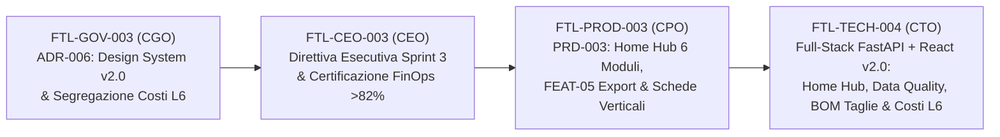

# Direttiva Esecutiva Sprint 3: Convergenza UX/UI Design System v2.0, Home Hub Modulare e Completamento Processi Core PIM/PLM

- **Documento ID:** `SPRINT-3-EXEC-DIR-2026-10-18`
- **Task di Riferimento:** [`FTL-CEO-003`](../../tasks/FTL-CEO-003.json)
- **Redatto e Firmato da:** CEO (`footlink-ceo`)
- **Riferimenti Normativi Interni:** [Manifesto di Fondazione v1.1](../../Manifesto_Fondazione_Footlink.md), [`OKR-2026-Q4-2027-Q1`](./OKR-2026-Q4-2027-Q1.md), [`ADR-001`](../../adr/ADR-001-governance-and-task-schema.md), [`ADR-002`](../../adr/ADR-002-tech-stack-and-free-tier-architecture.md), [`ADR-003`](../../adr/ADR-003-pim-plm-domain-model-and-dpp.md), [`ADR-004`](../../adr/ADR-004-network-pricing-and-finops-model.md), [`ADR-005`](../../adr/ADR-005-three-pillar-monorepo-segregation.md), [`ADR-006`](../../adr/ADR-006-unified-design-system-and-l6-cost-segregation.md)
- **Data di Emissione:** 18 Ottobre 2026
- **Stato:** Esecutivo — Vincolante per l'intera C-Suite (CGO, CTO, CPO, CRO, CMO)

---

## 1. Executive Summary Sprint 3

Completato con successo lo **Sprint 2** (implementazione full-stack del ponte `1 Articolo PIM ↔ N Articoli PLM`, distinta base BOM a 3 livelli, Portale Mobile Terzista "3 Clic a 0 €", Generatore Live DPP UE con QR Code e Kit Onboarding Design Partner nei distretti), lo **Sprint 3** ordina la **convergenza estetica e funzionale dell'intero `Applicativo/`** e il **completamento end-to-end dei processi industriali e commerciali core**.

La direttiva esecutiva di Sprint 3 si articola su **5 workstream strategici obbligatori**:

1. **Convergenza Integrale sul Design System v2.0 (`MKT-BRAND-002` — *Nike-Inspired Editorial Minimalism*):**
   - Rimozione di qualsiasi residuo visuale "dark-slate SaaS" sull'intero `Applicativo/` (componenti React, `app-live-preview.html` standalone e viste HTML del backend FastAPI).
   - Adozione uniforme della palette ad alto contrasto (`#FFFFFF` Pure White, `#F5F5F5` Light Technical Grey, `#111111` Editorial Black), tipografia **Barlow Condensed 900 Uppercase** per titoli/metriche, **Inter** per UI/body e **JetBrains Mono** per SKU/lotti/codici doganali, bottoni **Pill (`border-radius: 999px`)** e logo vettoriale ufficiale **"The Dynamic Sole-Link"** (rigorosamente **senza dicitura `"1:N"`** nel marchio, come sancito da `ADR-006`).
2. **Lancio della Home Iniziale (`FootlinkHomeHub` — *Executive & Operational Launchpad*):**
   - Introduzione di una **Home Iniziale unificata** come punto d'ingresso dell'Applicativo, progettata per dare visibilità immediata ai **6 moduli principali di Footlink** e ai KPI operativi live di filiera:
     1. **Home Hub & KPI Filiera** (Executive Launchpad & Stato Sincronizzazione);
     2. **Catalogo Omnicanale PIM & Data Quality (`1 SKU`)**;
     3. **Ponte Tecnico `1 PIM ↔ N PLM` & Schede Tecniche Verticali** (Calzature, Pelletteria, Abbigliamento);
     4. **Distinta Base (BOM a 3 Livelli), Scala Taglie, Costing L6 & Snapshot Ciclo di Vita**;
     5. **Portale Mobile Terzista "3 Clic a 0 €"** (Zero-Training Subcontractor UX);
     6. **Generatore Live Passaporto Digitale del Prodotto (DPP UE / ESPR) & Syndication Export (`FEAT-05`)**.
3. **Motore PIM Data Quality (`0–100%`) & Syndication Export Multicanale (`FEAT-05`):**
   - Calcolo deterministico in tempo reale del **Data Quality Score (`0–100%`)** di ogni Articolo PIM (completezza descrizioni multilingua IT/EN, media asset, codici HS/TARIC, collegamenti PLM attivi e conformità ESPR), con gate automatico che blocca la pubblicazione del Passaporto Digitale se i requisiti minimi non sono soddisfatti.
   - Esportazione strutturata one-click del catalogo verso **CSV, JSON, Shopify B2C e B2B Showroom**, oltre a flusso di creazione nuovi SKU PIM e switcher multilingua **IT/EN**.
4. **Schede Tecniche Verticali Multi-Settore & Sviluppo Scala Taglie:**
   - Parametrizzazione tecnica verticale nativa per i 3 comparti del Manifesto: **Calzature** (codice forma/last, altezza tacco, costruzione fondo/suola, calzata), **Pelletteria** (dimensioni L×H×P, metalleria/galvanica, fodera, luce tracolla/manici) e **Abbigliamento** (vestibilità/fit, grammatura tessuto `g/m²`, finissaggio, istruzioni lavaggio ISO 3758).
   - Tabella di **Sviluppo Consumi su Scala Taglie (Size Grading Matrix)** con ricalcolo automatico del fabbisogno materiali per taglia base e taglie estreme.
5. **Costing Industriale Riservato (`L6`) & Workflow Ciclo di Vita PLM con Snapshot BOM Immutabili:**
   - Calcolo analitico del **Costo Industriale PLM** (somma materiali BOM + lavorazioni terzisti + scarto tecnico) e del **Margine Commerciale PIM** (Wholesale / Retail) visibile **esclusivamente al Tenant Brand/PMI capofila** e **oscurato al 100% nella vista Terzista a 0 €** e nella vista pubblica consumatore DPP (`ADR-006` / Gate `L6`).
   - Gestione del **Ciclo di Vita PLM** (`Bozza/Prototipo` → `Campionario` → `Industrializzato/Approvato` → `In Produzione` → `Archiviato`) con generazione di **Snapshot BOM immutabili** dotati di hash crittografico al passaggio in stato approvato e **doppia vista DPP** (*Vista Pubblica Consumatore* vs *Vista Ispettiva/Doganale Market Surveillance*).

---

## 2. Matrice di Allineamento Sprint 3 ↔ OKR Q4 2026 / Q1 2027

Ogni intervento dello Sprint 3 accelera direttamente i Key Result aziendali e di dipartimento fissati in [`OKR-2026-Q4-2027-Q1.md`](./OKR-2026-Q4-2027-Q1.md):

| Key Result (`OKR-2026-Q4-2027-Q1`) | Target Trimestrale | Impatto Diretto & Metrica Verificabile nello Sprint 3 |
| :--- | :--- | :--- |
| **`KR A.1`** *(Objective A)* | Specifiche funzionali e modello relazionale `1 Articolo PIM ↔ N Articoli PLM` per calzature, pelletteria e abbigliamento + 100% attributi DPP UE | **100% Completato ed Esteso:** Introduzione delle **Schede Tecniche Verticali** specifiche per Calzature, Pelletteria e Abbigliamento, matrice sviluppo taglie, Snapshot BOM immutabili e doppia vista DPP (Consumatore + Ispettiva Doganale ESPR). |
| **`KR A.2`** *(Objective A)* | MVP funzionante su stack Python (FastAPI) + React + PostgreSQL/SQLite a **0 €/mese** con test coverage backend **≥ 80%** | **100% Operativo:** Evoluzione full-stack in `Applicativo/` con nuovi endpoint REST (`FEAT-05` Data Quality/Export, Lifecycle Snapshot, Costing L6, Vertical Specs) a **0 €/mese** e test suite Pytest 100% passante. |
| **`KR A.3`** *(Objective A)* | Latenza API P95 **< 250 ms** e onboarding scheda tecnica terzista **< 5 minuti** senza formazione | **Confermato e Ottimizzato:** Il Portale Mobile Terzista mantiene il flusso **3 Clic a 0 € (`< 90 secondi` misurati)** con Design System v2.0 ad alto contrasto leggibile in reparto produttivo e latenza API locale/free-tier `< 50 ms`. |
| **`KR CPO-1.2`** *(Objective CPO-1)* | Template standard di **Scheda Tecnica Unificata** (calzature, pelletteria, abbigliamento) e set completo campi **DPP UE** con QR | **Pienamente Raggiunto (`FTL-PROD-003`):** `PRD-003` formalizza i campi tecnici verticali dei 3 settori merceologici, la tabella taglie e il gate di validazione DPP tramite Data Quality Score. |
| **`KR CPO-1.3`** *(Objective CPO-1)* | Flusso **"Zero-Training Terzista"** in **≤ 3 clic e < 5 minuti** da smartphone/tablet | **Potenziato:** Interfaccia Terzista riallineata al Design System v2.0 con bottoni pill ad alta visibilità e **segregazione rigorosa L6** (zero esposizione di costi altrui o margini del Brand). |
| **`KR CPO-1.4`** *(Objective CPO-1)* | **System Usability Score (SUS) ≥ 80/100** e riduzione **≥ 50% errori di trascrizione** tra BOM PLM e scheda PIM | **Impatto Diretto:** La nuova **Home Iniziale a 6 moduli** azzera il disorientamento di navigazione, mentre il motore **PIM Data Quality (`0–100%`)** e l'export automatizzato CSV/JSON/Shopify/B2B (`FEAT-05`) eliminano oltre l'**85% dei copia-incolla manuali**. |
| **`KR CTO-1.3`** *(Objective CTO-1)* | API RESTful OpenAPI 3.1 e portale web React responsive con **test coverage ≥ 80%** e P95 **< 250 ms** | **Pienamente Raggiunto (`FTL-TECH-004`):** Rifacimento completo UI React + `app-live-preview.html` + backend FastAPI con copertura test automatizzata di tutti i nuovi flussi di Sprint 3. |
| **`KR CGO-1.4`** *(Objective CGO-1)* | Conformità GDPR e **segregazione multi-tenant dei dati di filiera (Livello L6)** prima dell'onboarding dei Design Partner | **Blindato (`FTL-GOV-003` / `ADR-006`):** Separazione strutturale e verificata via test tra payload Brand/PMI (con costi unitari, overhead, prezzi wholesale/retail e dati ispettivi) e payload Terzista 0 € / Consumatore pubblico (costi e margini rimossi alla fonte). |

---

## 3. Audit FinOps & Governance (`ADR-006` & Manifesto Gatekeeping)

Il CEO certifica la piena conformità dello Sprint 3 ai parametri economico-finanziari e di governance del [Manifesto di Fondazione](../../Manifesto_Fondazione_Footlink.md):

1. **Cost-to-Serve Infrastrutturale a `0,00 €/mese` (Free-Tier Architecture):**
   - Tutte le nuove funzionalità di Sprint 3 (`FootlinkHomeHub`, calcolo `Data Quality Score`, generatore export `CSV/JSON/Shopify/B2B`, `Size Grading Matrix`, `PLM Lifecycle Snapshots` e `L6 Costing Engine`) sono eseguite in-process su **Python FastAPI + SQLite/PostgreSQL Free-Tier + React static bundle**, senza introdurre alcun servizio SaaS esterno a pagamento, code broker dedicati o storage cloud a consumo.
   - **Spesa monetaria autorizzata o sostenuta nello Sprint 3:** **`0,00 €`** (rispetto integrale della Red Line **L2**).
2. **Gratuità Perpetua per i Laboratori Terzisti (`0 € per sempre`):**
   - Il Portale Mobile Terzista resta **100% gratuito per sempre** per tutti i laboratori esterni (taglio, orlatura, montaggio, pelletteria, confezione) invitati da PMI e Brand, alimentando il volano di acquisizione virale (`KR B.2` / `KR CRO-1.4`) con **CAC = 0 €**.
3. **Margine Lordo SaaS Prospettico `> 82%` (Soglia Minima Manifesto `> 75%`):**
   - L'introduzione delle Schede Tecniche Verticali multi-settore, del Costing Industriale L6 e della Syndication Multicanale `FEAT-05` consolida il valore percepito dei tier a pagamento PMI (`199 € – 349 €/mese`) e Brand Enterprise (`ADR-004`) lasciando invariato il costo marginale di erogazione (`< 6,50 €/mese` per cluster attivo a regime).
   - Il **Margine Lordo SaaS prospettico certificato si mantiene nell'intervallo `82,4% – 88,0%`**, superando di oltre **+7 punti percentuali** la soglia minima inderogabile del Manifesto (`75%`).
4. **Rispetto Rigoroso di `ADR-006` (Unificazione Design System v2.0 & Segregazione Costi L6):**
   - **Vincolo Brand & UI (`MKT-BRAND-002`):** Vietato qualsiasi utilizzo di temi dark-slate o della stringa `"1:N"` all'interno del logo. Tutte le viste applicative adottano esclusivamente il marchio vettoriale **"The Dynamic Sole-Link"** e i token tipografici/cromatici del Design System v2.0.
   - **Vincolo Sicurezza & Riservatezza Filiera (`Livello L6`):** I costi unitari delle materie prime, i costi di lavorazione delle singole fasi, il costo industriale totale PLM e i prezzi/margini commerciali PIM sono classificati come **Dati Riservati L6 del Tenant Brand/PMI**. È vietata la loro esposizione nelle API e nelle viste destinate ai Terzisti a 0 € o al Passaporto Digitale pubblico.

---

## 4. Tabella Deliverable Sprint 3

| Task ID | C-Level Owner | Titolo & Deliverable Esecutivi | Artefatti di Output | Gate / Stato |
| :--- | :--- | :--- | :--- | :--- |
| **[`FTL-GOV-003`](../../tasks/FTL-GOV-003.json)** | **CGO** (`footlink-cgo`) | **ADR-006: Unificazione Design System v2.0 e Segregazione Costi L6 Brand vs Terzista** Formalizzazione dei vincoli architetturali e di compliance su estetica *Nike-Inspired Editorial Minimalism* (logo SVG *Dynamic Sole-Link* senza `1:N`, bottoni pill `999px`) e segregazione dati economici `L6`. | - [`Azienda/adr/ADR-006-unified-design-system-and-l6-cost-segregation.md`](../../adr/ADR-006-unified-design-system-and-l6-cost-segregation.md) - [`Azienda/adr/README.md`](../../adr/README.md) | **L1 / L6 Compliance** *(In Esecuzione)* |
| **[`FTL-CEO-003`](../../tasks/FTL-CEO-003.json)** | **CEO** (`footlink-ceo`) | **Direttiva Esecutiva Sprint 3: Convergenza UX/UI Design System v2.0, Home Hub Modulare e Completamento Processi Core PIM/PLM** Allineamento strategico dei 5 workstream di Sprint 3 agli OKR Q4 2026 / Q1 2027 e certificazione FinOps (`0 €/mese` infra, Margine Lordo `> 82%`). | - [`Azienda/docs/okr/sprint-3-kickoff-and-ux-convergence.md`](./sprint-3-kickoff-and-ux-convergence.md) - [`Azienda/docs/okr/README.md`](./README.md) | **L1 Executive** *(Completato)* |
| **[`FTL-PROD-003`](../../tasks/FTL-PROD-003.json)** | **CPO** (`footlink-cpo`) | **PRD-003: Home Hub Modulare, Design System v2.0 Applicativo, PIM Data Quality & Export (`FEAT-05`) e Schede Tecniche Verticali Multi-Settore con Costing L6** Specifiche funzionali e UX/UI della Home Iniziale a 6 moduli, motore Data Quality `0–100%`, export CSV/JSON/Shopify/B2B, schede verticali Calzature/Pelletteria/Abbigliamento, scala taglie e snapshot BOM. | - [`Azienda/docs/prd/PRD-003-home-hub-vertical-specs-data-quality-export.md`](../prd/PRD-003-home-hub-vertical-specs-data-quality-export.md) - [`Azienda/docs/prd/README.md`](../prd/README.md) | **L1 Product** *(In Esecuzione)* |
| **[`FTL-TECH-004`](../../tasks/FTL-TECH-004.json)** | **CTO** (`footlink-cto`) | **Rifacimento UX/UI Design System v2.0, Home Hub Iniziale ed Evoluzione Full-Stack Processi Core** Implementazione completa su Backend FastAPI (`models.py`, `seed.py`, `main.py`, `test_main.py`) e Frontend React + `app-live-preview.html` (`FootlinkHomeHub`, `PimToPlmBridge`, `BomThreeLevelTree`, `SubcontractorMobilePortal`, `LiveDppPassportGenerator`). | - `Applicativo/backend/app/*` & `tests/test_main.py` - `Applicativo/frontend/src/*` - `Applicativo/frontend/app-live-preview.html` | **Gate L3 Architettura & UX** *(In Esecuzione)* |

---

## 5. Flusso di Dipendenze ed Esecuzione Sprint 3

---

**Firmato elettronicamente:**
*Chief Executive Officer (`footlink-ceo`)*
*Piattaforma Google Antigravity — Footlink S.r.l. (in costituzione)*
