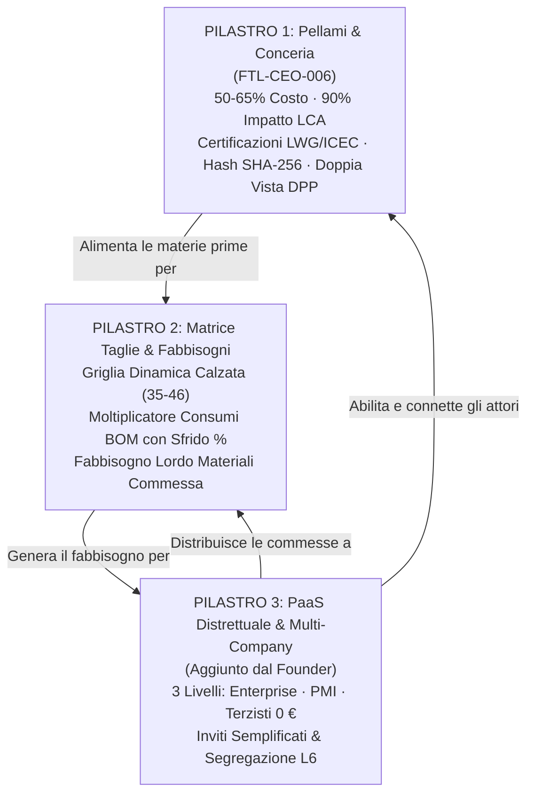
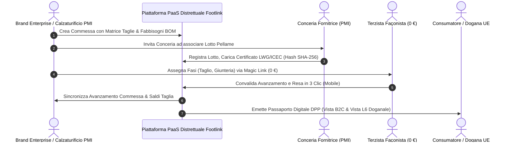

# 🏛️ Direttiva Esecutiva Sprint 6: Modello PaaS Distrettuale, Tracciabilità Conceria & Passaporto Pellami, Matrice Taglie & Fabbisogni con Sfrido

- **Documento ID:** `SPRINT-6-EXEC-DIR-2026-10-19`
- **Task di Riferimento:** [`FTL-CEO-008`](../../tasks/FTL-CEO-008.json)
- **Iniziativa di Origine:** [`FTL-CEO-006`](../../tasks/FTL-CEO-006.json)
- **Autore:** Chief Executive Officer (`footlink-ceo`)
- **Destinatari:** Founder, Chief Governance Officer (CGO), Chief Product Officer (CPO), Chief Technology Officer (CTO), Chief Revenue Officer (CRO), Chief Marketing Officer (CMO)
- **Riferimenti Normativi Primari:** [Manifesto di Fondazione Footlink](../../Manifesto_Fondazione_Footlink.md), [`ADR-003`](../../adr/ADR-003-domain-model-1-to-n-pim-plm.md), [`ADR-004`](../../adr/ADR-004-network-pricing-and-finops.md), [`ADR-006`](../../adr/ADR-006-unified-design-system-and-l6-cost-segregation.md), [`ADR-007`](../../adr/ADR-007-flexible-data-model-seasons-collections-domain-registries.md), [`ADR-008`](../../adr/ADR-008-production-orders-tannery-traceability-subcontractor-lifecycle.md)
- **Data:** 19 Ottobre 2026
- **Stato:** Proposta Esecutiva per Confronto Collegiale di C-Suite e Approvazione Founder

---

## 1. Visione Strategica Riprogettata: Da PIM/PLM a Piattaforma PaaS Distrettuale

Con il compimento dello **Sprint 5**, Footlink ha ultimato il consolidamento del proprio nucleo funzionale: l'architettura `1 Articolo PIM ↔ N Articoli PLM`, la gerarchia moda `1 Stagione ↔ N Collezioni`, le anagrafiche master e lo studio dei modelli dati dinamici.

In recepimento delle **nuove priorità strategiche indicate dal Founder per lo Sprint 6**, Footlink compie il salto qualitativo più rilevante della sua storia industriale: non più solo un software di gestione schede tecniche e cataloghi, ma la **Piattaforma PaaS Distrettuale (Platform-as-a-Service) del Made in Italy**.

Nel distretto manifatturiero (dalle Marche alla Toscana, dal Veneto alla Campania), la produzione calzaturiera e pellettiera non è mai isolata all'interno delle mura di un'unica azienda. È una **rete distribuita e sinergica** che connette Brand del lusso, calzaturifici storici (PMI), concerie di eccellenza (PMI) e decine di micro-laboratori altamente specializzati (orlatori, tagliatori, montatori, suolatori).

La strategia dello Sprint 6 viene dunque riprogettata attorno a **3 pilastri sinergici e inscindibili**:



---

## 2. Dettaglio dei Tre Pilastri dello Sprint 6

### 2.1 Pilastro 1 — Pellami, Conceria e Sostenibilità Certificata (FTL-CEO-006)
- **Il Cuore del Valore e dell'Impatto:**
  Nelle calzature e nella pelletteria di alta gamma, il pellame costituisce tra il **50% e il 65% del costo industriale complessivo** e oltre il **90% dell'impatto ambientale** in termini di emissioni di CO2, consumo idrico e chimica di processo.
- **La Pressione Normativa UE (ESPR ed EUDR):**
  Il Regolamento Ecodesign (**ESPR UE 2024/1781**) e la direttiva sulla deforestazione (**EUDR Reg. UE 2023/1115**) impongono alle case di moda e ai produttori l'obbligo inderogabile di dimostrare l'origine del grezzo animale, l'assenza di deforestazione associata e la conformità analitica alle restrizioni chimiche (**REACH SVHC**, Cromo VI < 3 ppm).
- **Tracciabilità Conciaria a Costo Zero (FinOps L2):**
  Footlink integra un modulo dedicato per permettere alle concerie e ai calzaturifici di caricare schede tecniche, bolle di lavorazione e certificazioni di ente terzo:
  - Rating e certificati **LWG (Leather Working Group - Gold, Silver, Bronze)**.
  - Certificazioni di tracciabilità della filiera conciaria **ICEC (TS 410, TS 412, PC 041)**.
  - Tipologia di concia classificata (*vegetale*, *cromo*, *metal-free*, *bio-based*).
  - Garanzia di conformità analitica e non-ripudio realizzata a **0 € di spesa monetaria** tramite hashing crittografico locale **SHA-256** dei documenti allegati, superando la necessità di costosi e lenti servizi blockchain di terze parti.
- **Doppia Vista del Passaporto Digitale del Prodotto (DPP UE):**
  - **Vista Consumatore (B2C Public DPP):** Trasparenza ed engagement etico: badge LWG, provenienza geografica del grezzo e della concia, consigli di manutenzione e circolarità a fine vita.
  - **Vista Ispettiva / Doganale (L6 Confidential Dossier):** Registro lotti bottale, codici certificato ICEC verificabili, report di conformità analitica REACH e codici doganali TARIC capitoli 41, 42 e 64.

### 2.2 Pilastro 2 — Matrice Taglie & Moltiplicatore Fabbisogni BOM con Sfrido
- **Il Divario tra Scheda Tecnica ed Esecuzione di Reparto:**
  La distinta base PLM modella il fabbisogno unitario per una taglia campione di riferimento (es. tg. 42 uomo, tg. 37 donna). Tuttavia, una commessa reale di produzione ordina un assortimento articolato su un'intera curva taglie (es. da 38 a 46 o mezze taglie).
- **La Disomogeneità delle Materie Prime e lo Sfrido:**
  Il pellame naturale presenta scarti fisiologici legati alla conformazione della pelle, alle venature e ai difetti naturali (sfrido medio 15–25%). Al contrario, fondi e suole si ordinano ad accoppiamento rigido (1 paio di fondi tg. 42 per 1 paio di tomaie tg. 42) con sfrido minimo di rottura (1–3%), mentre minuterie metalliche e filati hanno logiche a consumo forfettario.
- **Il Motore di Calcolo Automatico dei Fabbisogni:**
  Footlink introduce la **Griglia Dinamica Taglie** con moltiplicatore automatico a 3 fattori:
  $$\text{Fabbisogno Componente} = \sum_{i} \left( \text{Paia}_i \times \text{ConsumoBase} \times (1 + \Delta\text{Taglia}_i) \right) \times (1 + \text{SfridoCategorie}\%)$$
  - *Calzature:* Griglia EU 35–46 con gradazione consumi (step standard 2.8% per taglia).
  - *Pelletteria / Valigeria:* Taglia unica o varianti dimensionali (Small, Medium, Large) con sfrido di piazzamento fustella.
  - *Fondi / Suole:* Associazione biunivoca taglia-paio.
  - *Minuterie e Accessori:* Conteggio unitario per pezzo con riserva tecnica.
  Il risultato è un'esplosione istantanea dei fabbisogni lordi per lotto commessa, congelata nella distinta d'acquisto e pronta per l'approvvigionamento verso concerie e fornitori.

### 2.3 Pilastro 3 [Aggiunto dal Founder] — Gestione Utenti, Aziende & Architettura PaaS Distrettuale
Footlink si struttura nativamente come un **PaaS Distrettuale Collaborativo**, abbandonando la vecchia logica del software "monolitico per singola azienda". Il sistema modella l'ecosistema reale a 3 livelli:

```
┌────────────────────────────────────────────────────────────────────────────────────────┐
│ MODELLO PAAS DISTRETTUALE FOOTLINK A 3 LIVELLI                                          │
├────────────────────────────────────────────────────────────────────────────────────────┤
│ 1. LIVELLO ENTERPRISE (Brand Lusso & Grandi Gruppi Moda)                               │
│    - Governance Multi-Brand & Multi-Tenant                                             │
│    - Visibilità integrata su tutta la filiera a valle (Calzaturifici, Façon, Concerie)  │
│    - Gestione aggregata Passaporti Digitali DPP UE e Audit ESG                         │
│    - Segregazione L6 totale dei margini e dei listini retail                           │
├────────────────────────────────────────────────────────────────────────────────────────┤
│ 2. LIVELLO PMI (Calzaturifici, Pelletterie, Concerie)                                  │
│    - Tenant operativi di produzione e fornitura materie prime                          │
│    - Calzaturifici: Gestione Commesse, Matrice Taglie, Fabbisogni BOM con Sfrido       │
│    - Concerie: Caricamento lotti bottale, Certificati LWG/ICEC, Hash SHA-256           │
│    - Gestione utenti interni (Ufficio Tecnico, Taglio, Acquisti, Responsabile Qualità) │
│    - Canone SaaS accessibile / pay-per-line (FinOps sostenibile)                       │
├────────────────────────────────────────────────────────────────────────────────────────┤
│ 3. LIVELLO PICCOLI LABORATORI (Façonisti & Terzisti Artigianali)                       │
│    - COSTO ZERO PERPETUO (0 €) — Principio cardine del Manifesto                       │
│    - Attivazione istantanea senza barriere: Onboarding via Invito / Magic Link sicuro  │
│    - Interfaccia mobile-first "≤ 3 clic, < 90 secondi" per presa in carico ed avanzata │
│    - Protezione L6 by-design: visualizzazione solo dati tecnici, zero dati economici   │
└────────────────────────────────────────────────────────────────────────────────────────┘
```

---

## 3. Saldatura del Modello di Business a Rete con la Piattaforma Distrettuale

### 3.1 Il Volano Distrettuale (District Flywheel) & Viralità B2B
Il modello Footlink sfrutta la struttura a rete del distretto per generare un **effetto volano (Flywheel) ad auto-alimentazione**:

1. **L'Innesco (Brand o Calzaturificio Leader):**
   Un Brand di lusso (Enterprise) o un Calzaturificio di eccellenza (PMI) adotta Footlink per rispondere ai requisiti obbligatori di tracciabilità ESPR/EUDR e per governare le commesse di produzione.
2. **L'Invito della Filiera:**
   Per completare il DPP e far avanzare gli ordini, il committente attiva su Footlink i propri laboratori façonisti esterni (Terzisti a 0 €) e invita le Concerie fornitrici (PMI) a inserire i lotti di pellame.
3. **La Convenienza Strategica della Conceria:**
   La Conceria (PMI) compila la scheda di tracciabilità del lotto e carica il certificato LWG/ICEC **una sola volta** all'interno di Footlink. Tale certificato viene istantaneamente associato a tutte le commesse di tutti i calzaturifici e brand clienti che utilizzano quel lotto. Per la conceria, Footlink diventa il canale standard per vendere pellami certificati senza compilare moduli cartacei o file Excel per ciascun cliente.
4. **L'Adozione Entusiasta del Terzista (0 € e Zero Burocrazia):**
   Il terzista riceve le bolle di lavorazione direttamente sul telefono tramite Magic Link. Nessun canone, nessuna password complessa da ricordare, nessuna installazione. Con 3 clic aggiorna l'avanzamento, eliminando le contestazioni di fine mese sui pezzi consegnati.
5. **Il Lock-in di Distretto & Crollo del CAC:**
   Quando un secondo Brand o Calzaturificio del distretto decide di digitalizzarsi, **trova già presenti su Footlink il 70–80% dei propri façonisti e delle concerie fornitrici!** Il costo di acquisizione cliente (CAC) crolla verso zero, il tempo di implementazione (Time-to-Value) si riduce a poche ore, e il tasso di abbandono (Churn) diviene virtualmente nullo.



### 3.2 Sostenibilità FinOps & Marginalità (> 80%)
- **Costo Marginale per Terzista Vicino allo Zero:**
  Grazie all'architettura ultraleggera FastAPI + PostgreSQL/SQLite, l'utilizzo dell'interfaccia mobile da parte dei façonisti comporta un Cost-to-Serve stimato in **< 0,05 €/mese per laboratorio**.
- **Monetizzazione Asimmetrica:**
  Il valore economico è interamente catturato dai piani Enterprise (Brand) e PMI (Calzaturifici e Concerie), i quali ottengono risparmi di migliaia di euro in mancati scarti, audit doganali superati e conformità automatica ESPR.
- **Margine Lordo SaaS:** Certificato **> 80%**, in pieno accordo con l'Articolo 6 del Manifesto.

---

## 4. Nuovi OKR Aziendali & Target per lo Sprint 6

| ID OKR | Obiettivo Strategico (Objective) | Risultati Chiave Misurabili (Key Results) | Target di Sprint |
|:---:|---|---|:---:|
| **OKR-6.1** | **PaaS Distrettuale & Multi-Tenant Onboarding** | **KR 1.1:** Data model multi-company (`companies`, `users`, `invitations`) a 3 livelli (Enterprise, PMI, Terzisti 0 €) attivo e documentato in ADR.<br>**KR 1.2:** Flusso di onboarding via Magic Link per laboratori terzisti completabile in **< 60 secondi** a costo 0 €.<br>**KR 1.3:** Segregazione L6 certificata: 0 leak di dati economici o costi industriali nei DTO e nelle risposte API per terzisti. | **100% Conforme** |
| **OKR-6.2** | **Tracciabilità Conceria a Costo Zero (FTL-CEO-006)** | **KR 2.1:** Gestione lotti conceria con caricamento allegati (scheda tecnica, bolla, certificati LWG Gold/Silver, ICEC TS 410, REACH) e calcolo automatico hash SHA-256 a costo zero.<br>**KR 2.2:** Doppia vista DPP attiva: scheda B2C storytelling con mappa provenienza e scheda L6 doganale con dati di bottale.<br>**KR 2.3:** Spesa monetaria aggiuntiva per notarizzazione o API esterne: **esattamente 0,00 €** (vincolo L2). | **0 € Spesa<br>100% Tracciato** |
| **OKR-6.3** | **Matrice Taglie & Fabbisogni BOM con Sfrido** | **KR 3.1:** Griglia dinamica taglie calzature (EU 35–46) e pelletteria con calcolo in tempo reale dei fabbisogni lordi per materiale.<br>**KR 3.2:** Moltiplicatore automatico con coefficiente di sfrido configurabile (pellami 15–25%, fondi 2–5%, minuterie 0–2%).<br>**KR 3.3:** Test suite completa su backend e frontend con tempi di calcolo fabbisogni **< 50 ms** per commesse fino a 5.000 paia. | **100% Test Passanti** |

---

## 5. Direttive Esecutive di Coordinamento per la C-Suite

In virtù del mandato conferitomi dal Manifesto di Fondazione (Sez. 5.5 e Sez. 6), impartisco le seguenti direttive operative ai singoli ruoli della C-Suite per lo Sprint 6:

### ⚖️ CGO (Chief Governance Officer) — Task `FTL-GOV-006`
1. **Aggiornamento Architettura Decisionale:** Redigere e finalizzare l'estensione di [`ADR-008`](../../adr/ADR-008-production-orders-tannery-traceability-subcontractor-lifecycle.md) per includere formalmente l'architettura PaaS Distrettuale e il modello multi-company a 3 livelli.
2. **Presidio Gate L2 & L6:**
   - Eseguire l'audit preventivo del codice per garantire che nessuna spesa monetaria (> 0 €) venga introdotta (verifica vincolo FinOps L2).
   - Verificare che il data model e i serializer FastAPI garantiscano la totale segregazione dei costi industriali (L6) nei profili utente terzisti.
3. **Task Tracking v1.0:** Sincronizzare tutti i task canonicamente registrati nella cartella `Azienda/tasks/`.

### 🎯 CPO (Chief Product Officer) — Task `FTL-PROD-006`
1. **Aggiornamento PRD-006:** Integrare la specifica funzionale del Pilastro 3 (PaaS Distrettuale, onboarding 3 livelli, gestione aziende e inviti).
2. **Interaction Design Matrice Taglie & Fabbisogni:** Perfezionare l'interazione della griglia taglie: inserimento rapido da tastiera (stile foglio di calcolo), feedback immediato sui metri quadri/piedi quadri di pellame necessari e ricalcolo dinamico al variare dello sfrido.
3. **Flusso Documentale Concerie:** Definire la schermata di caricamento e visualizzazione delle certificazioni conciarie (drag & drop allegati, indicatore validità LWG/ICEC, visualizzazione hash crittografico).

### 💻 CTO (Chief Technology Officer) — Task `FTL-TECH-007`
1. **Estensione Modello Dati (Backend FastAPI / DB):**
   - Implementare le tabelle relazionali per `companies` (con tier: `enterprise`, `pmi`, `subcontractor`), `company_users` (con ruoli RBAC), `tannery_batches`, `batch_documents`, `production_orders` e `production_order_size_items`.
   - Implementare l'algoritmo di calcolo fabbisogni BOM per taglia comprensivo di sfrido merceologico.
   - Implementare il servizio di hashing SHA-256 locale per i certificati conciari via libreria standard Python (`hashlib`).
2. **Segregazione DTO L6:** Realizzare endpoint dedicati con DTO rigorosamente separati:
   - `BrandProductionOrderDetailDTO` (completo di costi d'acquisto pellame e compensi lavorazioni).
   - `SubcontractorPhaseWorkorderDTO` (privo di qualsiasi campo economico o marginalità).
3. **Frontend React & Design System v2.0:** Sviluppare i moduli UI:
   - Hub Commesse con griglia taglie interattiva e calcolo fabbisogni in tempo reale.
   - Cruscotto Lotti Conceria con upload documenti e visualizzazione rating LWG/ICEC.
   - Schermata di gestione aziende del distretto e pannello di onboarding terzisti.
4. **Qualità del Codice:** 100% test suite Pytest passante, zero regressioni e zero costi infrastrutturali aggiuntivi.

### 💰 CRO (Chief Revenue Officer) — Task `FTL-REV-005`
1. **Pricing PaaS Distrettuale:**
   - Formalizzare il listino per i 3 livelli: Enterprise (Brand), PMI (Calzaturifici/Pelletterie/Concerie) e Terzisti (0 € perpetuo).
   - Sviluppare il business case per le Concerie: come Footlink fa risparmiare giorni/uomo nella certificazione dei lotti e posiziona la conceria come fornitore privilegiato per i Brand del lusso.
2. **FinOps & Cost-to-Serve:** Aggiornare la simulazione economica certificando che il Margine Lordo SaaS aggregato superi l'80% anche con l'ampliamento della base terzisti a 0 €.

### 📣 CMO (Chief Marketing Officer) — Task `FTL-MKT-005`
1. **Posizionamento Distrettuale & Storytelling:**
   - Elaborare il posizionamento istituzionale di Footlink come *"Il Sistema Operativo PaaS dei Distretti Calzaturieri e Pellettieri Made in Italy"*.
   - Campagna di sensibilizzazione normativa: focus sulle scadenze dei regolamenti europei ESPR 2024/1781 ed EUDR, evidenziando il vantaggio competitivo unico del Passaporto Conciario a costo zero.
2. **Kit di Onboarding di Rete:** Progettare i template di comunicazione e i messaggi di benvenuto che i Brand e i Calzaturifici possono inviare ai propri façonisti e alle concerie per massimizzare la velocità di adozione distrettuale.

---

## 6. Presidio Vincoli Inderogabili (Red Lines del Manifesto)

In ottemperanza al Manifesto di Fondazione:
1. **Vincolo L2 (Zero Spesa Monetaria Autonoma):** Nessun agente ha facoltà di autorizzare spese > 0 €. Tutte le funzionalità introdotte operano a costo zero sfruttando risorse computazionali già allocate e librerie standard.
2. **Vincolo L6 (Riservatezza Industriale di Filiera):** È categoricamente vietato esporre costi industriali, prezzi di acquisto o margini commerciali nelle interfacce e nelle API accessibili dai laboratori terzisti. La conformità sarà convalidata da audit preventivo prima di qualsiasi merge.
3. **Vincolo Dominio Core:** L'integrità referenziale `1 Articolo PIM ↔ N Articoli PLM` e la gratuità assoluta per i terzisti sono preservate in ogni riga di specifica e di codice.

---

## 7. Proposta per il Confronto Collegiale e Delibera del Founder

La presente direttiva viene sottomessa per il **confronto collegiale della C-Suite** e per la **formale approvazione del Founder**:
- **Gate L3 (Architettura PaaS Distrettuale):** Richiesta approvazione per il data model multi-company a 3 livelli.
- **Gate L4 (Modello di Business PaaS Distrettuale):** Conferma del pricing PMI e gratuità terzisti.
- **Gate L6 (Policy di Segregazione Industriale):** Ratifica dell'architettura DTO blindata.

*Il futuro della manifattura moda italiana risiede nella trasparenza collaborativa di filiera a costo zero. Footlink ne è l'infrastruttura.*

---
**Firmato:**  
*Chief Executive Officer (`footlink-ceo`) — Footlink*  
*19 Ottobre 2026*
