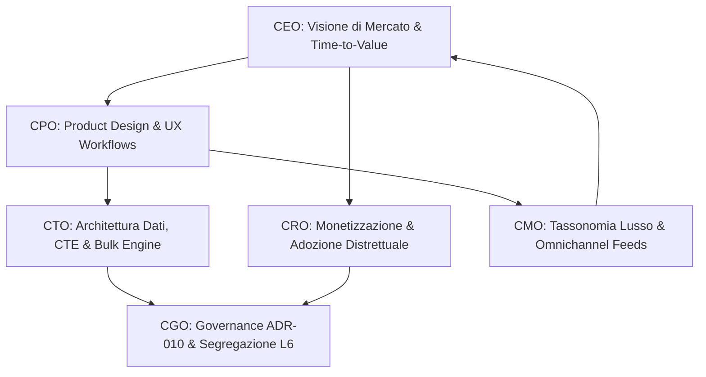

# 🏛️ Footlink C-Suite Summit — Definizione Strategica SPRINT 7
## "Deep Data Structuring, Product Hierarchies & Accelerated Article/BOM Onboarding"

**Data Sessione:** 20 Ottobre 2026  
**Presidenza:** Founder & CEO (`footlink-ceo`)  
**Partecipanti:** 
- **CEO** — Amministratore Delegato (`footlink-ceo`)
- **CGO** — Chief Governance Officer (`footlink-cgo`)
- **CTO** — Chief Technology Officer (`footlink-cto`)
- **CPO** — Chief Product Officer (`footlink-cpo`)
- **CRO** — Chief Revenue Officer (`footlink-cro`)
- **CMO** — Chief Marketing Officer (`footlink-cmo`)
**Stato:** Approvato all'unanimità dalla C-Suite — Sottoposto al Founder per Validazione Esecutiva  
**Riferimenti:** [Manifesto di Fondazione](../../Manifesto_Fondazione_Footlink.md), [`ADR-007`](../../adr/ADR-007-flexible-data-model-seasons-collections-domain-registries.md), [`ADR-008`](../../adr/ADR-008-production-orders-tannery-traceability-subcontractor-lifecycle.md), [`ADR-009`](../../adr/ADR-009-pause-work-orders-hub-and-refocus-plm-pim-leather-vault.md)

---

## 1. Sintesi Esecutiva & Mandato Strategico

Negli Sprint precedenti Footlink ha consolidato le fondamenta della piattaforma:
1. **Sprint 1–3:** Il ponte fondante `1 Articolo PIM (Vendita) ↔ N Varianti PLM (Produzione)`, la distinta base gerarchica a 3 livelli (`L1/L2/L3`), il Design System editoriale v2.0 e la segregazione dei costi industriali (Livello L6).
2. **Sprint 4–5:** La semplificazione dell'interfaccia a moduli di processo, la gestione del calendario moda (`1 Stagione ↔ N Collezioni`), le anagrafiche di dominio centralizzate con editing interattivo e il motore di estensione dati flessibile (`DataModelSchemaStudio`).
3. **Sprint 6:** La specializzazione dell'**Area Prodotti PLM** (`PlmProductsManager`), del **PIM Hub** (`PimCatalogManager`), del **Passaporto Pellami & Vault Conceria** (`TanneryVaultManager`), la gestione delle scale taglie certificate e il genere target.

### La Sfida di Sprint 7
Nel passaggio dai prototipi all'adozione industriale su scala nei distretti (Marche, Toscana, Veneto), i Brand e le PMI manifatturiere si trovano a gestire **collezioni complesse con centinaia di SKU e migliaia di righe di distinta base**. 
Oggi il sistema gestisce categorie merceologiche piatte (*Footwear, Leather Goods, Apparel*) e il caricamento di ciascun articolo con la relativa BOM richiede passaggi manuali sequenziali.

Il mandato del Founder per lo **SPRINT 7** richiede di **andare in profondità sulle funzionalità esistenti**, potenziando la piattaforma su 3 direttrici complementari:
1. **Profondità e Struttura Dati:** Superare la categoria piatta introducendo una **tassonomia merceologica multi-livello** e una matrice di **classificatori commerciali e di merchandising** (piramide di collezione, carryover, linea, occasione d'uso, segmento prezzo, canale).
2. **Accelerazione Caricamento Articoli e Distinte Basi:** Eliminare l'attrito manuale attraverso **Wizard di onboarding rapido**, **Duplicazione intelligente / Deep Copy ricorsivo di modelli e varianti con tutta la BOM**, e **Template/Presets BOM standard riutilizzabili**.
3. **Bulk Onboarding & Import/Export Massivo:** Fornire un motore affidabile di importazione ed esportazione Excel/CSV con **validazione preventiva (Dry-Run)** per caricare cataloghi interi e alberi di distinta base in pochi secondi.

---

## 2. Tavola Rotonda Esecutiva della C-Suite



### 🎯 2.1 Intervento del CEO (`footlink-ceo`)
> *"Il nostro obiettivo non è diventare una fotocopia complessa e lenta dei PLM legacy americani (Centric, Lectra) o dei PIM generalisti (Akeneo), ma offrire alle maison del lusso e alle PMI della calzatura uno strumento chirurgico, ultra-reattivo e perfettamente calzato sulle logiche dei nostri distretti.
>
> Il vero collo di bottiglia che frena un Brand dal passare a Footlink è il costo psicologico e temporale della migrazione dati: se per caricare una collezione di 150 modelli e le relative distinte basi servono due settimane di data-entry manuale, il cliente esita. Se invece Footlink consente di:**
> 1. *Importare il catalogo Excel con le BOM in 60 secondi con validazione immediata;*
> 2. *Clonare una sneaker iconica cambiando solo il pellame su tomaia in 2 clic;*
> 3. *Organizzare il campionario secondo la vera gerarchia moda (Macro-settore > Famiglia > Tipologia > Costruzione) e classificare gli articoli tra Carryover continuativi e Capsule stagionali;*
> 
> *allora il Time-to-Value si riduce del 90% e la nostra proposizione diventa irresistibile. Sprint 7 è lo sprint della maturità strutturale e della velocità operativa."*

### 🎨 2.2 Intervento del CPO (`footlink-cpo`)
> *"Dal punto di vista dell'esperienza utente e del workflow di prodotto, Sprint 7 trasforma il lavoro quotidiano di product manager, modellisti e responsabili campionario.
>
> Abbiamo progettato 4 pilastri funzionali integrati direttamente nelle aree esistenti (PLM Products, PIM Hub, Registries):*
>
> 1. **Gerarchia Merceologica a 3+1 Livelli:**
>    - **L1 - Divisione/Macro-Settore:** Calzature, Pelletteria, Abbigliamento.
>    - **L2 - Famiglia di Prodotto:** es. Sneakers, Scarpe Classiche / Eleganti, Mocassini, Stivali & Stivaletti, Sandali, Décolleté & Tacchi.
>    - **L3 - Sotto-Famiglia / Tipologia:** es. Low-Top Sneaker Fondo Cassetta, Running Retrò, Derby, Oxford, Penny Loafer, Gommino da Guida, Chelsea Boot, Biker.
>    - **L4 - Tipo di Costruzione / Montaggio:** es. Cassetta Cucita, Blake, Goodyear, Tubolare/Sacchetto, Strobel, Vulcanizzata, Ago.
>
> 2. **Matrice Classificatori Commerciali & Merchandising:**
>    - **Piramide di Collezione:** `Carryover / Continuativo` (il vero motore economico del lusso: modelli permanenti non soggetti a saldo), `Seasonal Core` (il cuore della stagione), `Fashion Trend / Runway` (pezzi sfilata d'immagine), `Capsule / Limited Edition / Drop` (collaborazioni speciali).
>    - **Linea di Prodotto:** Main Collection, First Line, Sport/Urban Line, Heritage Archives.
>    - **Occasione d'Uso (Lifestyle):** Business Formal, Smart Casual, Evening / Gala, Urban Active, Outdoor Leisure.
>    - **Fascia Prezzo (Price Tier):** Entry Luxury, Core Luxury, High Luxury, Bespoke / Haute Couture.
>    - **Canale Commerciale Target:** Retail Flagship, Wholesale B2B Showroom, E-Commerce Diretto, Department Store, Travel Retail.
>
> 3. **Acceleratori di Caricamento Articoli & Distinte Basi:**
>    - **Deep Copy / Duplicazione con Variazione BOM:** Un pulsante *'Duplica Modello/Variante'* che clona istantaneamente l'anagrafica e l'intero albero BOM a 3 livelli. Un sub-step opzionale permette di applicare una sostituzione rapida di materiali (es. *'Sostituisci Vitello Nero con Camoscio Deserto su tomaia L1'*), azzerando la ricostruzione manuale della distinta.
>    - **BOM Templates & Kits di Default:** Una libreria di distinte base standard per tipologia (es. *Preset Sneaker Cassetta Uomo*, *Preset Décolleté Fodera Capra*, *Preset Borsa Tote con Tracolla*). In fase di creazione variante, basta un clic per popolare la BOM di base con tutti i nodi L1, L2, L3 pronti per la personalizzazione.
>    - **Quick Onboarding Wizard (3 Step):** Procedura guidata rapida per inserire in sequenza PIM, PLM e BOM senza saltare da una schermata all'altra.
>
> 4. **Motore di Importazione/Esportazione Massiva Excel/CSV:**
>    - Download di template standard con intestazioni pulite e guidate.
>    - Finestra di upload con **validatore preventivo (Dry-Run)** che analizza le righe, verifica le chiavi univoche, le relazioni padre-figlio della BOM e i codici anagrafica, evidenziando gli errori prima del salvataggio nel database."*

### 💻 2.3 Intervento del CTO (`footlink-cto`)
> *"Sul piano ingegneristico e architetturale, Sprint 7 introduce modelli relazionali robusti ma mantiene totale coerenza con la filosofia Footlink: stack snello, zero debito tecnico, performance istantanee sia con SQLite locale che con PostgreSQL cloud, e FinOps L2 rispettato (0,00 € di spesa infrastrutturale aggiuntiva).
>
> I requisiti tecnici chiave che implementeremo:*
>
> 1. **Modello Dati Gerarchico per Categorie (`product_categories_hierarchy`):**
>    - Struttura auto-referenziale `id`, `parent_id`, `path_slug` (es. `footwear/sneakers/low-top-cassetta`), `level` (1..4), `label_it`, `label_en`, `is_active`, `sort_order`.
>    - Implementazione di query ad albero con Common Table Expressions ricorsive (`WITH RECURSIVE`) per estrazione ad altissima velocità e caricamento istantaneo del selettore a cascata.
>
> 2. **Estensione Anagrafica PIM/PLM con Classificatori:**
>    - Aggiunta in `PimCommercialItemORM` e `PlmProductionVariantORM` delle chiavi di collegamento gerarchico (`category_id`, `sub_category_id`, `construction_type`) e dei classificatori commerciali (`carryover_status`, `brand_line`, `target_occasion`, `price_tier`).
>    - Mantenimento della retro-compatibilità con il campo stringa `category` preesistente per garantire il funzionamento senza interruzioni di tutti gli export e test storici.
>
> 3. **Servizio di Deep Copy Ricorsivo BOM:**
>    - Metodo backend dedicato `clone_variant_with_bom(source_variant_id, target_payload, material_replacements_map)`: esegue una copia atomica (in singola transazione DB) di tutti i nodi BOM (L1, L2, L3), preservando le relazioni gerarchiche `parent_bom_item_id`, ricalcolando i nuovi `bom_item_id` e applicando le sostituzioni materiali richieste.
>
> 4. **BOM Template Engine:**
>    - Tabella relazionale `bom_templates` e `bom_template_items` (o serializzazione nativa collegata alle anagrafiche di dominio) per caricare kit componenti pronti per l'uso.
>
> 5. **Bulk Import/Export Parser Atomico con Dry-Run:**
>    - Endpoint `POST /api/v1/bulk-import/validate`: effettua il parsing del file CSV/Excel, valida i formati, verifica che le collezioni e le categorie esistano, controlla l'integrità dei nodi BOM orfani e restituisce un report sintetico con `valid_rows_count`, `invalid_rows_count` ed elenco puntuale degli errori.
>    - Endpoint `POST /api/v1/bulk-import/commit`: se la validazione è approvata dall'utente, esegue l'inserimento atomico con transazione singola (rollback automatico in caso di errore).
>
> 6. **Test Suite:**
>    - Espansione della suite Pytest per coprire al 100% l'albero gerarchico, la duplicazione BOM con sostituzione materiali e il parser di import massivo."*

### ⚖️ 2.4 Intervento del CGO (`footlink-cgo`)
> *"La governance garantisce che la rapidità di caricamento e la ricchezza tassonomica non compromettano l'integrità dei dati e la segregazione dei ruoli.
>
> I presidi inderogabili di Governance per Sprint 7:*
>
> 1. **Formalizzazione `ADR-010`:** Redazione immediata dell'Architecture Decision Record per tracciare la nuova gerarchia merceologica, la gestione dei classificatori di merchandising e il motore di import/export atomico.
> 2. **Presidio Gatekeeping L6 (Segregazione Industriale & Dati Riservati):**
>    - Quando un Brand esporta o importa massivamente distinte basi (BOM), i campi economici riservati (`cost_eur`, listini terzista) devono rimanere rigorosamente segregati. Se l'operazione è effettuata da un utente con visibilità terzista (Profilo Terzista a 0 €), i costi unitari non vengono esportati né visualizzati.
> 3. **Validazione Task Object Schema v1.0:**
>    - Tutti i 6 task di Sprint 7 (`FTL-CEO-013`, `FTL-GOV-007`, `FTL-PROD-010`, `FTL-TECH-012`, `FTL-REV-006`, `FTL-MKT-006`) saranno debitamente codificati e sincronizzati in `Azienda/tasks/` e nella dashboard del Founder.
> 4. **Vincolo FinOps L2:** 
>    - Il parsing CSV/Excel viene gestito nativamente da librerie Python open-source prive di costi di licenza o API esterne a consumo. Nessuna spesa monetaria autonoma (> 0 €)."*

### 💰 2.5 Intervento del CRO (`footlink-cro`)
> *"Sprint 7 ha un impatto diretto e quantificabile sul fatturato e sull'efficienza di vendita B2B di Footlink:
>
> 1. **Crollo del Time-to-Value (TTV):** Oggi un calzaturificio o un marchio impiega mediamente 20-30 giorni per popolare un nuovo PLM con il campionario in partenza. Con il motore di import massivo e i template BOM preconfigurati, abilitiamo il caricamento di un intero campionario (150 modelli, 450 varianti, 2.500 nodi BOM) in meno di 2 ore.
> 2. **Conversione Demo Commerciali:** Durante le demo con i direttori generali dei marchi marchigiani e toscani, la dimostrazione pratica di:
>    - Clonare una sneaker e generare la variante estiva con BOM modificata in 10 secondi;
>    - Filtrare il catalogo per 'Carryover vs Seasonal' per isolare i modelli ad alto margine continuativo;
>    costituisce il 'momento wow' che chiude i contratti SaaS Enterprise.
> 3. **Protezione dei Margini FinOps:** La gratuità perpetua per i façonisti terzisti a 0 € rimane intatta. Il modulo di import e gerarchia avanzata è una feature ad alto valore che valorizza il piano Brand e Manifattura PMI, consolidando il Margine Lordo SaaS oltre l'80%."*

### 📣 2.6 Intervento del CMO (`footlink-cmo`)
> *"Nel settore moda e lusso, il linguaggio e la tassonomia sono la base della credibilità. I marchi non ragionano solo in 'scarpe' o 'borse': ragionano in famiglie di stile, occasioni d'uso e soprattutto in **struttura della collezione**.
>
> I contributi del marketing per Sprint 7:*
>
> 1. **Lessico di Settore Certificato:** Integrare nelle anagrafiche predefinite una nomenclatura rigorosa sia in italiano che in inglese (es. *'Penny Loafer / Mocassino Classico'*, *'Derby Francesina'*, *'Sneaker Cupsole / Cassetta'*, *'Tote Bag / Borsa Shopping'*).
> 2. **Valorizzazione della Piramide di Collezione:** Il concetto di *Carryover / Iconico* è fondamentale per la narrazione di marca nel lusso contemporaneo (la sostenibilità economica e ambientale si basa su prodotti senza tempo che non vanno al macero). Renderemo questo classificatore ben visibile con badge visivi dedicati in tabella e nei filtri.
> 3. **Syndication Multicanale Arricchita:** I classificatori commerciali arricchiranno i feed B2B (NuORDER, JOOR) e i canali e-commerce (Shopify Plus) generati dal PIM Hub, offrendo tag di navigazione e filtri di collezione già pronti per i buyer internazionali."*

---

## 3. Matrice Strategica dei 4 Pilastri di SPRINT 7

```
+---------------------------------------------------------------------------------------------------+
|                                        SPRINT 7 STRATEGY                                          |
|                                                                                                   |
|  [PILASTRO 1: GERARCHIA MERCEOLOGICA]            [PILASTRO 2: CLASSIFICATORI COMMERCIALI]         |
|  - Macro-Settore (Footwear, Leather, Apparel)    - Piramide Collezione (Carryover, Core, Capsule) |
|  - Famiglia Merceologica (Sneaker, Loafer, etc)  - Linea di Prodotto (Main, Lab, Heritage)        |
|  - Sotto-Famiglia / Tipologia (Low-Top, Derby)   - Occasione d'Uso (Formal, Active, Gala)         |
|  - Costruzione Tecnica (Cassetta, Blake, etc)    - Fascia Prezzo & Canali Preferenziali           |
|                                                                                                   |
|  [PILASTRO 3: ACCELERATORI ARTICOLI & BOM]       [PILASTRO 4: BULK DATA ONBOARDING]               |
|  - Deep Copy / Duplica Variante con BOM          - Motore Import/Export Excel e CSV               |
|  - Variazione Rapida Materiali guidata           - Validatore Preventivo Dry-Run & Error Report   |
|  - Libreria Preset & Template BOM Standard       - Inserimento Atomico Transazionale              |
|  - Quick Onboarding Wizard (3 Step)              - Segregazione Costi L6 su export                |
+---------------------------------------------------------------------------------------------------+
```

### 3.1 Dettaglio Pilastro 1: Gerarchia Merceologica Multi-Livello
- Creazione della tabella `product_categories_hierarchy` con supporto ad alberi N-livelli.
- Preset iniziali pronti all'uso per i tre settori core (Calzature, Pelletteria, Abbigliamento).
- Selettore a cascata integrato nei form di creazione/modifica PIM e PLM.
- Filtri ad albero nella toolbar della tabella `PlmProductsManager` e `PimCatalogManager`.

### 3.2 Dettaglio Pilastro 2: Classificatori Commerciali & Merchandising
- Integrazione delle dimensioni di merchandising:
  - **Carryover Status:** `carryover` (Iconico Continuativo), `seasonal_core` (Volume Stagionale), `seasonal_trend` (Moda/Sfilata), `capsule_drop` (Edizione Limitata).
  - **Brand Line:** Main Line, Sport Line, Studio / Heritage.
  - **Occasione d'Uso:** Formal/Business, Smart Casual, Evening, Sport/Active, Leisure.
  - **Segmento Prezzo:** Entry, Core, Premium, High Luxury.
- Badge visivi eleganti in tabella (es. badge dorato per `Carryover`, badge viola per `Capsule Drop`).
- Sincronizzazione automatica con i filtri del PIM Hub e gli export feed.

### 3.3 Dettaglio Pilastro 3: Duplicazione & Clonazione Rapida con Distinta Base (BOM)
- **Azione "Duplica Variante":**
  - Modal dedicata con scelta del nuovo codice variante (es. da `MOD-01-NER` a `MOD-01-COG`), colore e scala taglie.
  - Checkbox *"Clona intera distinta base (BOM) a 3 livelli"*.
  - Tabella di *"Sostituzione Rapida Materiali"*: elenco dei materiali L1 (tomaia/fodera) con possibilità di selezionare il materiale alternativo per la nuova variante con 1 clic.
- **BOM Templates & Kits:**
  - Possibilità di salvare una BOM esistente come *"Template Standard"*.
  - Dropdown *"Applica Template BOM"* nella vista creazione o nell'albero BOM per popolare istantaneamente la struttura.

### 3.4 Dettaglio Pilastro 4: Bulk Onboarding & Motore Import/Export Excel/CSV
- **Template di Importazione Scaricabili:**
  - Template 1: *Articoli PIM & Varianti PLM* (con codici, gerarchie, classificatori, prezzi e scale taglie).
  - Template 2: *Distinte Basi Annidate (BOM L1/L2/L3)* (con SKU padre, tipo componente, materiale, fornitore, UoM, consumo, sfrido %, certificazioni).
  - Template 3: *All-in-One Fast Onboarding* (riga articolo con componenti principali).
- **Dry-Run Validation Engine:**
  - Parsing del file caricato senza scrittura immediata su disco.
  - Verifica della coerenza referenziale (le collezioni esistono? i codici genitore nella BOM sono validi?).
  - Tabella di anteprima visiva con evidenziazione in verde delle righe valide e in rosso degli errori specifici.
- **Commit Transazionale:**
  - Salvataggio solo previa conferma esplicita dell'utente.

---

## 4. Piano Operativo C-Suite & Matrice dei 6 Task Canonici

I 6 task operativi di **Sprint 7** sono strutturati in conformità al Task Object Schema v1.0 e allineati con i vincoli del Manifesto di Fondazione:

| Task ID | Ruolo | Titolo Task | Priorità | Effort Stimato | Dipendenze | Escalation Founder |
|---|:---:|---|:---:|:---:|---|:---:|
| **`FTL-CEO-013`** | **CEO** | Direttiva Esecutiva Sprint 7: Gerarchia Prodotti, Classificatori Merchandising e Motore di Caricamento Rapido Articoli & BOM | 🔴 `critical` | `M (1-3gg)` | — | No (`L1`) |
| **`FTL-GOV-007`** | **CGO** | ADR-010: Architettura Tassonomia Multi-Livello, Merchandising Matrix e Motore Atomico di Import/Clonazione BOM con Segregazione L6 | 🔴 `critical` | `S (<1g)` | `FTL-CEO-013` | No (`L1`) |
| **`FTL-PROD-010`** | **CPO** | PRD-008: Specifiche Funzionali e Interaction Design per Tassonomia a 3 Livelli, Classificatori di Collezione, Deep Copy BOM e Bulk Import Wizard | 🔴 `critical` | `M (1-3gg)` | `FTL-CEO-013`, `FTL-GOV-007` | No (`L1`) |
| **`FTL-TECH-012`** | **CTO** | Sviluppo Full-Stack: DDL Gerarchia Categorie, Query CTE Ricorsive, API Deep Copy BOM, Template Engine, Parser Bulk Import Atomico e Componenti UI React | 🔴 `critical` | `L (3-5gg)` | `FTL-PROD-010`, `FTL-GOV-007` | No (`L1`) |
| **`FTL-REV-006`** | **CRO** | Analisi Impatto Commerciale & FinOps Sprint 7: Riduzione TTV a < 2h, Enablement Vendite Enterprise e Tutela Gratuita Terzisti | 🟠 `high` | `S (<1g)` | `FTL-CEO-013`, `FTL-PROD-010` | No (`L1`) |
| **`FTL-MKT-006`** | **CMO** | Glossario Tassonomia Moda/Lusso, Allineamento Standard B2B (NuORDER/JOOR) e Guide Visive all'Onboarding Rapido di Campionario | 🟠 `high` | `S (<1g)` | `FTL-CEO-013`, `FTL-PROD-010` | No (`L1`) |

---

## 5. Sintesi della Bozza `ADR-010` (Proposta CGO & CTO)

- **Titolo:** `ADR-010: Gerarchia Prodotti Multi-Livello, Classificatori Commerciali di Merchandising e Motore di Caricamento Rapido e Clonazione BOM`
- **Stato:** Proposta in fase di validazione del Founder
- **Decisioni Chiave:**
  1. *Schema Relazionale:* Introduzione di `product_categories_hierarchy` con navigazione padre-figlio e calcolo ricorsivo del path.
  2. *Classificatori:* Colonne indicizzate su `pim_commercial_items` e `plm_production_variants` per `carryover_status`, `brand_line`, `target_occasion`, `price_tier`.
  3. *Deep Copy BOM:* Endpoint transazionale per clonare in singola transazione l'intero albero di distinta base a 3 livelli, con mappa di sostituzione materiali.
  4. *Bulk Import:* Servizio backend bi-fase (`validate` dry-run + `commit`) basato su librerie standard e streaming CSV/Excel a zero spesa FinOps.
  5. *Segregazione Costi L6:* Filtro server-side sui campi economici in esportazione in base al ruolo dell'utente (`brand` vs `subcontractor`).

---

## 6. Prossimi Passi e Richiesta di Approvazione al Founder

Con la presente delibera unanime della C-Suite, si richiede al Founder:
1. **Conferma e approvazione della direzione strategica di SPRINT 7** sui 4 pilastri definiti.
2. **Autorizzazione all'avvio operativo dei task** (`FTL-CEO-013`, `FTL-GOV-007`, `FTL-PROD-010`, `FTL-TECH-012`, `FTL-REV-006`, `FTL-MKT-006`) con registrazione nel Founder Control Center.

*Documento redatto e sottoscritto dalla C-Suite di Footlink.*
