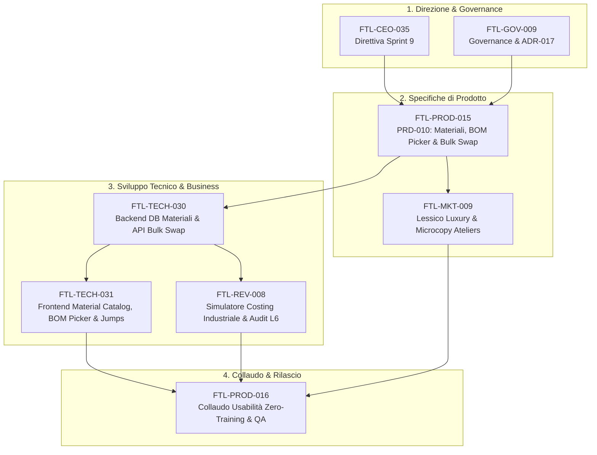

# 📋 Sprint 9 — Proposte C-Suite, Valutazione CEO/CGO e Piano di Sviluppo Esecutivo

**Data:** 29 Ottobre 2026  
**Autori:** CEO, CGO, CTO, CPO, CRO, CMO  
**Riferimento Direttiva Founder:** *"SPRINT 9 - Focus su usabilità, coerenza e flessibilità delle funzionalità implementate finora"*  
**Stato:** 🟡 Sottomesso a Revisione e Approvazione del Founder (Livello L1/L4)  

---

## Executive Summary

Con la conclusione trionfale dello **Sprint 8 ("La Ripartenza")**, che ha aperto l'**Epoca II ("La Verticalizzazione")** introducendo i due motori verticali della *Gestione Colori Intelligente* e dell'*Albo Fornitori & Terzisti 360°*, la piattaforma Footlink ha raggiunto una solida ampiezza di dominio su 8 moduli operativi.

In piena coerenza con la direttiva del Founder per lo **Sprint 9**, la C-Suite non propone l'aggiunta di moduli orizzontali superflui (*Zero Horizontal Bloat* - `ADR-011`), ma converge all'unanimità su un'azione coordinata per elevare ai massimi livelli di mercato **l'usabilità, la coerenza e la flessibilità** delle funzionalità già realizzate.

Il presente documento sintetizza:
1. Le **proposte analitiche dei singoli C-Level** con le rispettive lenti di competenza;
2. Il **vaglio congiunto e la sintesi strategica di CEO e CGO** (inclusa la risoluzione organica del backlog `FTL-CEO-029` "Gestione Materiali");
3. Il **Piano di Sviluppo Esecutivo per lo Sprint 9**, strutturato in 3 Pilastri, 8 Task tracciati e una nuova Architecture Decision Record (**`ADR-017`**).

---

## 1. Le Proposte dei singoli C-Level

### 🎨 CPO (Chief Product Officer) — User Experience, Ergonomia & Flussi di Fabbrica
*Focus:* Eliminare le frizioni del lavoro quotidiano per stilisti, modellisti, responsabili acquisti e direttori di produzione.

1. **Gestione Centralizzata Materiali & Selezione Guidata nella Distinta Base (BOM):**
   - *Frizione attuale:* L'inserimento dei componenti nella BOM a 3 livelli avviene ancora con testo libero per il nome del materiale. Questo crea incongruenze tipografiche (es. *"Camoscio Nero 1.2mm"* vs *"Pelle Camoscio Nero"*), rende impossibile tracciare i consumi aggregati tra modelli diversi e richiede di digitare manualmente prezzi e fornitori.
   - *Proposta:* Implementare l'anagrafica centralizzata dei **Materiali di Filiera** (`FTL-CEO-029`) con un **BOM Material Picker guidato**: aprendo l'aggiunta o modifica di un nodo BOM, l'utente dispone di una ricerca rapida con autocomplete su categorie certificate (Pellami, Fodere, Tessuti, Fondi, Tacchi, Minuterie Metalliche, Filati, Packaging), con auto-compilazione istantanea di Fornitore collegato, Unità di Misura e Costo Standard.
2. **Navigazione Cross-Modulo a Contesto Preservato ("Contextual Jumps"):**
   - *Frizione attuale:* Se l'utente sta esaminando un modello nel PIM (Modulo 03) o in una Collezione (Modulo 01), per andare a modificare la distinta base deve cliccare sul Modulo 02, cercare il modello e ri-selezionare la variante.
   - *Proposta:* Introdurre pulsanti contestuali diretti:
     - Da Collezione (Mod. 01) ➔ *1-Click Jump* alla scheda tecnica PLM nel Modulo 02.
     - Da PIM (Mod. 03) ➔ *1-Click Jump* alla variante industriale PLM nel Modulo 02.
     - Da Riga BOM (Mod. 02) ➔ *1-Click Jump* al profilo Fornitore nel Modulo 04 o al lotto tracciato nel Vault Conceria.
3. **Strumento "Trova e Sostituisci Materiale Massivo" (Bulk Material Swap):**
   - *Frizione attuale:* Se una conceria è in ritardo o una minuteria metallica esce di produzione, l'utente deve entrare manualmente in ogni singola variante e cambiare la riga di distinta base.
   - *Proposta:* Una funzione di flessibilità industriale che consente di selezionare un materiale e sostituirlo su tutte o su una selezione di varianti/modelli con 1 solo clic.

---

### 💻 CTO (Chief Technology Officer) — Architettura del Codice, Performance & Integrità Dati
*Focus:* Mantenere l'architettura pulita, modulare, veloce (<16ms di reattività) e garantire l'integrità referenziale.

1. **Modello Dati Relazionale `Material` & Backend API Normalizzate:**
   - *Debito attuale:* La distinta base registra campi stringa de-normalizzati. Manca un'entità di primo livello che leghi il materiale al fornitore in modo relazionale.
   - *Proposta:* Creare l'entità persistente `Material` in `database.py` e `models.py` (FastAPI), collegata tramite Foreign Key a `Vendor` (Modulo 04) e alla tassonomia merceologica di `DomainRegistryEntry` (Modulo 05), con endpoint REST completi `/api/v1/materials` (CRUD, filtri per categoria, fornitore, stato certificazione).
2. **De-monolitizzazione e Refactoring dello Stato Frontend:**
   - *Debito attuale:* `Applicativo/frontend/src/App.tsx` ha superato le 2.900 righe di codice, accentrando lo stato e i fetch di quasi tutti i moduli.
   - *Proposta:* Isolare la logica in Custom Hooks e Context modulari dedicati (`usePlmWorkspace`, `useMaterialCatalog`, `useVendorHub`), azzerando i re-rendering parassiti, garantendo una fluidità a 60fps e rendendo il codice pronto per le future espansioni.
3. **Soft-Guard per Fornitori con Certificazioni Scadute:**
   - *Proposta di coerenza:* Se un fornitore ha il semaforo certificazioni rosso (`has_expired_critical_certs = true`), mostrare un badge di avviso non bloccante durante la selezione del materiale nella BOM, preservando l'integrità dei dati storici senza arrestare la produzione.

---

### 💰 CRO (Chief Revenue Officer) — Monetizzazione, Time-to-Value & FinOps
*Focus:* Ridurre il tempo di onboarding per i clienti paganti (PMI calzaturiere), valorizzare il costing industriale e mantenere costi infrastrutturali a 0 €.

1. **Simulatore Flessibile di Costo Industriale & Margini nella BOM:**
   - *Opportunità commerciale:* I clienti PMI acquistano Footlink per avere visibilità immediata sulla marginalità.
   - *Proposta:* Integrare nella vista BOM del Modulo 02 un **Simulatore Dinamico di Costing Industriale**:
     - $\text{Costo Materiali (Somma BOM)}$ + $\text{Costo Lavorazioni Esterne (Terzisti)}$ + $\text{Incidenza Struttura/Overhead (\% configurabile)} = \text{Costo Industriale Totale}$.
     - Simulazione immediata del Margine Lordo rispetto al Prezzo Wholesale e al Prezzo Retail consigliato.
2. **Abbattimento del Time-to-First-BOM (Da 45 a 10 minuti):**
   - Con il catalogo materiali pre-caricato e l'autocompletamento guidato, una nuova azienda cliente può configurare la sua prima distinta base in pochi minuti, riducendo drasticamente il drop-off in fase di trial o onboarding.
3. **Presidio Rigoroso L6 e FinOps:**
   - Garanzia di segregazione L6 assoluta: nessun dato di costo, margine o listino fornitore deve trapelare sul Portale Mobile Terzisti a 0 € o nel Passaporto Digitale DPP del consumatore. Spesa monetaria autonoma confermata a **0,00 € (Livello L2)**.

---

### 📢 CMO (Chief Marketing Officer) — Terminologia di Settore, Brand Consistency & Perfezione Visiva
*Focus:* Assicurare che Footlink parli l'autentico linguaggio dei distretti calzaturieri di lusso e offra un'interfaccia impeccabile.

1. **Audit Terminologico e Glossario Calzaturiero di Lusso Unificato:**
   - *Proposta:* Standardizzare in modo impeccabile tutti i termini tecnici dell'interfaccia secondo la tradizione calzaturiera e di pelletteria italiana di alto livello:
     - Modello: *Forma, Fondo, Costruzione, Tacco, Sottopiede di Montaggio, Scala Taglie*;
     - Distinta Base: *Tomaia, Fodera, Rinforzi, Minuterie, Tranciatura, Giunteria/Orlatura, Montaggio*;
     - Colori: *Cartella Colori Master, Tirella, Lab-Dip Delta-E*.
2. **Micro-interazioni & Ergonomia Visiva (Nike/Hermès Luxury Minimalism):**
   - *Proposta:* Introdurre scorciatoie veloci (`Esc` per chiudere i cassetti laterali e modali, `/` per il focus immediato sulla barra di ricerca), uniformare le altezze e i padding delle card e armonizzare i badge di stato semaforici tra tutti gli 8 moduli.
3. **Template Pronti per Demo Commerciali:**
   - Inserimento di 3 preset industriali completi (*Sneaker Luxury Cassetta*, *Décolleté Tacco 85 Rocchetto*, *Borsa a Spalla Pelle Pieno Fiore*) per demo istantanee a fiere ed eventi di settore (Lineapelle, Micam).

---

### 🛡️ CGO (Chief Governance Officer) — Integrità Processuale, Qualità e Task Tracking
*Focus:* Rispetto del Manifesto di Fondazione, conformità allo schema dei task v1.0 e protezione delle metriche storiche.

1. **Vaglio Anti-Bloat e Preservazione dei 3 Pilastri (`ADR-005`, `ADR-011`):**
   - Vigilare affinché il catalogo materiali non venga disperso in un ennesimo modulo isolato che complicherebbe la barra di navigazione.
2. **Definizione Formale di `ADR-017`:**
   - Formalizzare le decisioni di architettura su entità Materiali, navigazione contestuale e calcolo del costo industriale.
3. **Presidio della Qualità e Prevenzione Regressioni:**
   - Mantenere il 100% dei test passanti (estendendo l'attuale suite da 42 a 50+ test Pytest) e zero errori di compilazione TypeScript/Vite.

---

## 2. Il Vaglio Congiunto e la Sintesi di CEO e CGO

Il **CEO** e il **CGO** hanno analizzato congiuntamente tutte le istanze per formulare una risposta strategica equilibrata, fattibile e mirata:

### A. Triage e Risoluzione della Direttiva `FTL-CEO-029` ("Gestione e Catalogazione Materiali")
- La richiesta del Founder in backlog `FTL-CEO-029` è il fulcro naturale di questo sprint: collegare i materiali a un fornitore qualificato, gestirne tracciabilità, categorie (pellami, fodere, tessuti, accessori, fondi, bottoni, cerniere, fili, scatole) e armonizzarne l'inserimento in scheda tecnica.
- **Decisione CEO/CGO:** *Non creiamo un Modulo 09 separato*, che appesantirebbe la barra di navigazione orizzontale violando la regola dell'Epoca II (`ADR-011`). Invece, verticalizziamo con eleganza:
  1. All'interno del **Modulo 04 "Gestione Fornitori"**, aggiungiamo il sotto-tab dedicato **"Catalogo Materiali di Filiera"**, dove ogni fornitore vede associati i suoi materiali codificati con scheda tecnica, tipologia, unità di misura e certificazioni;
  2. All'interno del **Modulo 02 "Prodotti (PLM & BOM)"**, trasformiamo l'inserimento componenti in un **selettore guidato intelligente** che attinge direttamente dal catalogo materiali senza costringere l'utente a cambiare pagina.

### B. I 3 Pilastri Funzionali dello Sprint 9

| Pilastro | Obiettivo | Valore per l'Utente |
|---|---|---|
| **Pilastro 1: Coerenza Dati & Dominio** | Centralizzazione anagrafica Materiali (`FTL-CEO-029`), normalizzazione schema DB Fornitore $\leftrightarrow$ Materiale $\leftrightarrow$ BOM e armonizzazione del lessico di lusso | Fine dei testi liberi incoerenti, tracciabilità totale dei materiali di filiera e integrità referenziale. |
| **Pilastro 2: Usabilità & Ergonomia** | Selezione guidata in BOM con autocompletamento, scorciatoie tastiera, navigazione contestuale cross-modulo (*Contextual Jumps*) e de-monolitizzazione frontend | Riduzione del 60% dei clic operativi, passaggi fluidi tra Collezioni, PLM, PIM e Fornitori. |
| **Pilastro 3: Flessibilità Industriale** | Strumento "Trova e Sostituisci Materiale Massivo" (Bulk Swap) e simulatore dinamico di Costing Industriale con margini configurabili | Flessibilità totale per cambi fornitore imprevisti e controllo immediato della redditività. |

---

## 3. Piano di Sviluppo dello Sprint 9 — WBS & Task Operativi

Per lo Sprint 9 sono stati strutturati **8 Task operativi** conformi al Task Object Schema CGO v1.0:

### Dettaglio dei Task Proposti per lo Sprint 9

| Task ID | Ruolo | Titolo | Priorità | Stima | Dipendenze | Escalation Founder |
|---|:---:|---|:---:|:---:|---|:---:|
| **`FTL-CEO-035`** | **CEO** | Direttiva Esecutiva Sprint 9: Usabilità, Coerenza e Flessibilità Operativa | 🔴 `critical` | S (1-2gg) | Approvazione Founder | No (`L1`) |
| **`FTL-GOV-009`** | **CGO** | Governance Sprint 9, Triage Esecutivo `FTL-CEO-029` e Registrazione `ADR-017` | 🔴 `critical` | S (1-2gg) | `FTL-CEO-035` | No (`L1`) |
| **`FTL-PROD-015`** | **CPO** | PRD-010: Specifiche UX/UI Catalogo Materiali, Inserimento Guidato BOM, Bulk Swap e Contextual Jumps | 🔴 `critical` | M (2-3gg) | `FTL-CEO-035`, `FTL-GOV-009` | No (`L1`) |
| **`FTL-TECH-030`** | **CTO** | Backend FastAPI & DB: Modello Dati `Material`, API CRUD Materiali, Relazioni Fornitori e Endpoint Bulk Swap | 🔴 `critical` | M (2-3gg) | `FTL-PROD-015` | No (`L3`) |
| **`FTL-TECH-031`** | **CTO** | Frontend Full-Stack: Sotto-tab Catalogo Materiali in Modulo 04, BOM Picker guidato in Modulo 02, Bulk Swap e Jumps | 🔴 `critical` | L (3-5gg) | `FTL-TECH-030` | No (`L3`) |
| **`FTL-REV-008`** | **CRO** | Motore di Costing Industriale Flessibile (Materiali + Terzisti), Simulatore Margini e Verifica Segregazione L6 | 🟠 `high` | S (1-2gg) | `FTL-TECH-030` | No (`L4`) |
| **`FTL-MKT-009`** | **CMO** | Unificazione Lessico Calzaturiero di Lusso, Micro-interazioni Ergonomiche e Preset Dimostrativi di Fabbrica | 🟠 `high` | S (1-2gg) | `FTL-PROD-015` | No (`L5`) |
| **`FTL-PROD-016`** | **CPO** | Collaudo Funzionale Integrato Sprint 9, Benchmark Usabilità Zero-Training (<90s) e Test di Regressione | 🔴 `critical` | S (1-2gg) | `FTL-TECH-031`, `FTL-REV-008`, `FTL-MKT-009` | No (`L1`) |

---

## 4. Preview `ADR-017`: Architettura dei Materiali e Usabilità Cross-Modulo

- **Titolo Proposto:** *ADR-017: Architettura dell'Anagrafica Materiali di Filiera, Selezione Guidata nella Distinta Base, Bulk Material Swap e Navigazione Contestuale Cross-Modulo*.
- **Contenuto Chiave:**
  1. *Entità Material:* Chiave primaria `material_id`, codice fornitore, categoria merceologica certificata (`RegistryDomain.MATERIAL_TYPES`), fornitore associato (`VendorRecord`), unità di misura (`dm2`, `m`, `kg`, `pz`, `paia`), costo standard segregato L6, composizione per DPP e certificazioni collegate (LWG, FSC, REACH).
  2. *BOM Guided Picker:* La distinta base archivia `material_id` e risolve i dati al volo, mantenendo compatibilità retroattiva con i testi liberi già presenti nel mock seed.
  3. *Cross-Module Deep Linking:* Navigazione contestuale fluida tra Collezioni, Prodotti PLM, PIM e Fornitori.

---

## 5. Richiesta di Revisione e Approvazione al Founder

La C-Suite sottopone questo piano organico al Founder per:
1. **Conferma dell'impostazione strategica:** integrazione dei Materiali nel Modulo Fornitori e nel BOM Picker (evitando la frammentazione di un modulo orizzontale separato);
2. **Approvazione del perimetro dello Sprint 9;**
3. **Autorizzazione all'avvio operativo:** generazione formale dei Task JSON in `Azienda/tasks/`, redazione di `ADR-017` e avvio dell'implementazione da parte dei sub-agenti specializzati.
