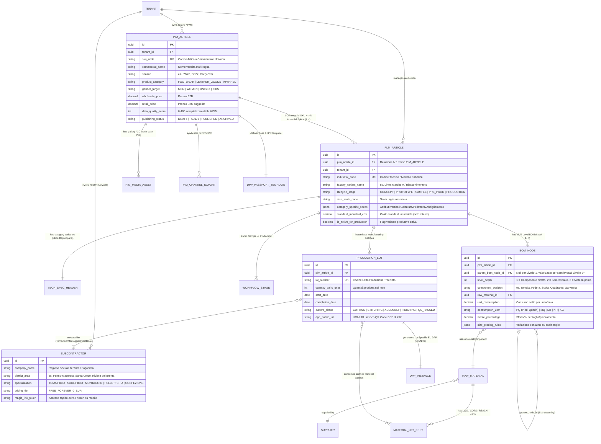
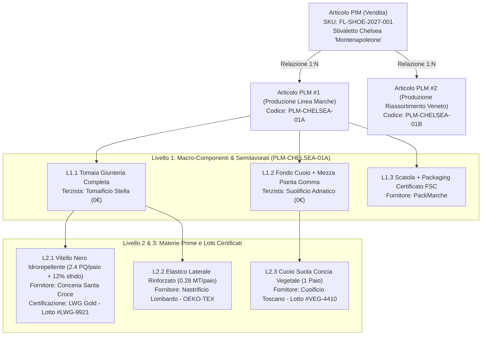
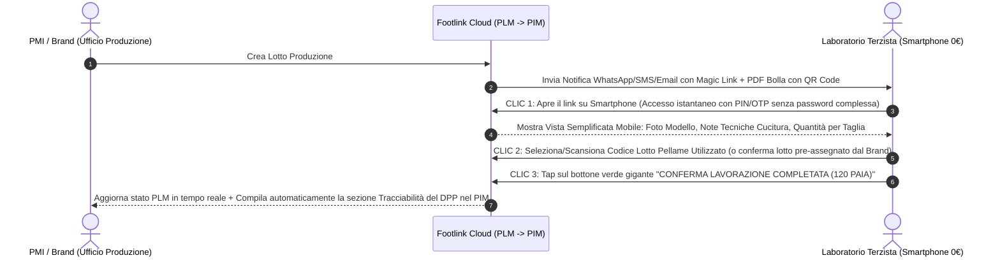

# PRD-001: Core MVP — Modello Dati 1:N PIM/PLM, Scheda Tecnica Filiera e Passaporto Digitale (DPP UE)

- **PRD ID:** `PRD-001`
- **Titolo:** Specifica Funzionale Core MVP — Architettura 1 Articolo PIM ↔ N Articoli PLM, BOM Multi-Livello, UX Terzista Zero-Friction e DPP UE (ESPR)
- **Autore:** CPO (`footlink-cpo`)
- **Stato:** Approvato (L1 — Allineato a [`OKR-2026-Q4-2027-Q1`](../okr/OKR-2026-Q4-2027-Q1.md) e [`ADR-003`](../../adr/ADR-003-domain-model-1-to-n-pim-plm.md))
- **Task di Riferimento:** [`FTL-PROD-001`](../../tasks/FTL-PROD-001.json)
- **Data:** 18 Ottobre 2026
- **Perimetro Merceologico:** Calzature, Pelletteria, Abbigliamento
- **Destinatari:** CTO (`FTL-TECH-001`), CRO (`FTL-REV-001`), CMO (`FTL-MKT-001`), CGO, CEO

---

## 1. Executive Summary & Visione di Prodotto

Nel settore della moda italiana (calzature, pelletteria e abbigliamento), la frattura tra **chi progetta/produce in fabbrica (PLM)** e **chi vende sui canali commerciali (PIM)** genera inefficienze croniche: fogli Excel duplicati, schede tecniche PDF non aggiornate inviate via WhatsApp ai laboratori terzisti, errori di trascrizione sui cataloghi B2B/B2C e impossibilità di tracciare in modo nativo i lotti per il **Passaporto Digitale del Prodotto (DPP UE — Regolamento ESPR)**.

L'MVP di **Footlink** risolve questo problema alla radice attraverso due pilastri architetturali e di esperienza utente:
1. **Il Ponte Nativo `1 Articolo PIM ↔ N Articoli PLM`:** Un singolo codice commerciale di vendita (**1 Articolo PIM / SKU Catalogo**) è collegato dinamicamente a **una o più varianti tecniche e industriali di produzione (**N Articoli PLM**)**, permettendo a un Brand o a una PMI di far produrre il medesimo articolo da più calzaturifici/pelletterie terziste o in stabilimenti diversi, con distinte base (BOM) o fornitori specifici, mantenendo un'unica identità commerciale verso il mercato e aggregando per lotto i dati del Passaporto Digitale (DPP).
2. **Principio "PMI-First & Terzista Zero-Friction" (Terzisti a 0 €):** Il software è progettato a partire dall'anello meno digitalizzato della catena: il **laboratorio terzista/façonista** (tomaificio, suolificio, laboratorio di montaggio, pelletteria esterna). I terzisti accedono **gratuitamente per sempre (0 €)** tramite un link/QR code su smartphone o tablet e completano la conferma commessa, la dichiarazione dei lotti materiali e l'avanzamento produzione in **≤ 3 clic e < 5 minuti**, senza alcuna formazione.

---

## 2. Architettura Concettuale Core: `1 Articolo PIM ↔ N Articoli PLM`

### 2.1 Razionale di Dominio
Nei software tradizionali (ERP legacy o PLM/PIM separati), esiste una rigidità 1:1 tra codice articolo tecnico e codice articolo commerciale, oppure una disconnessione totale. Nella realtà manifatturiera dei distretti italiani (Marche, Toscana, Veneto):
- Un **Articolo PIM (Entità Commerciale / Vendita)** rappresenta il prodotto così come viene presentato a buyer, showroom, B2B, e-commerce B2C e consumatori finali (es. *"Mocassino Uomo Penny Loafer 'Brera' in Vitello Spazzolato Nero — SKU: `FL-SHOE-2027-001`"*).
- Lo stesso articolo commerciale può essere realizzato tramite **N Articoli PLM (Entità Industriali / Produzione)**:
  - **`PLM-PROD-001A` (Lotto/Linea Calzaturificio Rossi - Fermo):** Tomaia in vitello Conceria Alpha, suola in cuoio Suolificio Beta, costruzione Blake Rapid.
  - **`PLM-PROD-001B` (Lotto/Linea Tomaificio & Montaggio Verdi - Civitanova):** Tomaia in vitello Conceria Gamma (second-sourcing approvato), suola in cuoio Suolificio Beta, variante foderatura invernale o riassortimento veloce (flash/carry-over).

Entrambe le esecuzioni industriali (`PLM-PROD-001A` e `PLM-PROD-001B`) confluiscono commercialmente nell'unico `PIM-SKU-001`, ma conservano **tracciabilità granulare per singolo lotto produttivo**, alimentando un **DPP dinamico** che risponde con i dati esatti del lotto a cui appartiene il singolo capo o paio fisico.

### 2.2 Schema Entità-Relazione (Mermaid `erDiagram`)



---

## 3. Scheda Tecnica Unificata: Mappatura Attributi per Settore Merceologico

Ogni `PLM_ARTICLE` possiede una testata standard condivisa e un blocco strutturato di **attributi tecnici verticali** (`category_specific_specs`) + attributi commerciali esposti nel `PIM_ARTICLE`. Di seguito la mappatura obbligatoria per l'MVP nei tre settori target.

### 3.1 Settore Calzature (`FOOTWEAR`)

| Dominio | Codice Campo (`snake_case`) | Etichetta UI (IT) | Livello | Tipo / Esempio Valore | Obbligatorio MVP |
|---------|-----------------------------|-------------------|---------|-----------------------|:----------------:|
| **Forma / Calzata** | `last_code` | Codice Forma (Last) | PLM | `String` (es. `FRM-884-PUNTA-TONDA`) | ✅ Sì |
| **Forma / Calzata** | `last_fitting` | Calzata (Fitting) | PLM + PIM | `Enum` (`E`, `F`, `G`, `H`, `Regular`, `Wide`) | ✅ Sì |
| **Scala Taglie** | `size_scale_system` | Sistema Scala Taglie | PLM + PIM | `Enum` (`EU_35_42`, `EU_39_46`, `UK`, `US`, `FR`) | ✅ Sì |
| **Scala Taglie** | `sample_base_size` | Taglia Base Campione | PLM | `String` (es. `37` Donna, `42` Uomo) | ✅ Sì |
| **Costruzione** | `construction_method` | Tecnica di Costruzione | PLM + PIM (DPP) | `Enum` (`AGO_CEMENTED`, `BLAKE`, `BLAKE_RAPID`, `GOODYEAR`, `STROBEL`, `VULCANIZED`, `IDEAL`) | ✅ Sì |
| **Tomaia** | `upper_primary_material` | Materiale Tomaia Principale | PLM + PIM (DPP) | `Ref(RAW_MATERIAL)` (es. Vitello Box 1.4-1.6mm) | ✅ Sì |
| **Tomaia** | `upper_cutting_method` | Metodo di Taglio Tomaia | PLM | `Enum` (`TRANCIA_FUSTELLA`, `TAGLIO_CAD_LAMA`, `MANO`, `LASER`) | ✅ Sì |
| **Fodera & Sottopiede** | `lining_material` | Materiale Fodera / Sottopiede | PLM + PIM (DPP) | `Ref(RAW_MATERIAL)` (es. Capra Metal-Free) | ✅ Sì |
| **Sottopiede / Insole** | `insole_texon_spec` | Sottopiede di Montaggio | PLM | `String` (es. Cuoio rigenerato + lamina acciaio) | ✅ Sì |
| **Suola / Fondo** | `outsole_code_mold` | Codice Suola / Stampo | PLM | `String` (es. `SUOLA-VIB-092` / Cuoio 4.5mm) | ✅ Sì |
| **Suola / Fondo** | `outsole_material` | Materiale Fondo/Suola | PLM + PIM (DPP) | `Enum` (`LEATHER`, `RUBBER`, `TPU`, `EVA`, `MICRO`, `PARA`) | ✅ Sì |
| **Tacco** | `heel_code_height_mm` | Codice Tacco & Altezza (mm) | PLM + PIM | `Int` + `String` (es. `TAC-65`, `65 mm`, Fasciato/Verniciato) | ✅ Sì |
| **Rinforzi** | `toe_puff_counter_spec` | Puntale e Contrafforte | PLM | `String` (es. Termoadesivo riciclato 1.2mm) | No (Opz.) |

### 3.2 Settore Pelletteria (`LEATHER_GOODS`)

| Dominio | Codice Campo (`snake_case`) | Etichetta UI (IT) | Livello | Tipo / Esempio Valore | Obbligatorio MVP |
|---------|-----------------------------|-------------------|---------|-----------------------|:----------------:|
| **Modello / Cartamodello** | `pattern_cad_code` | Codice Cartamodello / DXF | PLM | `String` (es. `BAG-TOTE-CAD-v3`) | ✅ Sì |
| **Dimensioni** | `bag_dimensions_lwh_cm` | Dimensioni (L × A × P cm) | PLM + PIM | `Object` (`{length: 32, height: 24, depth: 14, drop_cm: 22}`) | ✅ Sì |
| **Pellame Principale** | `leather_type_tanning` | Tipologia Pellame & Concia | PLM + PIM (DPP) | `Enum` (`VEGETABLE_TANNED`, `CHROME_FREE`, `CHROME_LWG`, `SYNTHETIC_BIO`) | ✅ Sì |
| **Pellame Principale** | `splitting_thickness_mm` | Spessore Spaccatura / Scarnitura | PLM | `String` (es. `Spacco in testa 1.2mm / Scarnitura bordi 0.6mm`) | ✅ Sì |
| **Rinforzi Interni** | `interlining_reinforcement` | Rinforzi (Salpa, Microfibra, Rete) | PLM | `Ref(RAW_MATERIAL)` (es. Salpa termoadesiva 0.8mm) | ✅ Sì |
| **Metalleria / Galvanica** | `hardware_galvanic_finish` | Accessori Metallici & Galvanica | PLM + PIM (DPP) | `String` (es. Ottone Nikel-Free bagno Oro Chiaro 0.5 micron) | ✅ Sì |
| **Chiusure / Zip** | `closure_zip_spec` | Tipologia Chiusura / Lampo | PLM + PIM | `String` (es. Zip metallica passo 5 + tiretto logato) | ✅ Sì |
| **Costruzione Bordi** | `edge_finishing_type` | Costola / Bordo (Tintura o Rimbocco) | PLM | `Enum` (`TINGIBORDO_A_MANO_3_MANI`, `RIMBOCCATO`, `TAGLIO_VIVO`, `FILETTATO`) | ✅ Sì |
| **Cuciture** | `stitching_thread_step` | Titolo Filo e Passo Cucitura | PLM | `String` (es. Filo Poliestere Tit. 20, passo 3.5 punti/cm) | ✅ Sì |

### 3.3 Settore Abbigliamento (`APPAREL`)

| Dominio | Codice Campo (`snake_case`) | Etichetta UI (IT) | Livello | Tipo / Esempio Valore | Obbligatorio MVP |
|---------|-----------------------------|-------------------|---------|-----------------------|:----------------:|
| **Vestibilità / Fit** | `garment_fit_type` | Vestibilità (Fit) | PLM + PIM | `Enum` (`SLIM`, `REGULAR`, `RELAXED`, `OVERSIZE`, `TAILORED`) | ✅ Sì |
| **Scala Taglie** | `apparel_size_scale` | Scala Taglie Abbigliamento | PLM + PIM | `Enum` (`IT_38_50`, `IT_46_58`, `INT_XS_XXL`, `JEANS_W_L`) | ✅ Sì |
| **Tessuto / Filato** | `fabric_composition_pct` | Composizione Fibrosa (%) | PLM + PIM (DPP) | `JSON Array` (es. `[{"fiber": "Wool", "pct": 95}, {"fiber": "Cashmere", "pct": 5}]`) | ✅ Sì |
| **Tessuto / Filato** | `fabric_weight_gsm_width` | Grammatura (g/m²) e Altezza Pezza | PLM | `Object` (`{gsm: 280, usable_width_cm: 148}`) | ✅ Sì |
| **Cartella Colori** | `colorway_pantone_code` | Variante Colore / Bagno Tintoria | PLM + PIM | `String` (es. `Navy Blue - Pantone 19-4024 TCX - Bagno #44`) | ✅ Sì |
| **Tabella Misure** | `pom_measurement_chart` | Tabella Punti di Misura (POM) & Tolleranze | PLM | `JSON Table` (Torace, Vita, Lunghezza centro dietro ±0.5cm per taglia) | ✅ Sì |
| **Trattamenti / Lavaggi** | `garment_wash_finishing` | Lavaggio / Finissaggio Capo | PLM + PIM (DPP) | `String` (es. Enzyme Wash / Tintura in capo ecologica) | ✅ Sì |
| **Etichettatura Cura** | `care_instructions_iso` | Simboli Manutenzione (ISO 3758) | PLM + PIM (DPP) | `Array<Enum>` (`HAND_WASH`, `DO_NOT_BLEACH`, `IRON_LOW`, `DRY_CLEAN_P`) | ✅ Sì |

---

## 4. Gestione Distinta Base (BOM) Multi-Livello e Tracciabilità Lotti/Terzisti

Per supportare la complessità reale della filiera (dove un calzaturificio acquista il pellame, lo invia al tomaificio per produrre la **tomaia orlata**, acquista il **fondo pre-fresato** dal suolificio e infine esegue il **montaggio** internamente o presso terzi), Footlink implementa una **BOM Multi-Livello fino a 3 livelli nativi nell'MVP**:



### Regole Funzionali della BOM Multi-Livello:
1. **Calcolo Consumi e Sfridi per Scala Taglie:** Ogni riga BOM accetta un consumo base (riferito alla `sample_base_size`, es. taglia 37 o 42), una percentuale di sfrido (`waste_percentage`) e una regola opzionale di sviluppo taglie (es. `+3%` di consumo pellame per ogni taglia sopra il 42).
2. **Versioning della BOM (Snapshot Immutabili):** Ogni passaggio di stato del workflow PLM (`PROTOTYPE` → `SAMPLE` → `PRE_PROD` → `PRODUCTION`) congela uno snapshot numerato della BOM (`v1.0`, `v1.1`, `v2.0`). Quando viene lanciato un `PRODUCTION_LOT`, la BOM associata diventa immutabile per garantire l'integrità legale del DPP UE.
3. **Eredità + Override tra gli N Articoli PLM:** Quando una PMI crea una seconda variante produttiva `PLM-01B` a partire da `PLM-01A` (collegata allo stesso `PIM_ARTICLE`), può clonare al 100% la BOM di `PLM-01A` e sovrascrivere solo i nodi che cambiano (es. cambiare il terzista di giunteria o sostituire il fornitore della fodera).
4. **Segregazione Costi e Riservatezza B2B (Compliance L6):** I prezzi unitari dei materiali e i costi di lavorazione sono visibili **esclusivamente al Tenant proprietario (Brand/PMI)**. Il laboratorio terzista invitato a `0 €` vede solo le specifiche tecniche di lavorazione, i consumi fisici e i lotti da confermare, senza mai accedere ai costi industriali o ai prezzi commerciali del Brand.

---

## 5. Specifiche UX "PMI-First & Terzista Zero-Friction" (Terzisti a 0 €)

In conformità al Manifesto (*Sezione 7 — PMI-first Thinking*) e al **KR CPO-1.3**, l'esperienza per i laboratori terzisti rispetta 4 vincoli inderogabili:
1. **Zero Costo Monetario Forever (`0 €`):** Nessun paywall, nessuna carta di credito richiesta, nessun limite sul numero di commesse ricevute dai Brand/PMI clienti.
2. **Zero Installazione & Accesso "Magic Link / QR":** Il titolare del tomaificio o della pelletteria riceve un link su WhatsApp/Email o scansiona il QR Code stampato sulla bolla di accompagnamento cartacea con la fotocamera del proprio smartphone Android/iOS.
3. **Regola dei "≤ 3 Clic e < 5 Minuti":** L'interfaccia mobile-first per il terzista presenta solo 3 pulsanti ad alto contrasto (font ≥ 18px, touch target ≥ 56px, utilizzabile anche in reparto produttivo).
4. **Zero Gergo Informatico:** L'interfaccia non usa termini come *"JSON, ERP, SKU, Node, Tenant"*, ma il linguaggio reale di fabbrica: **"Scheda Modello"**, **"Taglio / Giunteria / Montaggio"**, **"Lotto Pellame"**, **"Segna Pronto per Consegna"**.

### Flusso UX Mobile Terzista (Wireframe Funzionale in 3 Step)



---

## 6. Requisiti e Mappatura Passaporto Digitale del Prodotto (DPP UE — ESPR)

Il Regolamento Europeo **ESPR (Ecodesign for Sustainable Products Regulation — UE 2024/1781)** impone per il settore tessile, abbigliamento, calzature e pelletteria l'adozione del **Digital Product Passport (DPP)** accessibile tramite data carrier (QR Code / NFC).

In Footlink, il DPP **non è un modulo separato da compilare a mano**, ma viene **generato automaticamente nel modulo PIM** unendo:
- Gli **attributi descrittivi e di circolarità** presenti sull'Articolo PIM (1);
- I **dati reali di filiera, composizione, stabilimento e certificazioni** ereditati dallo specifico Articolo PLM e Lotto di Produzione (N).

### Tabella di Mappatura Ufficiale DPP UE (ESPR) in Footlink

| # | Categoria ESPR / DPP UE | Nome Attributo Tecnico (`dpp_schema`) | Fonte Dati in Footlink (PIM vs PLM) | Visibilità Pubblica (Consumatore) | Visibilità Vigilanza / Dogane / Brand |
|---|-------------------------|---------------------------------------|-------------------------------------|:---------------------------------:|:-------------------------------------:|
| 1 | **Identificativo Univoco** | `dpp_unique_product_id` (URI / GS1 Digital Link) | Generato da `PIM_ARTICLE.sku_code` + `PRODUCTION_LOT.lot_number` | ✅ Sì | ✅ Sì |
| 2 | **Identità Prodotto** | `commercial_name`, `brand_name`, `category`, `season`, `gtin_ean` | **PIM** (`PIM_ARTICLE`) | ✅ Sì | ✅ Sì |
| 3 | **Composizione Materiali** | `materials_breakdown` (Tomaia/Fodera/Suola o Composizione % Fibre ISO) | **PLM** (`BOM_NODE` Livello 1 & 2 aggregati) | ✅ Sì | ✅ Sì |
| 4 | **Tracciabilità Filiera (Tier 1–3)** | `supply_chain_steps` (Paese/Regione di Concia/Tessitura, Taglio/Giunteria, Assemblaggio Finale) | **PLM** (`PRODUCTION_LOT` ↔ `SUBCONTRACTOR` + `SUPPLIER`) | ✅ Sì (Città/Regione/Paese + Nome se autorizzato) | ✅ Sì (Ragione Sociale + GLN/P.IVA completa) |
| 5 | **Sostanze Preoccupanti (SVHC)** | `chemicals_reach_compliance` (Conformità REACH, assenza Cromo VI, Azo-free, Nikel-free) | **PLM** (`MATERIAL_LOT_CERT` allegato ai materiali BOM) | ✅ Sì (Stato Conformità + Badge) | ✅ Sì (Certificato PDF / Test Report lab) |
| 6 | **Certificazioni Ambientali/Sociali** | `sustainability_certifications` (LWG Gold/Silver, GOTS, GRS, FSC, OEKO-TEX) | **PLM** (`RAW_MATERIAL` + `MATERIAL_LOT_CERT`) | ✅ Sì | ✅ Sì (Numero certificato e scadenza) |
| 7 | **Contenuto Riciclato / Bio** | `recycled_content_percentage` (% peso materiali riciclati pre/post-consumer) | **PLM** (Calcolato da peso componenti in `BOM_NODE`) | ✅ Sì | ✅ Sì |
| 8 | **Impronta Ambientale (PEF)** | `estimated_carbon_footprint_kg_co2e` & `water_usage_liters` | **PLM + PIM** (Stima parametrica da fattori emissione materiali BOM + trasporti filiera) | ✅ Sì | ✅ Sì |
| 9 | **Durabilità, Cura e Riparabilità** | `care_instructions`, `repairability_index`, `spare_parts_availability` (es. risuolabilità Goodyear/Blake, sostituzione tacco/zip) | **PLM** (`construction_method`) + **PIM** (Guida cura e servizio riparazione Brand) | ✅ Sì | ✅ Sì |
| 10 | **Fine Vita e Riciclabilità** | `end_of_life_disassembly_guide` (Istruzioni smaltimento/separazione componenti e take-back program) | **PIM** (`DPP_PASSPORT_TEMPLATE`) | ✅ Sì | ✅ Sì |

---

## 7. User Stories & Acceptance Criteria Misurabili (Gherkin + Checklist)

### US-01 (Ruolo: Responsabile Prodotto / Modellista PMI) — Gestione Relazione `1 PIM ↔ N PLM` e Scheda Tecnica
> **Come** Responsabile Tecnico/Produzione di un calzaturificio o pelletteria PMI,
> **Voglio** collegare un singolo articolo commerciale a catalogo (`PIM_ARTICLE`) a due o più schede tecniche di produzione (`PLM_ARTICLE`) con distinte base (BOM) e terzisti differenti,
> **Affinché** io possa gestire il dual-sourcing o i riassortimenti in fabbriche diverse senza duplicare il codice articolo sul catalogo commerciale B2B/e-commerce.

**Acceptance Criteria (Gherkin):**
```gherkin
Scenario: Creazione e collegamento di una seconda variante produttiva PLM allo stesso articolo PIM
  Given un Articolo PIM esistente con sku_code "FL-BAG-2027-010" ("Borsa Shopping Pelle Martellata")
  And una prima scheda tecnica PLM associata "PLM-BAG-010-FIRENZE" con BOM a 2 livelli completa
  When l'utente clicca su "Crea Variante Produttiva PLM (Clona da esistente)"
  And assegna il codice "PLM-BAG-010-AREZZO" cambiando il laboratorio terzista di montaggio e il lotto fodera
  Then il sistema salva "PLM-BAG-010-AREZZO" mantenendo la chiave esterna verso "FL-BAG-2027-010"
  And la vista PIM di "FL-BAG-2027-010" mostra 1 SKU commerciale collegato a 2 Articoli PLM attivi
  And nessuna duplicazione di SKU viene generata nei feed di esportazione catalogo B2B/B2C.
```
- [x] Supporto nativo agli attributi verticali obbligatori per Calzature, Pelletteria e Abbigliamento.
- [x] Calcolo automatico del consumo totale materia prima comprensivo di `% sfrido` nella BOM.

---

### US-02 (Ruolo: Laboratorio Terzista / Tomaificio / Façonista) — Conferma Commessa e Lotti "Zero-Friction" a 0 €
> **Come** Titolare di un laboratorio terzista (tomaificio, suolificio o pelletteria esterna),
> **Voglio** accedere gratuitamente da smartphone alla scheda di lavorazione del lotto assegnatomi e confermare il completamento fase e i lotti materiali in meno di 3 clic,
> **Affinché** io possa comunicare l'avanzamento al Brand/PMI cliente in meno di 5 minuti senza pagare licenze software e senza usare WhatsApp o moduli cartacei.

**Acceptance Criteria (Gherkin):**
```gherkin
Scenario: Conferma avanzamento lotto e tracciabilità materiali in 3 clic da smartphone
  Given un Lotto di Produzione "LOT-2027-55" assegnato al terzista "Tomaificio Rossi" (piano FREE_FOREVER_0_EUR)
  When il terzista apre il Magic Link / scansiona il QR Code della bolla dal proprio smartphone (Clic 1)
  And verifica/conferma il lotto del pellame utilizzato dal menu a tendina pre-compilato (Clic 2)
  And preme il pulsante "Conferma Giunteria Completata" (Clic 3)
  Then il sistema registra timestamp, utente terzista e associazione lotto materiale con latenza API < 250ms
  And lo stato del lotto sul cruscotto della PMI committente passa automaticamente a "STITCHING_COMPLETED"
  And all'utente terzista non viene mai mostrato alcun costo industriale o prezzo di listino né richiesta alcuna carta di credito.
```
- [x] Tempo totale di completamento task da parte di un utente non formato **< 5 minuti** (Target KR CPO-1.3 / KR A.3).
- [x] Responsive design 100% mobile-first (viewport ≥ 360px) con touch target ≥ 56px.

---

### US-03 (Ruolo: Brand Manager / E-Commerce & Sustainability Manager) — Generazione Passaporto Digitale (DPP UE) e Data Quality PIM
> **Come** Brand Manager o Responsabile Sostenibilità/Commerciale,
> **Voglio** che il modulo PIM calcoli il punteggio di completezza commerciale/normativa (`data_quality_score`) e generi automaticamente la pagina pubblica e il QR Code del Passaporto Digitale del Prodotto (DPP UE) per ogni lotto,
> **Affinché** ogni prodotto immesso sul mercato sia conforme al regolamento europeo ESPR senza data-entry manuale tra ufficio produzione e ufficio marketing.

**Acceptance Criteria (Gherkin):**
```gherkin
Scenario: Generazione automatica del DPP UE (ESPR) da aggregazione PIM + Lotto PLM
  Given un Articolo PIM "FL-SHOE-2027-001" con foto, descrizione commerciale e istruzioni di cura/fine vita
  And un Lotto di Produzione completato "LOT-2027-01A" associato all'Articolo PLM "PLM-SHOE-001A"
  And tutti i nodi BOM di Livello 1 e 2 di "LOT-2027-01A" aventi fornitore, paese di origine e certificato LWG/REACH validi
  When l'utente richiede la pubblicazione del DPP per il lotto "LOT-2027-01A"
  Then il data_quality_score DPP raggiunge il 100%
  And il sistema genera un URL pubblico univoco e il relativo QR Code scaricabile in SVG/PNG
  And scansionando il QR Code viene renderizzata la pagina pubblica mobile del DPP con i 10 blocchi informativi ESPR popolati dai dati effettivi del lotto "LOT-2027-01A".
```
- [x] Blocco pubblicazione DPP se mancano attributi obbligatori ESPR (segnalazione puntuale dei campi mancanti in PLM o PIM).
- [x] Vista differenziata: Vista Consumatore (pubblica) vs Vista Ispettiva/Doganale (protetta da token/ruolo).

---

## 8. Tabella di Prioritizzazione RICE (Top-6 Feature Core MVP)

Valutazione eseguita secondo il framework RICE ufficiale definito in [`Role_CPO_Footlink.md`](../roles/Role_CPO_Footlink.md):
- **Reach (R):** Impatto utenti/clienti nel trimestre (scala 1–10)
- **Impact (I):** Valore strategico/operativo generato (`0.25` = minimo, `0.5` = basso, `1` = medio, `2` = alto, `3` = trasformativo)
- **Confidence (C):** Grado di certezza delle stime (`50%`, `80%`, `100%`)
- **Effort (E):** Person-weeks stimate sul team di sviluppo AI-assisted (in coordinamento col CTO su stack FastAPI + React + PostgreSQL)
- **Formula:** $\text{RICE Score} = \frac{\text{Reach} \times \text{Impact} \times \text{Confidence}}{\text{Effort}}$

| Rank | Feature ID | Nome Feature MVP | Modulo | Reach (1-10) | Impact (0.25-3) | Confidence (%) | Effort (p-w) | **RICE Score** | Decisione Sprint / Stato |
|:----:|------------|------------------|:------:|:------------:|:---------------:|:--------------:|:------------:|:--------------:|--------------------------|
| **1** | `FEAT-01` | **Motore Relazionale `1 Articolo PIM ↔ N Articoli PLM`** (Core Repository + Clonazione/Override Varianti Produttive) | Core PIM+PLM | 10 | 3.0 | 100% (1.0) | 1.0 | **30.0** | 🚀 **Fast-Track MVP (Sprint 1)** |
| **2** | `FEAT-02` | **Portale Mobile "Terzista Zero-Friction" a 0 €** (Accesso Magic Link/QR, conferma fasi e lotti in ≤ 3 clic) | PLM Network | 10 | 3.0 | 100% (1.0) | 1.2 | **25.0** | 🚀 **Fast-Track MVP (Sprint 1-2)** |
| **3** | `FEAT-03` | **Scheda Tecnica Unificata Multi-Settore & BOM Multi-Livello** (Calzature, Pelletteria, Abbigliamento + Consumi/Sfridi) | PLM Core | 10 | 3.0 | 90% (0.9) | 1.2 | **22.5** | 🚀 **Fast-Track MVP (Sprint 1-2)** |
| **4** | `FEAT-04` | **Generatore Automatico Passaporto Digitale (DPP UE - ESPR)** (Aggregazione Lotto PLM → Pagina Pubblica PIM + QR Code) | PIM + PLM | 9 | 3.0 | 90% (0.9) | 1.1 | **22.1** | 🚀 **Fast-Track MVP (Sprint 2)** |
| **5** | `FEAT-05` | **PIM Data Quality Scoring & Export Catalogo Strutturato (CSV/JSON/OpenAPI)** per E-Commerce B2B/B2C | PIM Core | 8 | 2.0 | 90% (0.9) | 1.0 | **14.4** | ✅ **Inclusa in MVP (Sprint 3)** |
| **6** | `FEAT-06` | **Workflow Approvazione Campionatura & Difettosità Fabbrica** (Tracking prototipi e note di modifica fit con foto) | PLM Core | 7 | 1.5 | 80% (0.8) | 1.2 | **7.0** | 📅 **Sprint 3-4 (Stretch Goal MVP)** |

> *Nota Governance RICE:* Le prime 4 feature superano la soglia `RICE > 20` e costituiscono il nucleo irrinunciabile ("Fast-Track") dell'MVP per soddisfare i Key Result `KR A.1`, `KR A.2`, `KR A.3` e `KR B.2`.

---

## 9. Allineamento Inter-Dipartimentale e Vincoli FinOps

1. **Handoff verso CTO (`FTL-TECH-001`):**
   - Il modello entità-relazione della Sezione 2.2 è progettato per essere implementato nativamente su **PostgreSQL** combinando tabelle relazionali tipizzate (per integrità referenziale `1:N`, BOM ricorsiva tramite `parent_bom_node_id` e lotti) e colonne `JSONB` indicizzate GIN per gli attributi verticali (`category_specific_specs`) e i payload ESPR del DPP.
   - Tutte le interfacce, inclusa la generazione dei QR Code (SVG client-side/server-side open-source) e delle schede PDF, operano a **costo infrastrutturale 0 € (Free-Tier)** senza dipendenze da API a pagamento esterne (Conformità L2).
2. **Handoff verso CRO (`FTL-REV-001`):**
   - L'architettura dei permessi supporta nativamente il **Modello di Pricing a Rete (`ADR-004`)**: il ruolo `SUBCONTRACTOR` è hard-coded nel tier `FREE_FOREVER_0_EUR` e funge da motore di acquisizione virale (ogni PMI invita i propri terzisti a costo di acquisizione zero), mentre il valore monetizzabile risiede nei moduli di orchestrazione commesse, BOM multi-livello e generazione DPP per **PMI** e **Brand Enterprise**.
3. **Handoff verso CMO (`FTL-MKT-001`):**
   - La matrice di mappatura del **Passaporto Digitale del Prodotto (Sezione 6)** e il posizionamento *"1 Articolo Vendita ↔ N Articoli Fabbrica, con Terzisti a 0 €"* costituiscono la base tecnica e di messaging per la Landing Page B2B e per il Piano Editoriale LinkedIn Q1.
