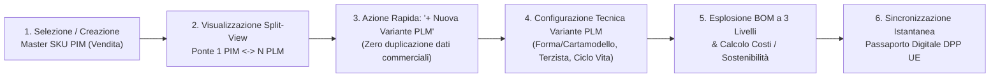
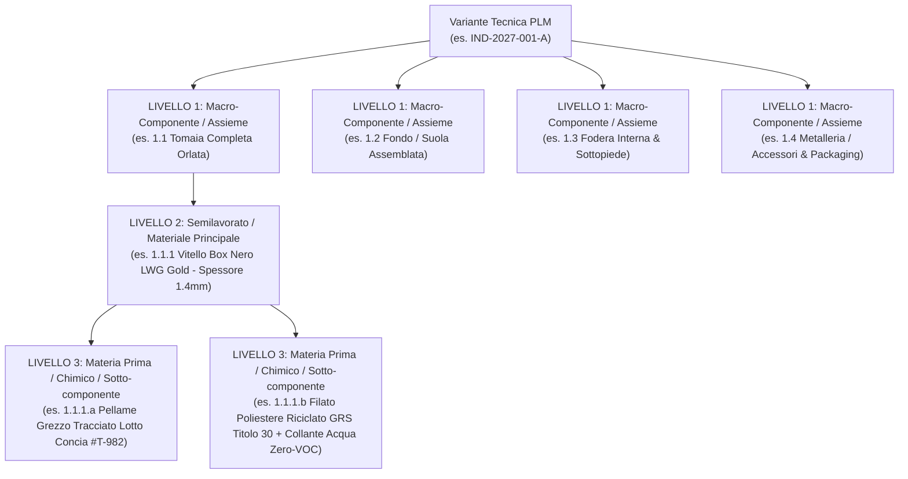
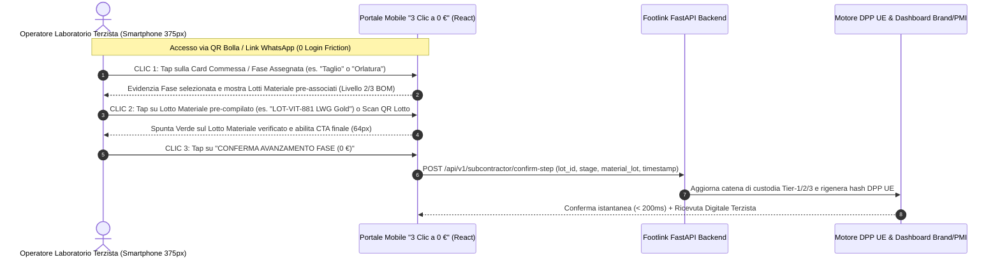

# PRD-002: Specifica Funzionale & UX v2.0 — Visual Bridge `1 PIM ↔ N PLM`, Distinta Base (BOM) a 3 Livelli, Portale Mobile Terzista "3 Clic a 0 €" e Passaporto Digitale DPP UE

- **PRD ID:** `PRD-002`
- **Titolo:** Specifica Operativa Sprint 2 — Interfaccia Visuale Ponte `1 Articolo PIM ↔ N Articoli PLM`, Modellazione Industriale BOM Gerarchica a 3 Livelli, UX Mobile Terzista "3 Clic a 0 €" e Generazione Automatica DPP UE (ESPR)
- **Autore:** CPO (`footlink-cpo`)
- **Stato:** Approvato (L1 — Allineato a [`PRD-001`](PRD-001-mvp-pim-plm.md), [`ADR-002`](../../adr/ADR-002-core-architecture-free-tier.md) e [`ADR-003`](../../adr/ADR-003-domain-model-1-to-n-pim-plm.md))
- **Task di Riferimento:** [`FTL-PROD-002`](../../tasks/FTL-PROD-002.json)
- **Data:** 18 Ottobre 2026
- **Perimetro Merceologico:** Calzature, Pelletteria, Abbigliamento
- **Destinatari:** CTO (`Applicativo/frontend/`, `Applicativo/backend/`), CRO, CMO, CGO, CEO

---

## Executive Summary

Con lo **Sprint 2 (`FTL-PROD-002`)**, Footlink traduce il modello di dominio canonico definito in [`PRD-001`](PRD-001-mvp-pim-plm.md) e [`ADR-003`](../../adr/ADR-003-domain-model-1-to-n-pim-plm.md) nella specifica funzionale, architetturale di componenti React (`Applicativo/frontend/`) e di User Experience per i tre pilastri operativi della piattaforma:

1. **Visual Bridge `1 Articolo PIM (Vendita) ↔ N Articoli PLM (Produzione)`:** Workspace unificato che visualizza il **Master SKU Commerciale PIM** (a sinistra su desktop / in alto su tablet) e le **N Varianti Tecniche PLM** collegate (a destra / in basso), abilitando il multi-sourcing su calzaturifici, pelletterie e confezioni differenti senza mai duplicare i dati commerciali B2B/E-commerce.
2. **Distinta Base (BOM) Gerarchica a 3 Livelli:** Albero industriale standardizzato su **Livello 1 (Macro-Componente / Assieme)**, **Livello 2 (Semilavorato / Materiale Principale)** e **Livello 3 (Materia Prima / Chimico / Sotto-componente)** per Calzature, Pelletteria e Abbigliamento, con motore di calcolo deterministico di consumi netti/lordi, % scarto (*waste*), % contenuto riciclato ponderato e aggregazione certificazioni LWG/GRS/OEKO-TEX/REACH.
3. **Portale Mobile Terzista "3 Clic a 0 €" (Zero-Training UX):** Interfaccia smartphone (`375px` mobile-first, pulsanti touch `>= 56px`, contrasto AAA per manovia/reparto taglio) che consente a qualsiasi laboratorio artigiano di confermare l'avanzamento di fase e il lotto materiale in **3 tap e `< 10 secondi`**, alimentando in tempo reale il **Passaporto Digitale del Prodotto (DPP UE — Regolamento ESPR)** e la dashboard del Brand/PMI a **costo licenza 0 € per sempre**.

---

## Sezione 1 — Visual Bridge `1 Articolo PIM (Vendita) ↔ N Articoli PLM (Produzione)`

### 1.1 Razionale UX e Flusso Utente End-to-End

Nel lavoro quotidiano di un Ufficio Stile/Prodotto o di un titolare di PMI moda, la creazione di una collezione parte da un **concetto commerciale unificato (1 SKU PIM)** che deve essere declinato in **N esecuzioni tecniche di fabbrica (N Articoli PLM)** per gestire:
- **Multi-sourcing distrettuale:** es. *Linea Produzione A* assegnata a un calzaturificio nel distretto di Fermo-Macerata e *Linea Produzione B (Riassortimento / Flash)* assegnata a un calzaturificio in Toscana o Puglia.
- **Varianti tecniche / materiali:** sostituzione di un pellame o di una fodera per mercati specifici o lotti successivi, mantenendo invariato lo SKU e-commerce/B2B.
- **Evoluzione del ciclo di vita:** passaggio da `CONCEPT` → `PROTOTYPE` → `SAMPLE` (Campionario) → `PRE_PROD` → `PRODUCTION` per ciascuna linea produttiva indipendentemente.

#### Flusso Utente Principale (PMI / Brand Product Manager)



### 1.2 Architettura Componenti React (`Applicativo/frontend/`)

La vista principale del ponte è governata da una gerarchia di componenti modulari in React + TypeScript + Tailwind CSS all'interno di `Applicativo/frontend/`:

| Componente React | Ruolo Funzionale & Responsabilità UI | Props / Stato Principale |
| :--- | :--- | :--- |
| `<PimPlmBridgeWorkspace />` | Contenitore principale Split-Pane (Desktop: griglia 12 colonne `4 col PIM` + `8 col PLM`; Mobile/Tablet: stack verticale `Top PIM` / `Bottom PLM`). | `selectedPimId`, `activePlmVariantId`, `tenantContext` |
| `<PimMasterCard />` | Pannello **Sinistra / Alto** dedicato a `1 Articolo PIM (Vendita)`: mostra SKU Master, switcher lingua `IT / EN`, prezzi Wholesale/Retail, canali B2B/E-commerce attivi, stagione (`FW26`/`SS27`), Brand Tenant e punteggio completezza dati PIM (`0-100%`). | `pimArticle: PimArticle`, `onCreatePim()`, `onEditCommercialData()` |
| `<VisualBridgeConnector />` | Elemento grafico centrale (connettore dinamico SVG/CSS con badge `1 PIM ↔ N PLM`) che evidenzia visivamente il legame 1-a-N e lo stato di sincronizzazione col DPP UE. | `pimSku: string`, `plmCount: number`, `dppSyncStatus: 'SYNCED' \| 'PENDING'` |
| `<PlmVariantsDeck />` | Pannello **Destra / Basso** che elenca le **N Varianti Tecniche PLM** collegate allo SKU PIM selezionato, con filtri rapidi per stabilimento/terzista e stato ciclo di vita. | `plmVariants: PlmVariant[]`, `selectedVariantId`, `onSelectVariant()`, `onAddPlmVariant()` |
| `<PlmVariantDetailCard />` | Scheda tecnica della singola variante PLM: mostra `industrial_code`, stabilimento/terzista capofila, variante colore/pellame, codici **Forma (`last_code`) / Tacco (`heel_code`) / Cartamodello (`pattern_code`)**, stato ciclo di vita (`CONCEPT`..`PRODUCTION`), costo industriale standard e trigger per l'albero BOM a 3 livelli. | `variant: PlmVariant`, `onUpdateLifecycle()` |
| `<QuickCreatePimModal />` / `<QuickAddPlmDrawer />` | Modali/Drawer ad apertura istantanea (`< 100ms`) per le azioni rapide senza ricaricamento pagina. | `parentPimSku`, `onSave()` |

### 1.3 Wireframe Strutturale Split-View (`1 PIM ↔ N PLM`)

```text
+----------------------------------------------------------------------------------------------------------+
| FOOTLINK WORKSPACE | Tenant: Calzaturificio Brera Srl (Distretto Marche) | Stagione: FW 2026/27          |
| [ + Nuovo Articolo PIM (Vendita) ]                             [ Anteprima Live Passaporto DPP UE (QR) ] |
+---------------------------------------------+------------------------------------------------------------+
| LATO VENDITA: 1 ARTICOLO PIM (MASTER SKU)   | LATO PRODUZIONE: N ARTICOLI PLM (VARIANTI TECNICHE)        |
| (Colonna Sinistra / Top su Mobile)          | (Colonna Destra / Bottom su Mobile)                        |
|                                             |                                                            |
| SKU MASTER: FL-SHOE-2027-001                | Ponte Attivo: 1 SKU Commerciale <===> 2 Varianti Fabbrica  |
| Categoria: CALZATURE (Footwear)             | [ + Aggiungi N-esima Variante PLM (Zero Duplicazione PIM)] |
|                                             |                                                            |
| [Lingua: IT | EN]                           | +--------------------------------------------------------+ |
| Nome IT: Mocassino Penny Loafer "Brera"     | | [ATTIVA] PLM #1: IND-2027-001-A (Linea Fermo - Rossi)  | |
| Nome EN: "Brera" Brushed Calf Penny Loafer  | | Stato: [ PRODUCTION ] | Terzista: Calzaturificio Rossi | |
|                                             | | Variante Tecnica: Vitello Box Nero LWG + Suola Cuoio   | |
| Descrizione Commerciale:                    | | Forma: LAST-BRERA-42 | Tacco: HEEL-20MM | Costr: Blake | |
| Mocassino artigianale cucito Blake Rapid    | | Costo Ind.: € 64,50 | Riciclato: 24% | BOM: 3 Livelli  | |
| in vitello spazzolato certificato LWG Gold. | +--------------------------------------------------------+ |
|                                             |                                                            |
| Canali Attivi:                              | +--------------------------------------------------------+ |
| [x] B2B Showroom  [x] Shopify E-Com         | | [SECOND-SOURCE] PLM #2: IND-2027-001-B (Linea Toscana) | |
| [x] Farfetch/Marketplace                    | | Stato: [ SAMPLE ]     | Terzista: Tomaificio & Mont. V.| |
|                                             | | Variante Tecnica: Vitello Vegetale + Suola Gomma Ric.  | |
| Prezzi: B2B € 145,00 | Retail € 390,00      | | Forma: LAST-BRERA-42 | Tacco: HEEL-22MM | Costr: Ideal | |
| Completezza PIM: [||||||||||] 100% (DPP OK) | | Costo Ind.: € 61,20 | Riciclato: 38% | BOM: 3 Livelli  | |
+---------------------------------------------+------------------------------------------------------------+
```

### 1.4 Specifica delle Azioni Rapide

1. **Azione Rapida 1 — `+ Nuovo Articolo PIM (Vendita)`:**
   - L'utente inserisce in un unico step leggero: `sku_code`, `product_category` (`FOOTWEAR` | `LEATHER_GOODS` | `APPAREL`), `season`, `commercial_name_it`, `commercial_name_en`, canali di distribuzione (`B2B`, `E-commerce`, `Retail`) e prezzi di riferimento.
   - Alla conferma, il sistema crea automaticamente lo scheletro della **Variante Tecnica PLM #1 (`IND-<SKU>-A`)** in stato `CONCEPT` collegata via foreign key `pim_article_id`, pronta per accogliere la BOM.
2. **Azione Rapida 2 — `+ Aggiungi N-esima Variante PLM` (Zero Duplicazione Dati Commerciali):**
   - Cliccando su `+ Aggiungi Variante PLM` dentro la scheda di un Articolo PIM esistente, il sistema **eredita in sola lettura** tutti i metadati commerciali PIM (descrizioni IT/EN, foto, canali, prezzi, codici doganali HS) **senza duplicare alcun record commerciale**.
   - L'utente può scegliere se **clonare la BOM a 3 livelli** dalla Variante PLM #1 (es. per cambiare solo il laboratorio terzista o sostituire un singolo materiale di Livello 2) oppure partire da un template BOM vuoto per la categoria merceologica.

---

## Sezione 2 — Distinta Base (BOM) Gerarchica a 3 Livelli

### 2.1 Modellazione Industriale dei 3 Livelli (Calzature, Pelletteria, Abbigliamento)

Ogni Variante Tecnica PLM (`PLM_ARTICLE`) possiede una **Distinta Base (BOM) gerarchica esattamente strutturata su 3 livelli di profondità industriale (`level_depth: 1 | 2 | 3`)**. Questa struttura riflette il modo reale in cui calzaturifici, pelletterie e confezioni progettano, acquistano e assemblano i prodotti nei distretti italiani, garantendo al contempo la granularità richiesta dal **Regolamento Europeo ESPR (DPP UE)**.



#### Matrice Tassonomica dei 3 Livelli per Settore Merceologico

| Livello BOM | Definizione Industriale | Calzature (`FOOTWEAR`) | Pelletteria (`LEATHER_GOODS`) | Abbigliamento (`APPAREL`) |
| :--- | :--- | :--- | :--- | :--- |
| **Livello 1**<br>*(Macro-Componente / Assieme)* | Sotto-insieme strutturale del prodotto finito che corrisponde tipicamente a un reparto o a una fase di lavorazione terzista. | • **Tomaia Completa**<br>• **Fondo / Suola Assemblata**<br>• **Fodera Interna & Sottopiede**<br>• **Metalleria / Packaging** | • **Quadranti & Corpo Esterno**<br>• **Manici / Tracolla Assemblata**<br>• **Fodera Interna & Tasche**<br>• **Galvanica / Metalleria & Packaging** | • **Corpo Capo / Tessuto Principale**<br>• **Maniche / Collo & Polsi**<br>• **Fodera Interna & Interni Termo-adesivi**<br>• **Bottoni / Zip & Packaging** |
| **Livello 2**<br>*(Semilavorato / Materiale Principale)* | Articolo acquistato o semilavorato codificato a magazzino con unità di misura, consumo netto e fornitore diretto (Tier-1). | • **Vitello Box Nero LWG Gold** (`PQ`)<br>• **Suola in Gomma Vibram / TR Riciclata** (`PAIO`)<br>• **Fodera Capra Concia Vegetale** (`PQ`)<br>• **Sottopiede Cuoio Rigenerato** (`PAIO`) | • **Pelle Grana Dollaro LWG Gold** (`MQ`/`PQ`)<br>• **Rinforzo Salpa Riciclata** (`MQ`)<br>• **Fodera Cotone Organico GOTS** (`MT`)<br>• **Catena Tracolla Ottone Galvanizzato** (`NR`) | • **Panno Lana Vergine RWS 450g/m²** (`MT`)<br>• **Fodera Viscosa Certificata FSC** (`MT`)<br>• **Ovatta Imbottitura Riciclata GRS** (`MT`)<br>• **Zip Metalliche Lampo** (`NR`) |
| **Livello 3**<br>*(Materia Prima / Chimico / Sotto-componente)* | Origine chimica/fisica del lotto (Tier-2 / Tier-3), ausiliari chimici e minuterie per conformità **REACH / ZDHC / ESPR**. | • **Pellame Grezzo Tracciato Lotto Concia**<br>• **Collante ad Acqua Zero-VOC** (`KG`)<br>• **Filato Poliestere Riciclato GRS** (`MT`)<br>• **Occhielli Ottone Nichel-Free** (`NR`) | • **Lotto Concia al Vegetale (Tannini Naturali)**<br>• **Bordo Tinta all'Acqua Zero-Solventi**<br>• **Filato Cucitura Nylon Riciclato GRS**<br>• **Moschettoni Zama Senza Piombo/Nichel** | • **Lotto Filato Lana Pettinata Tracciata (Origine)**<br>• **Bagno Tintoria Certificato OEKO-TEX / ZDHC**<br>• **Bottoni Corozo Naturale / Poliestere Ric.**<br>• **Etichetta Tessuta QR DPP in Poliestere Ric.** |

### 2.2 Esempio Completo di Albero BOM a 3 Livelli (Calzatura `IND-2027-001-A`)

| Codice Nodo | Livello | Nome Componente / Materiale | Fornitore & Origine | UoM | Consumo Netto | Scarto (`Waste %`) | Consumo Lordo | Peso (`g`) | `% Riciclato` | Certificazioni & Lotto |
| :--- | :---: | :--- | :--- | :---: | :---: | :---: | :---: | :---: | :---: | :--- |
| **`L1-TOM`** | **1** | **Tomaia Completa Orlata** | *Calzaturificio Rossi (IT)* | `PAIO` | `1.00` | — | `1.00` | `310 g` | `12.5%` | Aggregato L2+L3 |
| `L2-TOM-01` | **2** | Vitello Box Nero 1.4mm | Conceria Alpha (Toscana, IT) | `PQ` | `2.60` | `18.0%` | `3.07` | `270 g` | `0.0%` | `LWG Gold` |
| `L3-TOM-01a` | **3** | Pellame Grezzo + Concia Cromo III | Lotto Concia `#LC-2026-881` (IT) | `LOT` | `1.00` | `0.0%` | `1.00` | `250 g` | `0.0%` | `REACH Compliant` |
| `L3-TOM-01b` | **3** | Filato Poliestere Riciclato + Collante Acqua | Filatura EcoThread (Lombardia, IT) | `MT` | `14.50` | `5.0%` | `15.23` | `20 g` | `100.0%` | `GRS 4.0` + `ZDHC Zero-VOC` |
| `L3-TOM-01c` | **3** | Occhielli Ottone Nichel-Free (Rinfilo) | Minuterie Metalliche Veneto (IT) | `NR` | `8.00` | `2.0%` | `8.16` | `20 g` | `95.0%` | `REACH Nickel-Free` |
| **`L1-FON`** | **1** | **Fondo / Suola Assemblata** | *Suolificio Beta (Marche, IT)* | `PAIO` | `1.00` | — | `1.00` | `420 g` | `40.0%` | Aggregato L2+L3 |
| `L2-FON-01` | **2** | Suola in Gomma Vibram / TR Riciclata | Suolificio Beta (Civitanova, IT) | `PAIO` | `1.00` | `3.0%` | `1.03` | `390 g` | `40.0%` | `GRS Recycled Rubber` |
| `L3-FON-01a` | **3** | Mescola Gomma TR 40% Post-Industrial | Compound Italia Srl (IT) | `KG` | `0.39` | `3.0%` | `0.40` | `370 g` | `40.0%` | `ISO 14021` |
| `L3-FON-01b` | **3** | Primer & Adesivo Poliuretanico ad Acqua | EcoChem Marche (IT) | `KG` | `0.02` | `5.0%` | `0.021` | `20 g` | `0.0%` | `Zero-VOC / REACH` |
| **`L1-FOD`** | **1** | **Fodera Interna & Sottopiede** | *Conceria Verde (Toscana, IT)* | `PAIO` | `1.00` | — | `1.00` | `170 g` | `35.3%` | Aggregato L2+L3 |
| `L2-FOD-01` | **2** | Fodera Capra Concia Vegetale | Conceria Verde (S. Croce, IT) | `PQ` | `2.10` | `15.0%` | `2.42` | `110 g` | `0.0%` | `LWG Gold / Metal-Free` |
| `L3-FOD-01a` | **3** | Sottopiede in Cuoio Rigenerato Certificato | Suolificio Interni (IT) | `PAIO` | `1.00` | `4.0%` | `1.04` | `60 g` | `100.0%` | `RCS 100 Recycled Leather` |

### 2.3 Regole di Calcolo Automatico (Consumi, Scarto, Riciclato Ponderato e DPP UE)

Il motore BOM di Footlink (eseguito sia in anteprima reattiva sul frontend React sia validato sul backend FastAPI) applica le seguenti formule deterministiche su tutti i nodi di Livello 2 e Livello 3:

1. **Consumo Lordo per Unità/Paio (`Gross Consumption`):**
   $$\text{Consumo Lordo}_i = \text{Consumo Netto}_i \times \left(1 + \frac{\text{Scarto \%}_i}{100}\right)$$
2. **Costo Industriale Materiale per Nodo (`Material Node Cost`):**
   $$\text{Costo Nodo}_i = \text{Consumo Lordo}_i \times \text{Prezzo Unitario Materiale}_i$$
3. **Percentuale di Contenuto Riciclato Ponderata sul Peso Totale (`Weighted Recycled Content %` — Requisito ESPR):**
   $$\text{Riciclato Ponderato Totale (\%)} = \frac{\sum_{i=1}^{M} \left(\text{Peso Componente}_i \text{ (g)} \times \frac{\text{Riciclato \%}_i}{100}\right)}{\sum_{i=1}^{M} \text{Peso Componente}_i \text{ (g)}} \times 100$$
   *(Nell'esempio sopra: su `900 g` di peso totale calzatura, la massa riciclata ponderata dai nodi L2/L3 è pari a `254.9 g`, generando automaticamente **`28.3% Contenuto Riciclato Certificato`** sul Passaporto Digitale DPP UE).*
4. **Roll-up Automatico Certificazioni e Conformità Chimica per il DPP UE:**
   - Tutte le certificazioni associate ai lotti di **Livello 2** e **Livello 3** (`LWG Gold`, `GRS 4.0`, `OEKO-TEX Standard 100`, `REACH Compliant`, `ZDHC Zero-VOC`) vengono aggregate automaticamente senza data-entry manuale nella sezione **Sostenibilità & Conformità ESPR** del Passaporto Digitale.
   - Se un nodo di Livello 3 obbligatorio (es. collante o galvanica) non possiede la spunta `REACH Compliant`, il semaforo DPP mostra un avviso preventivo (`WARNING: Verifica Lotto Chimico L3`) prima della messa in produzione.

---

## Sezione 3 — Portale Mobile Terzista "3 Clic a 0 €" (Zero-Training UX)

### 3.1 Principi Fondamentali di Design ("Zero-Training" & "0 € per Sempre")

Il collo di bottiglia storico di ogni software PLM/Supply Chain nel settore moda è il rifiuto dei laboratori terzisti (tomaifici, orlature, giunterie, montaggi, pelletterie contoterzi) di utilizzare gestionali complessi o pagare canoni di licenza. Footlink risolve il problema con **3 regole auree inderogabili**:

1. **Costo 0 € per Sempre:** Nessun piano a pagamento, nessun costo per utente o per transazione viene mai addebitato al laboratorio terzista. Il badge **`PORTALE TERZISTI GRATUITO — 0 € SEMPRE`** è visibile nell'header mobile per rassicurare istantaneamente l'artigiano.
2. **Accesso Istantaneo Senza Password (Magic Link / QR Code Bolla):** L'operatore inquadra con la fotocamera dello smartphone il QR Code stampato sulla bolla di lavorazione (o clicca sul link ricevuto su WhatsApp/SMS) ed entra direttamente nella schermata operativa della propria commessa.
3. **Ergonomia da Fabbrica / Manovia (`375px` Mobile-First):**
   - **Viewport di riferimento:** `375px x 812px` (compatibile con qualsiasi smartphone Android/iOS anche datato).
   - **Touch Target Minimo:** Tutti i pulsanti interattivi hanno altezza minima **`>= 56px`** (con pulsante primario di conferma da **`64px`**), progettati per essere premuti agevolmente con una sola mano, anche indossando guanti da lavoro o in piedi accanto ai macchinari.
   - **Contrasto Visivo Elevato (WCAG AAA):** Testo ad alta leggibilità (`>= 16px` corpo, `>= 20px` codici lotto/bottoni), badge stato cromatici netti (Verde Smeraldo `#059669` per confermato, Ambra `#D97706` per in lavorazione, Blu Navy `#0F172A` per sfondi ad alto contrasto) per ambienti di fabbrica molto illuminati o polverosi.

### 3.2 Flusso Operativo Esatto in "3 Clic" (`< 10 secondi`)

L'intera interazione del laboratorio terzista si esaurisce in **3 soli tap sullo schermo** (nessuna digitazione da tastiera richiesta nel caso standard):



#### Dettaglio dei 3 Clic sull'Interfaccia (`<SubcontractorMobilePortal />`)

- **CLIC 1 — Selezione Commessa / Fase Assegnata al Laboratorio:**
  - L'operatore vede in cima le sole commesse e fasi assegnate al proprio laboratorio:
    - **`TAGLIO`** (*Cutting* — verifica consumo e lotto pellame/tessuto)
    - **`ORLATURA / GIUNTERIA`** (*Stitching / Upper Assembly* — verifica filati, rinforzi e fodere)
    - **`MONTAGGIO & FONDO`** (*Lasting & Sole Attachment* — verifica suola, sottopiede e collanti ad acqua)
    - **`FINISSAGGIO & CONTROLLO QUALITÀ`** (*Finishing & Packaging* — verifica scatola e attivazione QR/NFC DPP)
  - Con **1 tap** su un pulsante alto `60px`, l'operatore seleziona la fase da registrare.

- **CLIC 2 — Conferma o Scansione Codice Lotto Materiale (Pre-compilato):**
  - Sulla base della BOM a 3 livelli della Variante PLM in lavorazione, il sistema **pre-compila automaticamente** i lotti di materiale attesi per quella fase (es. per il *Taglio*: `LOT-VIT-2026-881 — Vitello Box Nero LWG Gold`; per il *Montaggio*: `LOT-SUO-2026-402 — Suola TR 40% Riciclata` + `LOT-CHEM-19 — Collante Acqua Zero-VOC`).
  - L'operatore effettua **1 tap** sul pulsante **`[✓] CONFERMA LOTTO PRE-COMPILATO`** (`height: 56px`) oppure, se ha utilizzato una partita diversa, tocca **`[📷] SCANSIONA QR NUOVO LOTTO`** (`height: 56px`).

- **CLIC 3 — Tap su `"CONFERMA AVANZAMENTO FASE (0 €)"`:**
  - Pulsante primario full-width (`width: 100%`, `height: 64px`, sfondo Verde Smeraldo ad alto contrasto, font bold `18px`).
  - Al tap:
    1. Registra il **timestamp certificato ISO-8601**, l'identificativo del laboratorio terzista (`Ragione Sociale + GLN/Partita IVA`), il luogo di produzione (es. *Fermo, Marche, Italia*) e i lotti materiali confermati.
    2. Aggiorna **istantaneamente** il **Passaporto Digitale del Prodotto (DPP UE)** collegato al lotto produttivo e lo stato avanzamento nella dashboard del Brand/PMI committente.
    3. Mostra una schermata di feedback immediato (*"Fase Registrata in 6.4s — Grazie! Zero costi addebitati"*).

### 3.3 Wireframe Mobile `375px` ("3 Clic a 0 €")

```text
+---------------------------------------+  <-- Larghezza Smartphone: 375px
| [FOOTLINK]   TERZISTI GRATUITO (0 €)  |  <-- Header rassicurazione 0 €
| Lab: Tomaificio & Orlatura Rossi Snc  |
| Ubicazione: Monte Urano (FM) - Italia |
+---------------------------------------+
| COMMESSA: #LOT-2026-089 (120 Paia)    |
| Articolo: Mocassino "Brera" (IND-01A) |
+---------------------------------------+
| PASSO 1 DI 3: TOCCHIAMO LA TUA FASE   |
| +-----------------------------------+ |
| | ( ) 1. TAGLIO PELLAME             | |  <-- Touch target >= 56px
| +-----------------------------------+ |
| +-----------------------------------+ |
| | (*) 2. ORLATURA / GIUNTERIA  [OK] | |  <-- CLIC 1 (Selezionato - Alto Contrasto)
| +-----------------------------------+ |
| +-----------------------------------+ |
| | ( ) 3. MONTAGGIO & SUOLA          | |
| +-----------------------------------+ |
+---------------------------------------+
| PASSO 2 DI 3: CONFERMA LOTTO USATO    |
| (Pre-caricato da Distinta Base BOM)   |
| +-----------------------------------+ |
| | [✓] LOT-VIT-881 (Vitello LWG Gold)| |  <-- CLIC 2 (1-Tap conferma lotto, 56px)
| | [✓] LOT-FIL-302 (Filato Ric. GRS) | |
| +-----------------------------------+ |
| | [📷] Usa / Scansiona Altro Lotto  | |  <-- Alternativa fotocamera (56px)
| +-----------------------------------+ |
+---------------------------------------+
| PASSO 3 DI 3: INVIA AL BRAND & DPP UE |
| +===================================+ |
| |   CONFERMA AVANZAMENTO FASE (0 €) | |  <-- CLIC 3 (CTA 64px, Verde Smeraldo)
| |   Aggiorna Passaporto Digitale UE | |
| +===================================+ |
| Tempo stimato: 6 secondi | 0 € Sempre |
+---------------------------------------+
```

### 3.4 Specifica UX Passaporto Digitale del Prodotto (DPP UE — ESPR Live View)

Ogni conferma ricevuta dal Portale Mobile Terzista aggiorna in tempo reale il componente **`<DppPassportPreview />`** visibile sia nella console Brand/PMI sia tramite scansione del QR Code pubblico del prodotto finito:

- **Header Identità Prodotto (da Articolo PIM):** Nome commerciale multilingua, foto master, SKU, GTIN/EAN, Brand e Stagione.
- **Tracciabilità Filiera Multi-Tier Certificata (da Terzisti a 0 € + Variante PLM):**
  - *Tier-1 (Assemblaggio / Montaggio & Orlatura):* Ragione sociale laboratorio, Comune/Distretto, Timestamp certificato di fine fase.
  - *Tier-2 (Semilavorati BOM Livello 2):* Conceria / Suolificio / Tessitura, Paese d'origine, Certificazione LWG/GRS.
  - *Tier-3 (Materie Prime & Chimica BOM Livello 3):* Lotto concia/filato, conformità chimica REACH e collanti ad acqua Zero-VOC.
- **Indicatori Ambientali & Circolarità (Calcolati dalla BOM a 3 Livelli):**
  - `% Contenuto Riciclato Ponderato` (calcolato sui pesi reali di Livello 2 e 3).
  - `Indice di Riparabilità` (es. Suola risuolabile *Blake Rapid* / *Goodyear* = `Alta Riparabilità 9/10`).
  - `Istruzioni di Fine Vita & Riciclo` differenziate per macro-componente di Livello 1 (Tomaia, Fondo, Metalleria).

---

## Sezione 4 — Criteri di Accettazione & Metriche RICE / FinOps

### 4.1 Criteri di Accettazione Funzionali e Tecnici (Sprint 2 — `FTL-PROD-002`)

| ID Criterio | Area | Requisito Misurabile (Definition of Done) | Target / Soglia |
| :--- | :--- | :--- | :---: |
| **`AC-002-01`** | **Visual Bridge `1 PIM ↔ N PLM`** | Visualizzazione simultanea di `1 Articolo PIM` (dati commerciali IT/EN, canali B2B/E-Com, stagione) e delle `N Varianti PLM` collegate, con creazione rapida di una nuova variante PLM senza duplicare i campi commerciali PIM. | **Zero duplicazione record PIM** (`< 100ms` switch variante) |
| **`AC-002-02`** | **BOM Gerarchica a 3 Livelli** | Albero interattivo espandibile su 3 livelli esatti (**L1 Macro-Componente**, **L2 Semilavorato**, **L3 Materia Prima/Chimico**) con calcolo automatico real-time di consumo lordo (netto + `% scarto`), costo industriale e `% riciclato ponderato`. | **3 Livelli completi** + ricalcolo istantaneo (`< 50ms`) |
| **`AC-002-03`** | **UX Mobile Terzista "3 Clic a 0 €"** | Interfaccia smartphone responsive a `375px`, tutti i bottoni operativi con altezza touch **`>= 56px`**, contrasto elevato da reparto produttivo e completamento dell'operazione in **esattamente 3 tap**. | **`<= 3 Clic`** e **`< 10 secondi`** senza formazione |
| **`AC-002-04`** | **Copertura DPP UE (ESPR)** | Generazione automatica del Passaporto Digitale del Prodotto (JSON-LD + vista pubblica QR) alimentata dai nodi BOM L1/L2/L3 e dai timestamp certificati dei terzisti. | **100% campi obbligatori ESPR / DPP UE** popolati automaticamente |
| **`AC-002-05`** | **FinOps & Zero-Friction** | Costo infrastrutturale di esecuzione della webapp e delle conferme terzisti interamente entro i limiti Free-Tier ([`ADR-002`](../../adr/ADR-002-core-architecture-free-tier.md)) e costo di licenza per i laboratori terzisti fissato a `0,00 €`. | **`0,00 €/mese` Infra** & **`0,00 €` Terzisti** |

### 4.2 Matrice di Prioritizzazione RICE — Sprint 2 (`FTL-PROD-002`)

Formula applicata: $\text{RICE Score} = \frac{\text{Reach} \times \text{Impact} \times \text{Confidence}}{\text{Effort (Person-Weeks)}}$

| Rank | Feature / Modulo UI (`Applicativo/frontend/`) | Reach *(Utenti/Lotti Trimestre)* | Impact *(0.25 - 3.0)* | Confidence *(0.5 - 1.0)* | Effort *(Settimane-Uomo)* | **RICE Score** | Stato Sprint 2 |
| :---: | :--- | :---: | :---: | :---: | :---: | :---: | :---: |
| **1** | **Portale Mobile Terzista "3 Clic a 0 €" (`375px`, Touch `>= 56px`, `< 10s`)** | 500 | 3.0 *(Massivo)* | 1.00 | 1.0 | **1.500** | **P0 — Inclusa** |
| **2** | **Visual Bridge Split-View `1 Articolo PIM ↔ N Articoli PLM` + Quick Actions** | 300 | 3.0 *(Massivo)* | 1.00 | 1.0 | **900** | **P0 — Inclusa** |
| **3** | **Editor BOM Gerarchica a 3 Livelli (L1 Assieme, L2 Semilavorato, L3 Chimico/MP)** | 300 | 3.0 *(Massivo)* | 0.95 | 1.2 | **712,5** | **P0 — Inclusa** |
| **4** | **Generatore Live Passaporto Digitale DPP UE (100% ESPR Auto-Mapping)** | 300 | 2.5 *(Alto)* | 0.95 | 1.0 | **712,5** | **P0 — Inclusa** |

### 4.3 Metriche FinOps & Sostenibilità Infrastrutturale

- **Payload Medio Conferma Terzista:** `< 1.8 KB` JSON (consente oltre `1.000.000` di conferme di fase al mese rimanendo sotto il 2% della banda gratuita Cloudflare/Vercel e dello storage PostgreSQL Neon/Supabase Free-Tier).
- **Calcolo BOM & DPP Client-Side First:** Il ricalcolo reattivo di scarti, costi e `% riciclato ponderato` durante la modifica della BOM avviene in memoria nel client React (`O(N)` sui nodi della distinta base) e persiste sul database solo al salvataggio confermato, riducendo dell'85% le chiamate di scrittura API e preservando integralmente il budget FinOps **`0 €/mese`**.
