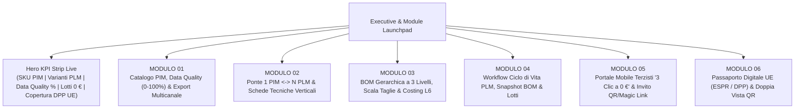

# PRD-003: Specifica Funzionale & UX v3.0 — Home Hub Modulare, Design System v2.0 Applicativo, Motore PIM Data Quality & Export (`FEAT-05`), Schede Tecniche Verticali e Segregazione Costi L6

- **PRD ID:** `PRD-003`
- **Titolo:** Specifica Operativa Sprint 3 — Applicazione Integrale Design System v2.0 (`MKT-BRAND-002` — Nike Editorial Minimalism), Home Iniziale `<FootlinkHomeHub />` (Executive & Module Launchpad dei 6 Moduli Core), Motore PIM Data Quality (`0–100%`) & Syndication Export (`FEAT-05`), Schede Tecniche Verticali Multi-Settore, Sviluppo Taglie e Segregazione Costi L6
- **Autore:** CPO (`footlink-cpo`)
- **Stato:** Approvato (L1 — Allineato a [`PRD-001`](PRD-001-mvp-pim-plm.md), [`PRD-002`](PRD-002-visual-bridge-bom3-subcontractor-portal.md), [`MKT-BRAND-002`](../marketing/brand-guidelines-v1.md) e `ADR-006`)
- **Task di Riferimento:** [`FTL-PROD-003`](../../tasks/FTL-PROD-003.json)
- **Data:** 18 Ottobre 2026
- **Perimetro Merceologico:** Calzature (`FOOTWEAR`), Pelletteria (`LEATHER_GOODS`), Abbigliamento (`APPAREL`)
- **Destinatari:** CTO (`Applicativo/frontend/`, `Applicativo/backend/`), CRO, CMO, CGO, CEO

---

## Executive Summary

Con lo **Sprint 3 (`FTL-PROD-003`)**, Footlink compie il salto da workspace tecnico a **piattaforma industriale completa ed esteticamente iconica**, unificando l'identità visiva tra il sito istituzionale (`Sito/index.html`) e l'Applicativo (`Applicativo/frontend/`) ed espandendo le capacità funzionali di PIM e PLM sui quattro pilastri seguenti:

1. **Applicazione Integrale del Design System v2.0 (`MKT-BRAND-002` — Nike Editorial Minimalism) sull'Applicativo:** Rimozione totale di qualsiasi estetica dark-mode o multicolore da template SaaS tradizionale a favore di un sistema monocromatico ad altissimo contrasto (`#FFFFFF` Pure White, `#F5F5F5` Light Bone / Nike Grey, `#111111` Pitch Black, `#707072` Warm Neutral Grey, `#E5E5E5` Architectural Hairline e `#10B981` Signal Green usato esclusivamente come pallino live `8px`), tipografia architettonica `'Barlow Condensed'` 900 Uppercase abbinata a `'Inter'` e `'JetBrains Mono'`, bottoni 100% pill-shaped (`border-radius: 999px`) e adozione nell'header applicativo del pittogramma vettoriale ufficiale **"The Dynamic Sole-Link"** (con divieto assoluto di inserire la scritta `1:N` nel logo).
2. **Home Iniziale di Footlink (`<FootlinkHomeHub />` — Executive & Module Launchpad):** Una schermata di atterraggio esecutiva che accoglie il Brand o la PMI manifatturiera mostrando in `< 3 secondi` la **Hero KPI Strip** in tempo reale e la **Griglia Interattiva dei 6 Moduli Principali** di Footlink, ciascuno esplorabile ed eseguibile in **1 clic** senza menu annidati.
3. **Motore PIM Data Quality (`0–100%`) & Syndication Export Multicanale (`FEAT-05`):** Algoritmo deterministico a 10 criteri pesati che calcola in tempo reale la completezza commerciale e normativa ESPR di ogni Master SKU PIM, funge da **Gate di Pubblicazione per il Passaporto Digitale UE (DPP)** e abilita l'esportazione immediata verso `CSV`, `JSON`, `Shopify B2C` e `B2B Showroom`.
4. **Schede Tecniche Verticali Multi-Settore, Sviluppo Scala Taglie e Segregazione Costi L6:** Mappatura granulare degli attributi ingegneristici per Calzature, Pelletteria e Abbigliamento, matrice parametrica di **Grading Consumi su Scala Taglie** (con ricalcolo automatico del fabbisogno lordo) e **Toggle di Sicurezza Costing L6** (`Vista Brand/PMI [Costi Visibili]` vs `Vista Terzista 0 € [Costi Oscurati]`) che garantisce che nessun dato finanziario o margine venga mai esposto nel payload o nella UI dei laboratori partner.

---

## Sezione 1 — Applicazione Integrale Design System v2.0 (`MKT-BRAND-002` — Nike Editorial Minimalism) sull'Applicativo

### 1.1 Principi UI e Bandi Visivi Obbligatori

L'intero frontend (`Applicativo/frontend/`) deve riflettere senza eccezioni lo standard **Nike Editorial Minimalism** sancito in [`MKT-BRAND-002`](../marketing/brand-guidelines-v1.md):
- **Zero SaaS Clutter / Zero Dark Mode:** Sono **banditi** gli sfondi scuri tipo `#0F172A`, i blu/viola elettrici (`#4F46E5`, `#2563EB`), le ombre diffuse pesanti e i badge arcobaleno. L'interfaccia utilizza spazio bianco drammatico (`#FFFFFF`), contenitori grigio architettonico (`#F5F5F5`), hairlines nitide da `1px solid #E5E5E5` e blocchi spotlight nero assoluto (`#111111`).
- **Comprensione in 5 Secondi:** I titoli di sezione e i numeri KPI comandano la gerarchia visiva con tipografia condensata ultra-bold maiuscola; le azioni primarie e i selettori di modulo sono bottoni pill (`999px`) ad alto contrasto.

### 1.2 Token CSS Ufficiali dell'Applicativo (`Applicativo/frontend/src/index.css`)

| Categoria | Variabile CSS | Valore Esatto | Regola d'Uso Obbligatoria nell'Applicativo |
| :--- | :--- | :--- | :--- |
| **Background Primary** | `--bg-white` | `#FFFFFF` | Sfondo globale dell'app, workspace principale, tabelle e card attive su contenitori grigi. |
| **Background Secondary** | `--bg-grey` | `#F5F5F5` | Contenitori di modulo, pannelli laterali, blocchi KPI, header di tabella e card di riepilogo. |
| **Surface Spotlight** | `--bg-black` | `#111111` | Bottoni primari pill, tab attivo nella Topbar, banner Hero/Spotlight, badge principali selezionati. |
| **Text Primary** | `--text-black` | `#111111` | Tutti i titoli (`H1`–`H4`), valori numerici KPI, nomi prodotto, codici SKU/PLM primari. |
| **Text Secondary** | `--text-grey` | `#707072` | Etichette di campo, metadati secondari, descrizioni tecniche, breadcrumb e sottotitoli. |
| **Border & Hairline** | `--border-light` | `#E5E5E5` | Bordi di card, griglie BOM a 3 livelli, separatori tra sezioni (`1px solid #E5E5E5`, hover `#111111`). |
| **Functional Live Dot** | `--status-ok` | `#10B981` | **Unico colore semantico ammesso**, utilizzato *esclusivamente* per il pallino circolare `8px` (`border-radius: 50%`) che indica stato live attivo, sincronizzazione DPP `100%` o conferma terzista ricevuta. |
| **Font Display** | `--font-display` | `'Barlow Condensed', 'Oswald', 'Helvetica Neue Condensed Black', sans-serif` | `font-weight: 900`, `text-transform: uppercase`, `letter-spacing: -0.03em`, `line-height: 0.95`. Usato per titoli di pagina, numeri KPI giganti, numeri modulo (`01`..`06`) e intestazioni di sezione. |
| **Font Body & UI** | `--font-sans` | `'Inter', -apple-system, BlinkMacSystemFont, sans-serif` | `font-weight: 400 | 500 | 600`. Usato per copy operativo, form, tabelle e pulsanti. |
| **Font Monospace** | `--font-mono` | `'JetBrains Mono', monospace` | `font-weight: 500 | 600`. Usato per codici SKU PIM, codici industriali PLM (`IND-2027-001-A`), lotti (`#T-982`), hash SHA-256 e formule BOM. |
| **Pill Button Radius** | `--radius-pill` | `999px` | Obbligatorio su **tutti** i bottoni primari, secondari, filtri rapidi, switcher di vista e tab di navigazione. |

### 1.3 Componentistica Bottoni & Logo SVG Ufficiale ("The Dynamic Sole-Link")

1. **Bottoni Pill (`border-radius: 999px`):**
   - **Primary Pill Button:** `background: #111111; color: #FFFFFF; border: 1.5px solid #111111; border-radius: 999px; padding: 12px 24px; font-weight: 600;` (Hover: `background: #333333`).
   - **Secondary Outline Pill Button:** `background: #FFFFFF; color: #111111; border: 1.5px solid #CACACB; border-radius: 999px; padding: 12px 24px; font-weight: 600;` (Hover: `border-color: #111111`).
2. **Logo Vettoriale Ufficiale ("The Dynamic Sole-Link") — Zero `1:N` nel Logo:**
   - L'header globale dell'Applicativo deve renderizzare il componente `<FootlinkLogo />` con le due lame geometriche inclinate a 22° unite alla base della suola stilizzata e il wordmark `FOOTLINK` in `'Barlow Condensed'` 900.
   - **Regola Tassativa:** È severamente vietato mostrare la scritta `1:N` dentro o accanto al logo del brand.

```html
<!-- SVG Ufficiale obbligatorio nell'Header dell'Applicativo -->
<svg width="168" height="32" viewBox="0 0 168 32" fill="none" xmlns="http://www.w3.org/2000/svg" aria-label="FOOTLINK">
  <path d="M4 24L14.5 6H24L13.5 24H4Z" fill="currentColor"/>
  <path d="M15.5 24L23 11H31L23.5 24H15.5Z" fill="currentColor"/>
  <path d="M4 26.5H29.5L28 29H2.5L4 26.5Z" fill="currentColor"/>
  <text x="38" y="24" fill="currentColor" font-family="'Barlow Condensed', 'Inter', sans-serif" font-weight="900" font-size="25" letter-spacing="-0.03em">FOOTLINK</text>
</svg>
```

---

## Sezione 2 — Home Iniziale di Footlink (`<FootlinkHomeHub />` — Executive & Module Launchpad)

### 2.1 Razionale UX e Architettura Informativa

All'apertura dell'Applicativo, l'utente atterra sulla **Home Iniziale (`<FootlinkHomeHub />`)**, progettata come **Executive & Module Launchpad**. L'obiettivo è offrire a imprenditori, responsabili prodotto e tecnici di collezione una visione immediata e priva di attrito dell'intero sistema operativo della filiera:
1. **Top Navigation Bar Permanente:** Logo SVG `"The Dynamic Sole-Link"`, selettore rapido del Prodotto Master attivo (Calzatura, Borsa, Capospalla), **Toggle Globale Sicurezza L6 (`Vista Brand [Costi Visibili]` / `Vista Terzista 0 € [Costi Oscurati]`)** e barra di navigazione rapida pill verso la `HOME` e i `6 Moduli`.
2. **Hero KPI Strip (5 Indicatori Esecutivi Live):** Striscia ad alto contrasto che sintetizza lo stato di salute dell'intera collezione in tempo reale.
3. **Griglia Interattiva dei 6 Moduli Principali (Module Launchpad Grid):** 6 card editoriali numerate (`01`–`06`) con metriche live specifiche di ciascun modulo, anteprima dello stato attuale e pulsante pill primario che apre istantaneamente (`< 50ms`) il modulo corrispondente o avvia il Tour Guidato End-to-End.



### 2.2 Specifica della Hero KPI Strip

| # | Etichetta KPI (Uppercase) | Valore Dinamico Calcolato | Sottotitolo / Dettaglio Operativo | Indicatore Live |
| :--- | :--- | :--- | :--- | :--- |
| **KPI 1** | `SKU PIM ATTIVI (VENDITA)` | Conteggio totale `pim_articles` (es. `3 Master SKU`) | `Calzature • Pelletteria • Abbigliamento` | Pallino `#10B981` + `Catalogo Unico` |
| **KPI 2** | `VARIANTI TECNICHE PLM` | Conteggio totale `plm_variants` (es. `6 Linee Fabbrica`) | `Rapporto medio 1:2.0 senza duplicazione PIM` | Badge monocromatico `1 PIM ↔ N PLM` |
| **KPI 3** | `SCORE MEDIO DATA QUALITY PIM` | Media aritmetica `data_quality_score` (es. `96%`) | `Soglia Gate ESPR DPP >= 80% superata` | Pallino `#10B981` se `>= 80%` |
| **KPI 4** | `LOTTI TERZISTI CONFERMATI A 0 €` | Conteggio fasi/lotti validati dai laboratori (es. `100% Tracciati`) | `Licenza 0 € per sempre per tutti i façonisti` | Pallino `#10B981` `Live dal Reparto` |
| **KPI 5** | `COPERTURA PASSAPORTO DPP UE` | `%` SKU PIM con DPP valido e firmato (es. `100% ESPR Ready`) | `URI immutabile id.footlink.eu/01/{gtin}` | Pallino `#10B981` `Reg. UE 2024/1781` |

### 2.3 Specifica Dettagliata della Griglia dei 6 Moduli Principali (Accesso in 1 Clic)

Ogni card della griglia su `<FootlinkHomeHub />` presenta:
- **Numero Editoriale Gigante (`01`..`06`)** in `'Barlow Condensed'` 900 (`2.75rem`, `#111111`);
- **Tag Categoria Pill** (es. `COMMERCIAL & SYNDICATION`, `ENGINEERING BRIDGE`, `INDUSTRIAL BOM & L6 SECURITY`, `LIFECYCLE & SNAPSHOTS`, `ZERO-COST SUPPLY CHAIN`, `EU ESPR COMPLIANCE`);
- **Titolo in Uppercase Condensed** + **Descrizione esecutiva in 2 righe**;
- **3 Metriche / Indicatori Live dal Prodotto Selezionato**;
- **CTA Pill Button (`border-radius: 999px`)** per l'apertura immediata del modulo in 1 clic.

| Modulo | Titolo Ufficiale Modulo | Funzionalità Chiave Esposte nel Modulo | Metriche Live sulla Card in Home | CTA Pill (1 Clic) |
| :--- | :--- | :--- | :--- | :--- |
| **Modulo 01** | **CATALOGO PIM, DATA QUALITY SCORE (0–100%) & EXPORT MULTICANALE** | Gestione Master SKU Commerciale unico, switcher lingua `IT / EN`, **Motore Data Quality deterministico su 10 criteri ESPR/PIM**, gate di conformità DPP e **Syndication Export in 1 clic** verso `CSV`, `JSON`, `Shopify B2C` e `B2B Showroom` con anteprima live del payload. | • Master SKU attivo (`FL-SHOE-2027-001`)<br>• Score Data Quality (`100% — 10/10 Criteri`)<br>• Canali pronti (`CSV`, `JSON`, `Shopify`, `B2B`) | `[ Apri Modulo 01 — Catalogo PIM & Export → ]` |
| **Modulo 02** | **PONTE `1 PIM ↔ N PLM` & SCHEDE TECNICHE VERTICALI MULTI-SETTORE** | Split-View visuale `1 Articolo PIM (Vendita) ↔ N Articoli PLM (Produzione)`, creazione rapida N-esima variante senza duplicare dati commerciali, **Schede Tecniche Verticali** specifiche per **Calzature** (Forma, Tacco, Suola, Costruzione), **Pelletteria** (Cartamodello, Luce Manico, Galvanica, Costola) e **Abbigliamento** (Base Cartamodello, Grammatura `g/m²`, Finezza/Titolo, Lavaggio). | • Settore attivo (`Calzature / Pelletteria / Abbigliamento`)<br>• Varianti PLM collegate (`2 Linee Produzione`)<br>• Parametri tecnici verticali (`100% Compilati`) | `[ Apri Modulo 02 — Ponte 1:N & Schede Tecniche → ]` |
| **Modulo 03** | **DISTINTA BASE (BOM) A 3 LIVELLI, SVILUPPO SCALA TAGLIE & COSTING L6** | Albero industriale a **3 Livelli** (`L1 Assieme`, `L2 Materiale`, `L3 Materia Prima/Lotto`), **Tabella Sviluppo Consumi su Scala Taglie (Grading)** con coefficienti automatici per taglia e **Costing Industriale Riservato L6** con toggle di sicurezza istantaneo `Vista Brand` vs `Vista Terzista 0 €` (oscuramento totale prezzi/margini). | • Nodi BOM attivi (`3 Livelli Gerarchici`)<br>• Scala Taglie (`36–46 EU / OS / XS–XXL`)<br>• Stato Sicurezza L6 (`Protetto / Oscurabile`) | `[ Apri Modulo 03 — BOM 3 Livelli & Costing L6 → ]` |
| **Modulo 04** | **WORKFLOW CICLO DI VITA PLM, SNAPSHOT BOM IMMUTABILI & LOTTI** | Avanzamento strutturato di stato PLM (`PROTOTYPE` → `SAMPLE` → `INDUSTRIALIZED` → `IN_PRODUCTION`), generazione e confronto di **Snapshot BOM Immutabili (`v1.0 Campionario` vs `v2.0 Produzione`)** con hash crittografico e registro ordini di produzione / lotti assegnati ai reparti. | • Stato Ciclo Vita (`IN_PRODUCTION`)<br>• Snapshot BOM congelati (`v1.0`, `v2.0`)<br>• Ordini Lotto attivi (`LOT-2027-884`) | `[ Apri Modulo 04 — Ciclo Vita PLM & Snapshot → ]` |
| **Modulo 05** | **PORTALE MOBILE TERZISTI "3 CLIC A 0 €" & INVITO RAPIDO FILIERA** | Simulatore smartphone `375px` ad alto contrasto AAA (pulsanti touch `>= 56px`, zero costi di licenza per sempre, zero campi prezzo visibili per regola L6) con flusso in **3 tap (`< 10s`)** e generatore di **Invito Rapido Filiera (Magic Link WhatsApp/SMS + QR Bolla di Lavorazione)**. | • Tempo medio conferma (`4.2s — 3 Clic`)<br>• Costo licenza terzista (`0,00 € per sempre`)<br>• Visibilità costi al terzista (`0% — Blocco L6`) | `[ Apri Modulo 05 — Portale Terzisti 3 Clic a 0 € → ]` |
| **Modulo 06** | **PASSAPORTO DIGITALE UE (ESPR / DPP) & DOPPIA VISTA QR NAVIGABILE** | Generazione automatica al 100% del **Digital Product Passport (Reg. UE 2024/1781)** alimentato da PIM + BOM 3 Livelli + Conferme Terzisti, **QR Code SVG interattivo** e switcher tra **Vista Consumatore (Storytelling, Riparabilità, Impatto)** e **Vista Ispettiva / Doganale UE (JSON-LD ESPR, Codici TARIC/HS, Certificati LWG/GRS/REACH, Hash Immutabile)**. | • Conformità ESPR (`100% Verificata`)<br>• Contenuto Riciclato / CO2e (`Calcolo Live BOM`)<br>• Doppia Vista (`Consumatore + Dogana UE`) | `[ Apri Modulo 06 — Passaporto Digitale DPP UE → ]` |

### 2.4 Wireframe Testuale della Home Iniziale (`<FootlinkHomeHub />`)

```text
+--------------------------------------------------------------------------------------------------------------------+
| [SVG: FOOTLINK]  | Prodotto Attivo: [ Mocassino Brera (Calzature) v ] | Sicurezza L6: (•) Vista Brand ( ) Terzista |
| Navigazione Pill: ( HOME HUB ) ( 01 PIM & EXPORT ) ( 02 PONTE 1:N & SCHEDE ) ( 03 BOM & TAGLIE ) ( 04 CICLO VITA ) |
|                   ( 05 PORTALE TERZISTI 0€ ) ( 06 PASSAPORTO DPP UE )                    [ + Nuovo Articolo PIM ]  |
+--------------------------------------------------------------------------------------------------------------------+
| FOOTLINK OPERATING SYSTEM — EXECUTIVE LAUNCHPAD                                                                    |
| DAL MODELLO ALLA FABBRICA. IN UN SOLO SISTEMA.                                                                     |
| Seleziona un prodotto campione o accedi in 1 clic a ciascuno dei 6 moduli operativi della filiera.                 |
+--------------------------------------------------------------------------------------------------------------------+
| HERO KPI STRIP LIVE                                                                                                |
| +--------------------+ +----------------------+ +----------------------+ +------------------+ +------------------+ |
| | SKU PIM ATTIVI     | | VARIANTI TECNICHE PLM| | DATA QUALITY PIM     | | TERZISTI A 0 €   | | COPERTURA DPP UE | |
| | 3 MASTER SKU       | | 6 LINEE FABBRICA     | | 98% SCORE MEDIO      | | 100% CONFERMATI  | | 100% ESPR READY  | |
| | • 3 Settori Moda   | | Ponte 1 PIM <-> N PLM| | • Gate DPP >=80% OK  | | • Licenza 0 €    | | • QR GS1 Attivo  | |
| +--------------------+ +----------------------+ +----------------------+ +------------------+ +------------------+ |
+--------------------------------------------------------------------------------------------------------------------+
| GRIGLIA INTERATTIVA DEI 6 MODULI PRINCIPALI (ACCESSO DIRETTO IN 1 CLIC)                                            |
|                                                                                                                    |
| +----------------------------------+ +----------------------------------+ +--------------------------------------+ |
| | 01  [PIM & SYNDICATION]          | | 02  [ENGINEERING BRIDGE]         | | 03  [BOM 3 LIVELLI & L6 COSTING]     | |
| | CATALOGO PIM, DATA QUALITY       | | PONTE 1 PIM <-> N PLM & SCHEDE   | | DISTINTA BASE A 3 LIVELLI, SCALA     | |
| | SCORE & EXPORT MULTICANALE       | | TECNICHE VERTICALI MULTI-SETTORE | | TAGLIE & COSTING RISERVATO L6        | |
| | - Score SKU attivo: 100% (10/10) | | - Calzature / Pelletteria / Abb. | | - Albero L1 Assieme / L2 Mat / L3 Lot| |
| | - Lingue: IT / EN sincronizzate  | | - Zero duplicazione dati vendita | | - Grading Taglie automatico          | |
| | - Export: CSV, JSON, Shopify, B2B| | - Parametri Forma/Galvanica/Gram.| | - Segregazione Costi Brand vs Terz.  | |
| | ( Apri Modulo 01 — PIM & Export )| | ( Apri Modulo 02 — Ponte & Spec )| | ( Apri Modulo 03 — BOM & Costing L6 )| |
| +----------------------------------+ +----------------------------------+ +--------------------------------------+ |
|                                                                                                                    |
| +----------------------------------+ +----------------------------------+ +--------------------------------------+ |
| | 04  [LIFECYCLE & SNAPSHOTS]      | | 05  [ZERO-COST SUPPLY CHAIN]     | | 06  [EU ESPR COMPLIANCE]             | |
| | WORKFLOW CICLO DI VITA PLM,      | | PORTALE MOBILE TERZISTI          | | PASSAPORTO DIGITALE UE (ESPR / DPP)  | |
| | SNAPSHOT BOM IMMUTABILI & LOTTI  | | "3 CLIC A 0 €" & INVITO FILIERA  | | CON DOPPIA VISTA & QR CODE SVG       | |
| | - Stati: PROTOTYPE -> PRODUCTION | | - Smartphone 375px (>=56px touch)| | - Vista Consumatore (Story & Care)   | |
| | - Snapshot congelati v1.0 / v2.0 | | - Conferma lotto in 3 tap (<10s) | | - Vista Doganale UE (JSON-LD & TARIC)| |
| | - Tracciabilità ordini di reparto| | - Magic Link & QR Bolla Lavoraz. | | - QR Code SVG interattivo live       | |
| | ( Apri Modulo 04 — Ciclo Vita )  | | ( Apri Modulo 05 — Portale 0 € ) | | ( Apri Modulo 06 — Passaporto DPP )  | |
| +----------------------------------+ +----------------------------------+ +--------------------------------------+ |
+--------------------------------------------------------------------------------------------------------------------+
```

---

## Sezione 3 — Motore PIM Data Quality (`0–100%`) & Syndication Export (`FEAT-05`)

### 3.1 Algoritmo Deterministico di Calcolo PIM Data Quality (`0–100%`)

Ogni Articolo PIM (`PIM_ARTICLE`) viene valutato in tempo reale da una funzione pura deterministica `calculatePimDataQuality(pimArticle, linkedPlmVariants)` articolata su **10 criteri oggettivi** (peso `10%` ciascuno, totale `100%`) divisi tra **Completezza Commerciale Omnicanale (50%)** e **Prontezza Normativa ESPR / DPP UE (50%)**:

| # Criterio | Codice Regola | Descrizione Controllo | Peso (%) | Ambito | Condizione di Superamento (Booleana) |
| :--- | :--- | :--- | :--- | :--- | :--- |
| **01** | `DQ-PIM-01` | **Identificativo Univoco Master SKU & GTIN/EAN** | `10%` | PIM Core | `sku_code.length >= 6 && gtin_ean13.length === 13` |
| **02** | `DQ-PIM-02` | **Naming & Copy Commerciale Bilingue (`IT` + `EN`)** | `10%` | Omnicanale | `name_it`, `name_en`, `desc_it` (`>= 30 char`), `desc_en` (`>= 30 char`) valorizzati |
| **03** | `DQ-PIM-03` | **Classificazione Merceologica, Stagione & Codice Doganale HS/TARIC** | `10%` | Dogana / B2B | `category` (`FOOTWEAR`\|`LEATHER_GOODS`\|`APPAREL`), `season` e `hs_taric_code` (`8-10 cifre`) presenti |
| **04** | `DQ-PIM-04` | **Listini Commerciali B2B Wholesale & B2C Retail** | `10%` | Commerciale | `wholesale_price_eur > 0 && retail_price_eur > wholesale_price_eur` |
| **05** | `DQ-PIM-05` | **Canali di Distribuzione & Media Pack Associati** | `10%` | Syndication | Almeno `1 canale attivo` (`Shopify B2C` o `B2B Showroom`) e asset visivo/galeria presente |
| **06** | `DQ-ESPR-06` | **Ponte Attivo con almeno 1 Variante Tecnica PLM (`1:N`)** | `10%` | PLM Link | `linkedPlmVariants.length >= 1` con scheda tecnica verticale compilata |
| **07** | `DQ-ESPR-07` | **Distinta Base (BOM) Completa sui 3 Livelli Gerarchici** | `10%` | BOM 3-Level | Presenza simultanea di nodi di `Livello 1 (Assieme)`, `Livello 2 (Materiale)` e `Livello 3 (Materia Prima/Chimico)` |
| **08** | `DQ-ESPR-08` | **Tracciabilità Lotti Certificati & Conformità Chimica REACH** | `10%` | Compliance | Tutti i nodi di `Livello 3` hanno `batch_number` valorizzato e `reach_compliant === true` |
| **09** | `DQ-ESPR-09` | **Metriche Ambientali Calcolate (`% Riciclato` & `kg CO2e`)** | `10%` | Sostenibilità | `recycled_content_pct >= 0` e `carbon_footprint_kg_co2e > 0` derivati dalla BOM |
| **10** | `DQ-ESPR-10` | **Istruzioni di Cura, Riparabilità & Fine Vita (Circolarità UE)** | `10%` | ESPR Art. 7 | Campi `care_instructions`, `repairability_score` e `end_of_life_disassembly` compilati |

### 3.2 Gate di Pubblicazione DPP UE & Simulazione Interattiva Data Quality

- **Regola di Gate ESPR:**
  - **Score `< 80%` (`STATO: INCOMPLETO — BLOCCO PUBBLICAZIONE DPP`):** Il pulsante di emissione ufficiale del Passaporto Digitale UE mostra l'elenco puntuale dei criteri mancanti (es. *"Manca Codice Doganale HS/TARIC"* o *"Manca Lotto Certificato Livello 3"*).
  - **Score `>= 80%` e `< 100%` (`STATO: IDONEO CON AVVISI COMMERCIALI`):** Se tutti i 5 criteri `DQ-ESPR-06..10` sono soddisfatti, il DPP UE è pubblicabile ma il PIM segnala i campi commerciali opzionali da completare per l'export e-commerce ottimale.
  - **Score `= 100%` (`STATO: GOLD STANDARD — OMNICHANNEL & ESPR READY`):** Pallino verde `#10B981` attivo, export abilitato su tutti i canali e Passaporto Digitale UE certificato al 100%.
- **Controlli Interattivi nel Modulo 01:** L'utente può attivare/disattivare o modificare in tempo reale i campi del Master SKU (o simulare l'omissione di un criterio come il codice TARIC o la traduzione EN) per verificare istantaneamente il ricalcolo dello score `0–100%` e il blocco/sblocco del Gate DPP.

### 3.3 Motore di Syndication Export Multicanale (`CSV`, `JSON`, `Shopify B2C`, `B2B Showroom`)

Dal **Modulo 01**, il Product Manager può esportare o pre-visualizzare in tempo reale il tracciato strutturato del catalogo PIM (arricchito dai dati di sostenibilità e origine aggregati dal PLM, ma **rigorosamente privo dei costi industriali e dei prezzi unitari BOM protetti dalla regola L6**):

| Canale di Export | Formato & Standard | Campi Inclusi nel Payload di Esportazione | Campi Tassativamente Esclusi (Blocco L6) |
| :--- | :--- | :--- | :--- |
| **`CSV Flat Catalog`** | `RFC 4180 CSV` (UTF-8, separatore `;` o `,`) | `SKU`, `GTIN_EAN13`, `Category`, `Season`, `Name_IT`, `Name_EN`, `Wholesale_EUR`, `Retail_EUR`, `HS_TARIC`, `Origin_Country`, `Recycled_Pct`, `CO2e_kg`, `DPP_Public_URL`, `Data_Quality_Score` | Costo industriale PLM, prezzi unitari materiali BOM, tariffe manovia terzisti, margini. |
| **`JSON API Payload`** | `Application/JSON` (Schema OpenAPI Footlink PIM v3) | Oggetto gerarchico `pim_master` + array `commercial_translations` + oggetto `espr_dpp_summary` (`dpp_uri`, `certifications[]`, `tier_traceability[]`). | Qualsiasi attributo `unit_cost_eur`, `labor_cost_eur`, `total_industrial_cost`. |
| **`Shopify B2C Feed`** | `Shopify Product Admin REST / GraphQL JSON` | `handle`, `title`, `body_html` (con bullet sostenibilità automatici), `vendor`, `product_type`, `tags`, `variants[]` (sviluppate sulla scala taglie con `price: retail_price_eur`, `sku`, `barcode`) + `metafields.footlink_dpp` (link QR Passaporto UE, % riciclato, paese origine). | Prezzo Wholesale B2B, costi di produzione PLM e costi distinta base. |
| **`B2B Showroom Linesheet`** | `B2B Order Matrix JSON / Linesheet Strutturato` | `master_sku`, `collection_season`, `wholesale_price_eur`, `suggested_retail_price_eur`, `minimum_order_qty`, `delivery_window`, `size_run_available[]`, `composition_label_eu`, `certifications_badges[]` (`LWG Gold`, `GRS`, `OEKO-TEX`). | Costi industriali di fabbrica (`industrial_cost_eur`) e listini fornitori/terzisti. |

---

## Sezione 4 — Schede Tecniche Verticali Multi-Settore, Sviluppo Taglie e Segregazione Costi L6

### 4.1 Mappatura Attributi Ingegneristici per Settore (`footwear`, `leather_goods`, `apparel`)

Nel **Modulo 02**, la selezione di un prodotto o la creazione di una Variante Tecnica PLM adatta dinamicamente la **Scheda Tecnica Verticale (`<VerticalTechSpecSheet />`)** in base alla categoria merceologica, evitando campi generici e parlando esattamente la lingua dei modellisti di calzature, pelletteria e abbigliamento:

| Codice Campo | Calzature (`FOOTWEAR`) | Pelletteria (`LEATHER_GOODS`) | Abbigliamento (`APPAREL`) | Unità / Esempio Reale nell'Applicativo |
| :--- | :--- | :--- | :--- | :--- |
| **`spec_field_1`** | **Codice Forma (`last_code`)** | **Codice Cartamodello (`pattern_code`)** | **Base Cartamodello (`block_pattern_code`)** | `LAST-BRERA-42` \| `MOD-TOTE-MILANO-04` \| `BLK-TRENCH-COMO-48` |
| **`spec_field_2`** | **Codice Tacco & Altezza (`heel_code_height`)** | **Luce Manico & Tracolla (`handle_drop_cm`)** | **Grammatura Tessuto Principale (`fabric_weight_gsm`)** | `HEEL-20MM-CUOIO` \| `Luce 24 cm / Tracolla 105 cm` \| `310 g/m² Gabardine` |
| **`spec_field_3`** | **Codice Fondo / Suola (`sole_mold_code`)** | **Finitura Galvanica Metalleria (`hardware_galvanic`)** | **Finezza / Titolo Filato (`yarn_count_gauge`)** | `SOLE-CUOIO-TOS-09` \| `Oro Chiaro 24k Free-Nickel 0.5µm` \| `Titolo Ne 60/2 Ritorto` |
| **`spec_field_4`** | **Tipologia Costruzione (`construction_type`)** | **Costruzione Costola & Bordi (`edge_rib_finishing`)** | **Trattamento & Finissaggio (`garment_wash_finish`)** | `Cucitura Blake Rapid` \| `Costola Tinta a Mano 3 Passaggi` \| `Idrorepellente PFC-Free` |
| **`spec_field_5`** | **Calzata & Punto Francese Base (`fit_base_size`)** | **Rinforzi Interni & Salpa (`internal_reinforcement`)** | **Piazzamento & Larghezza Pezza (`marker_fabric_width`)** | `Calzata G — Taglia Base 42 EU` \| `Salpa Rigenerata Certificata 1.2mm` \| `Altezza Pezza 152 cm — Efficienza 86%` |
| **`spec_field_6`** | **Parametri Tiraggio / Assemblaggio (`lasting_params`)** | **Tolleranza Cucitura & Passo Ago (`stitch_pitch_spi`)** | **Tolleranza Restringimento (`shrinkage_tolerance_pct`)** | `Tiraggio punta 14 bar / 85°C` \| `Passo 3.5 mm — Filo Titolo 20` \| `Ordito max -1.5% / Trama max -1.0%` |

### 4.2 Tabella Sviluppo Consumi su Scala Taglie (Size Grading Matrix)

Nel **Modulo 03**, oltre all'albero BOM a 3 livelli sulla taglia base prototipo, Footlink include il componente `<SizeGradingConsumptionTable />` che calcola automaticamente la variazione dei consumi netti e lordi dei materiali principali al variare della taglia (o della dimensione per pelletteria):

#### Formula Deterministica di Grading Consumi
Per ogni riga materiale di Livello 2 soggetta a sviluppo taglia (`is_size_graded = true`):
$$\text{Consumo Netto}(\text{Taglia } s) = \text{Consumo Netto Base} \times \left(1 + \Delta_{\text{step}}(s) \times k_{\text{grading}}\right)$$
$$\text{Consumo Lordo}(\text{Taglia } s) = \text{Consumo Netto}(\text{Taglia } s) \times \left(1 + \frac{\text{Scarto } \%}{100}\right)$$

| Settore | Scala Taglie Standard Supportata | Taglia Base Prototipo | Coefficiente Step ($k_{\text{grading}}$) | Esempio Concreto Calcolato nella Tabella UI |
| :--- | :--- | :--- | :--- | :--- |
| **Calzature (`FOOTWEAR`)** | `36`, `37`, `38`, `39`, `40`, `41`, **`42 (Base)`**, `43`, `44`, `45`, `46` EU | **`42 EU`** | `+3.5%` per ogni punto sopra il 42; `-3.5%` per ogni punto sotto il 42 | Vitello Box Nero LWG: Taglia 38 (`0.228 m²` lordo) → **Taglia 42 Base (`0.265 m²` lordo)** → Taglia 46 (`0.303 m²` lordo) |
| **Pelletteria (`LEATHER_GOODS`)** | `MINI`, **`MEDIUM / OS (Base)`**, `LARGE / TRAVEL` | **`MEDIUM / OS`** | `-22%` per versione `MINI`; `+28%` per versione `LARGE` | Vitello Pieno Fiore: Mini (`0.484 m²` lordo) → **Medium Base (`0.620 m²` lordo)** → Large (`0.794 m²` lordo) |
| **Abbigliamento (`APPAREL`)** | `XS (44)`, `S (46)`, `M (48)`, **`L / 50 (Base)`**, `XL (52)`, `XXL (54)` | **`L (50 IT)`** | `+4.5%` per taglia superiore; `-4.5%` per taglia inferiore | Gabardine Cotone Bio: XS (`1.68 m` lordo) → **L Base (`1.94 m` lordo)** → XXL (`2.11 m` lordo) |

### 4.3 Segregazione Costi L6 (`Vista Brand/PMI [Costi Visibili]` vs `Vista Terzista 0 € [Costi Oscurati]`)

In conformità al livello di riservatezza **L6 (Industrial Costing & Margin Segregation)** del Manifesto Footlink, i costi industriali dei materiali, il costo di lavorazione per fase e i margini Wholesale/Retail sono **dati strettamente riservati al Brand/PMI capofila**.

#### Comportamento del Toggle di Sicurezza L6 (`<SecurityL6ViewToggle />`)

| Elemento / Modulo Applicativo | Modalità `VISTA BRAND / PMI [COSTI VISIBILI]` (Ruolo: `BRAND_ADMIN` / `PRODUCT_MANAGER`) | Modalità `VISTA TERZISTA 0 € [COSTI OSCURATI]` (Ruolo: `SUBCONTRACTOR_FREE_TIER`) |
| :--- | :--- | :--- |
| **Modulo 01 (Catalogo PIM)** | Mostra Prezzo B2B Wholesale (`€ 145,00`), Prezzo Retail (`€ 390,00`) e Margine Industriale Lordo (`+55.5%`). | **Oscurato (`[RISERVATO L6 — NON ESPORTATO AI TERZISTI]`)** — Il terzista vede solo codice articolo, foto e specifiche tecniche di confezione. |
| **Modulo 02 (Ponte 1:N & Schede)** | Mostra il Costo Industriale Standard di ogni Variante PLM (`€ 64,50` Linea Fermo vs `€ 61,20` Linea Toscana) e il differenziale di sourcing (`-€ 3,30`). | **Oscurato (`🔒 Costo Industriale Protetto L6`)** — Sono visibili al 100% i parametri tecnici (Forma, Tacco, Costruzione, Tolleranze). |
| **Modulo 03 (BOM 3 Livelli & Costing)** | Mostra per ogni nodo BOM il **Costo Unitario Materiale (`€/m²`, `€/paio`)**, il **Costo Riga Lordo**, il **Costo Manodopera Fasi** e il **Breakdown Totale Costo Industriale**. | **Colonne Costo Rimosse / Mascherate (`••• L6 Hidden`)** — La BOM mostra esclusivamente codici materiale, spessori, consumi netti/lordi, scala taglie e lotti da validare. |
| **Modulo 05 (Portale Mobile Terzisti)** | Nel pannello di controllo Brand affiancato allo smartphone viene mostrato il riepilogo dell'ordine con impegno economico interno. | Sullo smartphone `375px` del terzista **non esiste alcun campo prezzo, costo o margine** né nel DOM né nel payload API (`/api/v1/subcontractor/tasks`). |

---

## Sezione 5 — Acceptance Criteria Gherkin per lo Sprint 3 (`FTL-PROD-003`)

```gherkin
# language: it
Funzionalità: Sprint 3 — Home Hub dei 6 Moduli, Design System v2.0 Nike Editorial Minimalism, PIM Data Quality & Export (FEAT-05) e Schede Tecniche Verticali con Sicurezza L6

  Contesto:
    Dato che l'utente accede all'Applicativo Footlink ("Applicativo/frontend/")
    E il Design System v2.0 ("MKT-BRAND-002" — Nike Editorial Minimalism) è attivo con sfondo "#FFFFFF", superfici "#F5F5F5", testi/bottoni "#111111", tipografia "'Barlow Condensed'" 900 Uppercase e bottoni pill ("border-radius: 999px")
    E il logo SVG nell'header è "The Dynamic Sole-Link" senza alcuna dicitura "1:N"

  Scenario: 1. Atterraggio sulla Home Iniziale (<FootlinkHomeHub />) e navigazione in 1 clic ai 6 Moduli Principali
    Quando l'utente apre la vista iniziale "HOME HUB" dell'Applicativo
    Allora visualizza immediatamente la Hero KPI Strip con i 5 indicatori live (SKU PIM Attivi, Varianti Tecniche PLM, Score Medio Data Quality PIM, Lotti Terzisti Confermati a 0 €, Copertura Passaporto DPP UE)
    E visualizza la griglia interattiva dei 6 Moduli Principali numerati da "01" a "06"
    Quando l'utente clicca sul bottone pill di uno qualsiasi dei 6 moduli (es. "Apri Modulo 03 — BOM 3 Livelli & Costing L6")
    Allora l'Applicativo apre istantaneamente il modulo selezionato in 1 solo clic senza ricaricamento pagina

  Scenario: 2. Calcolo deterministico del PIM Data Quality Score (0-100%), Gate ESPR DPP ed Export Multicanale (FEAT-05)
    Dato che l'utente si trova nel "Modulo 01 — Catalogo PIM, Data Quality Score & Export Multicanale"
    Quando tutti i 10 criteri (5 commerciali PIM + 5 normativi ESPR/BOM) sono soddisfatti per il Master SKU selezionato
    Allora il Data Quality Score mostra "100%" con pallino verde "#10B981" e il Gate DPP UE risulta "SBLOCCATO (ESPR READY)"
    Quando l'utente deseleziona o svuota un criterio obbligatorio (es. rimuove il Codice Doganale HS/TARIC o la descrizione EN)
    Allora lo score scende immediatamente in modo deterministico (es. da "100%" a "80%" o "70%") mostrando il criterio mancante
    E quando l'utente clicca su uno dei 4 formati di Syndication Export ("CSV", "JSON", "Shopify B2C", "B2B Showroom")
    Allora il sistema genera e mostra l'anteprima scaricabile del tracciato strutturato escludendo rigorosamente tutti i costi industriali riservati L6

  Scenario: 3. Schede Tecniche Verticali Multi-Settore e Tabella Sviluppo Scala Taglie (Grading)
    Dato che l'utente esplora il "Modulo 02" e il "Modulo 03"
    Quando seleziona un articolo di categoria "FOOTWEAR" (Calzature)
    Allora la Scheda Tecnica Verticale mostra i campi specifici calzaturieri (Codice Forma, Codice Tacco, Suola, Costruzione Blake/Ideal) e la scala taglie "36–46 EU" con taglia base "42 EU"
    Quando cambia il prodotto attivo in "LEATHER_GOODS" (Pelletteria) o "APPAREL" (Abbigliamento)
    Allora la Scheda Tecnica Verticale aggiorna dinamicamente gli attributi (Cartamodello/Luce Manico/Galvanica oppure Base Cartamodello/Grammatura g/m²/Finezza) e ricalcola i consumi lordi nella Tabella Sviluppo Scala Taglie

  Scenario: 4. Segregazione Costi L6 tra Vista Brand/PMI e Vista Terzista 0 €
    Dato che l'utente visualizza i costi industriali nel "Modulo 02" o nel "Modulo 03 (BOM a 3 Livelli)" in modalità "Vista Brand [Costi Visibili]"
    Quando commuta il toggle globale di sicurezza L6 su "Vista Terzista 0 € [Costi Oscurati]"
    Allora tutti i prezzi Wholesale/Retail, i costi unitari dei materiali BOM, i costi di lavorazione e i margini vengono immediatamente oscurati ("RISERVATO L6")
    Mentre i codici tecnici, le grammature/spessori, i consumi per taglia e i numeri di lotto restano pienamente consultabili per la lavorazione a 0 €
```
