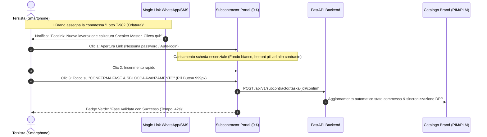

# PRD-004: Protocollo di Validazione Pilota sul Campo "Zero-Training Terzista" (≤ 3 Clic, < 90s) & Framework Benchmark SUS

- **PRD ID:** `PRD-004`
- **Titolo:** Protocollo Operativo di Validazione Industriale in Reparto per i primi 3 Design Partner Pilota e i loro Terzisti a 0 €
- **Autore:** Chief Product Officer (`footlink-cpo`)
- **Stato:** Approvato (Operativo)
- **Task di Riferimento:** [`FTL-PROD-004`](../../tasks/FTL-PROD-004.json)
- **Allineamento:** [`OKR-2026-Q4-2027-Q1`](../okr/OKR-2026-Q4-2027-Q1.md) (`KR A.3`, `KR CPO-1.3`, `KR CPO-1.4`), [`PRD-002`](PRD-002-visual-bridge-bom3-subcontractor-portal.md), [`PRD-003`](PRD-003-home-hub-vertical-specs-data-quality-export.md)
- **Data:** 19 Ottobre 2026
- **Perimetro Merceologico:** Calzature (`FOOTWEAR`), Pelletteria (`LEATHER_GOODS`), Abbigliamento (`APPAREL`)

---

## 1. Obiettivo e Razionale Industriale

Con l'avvio della fase pilota nei distretti delle Marche, della Toscana e del Veneto, il team di prodotto deve verificare sul campo l'assunto cardine di Footlink:
> **"Un laboratorio terzista deve poter confermare commessa, avanzamento fase e lotti di lavorazione da smartphone in ≤ 3 clic e meno di 90 secondi, senza alcuna formazione preventiva."**

Se il software richiede manuali d'uso o sessioni di training ai laboratori façonisti, l'effetto rete virale fallisce. Il protocollo `PRD-004` formalizza il collaudo di usabilità in reparto e le metriche di accettazione.

---

## 2. Il Flusso Mobile "Zero-Training" a 3 Clic

### Regole Rigorose di UX per lo Smartphone del Terzista:
1. **Zero Campi Prezzo o Costo (Livello L6):** Sullo schermo non appare alcun dato economico o valore del Brand (`[RISERVATO L6]`).
2. **Design Ad Alta Leggibilità in Fabbrica:** Sfondo `#FFFFFF` o `#F5F5F5`, testi `#111111` ultra-bold maiuscoli in `Barlow Condensed`, bottoni pill giganti (`min-height: 56px`) premibili anche con guanti da lavoro.
3. **Modalità Offline-Tolerant:** Se la connessione nel reparto produttivo è debole, l'avanzamento viene registrato localmente e sincronizzato non appena torna la rete.

---

## 3. Metriche di Accettazione e Protocollo di Cronometraggio

Durante i 60 giorni di sperimentazione con i 3 Design Partner pilota, il Product Team registrerà le seguenti metriche oggettive su almeno **30 commesse reali**:

| Metrica di Validazione | Target Minimo Accettabile | Target di Eccellenza | Modalità di Rilevazione |
| :--- | :---: | :---: | :--- |
| **Tempo Medio Completamento Task** | **< 120 secondi** | **< 60 secondi** | Cronometraggio in-app automatico tra apertura link e click su "Conferma" |
| **Numero di Clic / Tap Eseguiti** | **≤ 4 tocchi** | **≤ 3 tocchi** | Event logging su interfaccia touch |
| **Tasso di Completamento Senza Assistenza** | **≥ 90%** | **≥ 98%** | % di task chiusi senza telefonate o richieste di supporto al Brand |
| **System Usability Score (SUS)** | **≥ 75 / 100** | **≥ 85 / 100** | Questionario standardizzato a 10 domande somministrato a fine settimana 2 |
| **Riduzione Errori di Trascrizione** | **≥ 50%** | **≥ 80%** | Confronto tra contestazioni lotti storiche e anomalie registrate con Footlink |

---

## 4. Questionario Standard di Valutazione SUS (System Usability Score)

Somministrato ai referenti di produzione e ai titolari dei laboratori terzisti coinvolti:
1. Penso che mi piacerebbe utilizzare frequentemente questo sistema.
2. Ho trovato il sistema inutilmente complesso.
3. Ho trovato il sistema molto facile da usare.
4. Penso che avrei bisogno dell'aiuto di un tecnico per usare questo sistema.
5. Ho trovato le varie funzioni del sistema ben integrate.
6. Ho trovato troppa incoerenza in questo sistema.
7. Immagino che la maggior parte delle persone imparerebbe a usare questo sistema molto rapidamente.
8. Ho trovato il sistema molto scomodo o macchinoso da usare.
9. Mi sono sentito molto sicuro nell'usare il sistema.
10. Ho dovuto imparare molte cose prima di poter utilizzare il sistema.

---

## 5. Criteri di Approvazione per la Chiusura del Pilota

Il passaggio dallo stato di Pilota a quello di Contratto Commerciale Definitivo avverrà al verificarsi di tutte le seguenti condizioni:
- **Almeno 10 commesse validate con successo** per ciascun Design Partner.
- **Punteggio medio SUS ≥ 80/100** calcolato sui questionari ricevuti.
- **Zero contestazioni per mancata tracciabilità** o violazione della riservatezza industriale L6.
