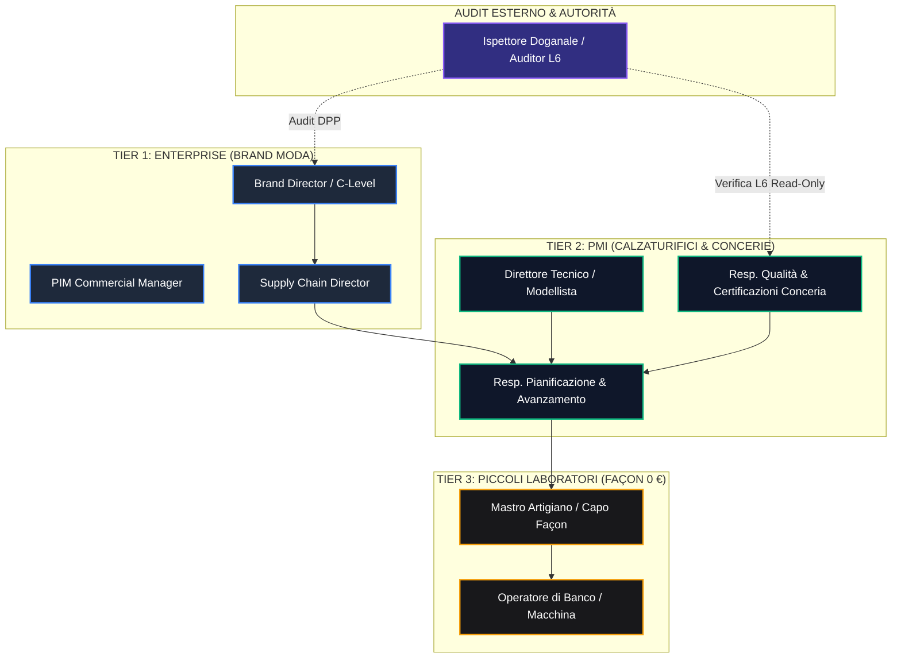
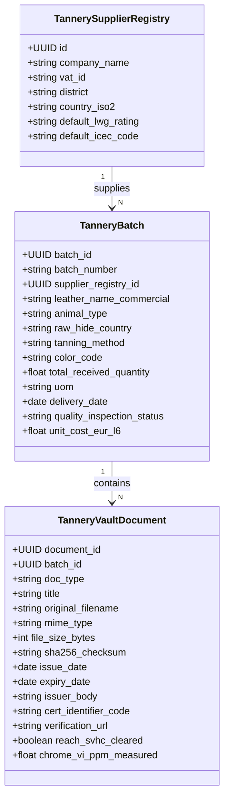

# PRD-006: Piattaforma PaaS Distrettuale Aziende & Utenti, Document Vault Conceria & Lotti Pellami, e Matrice Taglie & Fabbisogni BOM Industriali

**Versione:** 2.0 (Riprogettazione Esecutiva per Direttive Founder Sprint 6)  
**Data:** 19 Ottobre 2026  
**Autore:** Chief Product Officer (`footlink-cpo`)  
**Destinatari:** Founder, CEO, CTO, CGO, CRO, CMO  
**Riferimento Strategico:** [Manifesto di Fondazione Footlink](../../Manifesto_Fondazione_Footlink.md) · [`Role_CPO_Footlink.md`](../roles/Role_CPO_Footlink.md)  
**Task Collegati:** [`FTL-PROD-006`](../../tasks/FTL-PROD-006.json), [`FTL-CEO-006`](../../tasks/FTL-CEO-006.json), [`FTL-CEO-007`](../../tasks/FTL-CEO-007.json), [`FTL-CEO-008`](../../tasks/FTL-CEO-008.json), [`FTL-GOV-006`](../../tasks/FTL-GOV-006.json)  
**Decision Record di Riferimento:** [`ADR-003`](../../adr/ADR-003-domain-model-1-to-n-pim-plm.md), [`ADR-004`](../../adr/ADR-004-network-pricing-and-finops.md), [`ADR-006`](../../adr/ADR-006-unified-design-system-and-l6-cost-segregation.md), [`ADR-007`](../../adr/ADR-007-flexible-data-model-seasons-collections-domain-registries.md), [`ADR-008`](../../adr/ADR-008-production-orders-tannery-traceability-subcontractor-lifecycle.md)  

---

## 1. Executive Summary & Visione di Prodotto

Con il completamento dello **Sprint 5**, Footlink ha validato l'architettura core di prodotto:
1. Il ponte **1 Articolo Commerciale PIM ↔ N Articoli Industriali PLM** con Distinta Base (BOM) multi-livello a 3 livelli.
2. La gerarchia temporale del lusso: **1 Stagione Moda ↔ N Collezioni**.
3. Il **Master Data Hub** per le anagrafiche di dominio (Modulo 03) e lo **Studio Modello Dati Flessibile** (Modulo 04).
4. Il **Portale Mobile Terzisti a 0 €** ("≤ 3 clic, < 90s") e l'architettura base del **Passaporto Digitale del Prodotto (DPP UE)** conforme a ESPR (Reg. UE 2024/1781).

In risposta alle **priorità ridefinite dal Founder per lo SPRINT 6**, Footlink compie la transizione architetturale decisiva: da applicazione stand-alone a **PaaS Distrettuale di Filiera della Moda e del Lusso**, connettendo Brand committenti, manifatture industriali (calzaturifici e concerie) e laboratori façonisti indipendenti.

Questo documento formalizza la specifica funzionale e UX completa dei tre pilastri ridefiniti:
1. **Modulo PaaS Distrettuale Aziende & Utenti:** gestione multi-tenant distrettuale con attivazione su 3 Tier (*Enterprise Brand*, *PMI Produttiva/Conceria*, *Piccolo Laboratorio 0 €*), onboarding guidato per tipologia aziendale, matrice ruoli operativi di filiera e company switcher con isolamento dati stagno.
2. **Document Vault Conceria & Lotti Pellami:** repository documentale integrato per lotti di concia (attestati LWG Gold/Silver, certificazioni tracciabilità ICEC, schede tecniche fornitore, report chimici SVHC/Cromo VI < 3 ppm), gestione della validità temporale con alert, integrazione puntuale nella BOM L1 e doppia vista DPP (Consumatore B2C vs Ispettiva Dogana L6).
3. **Matrice Taglie & Fabbisogni BOM Industriali:** griglia dinamica per famiglie calzatura (Donna 35-42, Uomo 38-46 con mezzi numeri) e abbigliamento (IT 44-56), moltiplicatore automatico dei consumi BOM basato su gradazione taglia, e calcolo automatico dei fabbisogni netti e lordi con percentuale di sfrido differenziata per tipologia materiale.

---

## 2. Pilastro 1 — Modulo PaaS Distrettuale Aziende & Utenti

### 2.1 Il Modello Multi-Tenant Distrettuale a 3 Tier

Nei distretti del Made in Italy (Fermano-Maceratese per le calzature, Santa Croce sull'Arno e Arzignano per le concerie, Riviera del Brenta e Scandicci per pelletteria e calzature d'alta moda), la filiera non è composta da un'unica grande azienda, ma da una rete simbiotica e asimmetrica di attori.

Footlink modella questa realtà attraverso **3 Tier di Membership Aziendale**:

```
┌────────────────────────────────────────────────────────────────────────────────────────────────────────┐
│ MODELLO PAAS DISTRETTUALE FOOTLINK: GERARCHIA DEI 3 TIER                                              │
├────────────────────────────────────────────────────────────────────────────────────────────────────────┤
│                                                                                                        │
│  [TIER 1: ENTERPRISE] ──────► Brand Moda / Committente Globale                                         │
│                               • Visione globale PIM & PLM (1 PIM ↔ N PLM)                              │
│                               • Gestione catalogo commerciale, collezioni, showroom, listini           │
│                               • Tracciabilità omnicomprensiva di filiera & Audit L6 segregato          │
│                               • Emissione Work Orders e monitoraggio avanzamento distrettuale          │
│                                                                                                        │
│  [TIER 2: PMI]        ──────► Calzaturifici Manifatturieri & Concerie Industriali                      │
│                               • Gestione produzione PLM, BOM multi-livello a 3 livelli                 │
│                               • Ingegnerizzazione prodotto, matrici taglie e fabbisogni commessa      │
│                               • Document Vault Conceria & certificazioni di lotto (LWG/ICEC)           │
│                               • Assegnazione fasi esterne ai façonisti distrettuali                    │
│                                                                                                        │
│  [TIER 3: PICCOLI     ──────► Façonisti, Orlatrici, Guardolifici, Tagliatori Indipendenti             │
│   LABORATORI 0 EUR]           • Accesso perpetuo a 0 € (Vincolo Fondativo del Manifesto)               │
│                               • Zero-Training UX (≤ 3 clic, < 90s su smartphone/tablet)                │
│                               • Presa in carico ordini di fase, dichiarazione resa e scarti            │
│                               • Segregazione L6 totale: nessun accesso a costi, prezzi o margini Brand │
│                                                                                                        │
└────────────────────────────────────────────────────────────────────────────────────────────────────────┘
```

#### 2.1.1 Matrice Comparativa Funzionalità per Tier Aziendale

| Modulo / Funzionalità | Tier 1: Enterprise (Brand Moda) | Tier 2: PMI (Calzaturificio/Conceria) | Tier 3: Piccolo Lab (Façon 0 €) |
|---|:---:|:---:|:---:|
| **Catalogo PIM & Canali Commerciali** | ✅ Completo (B2B/B2C, Prezzi, E-com) | ❌ Inibito (o sola vista commessa) | ❌ Disabilitato |
| **Sviluppo PLM & Schede Tecniche** | ✅ Approvazione & Release | ✅ Creazione, Editing, Distinte Base | ❌ Solo consultazione scheda fase |
| **BOM Multi-livello (3 Livelli)** | ✅ Visione complessiva | ✅ Configurazione & Costificazione | ❌ Solo componenti assegnati |
| **Document Vault Conceria (LWG/ICEC)**| ✅ Audit & Verifica Conformità | ✅ Caricamento, Scadenze, Gestione | ❌ Non visibile |
| **Matrice Taglie & Fabbisogni BOM** | ✅ Analisi fabbisogni aggregati | ✅ Pianificazione & Ripartizione Taglie| 👁️ Visualizzazione paia per taglia |
| **Work Orders Hub (Lancio Commesse)** | ✅ Commesse di Collezione | ✅ Commesse di Fabbrica & Reparti | ⚙️ Avanzamento di Fase ("3 Clic") |
| **Costi Industriali & Listini (L6)** | 🔒 Riservato / Completo | 🔒 Riservato al proprio stabilimento | 🚫 Totalmente oscurato (L6) |
| **Canone Software (FinOps)** | Commerciale (Enterprise) | Commerciale (PMI) | **0,00 € Perpetuo (Gratuito)** |

---

### 2.2 Onboarding Guidato per Tipologia Aziendale (Wizard UX)

L'onboarding di una nuova entità nella rete deve avvenire in **massimo 3 passaggi**, guidando l'utente alla profilazione corretta senza richiedere competenze informatiche o configurazioni sistemistiche complesse.

```
┌────────────────────────────────────────────────────────────────────────────────────────────────────────┐
│ WIZARD ONBOARDING AZIENDALE FOOTLINK (STEP 1 DI 3)                                                    │
├────────────────────────────────────────────────────────────────────────────────────────────────────────┤
│ Seleziona la tipologia di organizzazione nel distretto:                                                │
│                                                                                                        │
│  ┌─────────────────────────┐  ┌─────────────────────────┐  ┌─────────────────────────┐               │
│  │   👑 BRAND MODA /       │  │   🏭 MANIFATTURA /      │  │   ✂️ LABORATORIO        │               │
│  │      COMMITTENTE        │  │      CONCERIA (PMI)     │  │      FAÇON (0 €)        │               │
│  │                         │  │                         │  │                         │               │
│  │ Tier: Enterprise        │  │ Tier: PMI Distrettuale  │  │ Tier: Free Façonist     │               │
│  │ Governance PIM/PLM,     │  │ Schede tecniche, BOM,   │  │ Avanzamento ordini fase,│               │
│  │ collezioni, ordini e    │  │ Document Vault lotti e  │  │ smartphone ready, zero  │               │
│  │ passaporto DPP globale. │  │ gestione fabbisogni.    │  │ costi di licenza.       │               │
│  │                         │  │                         │  │                         │               │
│  │       [ SELEZIONA ]     │  │       [ SELEZIONA ]     │  │       [ SELEZIONA ]     │               │
│  └─────────────────────────┘  └─────────────────────────┘  └─────────────────────────┘               │
│                                                                                                        │
│ [Annulla]                                                                            [Continua: Dati ►]│
└────────────────────────────────────────────────────────────────────────────────────────────────────────┘
```

#### Flusso dei 3 Step di Onboarding:
1. **Step 1 — Identificazione & Tier:**
   - Selezione del profilo (Brand Moda, Manifattura/Conceria, Laboratorio Façon).
   - Assegnazione automatica del piano e dei vincoli architetturali (attivazione canone vs lock-in a 0 € perpetuo).
2. **Step 2 — Dati di Distretto & Fiscali:**
   - Ragione Sociale, Partita IVA / Codice Fiscale, Sede Legale e Operativa.
   - Distretto Manifatturiero di Appartenenza (Menù a tendina geolocalizzato: *Fermo-Macerata*, *Santa Croce sull'Arno*, *Arzignano*, *Riviera del Brenta*, *San Mauro Pascoli*, *Solofra*, *Scandicci-Firenze*, *Altro*).
   - Codice Univoco Distrettuale Footlink (generato automaticamente, es. `FTL-DIS-MC-042`).
3. **Step 3 — Specializzazioni di Filiera & Attivazione Utente Master:**
   - Per le Concerie: Selezione specializzazione (Pelli bovine, ovocaprini, concia vegetale, concia al cromo, metal-free) e certificazioni iniziali (LWG Gold/Silver, ICEC).
   - Per i Calzaturifici: Tipologia montaggio (Blake, Goodyear, Strobel, Ago, Bologna) e capacità produttiva settimanale (paia).
   - Per i Laboratori Façon: Fasi lavorative eseguibili (*Taglio CAD/manuale*, *Giunteria/Orlatura*, *Applicazione suola*, *Finissaggio*) e numero di postazioni operative.
   - Configurazione dell'account Master Administrator e invio Magic Link di benvenuto.

---

### 2.3 Profilazione dei Ruoli Operativi di Filiera (RBAC Distrettuale)

Il modello di autorizzazioni supera i generici ruoli IT "admin/editor/viewer", implementando la semantica reale delle fabbriche e delle concerie della moda:



#### Dettaglio Ruoli Operativi e Permessi:

1. **Brand Director / Supply Chain Director (`brand_admin` / `supply_chain_lead`):**
   - Accesso completo alla vista globale commesse e catalogo PIM/PLM.
   - Visione dello stato avanzamento in tempo reale di tutti i calzaturifici e façonisti del network.
   - Accesso ai costi industriali L6 consolidati e marginalità.
2. **Direttore Tecnico / Responsabile Produzione PMI (`factory_tech_lead` / `prod_planner`):**
   - Creazione e modifica schede tecniche PLM, varianti fornitore e BOM a 3 livelli.
   - Configurazione della Matrice Taglie, moltiplicatori di consumo e percentuali di sfrido.
   - Emissione commesse di fabbrica, assegnazione fasi ai façonisti distrettuali e approvazione collaudo finale.
3. **Responsabile Qualità & Certificazioni Conceria (`tannery_qa_officer`):**
   - Accesso al Document Vault di Conceria: caricamento PDF, attestati LWG, certificati ICEC e report analitici REACH.
   - Creazione e rilascio lotti pellame (`tannery_batches`) con associazione certificati e hash crittografico SHA-256.
4. **Mastro Artigiano / Capo Façonista (`subcontractor_artisan`):**
   - Interfaccia mobile a zero-training (0 €): visualizzazione bolle di lavorazione, lotti pellame assegnati e griglia taglie.
   - Presa in carico, registrazione avanzamento fase, consuntivazione pezzi finiti e dichiarazione scarti ("3 Clic").
   - **Zero visibilità su prezzi, costi orari o margini industriali (Segregazione L6 vincolante).**
5. **Auditor Terzo / Ispettore Doganale L6 (`customs_inspector_readonly`):**
   - Token di accesso temporaneo read-only per controlli doganali ESPR / TARIC / REACH.
   - Visualizzazione del fascicolo tecnico e dei certificati del Document Vault, senza accesso a dati contrattuali privati o margini commerciali del brand.

---

### 2.4 Company Switcher & Multi-Membership UX

Nel distretto manifatturiero italiano, un façonista qualificato o un modellista indipendente lavora simultaneamente per **3-5 diversi calzaturifici e brand concorrenti**. Costringerlo a fare logout e login con credenziali multiple genererebbe errori, frustrazione e abbandono della piattaforma.

#### Requisiti di Interazione Company Switcher:
- **Menu a tendina persistente nell'Header di Navigazione:** mostra l'azienda attualmente attiva con relativo badge di Tier (`👑 Enterprise`, `🏭 PMI`, `✂️ Façon 0 €`).
- **Cambio Contesto a 1 Clic:** il clic su un'altra azienda autorizzata commuta istantaneamente il tenant context (token JWT/session state aggiornato) senza richiedere logout.
- **Isolamento Dati Stagno (Multi-Tenant Segregation):**
  - Ogni query al database (FastAPI + SQLAlchemy) include rigorosamente la clausola di tenant scoping `WHERE company_id = :active_company_id`.
  - È categoricamente impossibile che un façonista, mentre opera per il "Calzaturificio Rossi", visualizzi distinte base, commesse o modelli del "Calzaturificio Bianchi".
- **Visual Feedback & Ambient Color Tinting:**
  - Quando l'utente opera in contesto Brand Enterprise: accento primario *Electric Cobalt* (`#3b82f6`).
  - Quando opera in contesto PMI: accento *Emerald Manifattura* (`#10b981`).
  - Quando opera in contesto Façon 0 €: accento *Warm Amber Craft* (`#f59e0b`).
  - L'utente ha sempre contezza visiva immediata del perimetro di riservatezza in cui sta operando.

```
┌────────────────────────────────────────────────────────────────────────────────────────────────────────┐
│ HEADER FOOTLINK CON COMPANY SWITCHER MULTI-MEMBERSHIP                                                 │
├────────────────────────────────────────────────────────────────────────────────────────────────────────┤
│ [👟 FOOTLINK]   PIM  │  PLM  │  BOM  │  Commesse  │  DPP  │         [🏢 Calzaturificio Marchigiano ▾] │
│                                                                    ┌──────────────────────────────────┐│
│                                                                    │ AZIENDE ATTIVE COLLEGATE:        ││
│                                                                    │ • Calzaturificio Marchigiano [PMI││
│                                                                    │   (Azienda Corrente)             ││
│                                                                    │ ──────────────────────────────── ││
│                                                                    │ • Maison Luxe Paris [Enterprise] ││
│                                                                    │ • Façon Taglio & Cucito [Lab 0 €]││
│                                                                    │ ──────────────────────────────── ││
│                                                                    │ ➕ Registra Nuova Azienda        ││
│                                                                    │ 🚪 Esci dal Profilo              ││
│                                                                    └──────────────────────────────────┘│
└────────────────────────────────────────────────────────────────────────────────────────────────────────┘
```

---

## 3. Pilastro 2 — Document Vault Conceria & Lotti Pellami

### 3.1 Il Valore Strategico del Pellame & il Document Vault di Conceria

Nel lusso calzaturiero e pellettiero, la pelle conciata costituisce il cuore identitario ed economico del manufatto. La nuova regolamentazione europea impone la prova documentale inoppugnabile di:
- **Assenza di Deforestazione (EUDR Reg. UE 2023/1115):** tracciabilità geolocalizzata dell'allevamento di origine del grezzo.
- **Sostenibilità Ambientale di Conceria:** certificazione Leather Working Group (**LWG**) con rating auditato (*Gold*, *Silver*, *Bronze*).
- **Tracciabilità di Filiera Certificata:** certificati **ICEC** (*ICEC TS 410 Tracciabilità fino al grezzo*, *ICEC TS 412 Benessere Animale*, *ICEC TS 420 Sostenibilità di Prodotto*).
- **Sicurezza Chimica & Assenza Sostanze Nocive (Regolamento REACH SVHC):** prove di laboratorio accreditate per Cromo VI (< 3 ppm), APEO/NPEO (< 100 mg/kg), formaldeide e metalli pesanti estraibili.

Il **Document Vault Conceria** di Footlink trasforma la gestione documentale da faldoni cartacei e PDF dispersi in chat a **repository digitale crittograficamente verificabile e integrato nella BOM**.

---

### 3.2 Tassonomia Documentale & Scheda Dati Lotto (`tannery_batches`)

Ogni documento caricato nel Vault appartiene a una tipologia normata ed è vincolato a un'anagrafica conceria o direttamente a uno specifico lotto fornitura:



#### 3.2.1 Metadati e Tipologie Documenti Normati:
1. **Certificato di Sostenibilità Conciaria (`lwg_certificate`):**
   - Ente emittente: Leather Working Group (LWG).
   - Metadati: Rating (*Gold*, *Silver*, *Bronze*, *Audited*), Audit URN, Data di validità (scadenza max 24 mesi).
2. **Certificato Tracciabilità di Filiera (`icec_traceability`):**
   - Ente emittente: Istituto di Certificazione della Pelle (ICEC).
   - Metadati: Norma applicata (*ICEC TS 410*, *ICEC TS 412*, *ICEC TS 420*), livello di tracciabilità garantito (% tracciabilità al macello / paese d'allevamento).
3. **Scheda Tecnica di Sicurezza & Capitolato Fornitore (`supplier_spec_sheet` / `msds`):**
   - Metadati: Tipologia finissaggio (anilina, semi-anilina, fiore corretto, scamosciato), spessore medio (mm), resistenza alla flessione (cicli Bally), solidità del colore allo sfregamento (Veslic secco/umido).
4. **Rapporto di Prova Analisi Chimica (`chemical_reach_report`):**
   - Metadati: Laboratorio accreditato (es. BLC, TÜV, Centrocot), Data prova, Valore riscontrato Cromo VI (limite rilevabilità < 3 mg/kg), Esito conformità elenco sostanze candidate SVHC.

---

### 3.3 Validità Temporale, Alert di Scadenza & Audit Trail Immutabile

1. **Monitoraggio Temporale Attivo:**
   - Ciascun documento possiede una data di emissione (`issue_date`) e una data di scadenza (`expiry_date`).
   - Il sistema calcola lo stato temporale in tempo reale:
     * 🟢 **VALIDO:** Scadenza oltre i 60 giorni.
     * 🟡 **IN SCADENZA:** Scadenza compresa tra 1 e 60 giorni (Notifica automatica al Responsabile Qualità).
     * 🔴 **SCADUTO:** Data di scadenza superata. Il lotto non può essere agganciato a nuove BOM di commessa senza un override autorizzato dal Brand Director.
2. **Integrità Crittografica a Costo Zero (FinOps L2):**
   - Al momento del caricamento, il backend calcola l'impronta crittografica **SHA-256** del file binario.
   - L'impronta viene registrata su database e costituisce la prova inalterabile di non-ripudio in caso di contenzioso o audit doganale, **senza necessità di sottoscrivere costosi servizi blockchain o notarili esterni**.
3. **Storage Locale Compliant:**
   - I file binari vengono salvati in un directory storage locale versionato e protetto (`/var/data/footlink/vault/`), con URL mascherati da token crittografici ad accesso limitato.

---

### 3.4 Integrazione nella Distinta Base (BOM a 3 Livelli)

Nel modello di Distinta Base a 3 livelli consolidato in Sprint 5:
- **Livello L1:** Componenti primari (Tomaia, Fodera, Soletto, Battistrada, Tacco).
- **Livello L2:** Semilavorati e assiemi (Tomaia tranciata e orlata, Suola assemblata con guardolo).
- **Livello L3:** Materie prime e ausiliari (Pellame di vitello grezzo/rifinito, filo di cucitura, mastice, rinforzi salpa, minuteria metallica).

Quando un componente di Livello L1/L3 è marcato come materiale conciario (`material_class = 'leather'`), l'interfaccia BOM impone l'associazione di un **Lotto Conceria Validato** (`tannery_batch_id`):

```
┌────────────────────────────────────────────────────────────────────────────────────────────────────────┐
│ DISTINTA BASE PLM (BOM) · INGEGNERIA COMPONENTE PELLAME                                               │
├────────────────────────────────────────────────────────────────────────────────────────────────────────┤
│ Codice Componente: BOM-L1-TOM-01 · Nome: Tomaia Esterna Vitello Nappa Piuma                            │
│ Materiale: Vitello Pieno Fiore 1.2-1.4mm · Colore: Deep Black · Fabbisogno Base: 14.8 sqft / paio     │
├────────────────────────────────────────────────────────────────────────────────────────────────────────┤
│ TRACCIABILITÀ CONCERIA & DOCUMENT VAULT COLLEGATO:                                                    │
│ Fornitore Conceria: Conceria del Chienti S.r.l. (Civitanova Marche, MC)                                │
│ Lotto Conceria: LOT-2026-CH-942  [Verificato ✅]       Arrivo Magazzino: 12/10/2026                     │
│                                                                                                        │
│ DOCUMENTI VAULT ATTIVI:                                                                                │
│ 📜 [PDF] Certificato LWG Gold (Audit ID: LWG-IT-8491) ── Validità: 15/03/2027 [🟢 Valido]  [👁️ Visualizza]│
│ 📜 [PDF] Certificato ICEC TS 410 Tracciabilità Allevamento FR ── Validità: 30/11/2027 [🟢] [👁️ Visualizza]│
│ 📜 [PDF] Rapporto Prova Chimica Cromo VI < 3ppm (Lab BLC) ── Validità: 12/10/2027 [🟢]     [👁️ Visualizza]│
│                                                                                                        │
│ [+ Allega Nuovo Documento al Vault]                                                [Salva Riga BOM]   │
└────────────────────────────────────────────────────────────────────────────────────────────────────────┘
```

---

### 3.5 Doppia Vista del Passaporto Digitale del Prodotto (DPP UE)

In ottemperanza al Regolamento UE 2024/1781 (ESPR), il QR code univoco generato da Footlink espone una **doppia interfaccia rigorosamente segregata a livello di Controller e DTO**:

```
┌────────────────────────────────────────────────────────────────────────────────────────────────────────┐
│ VISTA 1: DPP B2C PUBBLICO (CONSUMATORE)         │ VISTA 2: DPP L6 ISPETTIVO (DOGANA / AUDITOR)         │
│ (Accessibile da chiunque inquadri il QR Code)   │ (Accesso con credenziali autorizzate o Token L6)     │
├─────────────────────────────────────────────────┼──────────────────────────────────────────────────────┤
│ 👟 Calzatura Artigianale Derby Francesina       │ 🛡️ DOSSIER DOGANALE & COMPLIANCE AMBIENTALE          │
│ Modello: DUCA-NERO-2026 · Brand: Maison Luxe    │ ID Univoco DPP: FTL-DPP-2026-EU-98421                │
│                                                 │ TARIC Code: 6403.59.99 (Calzature suola cuoio)       │
│ 🌱 SOSTENIBILITÀ DEL PELLAME                    │                                                      │
│ • Origine Materia Prima: Allevamento Francia    │ 📄 FASCICOLO CONCERIA & CHIMICA:                     │
│ • Manifattura: Conciata nel Distretto Marchigiano│ • Ragione Sociale Conceria: Conceria del Chienti Srl │
│ • Certificazione Ambientale: LWG Gold Medalist  │ • Partita IVA Fornitore: IT01849200431               │
│ • Metodo di Concia: Metal-Free Ecosostenibile   │ • Lotto Bottale Conceria: LOT-2026-CH-942            │
│ • Impronta Carbonica Calcolata: 11.4 kg CO2e    │ • Hash SHA-256 Scheda: e3b0c44298fc1c149afbf4c899... │
│                                                 │ • Report Chimico: REACH SVHC Assenti                 │
│ 👞 GUIDA ALLA CURA DELLA PELLE                 │ • Test Cromo VI: Conforme (< 3 mg/kg rilevati 0.4)   │
│ Istruzioni di pulizia e nutrimento per          │ • Certificato Tracciabilità: ICEC TS 410 / Cert 841  │
│ prolungare la longevità della calzatura.        │ • Conformità Deforestation-Free: Conforme EUDR       │
│                                                 │                                                      │
│ 🔒 DATI RISERVATI INDUSTRIALI:                  │ 📥 [Scarica Dossier Ufficiale Ispettivo PDF A/3]     │
│ Zero dettagli su terzisti façonisti, prezzi di  │                                                      │
│ acquisto o margini aziendali (Protezione Brand).│ Accesso tracciato nel Registro Audit di Filiera L6.  │
└─────────────────────────────────────────────────┴──────────────────────────────────────────────────────┘
```

---

## 4. Pilastro 3 — Matrice Taglie Dinamica & Calcolo Fabbisogni BOM Industriali

### 4.1 Contesto di Fabbrica & il Problema del Consumo Scalare

Nel settore manifatturiero, una scarpa taglia 45 richiede significativamente più superficie di pelle, un fondo più grande e un consumo maggiore di filo rispetto a una taglia 38. Allo stesso modo, una giacca o un cappotto taglia 54 consuma più tessuto e fodera rispetto a una taglia 44.

Inoltre, il pellame naturale non è una superficie geometrica uniforme come un rotolo di tessuto sintetico: presenta bordi irregolari, zone di diversa elasticità e venature naturali. Ne consegue che ogni lavorazione produce una quota inevitabile di **sfrido (wastage/scrap)**.

Fino ad oggi, i sistemi gestionali tradizionali forzano l'ufficio tecnico a calcoli manuali su fogli Excel o a stime forfettarie medie, provocando due gravi inefficienze:
1. **Sotto-approvvigionamento:** fermo delle linee di montaggio per mancanza pellame su numeri grandi.
2. **Sovra-approvvigionamento:** rimanenze di magazzino costose e obsolescenza di materiali pregiati.

---

### 4.2 Griglie Taglie per Famiglia Merceologica

Footlink modella nel core tre griglie standard per calzatura e abbigliamento, consentendo l'abilitazione facoltativa dei mezzi numeri (half-sizes):

```
┌────────────────────────────────────────────────────────────────────────────────────────────────────────┐
│ SCALE TAGLIE STANDARD SUPPORTATE                                                                       │
├────────────────────────────────────────────────────────────────────────────────────────────────────────┤
│ 1. CALZATURA DONNA (EU 35 - 42):                                                                       │
│    [35] [35.5] [36] [36.5] [37] [37.5] [38] [38.5] [39] [39.5] [40] [40.5] [41] [41.5] [42]           │
│    Taglia Base Campionario: 37 · Passo Gradazione Consumi: +2.8% per taglia intera (+1.4% per 1/2 num) │
│                                                                                                        │
│ 2. CALZATURA UOMO (EU 38 - 46):                                                                        │
│    [38] [38.5] [39] [39.5] [40] [40.5] [41] [41.5] [42] [42.5] [43] [43.5] [44] [44.5] [45] [45.5] [46]│
│    Taglia Base Campionario: 42 · Passo Gradazione Consumi: +2.6% per taglia intera (+1.3% per 1/2 num) │
│                                                                                                        │
│ 3. ABBIGLIAMENTO / CONFEZIONE (IT 44 - 56):                                                            │
│    [44] [46] [48] [50] [52] [54] [56]                                                                 │
│    Taglia Base Campionario: 48 · Passo Gradazione Consumi: +3.5% per taglia intera                     │
│                                                                                                        │
│ 4. PELLETTERIA / ACCESSORI:                                                                            │
│    Taglia Unica [TU] (Consumo Fisso 1:1) oppure Varianti Dimensionali [Small] [Medium] [Large]         │
└────────────────────────────────────────────────────────────────────────────────────────────────────────┘
```

---

### 4.3 Il Motore Matematico di Calcolo Fabbisogni & Sfrido

Il calcolo dei fabbisogni industriali per commessa è governato da una formula deterministica implementata nel motore di ingegneria BOM:

#### Formule Matematiche Fondamentali:

1. **Fattore di Gradazione Taglia ($F_s$):**
   Dato l'indice taglia $s$, la taglia base campionario $s_{\text{base}}$ e il gradiente percentuale di sviluppo $\delta$:
   $$F_s = 1 + (s - s_{\text{base}}) \times \frac{\delta}{100}$$

2. **Fabbisogno Netto per Taglia ($FN_{s,c}$):**
   Per il componente $c$ con consumo nominale a distinta base $C_{\text{base}, c}$ e quantità pianificata paia/pezzi $Q_s$:
   $$FN_{s,c} = Q_s \times (C_{\text{base}, c} \times F_s)$$

3. **Fabbisogno Netto Totale Commessa ($FN_{\text{tot}, c}$):**
   $$FN_{\text{tot}, c} = \sum_{s \in \text{Taglie}} FN_{s,c}$$

4. **Fabbisogno Lordo Totale con Sfrido ($FL_{\text{tot}, c}$):**
   Data la percentuale di sfrido applicata al materiale $\sigma_c$ (Scrap %):
   $$FL_{\text{tot}, c} = FN_{\text{tot}, c} \times \left(1 + \frac{\sigma_c}{100}\right)$$

#### Matrice Sfridi Suggeriti di Default per Categoria Materiale:

| Categoria Materiale Componente | Comportamento Taglia | Sfrido Medio Suggerito ($\sigma_c$) | Rationale Tecnico di Fabbrica |
|---|:---:|:---:|---|
| **Pellame Pieno Fiore Liscio (Vitello)** | Graduato ($F_s$) | **18.0 %** | Scarto per contorni naturali, buchi collo e pancia |
| **Pellame Scamosciato / Crosta** | Graduato ($F_s$) | **14.0 %** | Minore difettosità superficiale rispetto al fiore |
| **Pellami Pregiati (Coccodrillo/Pitone)** | Graduato ($F_s$) | **25.0 %** | Allineamento millimetrico squame e simmetria tomaia |
| **Fodera in Pelle (Ovocaprina)** | Graduato ($F_s$) | **12.0 %** | Sagome interne più piccole e flessibili |
| **Fondi / Suole / Battistrada** | Taglia 1:1 ($F_s = 1.0$) | **2.0 %** | Un pezzo/paio per taglia; sfrido solo per scarto difetti |
| **Tacchi / Forme / Soletti** | Taglia 1:1 ($F_s = 1.0$) | **1.5 %** | Componente stampato/fresato su misura per taglia |
| **Tessuti & Rinforzi in Rotolo** | Graduato ($F_s$) | **8.0 %** | Piazzamento CAD ottimizzato a incastro |
| **Minuterie Metalliche (Fibbie/Occhielli)**| Fisso Commessa | **1.0 %** | Scarto fisiologico di montaggio |

---

### 4.4 Specifica UX: Griglia Interattiva Matrice Taglie & Consumi Commessa

L'interfaccia utente consente l'inserimento rapido con tastiera (tasto `TAB` e `Invio` fluidi senza dover usare il mouse), applicazione di curve preset e calcolo dinamico in tempo reale senza ricaricare la pagina:

```
┌────────────────────────────────────────────────────────────────────────────────────────────────────────┐
│ COMMESSA COMM-2026-084 · MODELLO: MOCASSINO DUCA (PLM-DUCA-NERO) · SCALA: UOMO EU 38-46                │
├────────────────────────────────────────────────────────────────────────────────────────────────────────┤
│ PRESET CURVE: [Standard Uomo ▾] [Campanata Centro ▾] [Invertita ▾]     [Pulisci Griglia]               │
├────────────────────────────────────────────────────────────────────────────────────────────────────────┤
│ TAGLIE EU      │  39  │  40  │  41  │  42* │  43  │  44  │  45  │  46  │ TOTALE PAIA COMMESSA          │
│ Quantità Paia  │  40  │  80  │ 160  │ 220  │ 180  │ 100  │  40  │  20  │ 840 PAIA                      │
│ Fattore Grad.  │ 0.922│ 0.948│ 0.974│ 1.000│ 1.026│ 1.052│ 1.078│ 1.104│ (*Taglia Base: 42)            │
├────────────────────────────────────────────────────────────────────────────────────────────────────────┤
│ RIEPILOGO FABBISOGNI MATERIALI BOM (CALCOLO AUTOMATICO IN TEMPO REALE):                                │
│                                                                                                        │
│ Componente L1: Tomaia Vitello Nappa (BOM-L1-TOM-01) ── UoM: sqft · Consumo Base: 14.50 sqft/paio       │
│ • Fabbisogno Netto: 12.196,4 sqft                                                                      │
│ • Sfrido Calcolato (18.0%): +2.195,4 sqft                                                              │
│ • FABBISOGNO LORDO TOTALE DA ORDINARE / PRELEVARE: 14.391,8 sqft                                       │
│ • Lotto Conceria Assegnato: LOT-2026-CH-942 (Disponibilità Magazzino: 18.000 sqft ✅ COPERTO)          │
│ ────────────────────────────────────────────────────────────────────────────────────────────────────── │
│ Componente L1: Fondo Cuoio con Iniezione Gomma ── UoM: paia · Consumo: 1 paio/paio                     │
│ • Fabbisogno Netto: 840 paia (Suddivise esattamente secondo la griglia taglie 39..46)                 │
│ • Sfrido Calcolato (2.0%): +17 paia                                                                    │
│ • FABBISOGNO LORDO TOTALE: 857 paia                                                                    │
│                                                                                                        │
│ [🔄 Ricalcola Fabbisogni]      [📋 Esporta Bolla di Taglio PDF]      [🚀 Conferma & Lancia Commessa]   │
└────────────────────────────────────────────────────────────────────────────────────────────────────────┘
```

---

## 5. Prioritizzazione RICE Score Aggiornata per lo Sprint 6

Il CPO applica il framework quantitativo prescritto dal ruolo:
$$\text{RICE Score} = \frac{\text{Reach} \times \text{Impact} \times \text{Confidence}}{\text{Effort (Person-Week)}}$$

### Criteri di Scala:
- **Reach (1–10):** Ampiezza della popolazione utenti impattata direttamente ogni settimana (10 = Tutti i Brand, PMI e Laboratori; 7 = Ufficio Tecnico, Taglio e Pianificazione; 5 = Solo Amministratori).
- **Impact (0.25–3.0):** Valore differenziale generato (3.0 = Rivoluzionario / Deal-maker essenziale; 2.0 = Alto; 1.0 = Medio).
- **Confidence (50%–100%):** Certezza tecnica, di adozione e di dominio (1.0 = 100%, 0.85 = 85%, 0.70 = 70%).
- **Effort (Person-Week):** Stima di effort congiunto Prodotto + Architettura Software.

### Tabella Comparativa RICE Sprint 6:

| ID Feature | Iniziativa di Prodotto | Reach (1-10) | Impact (0.25-3) | Confidence (0.5-1.0) | Effort (PW) | **RICE Score** | Priorità Sprint 6 |
|---|---|:---:|:---:|:---:|:---:|:---:|:---:|
| **FEAT-6A** | **Matrice Taglie & Calcolo Fabbisogni BOM Industriali con Sfrido Differenziato** | 10 | 3.0 | 0.95 | 1.0 PW | **28.5** | 🥇 **P0 (Fast-Track)** |
| **FEAT-6B** | **Document Vault Conceria, Lotti Pellami & Doppia Vista DPP UE (B2C vs Dogana L6)** | 9 | 3.0 | 0.90 | 1.0 PW | **24.3** | 🥈 **P0 (Fast-Track)** |
| **FEAT-6C** | **Modulo PaaS Distrettuale: Onboarding 3 Tier, Profilazione Ruoli & Company Switcher** | 9 | 2.5 | 0.90 | 1.0 PW | **20.25** | 🥉 **P0 (Fast-Track)** |
| **FEAT-6D** | **Work Orders Hub: Pipeline Avanzamento Fasi Kanban & Portale Mobile Terzista 0 €** | 9 | 2.5 | 0.85 | 1.1 PW | **17.38** | **P1 (Core Sprint)** |
| **FEAT-6E** | **Specifica UX Editing Anagrafiche di Dominio con Soft-Disable (FTL-CEO-007)** | 7 | 2.0 | 1.00 | 0.8 PW | **17.50** | **P1 (Core Sprint)** |

### Motivazione Strategica del Ranking:

1. **FEAT-6A (RICE 28.5):** La matrice taglie con calcolo automatico dei fabbisogni netti/lordi e sfrido è la **funzionalità a più alto valore d'uso dell'intera storia di Footlink**. Senza di essa, un calzaturificio non può lanciare la produzione reale né quantificare il pellame da ordinare alla conceria. RICE record di 28.5.
2. **FEAT-6B (RICE 24.3):** Risponde direttamente all'obbligo normativo europeo ESPR 2024/1781 e alle richieste dei grandi Brand di monitorare la filiera conciaria con certificati inoppugnabili (LWG/ICEC). La separazione della vista B2C dalla vista ispettiva L6 garantisce la massima trasparenza verso l'UE tutelando i segreti commerciali.
3. **FEAT-6C (RICE 20.25):** L'introduzione del multi-tenant distrettuale con Company Switcher trasforma Footlink da software isolato a piattaforma di rete (Network PaaS). Abilita l'onboarding virale dei façonisti a costo 0 € e l'adozione delle PMI.
4. **FEAT-6D (RICE 17.38) & FEAT-6E (RICE 17.50):** Pilastri operativi che completano il ciclo di vita della commessa sul campo e la robustezza delle tabelle anagrafiche.

---

## 6. Matrice di Segregazione Industriale L6 & FinOps Invariante L2

A tutela dei principi del [Manifesto di Fondazione](../../Manifesto_Fondazione_Footlink.md), il CPO stabilisce le regole di visibilità e i vincoli di budget applicabili a tutta la specifica:

### 6.1 Matrice di Visibilità Dati L6

| Entità / Attributo Informativo | Brand Enterprise | PMI Manifattura | Conceria Fornitrice | Façonista (0 €) | Dogana / Ispettore | B2C Consumatore |
|---|:---:|:---:|:---:|:---:|:---:|:---:|
| **Distinta Base (BOM) Esplosa** | ✅ Full | ✅ Full | ❌ No | 👁️ Solo riga fase | 👁️ Sintesi tecnica | ❌ No |
| **Costo Pellame al mq/sqft** | 🔒 Visibile | 🔒 Visibile proprio | 🔒 Visibile proprio | 🚫 **OSCURATO L6** | 🚫 **OSCURATO L6** | 🚫 **OSCURATO L6** |
| **Compenso Façon Lavorazione** | 🔒 Visibile | 🔒 Visibile proprio | 🚫 **OSCURATO** | 🔒 Solo proprio | 🚫 **OSCURATO L6** | 🚫 **OSCURATO L6** |
| **Certificati LWG / ICEC (PDF)** | ✅ Download | ✅ Download | ✅ Upload/Gestione | ❌ No | ✅ Verifica Legale | 👁️ Badge Sintetico |
| **Test Chimici REACH SVHC** | ✅ Full | ✅ Full | ✅ Upload/Gestione | ❌ No | ✅ Fascicolo Dogana| 👁️ Esito "Conforme" |
| **Griglia Taglie e Quantità** | ✅ Full | ✅ Full | 👁️ Quote pelle | 👁️ Paia propria fase| 👁️ Totali commessa | ❌ No |

### 6.2 FinOps Invariante L2 (Costo Zero 0 €/mese)
- **Zero Costi Cloud Aggiuntivi:** Nessun bucket S3 a pagamento; il Document Vault opera sullo storage filesystem locale opportunamente protetto con permessi Unix `chmod 600`.
- **Zero Canoni Blockchain:** La veridicità dei certificati conciari è garantita dall'impronta crittografica SHA-256 calcolata con libreria nativa Python (`hashlib`).
- **Nessuna API Esterna a Pagamento:** I controlli di validità delle scadenze e i calcoli di matrice taglie avvengono internamente nel runtime FastAPI/React.

---

## 7. Criteri di Accettazione (Acceptance Criteria Esecutivi)

Il rilascio di PRD-006 nello Sprint 6 sarà considerato conforme quando tutti i seguenti criteri saranno verificati:

1. ✅ **Multi-Tenant Distrettuale Funzionante:** Possibilità di creare e gestire aziende nei 3 Tier (Enterprise, PMI, Laboratorio 0 €) con profilazione corretta dei ruoli e company switcher funzionante a 1 clic senza perdita di contesto.
2. ✅ **Isolamento Dati Stagno:** Verifica programmatica che un utente associato a due aziende veda unicamente i dati, le BOM e le commesse pertinenti all'azienda attualmente selezionata.
3. ✅ **Document Vault Conceria Operativo:** Upload di file PDF/JPG per attestati LWG, certificati ICEC e schede chimiche, con calcolo automatico dell'hash SHA-256 e gestione visiva degli stati di scadenza (Valido, In scadenza, Scaduto).
4. ✅ **Doppia Vista DPP Conforme:** Il QR code del passaporto digitale mostra al consumatore solo i badge di sostenibilità e cura del pellame, esponendo il fascicolo tecnico e chimico completo esclusivamente su rotta protetta L6 per dogane.
5. ✅ **Matrice Taglie Dinamica:** Griglia di inserimento reattiva per Donna (35-42), Uomo (38-46) e Abbigliamento (44-56), con supporto mezzi numeri e applicazione di preset di curva.
6. ✅ **Motore Fabbisogni & Sfrido Matematico:** Ricalcolo istantaneo del fabbisogno netto e lordo con percentuale di sfrido differenziata per tipologia di materiale, sia per singola taglia che sul totale commessa.
7. ✅ **Work Orders Hub Integrato:** Aggancio obbligatorio della commessa a Stagione, Collezione e Articolo PLM, con pipeline di avanzamento a fasi e portale mobile façonisti a costo 0 €.
8. ✅ **Segregazione L6 Rispettata al 100%:** Nessun dato di costo, listino o compenso façon è esposto nei payload DTO inviati al portale del terzista o nella vista pubblica DPP.

---

## 8. Sintesi Esecutiva per il Confronto Collegiale con il Founder

> **Contributo Formale del CPO per la riunione di C-Suite:**
> 
> "La ridefinizione dello Sprint 6 voluta dal Founder posiziona Footlink al livello dei più moderni Operating System manifatturieri mondiali, fondendo tre anime indispensabili:
> 1. La **PaaS Distrettuale**, che rispecchia la realtà sociale ed economica dei nostri distretti della moda (brand committenti, manifatture di eccellenza e façonisti artigiani uniti in una rete trasparente e a barriera di ingresso zero per i piccoli).
> 2. Il **Document Vault di Conceria**, che trasforma l'obbligo burocratico europeo (ESPR, EUDR, REACH) in un asset di valore per i Brand del lusso, garantendo al consumatore la bellezza della sostenibilità certificata (LWG/ICEC) e alle dogane l'inoppugnabilità tecnica senza esporre i segreti industriali Made in Italy.
> 3. La **Matrice Taglie & Fabbisogni con Sfrido**, che parla il vero linguaggio dell'ufficio tecnico e della modelleria di fabbrica, eliminando lo spreco di materie prime preziose e azzerando i fermi linea per mancanza materiali.
> 
> Questo PRD-006 consegna al CTO un'architettura funzionale e UX rigorosa, con priorità RICE inequivocabili e la garanzia assoluta di rispetto dei principi fondativi: Zero Spesa Monetaria (L2), Segregazione Industriale (L6) e Semplicità Radicale per i Terzisti."

---

*Documento approvato dal Chief Product Officer (CPO) di Footlink in data 19 Ottobre 2026 per la presentazione formale al Founder.*
