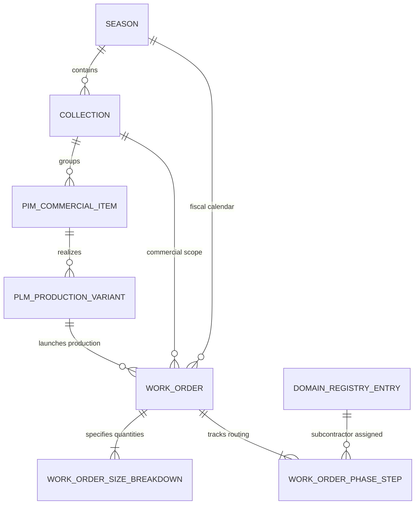

# PRD-006: Gestione Ordini di Produzione (Work Orders Hub), Passaporto Pellami & Tracciabilità Conceria, e Specifica UX Editing Anagrafiche di Dominio

**Versione:** 1.0  
**Data:** 19 Ottobre 2026  
**Autore:** CPO (`footlink-cpo`)  
**Destinatari:** Founder, CEO, CTO, CGO, CRO, CMO  
**Riferimento Strategico:** [Manifesto di Fondazione Footlink](../../Manifesto_Fondazione_Footlink.md) · [`Role_CPO_Footlink.md`](../roles/Role_CPO_Footlink.md)  
**Task Collegati:** [`FTL-PROD-006`](../../tasks/FTL-PROD-006.json), [`FTL-CEO-006`](../../tasks/FTL-CEO-006.json), [`FTL-CEO-007`](../../tasks/FTL-CEO-007.json)  
**Decision Record di Riferimento:** [`ADR-003`](../../adr/ADR-003-domain-model-1-to-n-pim-plm.md), [`ADR-006`](../../adr/ADR-006-unified-design-system-and-l6-cost-segregation.md), [`ADR-007`](../../adr/ADR-007-flexible-data-model-seasons-collections-domain-registries.md)  

---

## 1. Executive Summary & Visione di Prodotto

Con il completamento dello **Sprint 5**, Footlink ha consolidato le sue fondamenta:
1. L'architettura core **1 Articolo Commerciale PIM ↔ N Articoli Industriali PLM** con Distinta Base (BOM) multi-livello a 3 livelli.
2. La gerarchia temporale del lusso: **1 Stagione Moda ↔ N Collezioni**.
3. Il **Master Data Hub** per le anagrafiche di dominio (Modulo 03) e lo **Studio Modello Dati Flessibile** (Modulo 04).
4. Il **Portale Mobile Terzisti a 0 €** ("≤ 3 clic, < 90s") e il **Passaporto Digitale del Prodotto (DPP UE)** conforme al Regolamento UE 2024/1781 (ESPR).

Per lo **Sprint 6**, la visione di prodotto Footlink compie il salto qualitativo determinante: da strumento di catalogazione e ingegnerizzazione (PIM/PLM) a **Execution & Traceability Operating System di Filiera**.

Il presente PRD formalizza tre requisiti core:
1. **Specifica UX di Dominio per l'Editing delle Anagrafiche (FTL-CEO-007):** perfezionamento dell'interazione no-code per la modifica di etichette bilingue (IT/EN), ordinamento, stato di attivazione/disattivazione morbida (soft-disable) e form guidati per i metadati specifici di calzaturifici, pelletterie e façonisti.
2. **Work Orders Hub (Modulo Commesse di Fabbrica):** generazione automatica dell'ordine di produzione da variante PLM, aggancio obbligatorio a Stagione e Collezione, matrice di calzata/taglie (Size Breakdown Grid) per calzature e abbigliamento, ed avanzamento visuale a fasi di filiera (Pipeline Gantt/Kanban) con assegnazione terzisti a costo zero.
3. **Passaporto Pellami & Tracciabilità Conceria (FTL-CEO-006):** arricchimento della BOM con dati di tracciabilità conciaria (rating LWG Gold/Silver, certificazione ICEC TS 410/412, lotto bottale conceria, tipo concia e conformità REACH SVHC) ed esposizione integrata nel Passaporto Digitale DPP UE (doppia vista B2C consumatore ed ispettiva doganale L6).

---

## 2. Pilastro 1 — Specifica UX per l'Editing delle Anagrafiche di Dominio (FTL-CEO-007)

### 2.1 Problema Utente & Motivazione di Dominio
Nelle PMI calzaturiere e della pelletteria, i dati anagrafici di fornitori, façonisti, fasi e unità di misura non sono statici: un terzista cambia sede operativa o ottiene una nuova certificazione etica (SA8000), una conceria aggiorna il proprio rating LWG da Silver a Gold, un'unità di misura richiede un fattore di conversione standard per il calcolo consumi CAD.
L'eliminazione fisica di una riga anagrafica è un **anti-pattern distruttivo** che corromperebbe l'integrità referenziale dei prodotti storici e delle verifiche doganali ESPR (valide 10 anni). È quindi indispensabile un flusso di **editing controllato e disattivazione soft**.

### 2.2 Requisiti Funzionali & Campi Modificabili
Per ogni voce censita nel Modulo 03 (`DomainRegistriesManager`):
- **Codice Univoco (`entry_code`):** Immutabile una volta creato (garantisce integrità nelle relazioni FK con BOM e commesse).
- **Etichetta Italiana (`label_it`):** Modificabile in tempo reale, max 100 caratteri, usata nei form operativi di reparto.
- **Etichetta Inglese (`label_en`):** Modificabile, fallback su IT se non specificata, usata per showroom esteri, dogane ed export multicanale.
- **Ordinamento (`sort_order`):** Valore intero positivo. Determina la sequenza di visualizzazione nei menù a tendina (es. fasi di produzione ordinate cronologicamente; componenti principali prima degli accessori).
- **Stato Attivo/Disattivo (`is_active`):** Toggle booleano. Se disattivata (`is_active = false`), la voce:
  - Non appare più nei selettori di creazione nuovi prodotti, nuove righe BOM o nuove commesse.
  - Rimane perfettamente visibile, valida e referenziata in tutte le schede tecniche, ordini e passaporti storici preesistenti.
- **Metadati Specifici Guidati (Schema no-code per tipologia di registro):**
  Invece di richiedere la compilazione manuale di JSON grezzo, la UX presenta campi specializzati in base alla tabella selezionata:

| Tabella Anagrafica | Metadati Specifici di Dominio | Tipo Dato & Validazione |
|---|---|---|
| **Terzisti Façonisti (`subcontractors`)** | - Partita IVA / CF<br>- Indirizzo laboratorio fisico (Via, CAP, Comune, Distretto)<br>- Fasi autorizzate lavorazione conto terzi<br>- Certificazione etica (SA8000, SEDEX Smeta)<br>- Magic Link Portale Mobile (0 €) | Text (11-16 car.)<br>Text indirizzo<br>Multi-select fasi<br>Select rating<br>Read-only token URL |
| **Fornitori & Concerie (`suppliers`)** | - Partita IVA / Tax ID<br>- Distretto conciario (Arzignano, Santa Croce, Solofra)<br>- Certificazione Conciaria (LWG Gold/Silver, ICEC, ISO 14001)<br>- Paese di concia e origine grezzo<br>- Rating affidabilità qualitativa (A+, A, B) | Text P.IVA<br>Select distretto<br>Multi-select certs<br>Select ISO2 country<br>Select rating |
| **Fasi di Produzione (`production_phases`)** | - Reparto stabilimento / esterno façon<br>- Lead-time medio di fase (giorni lavorativi)<br>- Unità di misura avanzamento (paia, pezzi, lotti)<br>- Tipologia macchinario standard richiesto | Select interno/esterno<br>Number > 0<br>Select UoM<br>Text macchinario |
| **Unità di Misura (`units_of_measure`)** | - Simbolo display (sqft, m², dm², m, kg, paia, pz)<br>- Categoria grandezza (superficie, lunghezza, massa, unità)<br>- Fattore di conversione a unità base SI (es. 1 sqft = 0.092903 m²)<br>- Sfrido medio calcolato suggerito (%) | Text (max 6 car.)<br>Select categoria<br>Float decimale > 0<br>Percentuale (0-30%) |
| **Scale Taglie (`size_scales`)** | - Famiglia calzata (Donna EU 35-42, Uomo EU 38-46, Bambino, IT 44-56)<br>- Taglia base prototipo / campionario (es. 37 donna, 42 uomo)<br>- Passo percentuale di gradazione consumi (es. 2.8% scarpa, 3.4% abito)<br>- Array taglie ordinate costituenti la scala | Select famiglia<br>Text taglia base<br>Percentuale (1-10%)<br>Lista ordinata valori |

### 2.3 Interaction Design & Ergonomia UX
1. **Accesso immediato:** Pulsante `✏️ Modifica` su ciascuna riga della tabella anagrafica (hover con micro-animazione e contrasto Nike Editorial).
2. **Modal Ergonomico con Focus Trap:** La finestra modale si apre preservando il contesto; il tasto ESC o clic all'esterno chiude senza modifiche.
3. **Validazione inline:** Errori di validazione segnalati in rosso senza perdita di dati digitati.
4. **Salvataggio Real-time:** Esecuzione asincrona verso API backend (`PUT /api/v1/registries/{domain}/{name}/{code}`) con feedback visivo toast e mutazione immediata dello stato React senza reload pagina.

---

## 3. Pilastro 2 — Work Orders Hub: Gestione Commesse di Fabbrica & Ordini di Produzione

### 3.1 Contesto di Dominio: Il Ponte dalla Scheda Tecnica alla Fabbrica
Nel processo manifatturiero calzaturiero e pellettiero, una volta definita la collezione e approvata la variante PLM (con la sua distinta base BOM snapshot e i costi standard L6), la direzione industriale emette l'**Ordine di Produzione (Commessa di Fabbrica)**.
Una commessa non ordina "quantità generiche", ma ordina un mix dettagliato di taglie e assegna la sequenza delle lavorazioni ai reparti interni e ai façonisti distrettuali esterni.

### 3.2 Modello Entità-Relazione (ERD)



### 3.3 Campi Entità Core

#### 3.3.1 `WorkOrder` (Commessa di Fabbrica)
- `work_order_id`: Identificativo univoco (es. `WO-2026-PE-001`).
- `order_number`: Numero visuale commessa fabbrica (es. `COMM-2026-084`).
- `pim_item_id` & `plm_variant_id`: Variante industriale da produrre (FK).
- `season_id` & `collection_id`: Contesto stagionale e commerciale di appartenenza.
- `customer_order_ref`: Riferimento ordine cliente/showroom o lotto stock interno.
- `launch_date`: Data emissione commessa.
- `target_completion_date`: Data richiesta consegna a magazzino / showroom.
- `total_planned_quantity`: Totale paia (calzatura) o pezzi (pelletteria/abbigliamento), calcolato dalla somma del Size Breakdown.
- `total_completed_quantity`: Quantità finita e collaudata al 100% da QA.
- `lifecycle_status`:
  - `draft`: In preparazione, quote taglia in fase di aggiustamento.
  - `launched`: Lanciata in produzione, BOM e lotti congelati.
  - `in_production`: Almeno una fase avviata.
  - `quality_inspection`: Finissaggio completato, in collaudo QA.
  - `completed`: Intero lotto conforme e pronto per la spedizione.
  - `shipped`: Inviato a canali showroom / distributore.
- `notes`: Note tecniche speciali di produzione (es. "Attenzione sformo tomaia pellame abrasivato").

#### 3.3.2 `WorkOrderSizeBreakdown` (Matrice Ripartizione Quantità per Taglia)
Per ciascuna taglia attiva della scala taglie associata alla variante PLM:
- `size_label`: Taglia (es. `38`, `39`, `40`, `41`, `42`, `43`, `44`, `45`, `46` o `IT 46`..`IT 56`).
- `planned_quantity`: Paia o pezzi programmati.
- `actual_produced_quantity`: Paia collaudate conformi.
- `scrap_quantity`: Pezzi scartati durante le lavorazioni.
- `size_consumption_factor`: Fattore di gradazione consumo (es. taglia 42 = 1.0, taglia 45 = 1.084). Consente il calcolo istantaneo del fabbisogno materiali complessivo della commessa.

#### 3.3.3 `WorkOrderPhaseStep` (Avanzamento Fasi & Assegnazione Terzisti)
Generato automaticamente dal ciclo di produzione standard della variante:
- `step_sequence`: Ordine cronologico (1..N).
- `phase_code`: Codice fase (es. `cutting`, `stitching_upper`, `lasting_assembly`, `finishing`, `quality_control`).
- `phase_name_it`: Denominazione italiana della fase.
- `subcontractor_id`: Terzista assegnato (dall'anagrafica `subcontractors`).
- `subcontractor_name`: Nome laboratorio distrettuale.
- `material_lot_code`: Codice lotto materia prima/semilavorato associato alla lavorazione.
- `planned_start_date` / `planned_end_date`: Finestra temporale di calendario stimata.
- `actual_completed_at`: Timestamp validazione.
- `step_status`: `pending` | `in_progress` | `completed` | `quality_hold`.
- `scrapped_pieces`: Eventuali scarti registrati dal terzista.
- `mobile_portal_token`: Token univoco per l'avanzamento dal Portale Mobile Terzista a 0 €.

### 3.4 Interaction Design: Griglia Taglie & Pipeline Kanban/Gantt

```
┌────────────────────────────────────────────────────────────────────────────────────────────────────────┐
│ MODULO WORK ORDERS · COMMESSA COMM-2026-084                                                           │
│ Modello: Mocassino Artigianale Duca (PLM-DUCA-NERO) · Stagione: P/E 2026 · Collezione: Main Collection │
├────────────────────────────────────────────────────────────────────────────────────────────────────────┤
│ MATRICE RIPARTIZIONE QUANTITÀ PER TAGLIA (SIZE BREAKDOWN)                                              │
│ Taglia       │  38  │  39  │  40  │  41  │  42  │  43  │  44  │  45  │  46  │ TOTALE PAIA COMMESSA  │
│ Programmate  │  20  │  60  │ 120  │ 240  │ 300  │ 180  │  80  │  30  │  10  │ 1.040 PAIA             │
│ Fabbisogno   │ 58sqf│176sqf│355sqf│720sqf│915sqf│558sqf│252sqf│ 96sqf│ 32sqf│ 3.162 sqft Vitello     │
├────────────────────────────────────────────────────────────────────────────────────────────────────────┤
│ AVANZAMENTO FASI DI FILIERA (KANBAN WORKFLOW)                                                         │
│                                                                                                        │
│ [1. TAGLIO CAD]       [2. GIUNTERIA]         [3. MONTAGGIO]        [4. FINISSAGGIO]     [5. COLLAUDO QA]│
│ ✅ COMPLETATO          ⚙️ IN CORSO            ⏳ PROGRAMMATO        ⏳ PROGRAMMATO       ⏳ PROGRAMMATO │
│ Reparto Interno       Lab Façon FM-01        Calzaturificio Master Reparto Interno      Ente Qualità    │
│ Lotto: LOT-2026-084   Lotto: LOT-2026-084    Lotto: LOT-2026-084   Lotto: LOT-2026-084  Lotto: LOT-2026 │
│ Concluso 18/10 16:30  Target: 22/10          Target: 26/10         Target: 29/10        Target: 31/10   │
└────────────────────────────────────────────────────────────────────────────────────────────────────────┘
```

1. **Preset Curve di Taglia:** L'utente può scegliere curve preimpostate (es. "Curva Calzatura Uomo Standard 39-46", "Curva Slim") oppure inserire manualmente i quantitativi.
2. **Aggiornamento automatico BOM Fabbisogni:** La matrice ricalcola in tempo reale i metri quadri / piedi quadri totali di pellame necessari sommando le quote di ciascuna taglia moltiplicate per i fattori di gradazione.
3. **Ponte Mobile Terzista a 0 €:** L'avanzamento della fase (es. Giunteria completata) viene registrato dal terzista dal suo smartphone via Magic Link senza account a pagamento, aggiornando la commessa e il DPP in tempo reale.

---

## 4. Pilastro 3 — Passaporto Pellami & Tracciabilità Conceria (FTL-CEO-006)

### 4.1 Valore di Settore & Esigenza Normativa
Nel settore delle calzature e della pelletteria di alta gamma, la **pelle conciata rappresenta tra il 50% e il 70% del valore del prodotto**, oltre a costituire il componente più critico per:
- La conformità al **Regolamento UE 2024/1781 (ESPR)** e alla direttiva **EU Deforestation Regulation (EUDR)**.
- Le verifiche doganali internazionali sulle sostanze vietate (**REACH SVHC**, limite Cromo VI < 3 ppm).
- Le richieste di trasparenza dei consumatori del lusso sull'origine e sul benessere animale.

### 4.2 Modello Esteso Distinta Base (BOM) per Componenti in Pelle
Ogni componente della distinta base BOM (`BomItem`) che appartiene a categorie pelle (`upper`, `lining`, `insole`, o `leather`) viene arricchito con i seguenti campi di filiera conciaria:

```typescript
export interface LeatherTraceabilityAttributes {
  is_leather_component: boolean;
  tannery_supplier_name: string;        // es. Conceria del Chienti Srl
  tannery_vat_id: string;               // P.IVA Conceria per audit doganale
  tannery_district: string;             // Fermo-Macerata / Santa Croce / Arzignano
  tannery_lot_number: string;           // Lotto bottale / fornitura conceria
  lwg_rating: "Gold" | "Silver" | "Bronze" | "Audited" | "None";
  lwg_certificate_id?: string;          // es. LWG-CERT-2026-IT-8491
  icec_certificate_id?: string;         // es. ICEC-TS410-TRAC-2026
  origin_country_farming: string;       // ISO2 Paese allevamento grezzo (es. FR, DE, IT)
  origin_country_tanning: string;       // ISO2 Paese concia (es. IT)
  tanning_method: "vegetable" | "chrome" | "metal_free" | "bio_based";
  chemical_reach_compliance: boolean;   // Assenza SVHC / Cromo VI < 3 mg/kg
  deforestation_free_certified: boolean;// Conforme EUDR Regolamento UE 2023/1115
}
```

### 4.3 Visualizzazione nel Passaporto Digitale del Prodotto (DPP UE)
I dati conciari arricchiscono sia la vista pubblica B2C sia la vista ispettiva L6:
1. **Vista Consumatore (B2C Public DPP):**
   - **Badge Trasparenza Conciaria:** Marchio LWG Gold / Silver ben visibile con punteggio di sostenibilità.
   - **Mappa dell'Origine del Pellame:** Dalla regione di provenienza del grezzo (es. Normandia, Francia) allo storico distretto conciario toscano o marchigiano, fino al laboratorio di cucitura.
   - **Scheda Tecnica di Manutenzione del Pellame:** Istruzioni di cura basate sul tipo di concia (es. creme nutrienti naturali per concia al vegetale vs spray idrorepellente per pelli scamosciate).
2. **Vista Ispettiva / Doganale (L6 Customs Dossier):**
   - Registro lotti bottale e codici certificato ICEC TS 410 verificabili.
   - Dichiarazione di conformità analitica Cromo VI e assenza alchilfenoli etossilati (APEO).
   - Codici doganali TARIC capitolo 41 (Pelli e cuoi) incrociati con capitolo 64 (Calzature) e 42 (Pelletteria).

---

## 5. Prioritizzazione RICE Score formale per lo Sprint 6

Il CPO applica il framework oggettivo RICE definito nella specifica di ruolo:
$$\text{RICE Score} = \frac{\text{Reach} \times \text{Impact} \times \text{Confidence}}{\text{Effort}}$$

### Parametri di Scala
- **Reach (Portata, 1–10):** Quanti utenti/ruoli beneficiano direttamente della feature ogni settimana?
  - 10 = Tutti i Brand, PMI e Terzisti; 7 = Ufficio Tecnico, Pianificazione e Terzisti; 5 = Solo Amministratori.
- **Impact (Impatto sul valore, 0.25 / 0.5 / 1 / 2 / 3):**
  - 3 = Massimale (differenziatore di vendita irrinunciabile); 2 = Alto; 1 = Medio; 0.5 = Basso.
- **Confidence (Affidabilità della stima):**
  - 100% (1.0) = Alta certezza tecnica e di mercato; 80% (0.8) = Buona certezza con qualche dettaglio da validare; 50% (0.5) = Bassa certezza/esplorativo.
- **Effort (Person-week stimate):**
  - Effort congiunto Prodotto + Architettura Software Full-stack.

### Tabella Comparativa RICE Sprint 6

| ID Feature | Descrizione Iniziativa | Reach (1-10) | Impact (0.25-3) | Confidence (0.5-1.0) | Effort (PW) | **RICE Score** | Priorità CPO |
|---|---|:---:|:---:|:---:|:---:|:---:|:---:|
| **FEAT-6A** | **Work Orders Hub: Matrice Ripartizione Quantità per Taglia (Size Breakdown) & Fabbisogni BOM** | 9 | 3.0 | 0.90 | 1.0 PW | **24.3** | 🥇 **P0 (Fast-Track)** |
| **FEAT-6B** | **Passaporto Pellami & Tracciabilità Conceria (FTL-CEO-006): Campi Conceria, LWG, ICEC in BOM & DPP** | 8 | 3.0 | 0.85 | 1.0 PW | **20.4** | 🥈 **P0 (Fast-Track)** |
| **FEAT-6C** | **Work Orders Hub: Pipeline Avanzamento a Fasi (Kanban/Gantt) & Assegnazione Terzisti 0 €** | 9 | 2.5 | 0.85 | 1.0 PW | **19.1** | 🥉 **P1 (Core)** |
| **FEAT-6D** | **Specifica UX Editing Anagrafiche di Dominio (FTL-CEO-007): Form Guidati Metadati & Soft-Disable** | 7 | 2.0 | 1.00 | 0.8 PW | **17.5** | **P1 (Core)** |

### Motivazione del Ranking
1. **FEAT-6A (RICE 24.3):** La matrice di taglie con calcolo automatico dei fabbisogni è il vero elemento abilitante per l'adozione nei distretti Made in Italy. Senza la ripartizione taglie, nessun responsabile di produzione calzaturiero può utilizzare Footlink per ordinare i pellami e lanciare i lotti. Con RICE > 20 entra in **fast-track immediato**.
2. **FEAT-6B (RICE 20.4):** La tracciabilità conciaria (LWG, ICEC) è il requisito vincente verso i Brand del lusso che chiedono conformità ESPR 2026/1781. Anch'essa supera soglia 20 ed entra in **fast-track**.
3. **FEAT-6C (RICE 19.1):** Chiude il cerchio della collaborazione con i terzisti a 0 €, portando la commessa direttamente sugli smartphone dei façonisti.
4. **FEAT-6D (RICE 17.5):** Già impostata a livello di backend da FTL-CEO-007, richiede il completamento della UX ergonomica e della validazione di sicurezza.

---

## 6. Piano di Rilascio & Allocazione Sprint 6

### 6.1 Scomposizione per Ruoli C-Suite
- **CPO (Prodotto & UX):**
  - PRD-006 redatto e approvato.
  - Wireframe e specifiche interattive delle griglie taglie e avanzamento Kanban commesse.
  - Validazione tassonomia conciaria (LWG, ICEC) con gli standard di filiera.
- **CTO (Architettura & Ingegneria Software):**
  - Estensione DDL SQLite/PostgreSQL per `work_orders`, `work_order_size_items`, `work_order_phase_steps`.
  - Estensione tabella `bom_items` con campi certificazione conciaria e lotto pelle.
  - Endpoint RESTful FastAPI per creazione commessa, calcolo fabbisogni BOM per taglia e aggiornamento fasi.
  - Componenti React per la gestione interattiva del Work Orders Hub.
- **CRO (Monetizzazione & Vendite):**
  - Integrazione del modulo Work Orders Hub nella proposta commerciale per Brand e PMI di taglia media (upsell su pacchetti produzione).
  - Conferma del vincolo invalicabile: **Terzisti façonisti a 0 € perpetui** anche nel flusso di ricezione commessa.
- **CMO (Marketing & Lancio):**
  - Comunicazione di posizionamento: "Footlink: il primo PLM/PIM al mondo con Passaporto Conciario LWG & ICEC nativo per il Made in Italy".
- **CGO (Governance & Rischi):**
  - Verifica segregazione L6: i costi orari interni e i prezzi industriali rimangono inaccessibili al portale del terzista.

### 6.2 Acceptance Criteria (Criteri di Accettazione Sprint 6)
1. ✅ **Editing Anagrafiche:** Possibilità di modificare etichette IT/EN, ordine e stato attivo/disattivo delle anagrafiche, con campi metadati strutturati per Fornitori/Concerie e Terzisti senza errori di validazione.
2. ✅ **Creazione Commessa Work Order:** Generazione di una commessa a partire da un articolo PLM, associata obbligatoriamente a una Stagione e Collezione esistente.
3. ✅ **Matrice Taglie Dinamica:** Inserimento quantità per taglia su scala calzature (38-46) o abbigliamento, con somma automatica paia e calcolo istantaneo del fabbisogno lordo pellami BOM.
4. ✅ **Avanzamento Fasi Terzisti:** Assegnazione delle lavorazioni ai laboratori censiti, con avanzamento Kanban e sincronizzazione con il Portale Mobile Terzisti a 0 €.
5. ✅ **Passaporto Conceria Integrato:** Presenza dei campi lotto conciario, rating LWG e certificato ICEC nella distinta base pelle e nel Passaporto DPP UE generato.
6. ✅ **Test Suite 100% Passante:** Tutte le unit test e regression test backend/frontend con esito verde e costo computazionale 0 € (Free-Tier).

---

*Documento approvato dal Chief Product Officer (CPO) per il confronto di C-Suite da presentare al Founder.*
