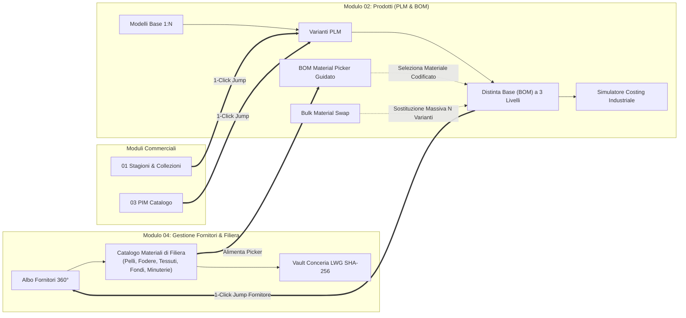

# PRD-010: Sprint 9 — Catalogo Materiali di Filiera, BOM Material Picker Guidato, Bulk Swap, Navigazione Contestuale e Costing Industriale Flessibile

- **Versione:** 1.0  
- **Data:** 29 Ottobre 2026  
- **Autore:** Chief Product Officer (`footlink-cpo`)  
- **Stato:** Approvato (Founder Directive Sprint 9 - 2026-10-29)  
- **Destinatari:** Founder, CEO (`footlink-ceo`), CTO (`footlink-cto`), CGO (`footlink-cgo`), CRO (`footlink-cro`), CMO (`footlink-cmo`)  
- **Riferimento Strategico:** [Manifesto di Fondazione Footlink](../../Manifesto_Fondazione_Footlink.md) · [`Role_CPO_Footlink.md`](../roles/Role_CPO_Footlink.md)  
- **Direttive Founder Collegate:** [`FTL-CEO-029`](../../tasks/FTL-CEO-029.json) (Gestione e Catalogazione Materiali), [`FTL-CEO-035`](../../tasks/FTL-CEO-035.json) (Direttiva Esecutiva Sprint 9)  
- **Task Prodotto:** [`FTL-PROD-015`](../../tasks/FTL-PROD-015.json)  
- **Decision Record di Riferimento:** [`ADR-011`](../../adr/ADR-011-epoch-2-verticalization-governance-and-modular-depth.md), [`ADR-013`](../../adr/ADR-013-product-model-construction-vs-product-style-separation.md), [`ADR-014`](../../adr/ADR-014-menu-reorganization-and-unified-supplier-management-hub.md), [`ADR-017`](../../adr/ADR-017-materials-catalog-bom-picker-bulk-swap-and-cross-module-ergonomics.md)

---

## 1. Visione di Prodotto & Obiettivi Strategici dello Sprint 9

### 1.1 Il Principio di Usabilità, Coerenza e Flessibilità
Nel solco della direttiva del Founder per lo **Sprint 9** e in piena continuità con la regola dell'Epoca II (*Zero Horizontal Bloat / Deep Vertical Capabilities* — `ADR-011`), Footlink non aggiunge moduli orizzontali esterni che disperderebbero l'attenzione degli utenti, ma concentra ogni sforzo per perfezionare **l'usabilità, la coerenza ontologica e la flessibilità** dei moduli esistenti.

| Obiettivo | Criticità Risolta | Soluzione di Prodotto (Sprint 9) |
|---|---|---|
| **Coerenza Dati (BOM & Fornitori)** | Inserimento manuale a testo libero dei materiali nella distinta (`material_name`), con disallineamento prezzi, duplicazioni e perdita del fornitore qualificato. | **Anagrafica Centralizzata Materiali (`FTL-CEO-029`):** ogni materiale è codificato, categorizzato e legato a un fornitore accreditato. |
| **Usabilità (Zero-Training d'Atelier)** | Navigazione frammentata tra PIM, Collezioni, PLM e Fornitori con continue ricerche manuali. | **Contextual Jumps (Deep Links):** passaggio istantaneo in 1 clic con conservazione del contesto di modello/variante/fornitore. |
| **Flessibilità Industriale** | Sostituzione di un materiale su 10 varianti colore richiede decine di modifiche manuali riga per riga. | **Bulk Material Swap:** strumento di sostituzione massiva in 1 clic per far fronte a cambi fornitore o rotture di stock. |
| **Flessibilità di Business** | Mancanza di un quadro immediato della redditività industriale complessiva del prodotto. | **Simulatore Dinamico di Costing Industriale:** calcolo automatico Materiali + Manodopera Terzisti (0 €) + Overhead con margini Wholesale/Retail. |

---

## 2. Architettura Funzionale & Personas Utente

### Personas d'Atelier Target
1. **📐 Modellista & Tecnico Distinta Base (PLM Specialist):** compone la distinta base scegliendo materiali certificati in pochi secondi con il *BOM Material Picker*; se un materiale viene a mancare, usa il *Bulk Material Swap* per aggiornare tutte le varianti colore senza errori.
2. **💼 Buyer & Responsabile Approvvigionamenti (Sourcing Manager):** gestisce il catalogo materiali fornitori all'interno del *Modulo 04*, verificando costi standard, unità di misura e certificazioni ambientali (LWG, FSC, EUDR).
3. **📊 Controller di Fabbrica & Direttore Commerciale (Costing & Pricing Manager):** consulta il *Simulatore di Costing Industriale* per valutare i margini lordi e simulare i prezzi di listino Wholesale/Retail in piena conformità con la segregazione L6.
4. **🛍️ Responsabile Merchandising & Showroom (PIM & Collection Coordinator):** naviga fluidamente tra le collezioni del *Modulo 01*, gli articoli del *Modulo 03* e le schede tecniche industriali del *Modulo 02* tramite i *Contextual Jumps*.

---

## 3. Specifiche di Dettaglio

### 3.1 Catalogo Materiali di Filiera (Modulo 04 — `SupplierManagementHub`)
Il Modulo 04 include il nuovo sotto-tab **"Catalogo Materiali"** (`MaterialsCatalogManager.tsx`):
- **Campi Entità `Material`:**
  - `material_id`: ID univoco (es. `MAT-PEL-001`, `MAT-FND-002`);
  - `name`: Nome commerciale/tecnico (es. *"Vitello Pieno Fiore Nappa Morbida"*);
  - `material_code`: Codice articolo fornitore (es. *"ART-NAP-802"*);
  - `category`: Categoria merceologica certificata (`leather`, `lining`, `fabric`, `sole_bottom`, `heel`, `hardware`, `thread`, `packaging`, `other`);
  - `vendor_id`: FK verso `VendorRecord` (fornitore associato);
  - `unit_of_measure`: Unità di misura (`dm2`, `m`, `kg`, `pz`, `paia`);
  - `standard_cost`: Costo unitario standard (€) con presidio L6;
  - `color_shade`: Tonalità/finitura di riferimento;
  - `certifications`: Array di certificazioni (LWG Gold/Silver, REACH SVHC, EUDR, FSC);
  - `is_active`: Stato di disponibilità.
- **Filtri Rapidi:** Ricerca per testo (`name`, `material_code`), filtro per categoria merceologica, filtro per fornitore accreditato.
- **Azioni:** Creazione nuovo materiale, modifica anagrafica, disattivazione logica (`soft-delete`).

### 3.2 BOM Material Picker Guidato (Modulo 02 — `BomThreeLevelTree`)
Nel pannello di aggiunta/modifica nodo BOM (Livello 1 Componente, Livello 2 Semilavorato, Livello 3 Materiale di Base):
- **Modalità Guidata (Default):** Un campo di ricerca ad autocompletamento intelligente mostra i materiali del catalogo ordinati per rilevanza, con badge di categoria, fornitore e swatch/icona.
- **Auto-compilazione Immediata:** Selezionando un materiale:
  - `material_name` viene popolato automaticamente con `Material.name`;
  - `vendor_id` viene associato al fornitore del materiale;
  - `unit_cost` viene valorizzato con `standard_cost`;
  - `unit_of_measure` viene impostato automaticamente (es. `dm2` per pellami, `pz` per suole);
  - Se il fornitore ha certificati scaduti (`has_expired_critical_certs = true`), appare un badge semaforico d'avviso ambra non bloccante.
- **Modalità Avanzata / Override:** Possibilità opzionale per il modellista di personalizzare note di lavorazione o forzare un costo specifico per variante.

### 3.3 Funzione "Trova e Sostituisci Materiale" (Bulk Material Swap)
All'interno del Modulo 02, nella barra operativa della distinta base:
- Pulsante dedicato: `🔄 Sostituisci Materiale su Varianti`.
- **Modale Interattivo:**
  1. *Materiale Sorgente:* Seleziona il materiale attualmente presente in distinta da sostituire;
  2. *Materiale Destinazione:* Sceglie il nuovo materiale sostitutivo dal Catalogo Materiali;
  3. *Perimetro:* Checkbox per selezionare su quali varianti colore del prodotto applicare la sostituzione (es. *"Tutte le varianti"* oppure solo *"Variante 01 - Nero"* e *"Variante 02 - Moro"*);
  4. *Aggiornamento Costi:* Opzione per ricalcolare automaticamente i costi o mantenere i valori precedenti;
  5. *Esecuzione:* Click su *"Esegui Sostituzione Massiva"* con feedback visivo immediato e notifica toast di conferma.

### 3.4 Navigazione Contestuale Cross-Modulo (*Contextual Jumps*)
Per azzerare l'attrito cognitivo e i passaggi manuali tra moduli:
1. **Da Modulo 01 (Stagioni & Collezioni):**
   - In ciascuna card di prodotto associato alla collezione, pulsante `🛠️ Scheda PLM`: reindirizza istantaneamente al Modulo 02 impostando `selectedPimId` sul prodotto e aprendo il tab di visualizzazione tecnica.
2. **Da Modulo 03 (PIM Catalogo):**
   - Nel dettaglio dell'articolo commerciale, accanto alle varianti PLM collegate, pulsante `⚙️ Dettaglio PLM & BOM`: passa al Modulo 02 selezionando la specifica variante industriale.
3. **Da Modulo 02 (PLM & Distinta Base):**
   - Su ogni riga BOM che possiede un fornitore associato, icona interattiva `🏭 Fornitore`: cliccando, l'utente viene indirizzato al Modulo 04 con filtro automatico sul fornitore selezionato;
   - Se il componente è un pellame, icona `📜 Vault LWG`: apre direttamente il Vault Conceria con il filtro sui lotti compatibili.

### 3.5 Simulatore Dinamico di Costing Industriale (Modulo 02)
Pannello compatto posizionato a fianco della distinta base:
- **Calcolo Costo Primo Industriale:**
  $$\text{Costo Materiali} = \sum (\text{Quantità Consumo} \times \text{Costo Unitario})$$
  $$\text{Costo Manodopera Esterne} = \sum (\text{Fasi Terzisti a 0 €}) = 0{,}00\text{ €}$$
  $$\text{Incidenza Struttura / Overhead} = \text{Costo Materiali} \times \text{Overhead Rate \%}$$
  $$\text{Costo Industriale Totale} = \text{Costo Materiali} + \text{Incidenza Struttura}$$
- **Simulatore di Prezzo & Margine:**
  - Slider o input per *Prezzo Wholesale B2B (€)* $\rightarrow$ calcolo automatico del *Margine di Fabbrica \%*;
  - Calcolo del *Prezzo Consigliato Retail B2C (€)* basato sul moltiplicatore di ricarico impostabile (es. $2{,}5\times$ o $3{,}0\times$).
- **Segregazione L6:** Questo pannello è rigorosamente visibile solo ai ruoli `brand` e `pmi`. Se il visualizzatore è impostato su `subcontractor` o `consumer`, il pannello è oscurato con il messaggio protetto *"Dati di Costing Industriale riservati (Segregazione L6)"*.

---

## 4. Criteri di Accettazione e Protocollo Zero-Training (<90s)

1. **Creazione Materiale & Inserimento BOM (<60s):** Un operatore deve poter creare un nuovo materiale nel Modulo 04 e inserirlo nella distinta base di una variante nel Modulo 02 in meno di 60 secondi senza errori.
2. **Bulk Swap Eseguito con Successo:** La sostituzione massiva di una fodera o minuteria su 3 varianti aggiorna tutti i nodi corrispondenti in meno di 1 secondo con feedback visivo.
3. **Contextual Jumps Bidirezionali:** I salti contestuali da Modulo 01 e 03 verso Modulo 02 mantengono intatto il prodotto selezionato al 100%.
4. **Protezione Segregazione L6:** Nessun costo o margine è esposto a profili non autorizzati.
5. **Zero Regressioni:** 100% test Pytest passanti e zero errori TypeScript nella compilazione Vite.
