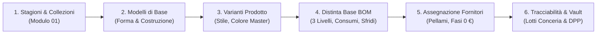

# PRD-011: Semplificazione Flusso Modelleria, Stepper di Processo e Coordinamento Modulo 02 (PLM & BOM)
## Specifiche Funzionali & Interaction Design · Chief Product Officer (CPO)
**Documenti di Riferimento:** [ADR-018](../../adr/ADR-018-atelier-process-streamlining-and-plm-navigation-coordination.md) · Direttive Founder [`FTL-CEO-036`](../../tasks/FTL-CEO-036.json), [`FTL-CEO-037`](../../tasks/FTL-CEO-037.json)  
**Data di Emissione:** 2026-10-29  
**Stato:** Approvato per Implementazione Immediata

---

## 1. Visione di Prodotto & Risoluzione Criticità

Nelle aziende calzaturiere e di pelletteria di alta gamma, il passaggio dalla visione stilistica alla produzione industriale segue una sequenza rigorosa ma fluida.
In risposta all'analisi del Founder:
1. **Risoluzione `FTL-CEO-036`:** Eliminazione definitiva del pulsante *"Apri Workspace Integrato Completo →"* e del rendering del vecchio monolite disallineato `PimToPlmBridge`, consolidando la navigazione sui soli 8 moduli ufficiali.
2. **Risoluzione `FTL-CEO-037`:** Sostituzione delle 6 zone frammentate e poco coordinate di Modulo 02 con l'**Atelier Process Stepper** interattivo e con **ponti di navigazione inter-fase** che guidano il modellista lungo il naturale ciclo di vita del prodotto.

---

## 2. Il Ciclo di Processo a 6 Fasi (Atelier Lifecycle Blueprint)

L'interfaccia guida l'utente attraverso i 6 step indicati dal Founder:

### Specifica di Dettaglio per Singola Fase:

| Fase | Denominazione Fabbrica | Modulo / Tab FootLink | Dati In Input | Azione di Avanzamento / Ponte |
| :---: | :--- | :--- | :--- | :--- |
| **1** | **Apertura Stagione & Collezioni** | `01 Stagioni & Collezioni` | Codice Stagione (es. FW 2026/27), nome collezione, budget. | Pulsante *"Procedi con Modelli Industriali →"* (apre Modulo 02 - Tab Modelli). |
| **2** | **Definizione Modelli di Base** | `02 Prodotti` → `Tab Modelli` | Codice Forma (es. FM-108), Costruzione (Goodyear, Blake), Scala Taglie. | Dalla card modello: *"➕ Crea Variante per [Modello]"* (apre Tab Prodotti con modello preselezionato). |
| **3** | **Definizione Varianti di Stile** | `02 Prodotti` → `Tab Prodotti` | Colore Master (da cartella colori), Codice Variante, SKU PIM, prezzi. | Dalla riga tabella: *"🌿 Apri Distinta Base"* (apre Tab Distinta Base con variante attiva). |
| **4** | **Definizione Distinta Base BOM** | `02 Prodotti` → `Tab Distinta Base` | Materiali da Catalogo (BOM Picker), consumo netto, sfrido %, costo L6. | Pulsante *"📋 Copia/Applica BOM da Modello"* se vuota; salti contestuali ai fornitori. |
| **5** | **Assegnazione Fornitori & Terzisti** | `04 Gestione Fornitori` | Albo Fornitori 360°, qualifica ESG (LWG/EUDR), assegnazione fasi a terzisti. | Link contestuale da ogni componente BOM verso il fornitore designato. |
| **6** | **Tracciabilità Lotti & Vault** | `04 Vault` & `08 Passaporto DPP` | Codici lotto conceria crittografici SHA-256, certificati doganali, QR Code. | Generazione Passaporto Digitale del Prodotto (DPP UE ESPR). |

---

## 3. Interaction Design & Coordinamento delle 6 Zone

### 3.1. Atelier Process Stepper Bar (Header di Modulo 02)
- Posizionata sotto la testata principale, la barra visualizza i 6 step orizzontali numerati.
- Lo step corrente è evidenziato con sfondo scuro a contrasto ed icona attiva.
- Gli step 1, 5 e 6 contengono badge *"Modulo 01"*, *"Modulo 04"* e *"Modulo 08"* con link diretto.
- Gli step 2, 3 e 4 permettono di cambiare istantaneamente il sub-tab di Modulo 02 mantenendo il contesto del modello e della variante correnti.
- Un pulsante discreto *"Mostra/Comprimi Guida di Flusso"* permette all'utente esperto di minimizzare l'altezza dell'area.

### 3.2. Semplificazione della Testata & Raggruppamento Bottoni
I 5 bottoni precedentemente dispersi vengono ricondotti a due gruppi logici:
1. **Azioni Dirette di Flusso (Avanzamento Modelleria):**
   - `+ Nuovo Modello Base`
   - `+ Nuova Variante PLM`
2. **Strumenti Analitici & Integrazioni:**
   - Dropdown compatto *"Strumenti Avanzati ▾"* contenente:
     - `🎨 Cartella Colori Master`
     - `⚡ 1-Click Colorway Explosion`
     - `📥 Import Massivo CSV`
     - `📊 Esporta Excel / CSV`

### 3.3. Ponti di Navigazione Diretta tra Tab (Seamless Transitions)
- **Da Modelli a Varianti:** Nella vista `Modelli`, ciascuna card di modello include un pulsante in evidenza: `➕ Crea Variante da Modello`. Il click seleziona il modello, imposta `activeOperationalTab("catalogo")` e apre il form di creazione variante con il modello già agganciato.
- **Da Varianti a Distinta Base:** Nella tabella di `Prodotti`, ogni variante presenta una colonna/azione dedicata: `🌿 Apri BOM`. Il click seleziona la variante specifica e commuta automaticamente il tab in `Distinta Base`.
- **Eredità Struttura BOM:** Quando si accede a `Distinta Base`, se la variante non ha ancora componenti, un riquadro amichevole suggerisce: *"Questa variante non ha ancora una distinta base configurata. Vuoi ereditare la struttura standard dal modello o applicare un template?"*, con pulsante `📋 Applica Template di Modello`.

---

## 4. Verifica di Usabilità & Criteri di Accettazione

- [x] Il link decontestualizzato *"Apri Workspace Integrato Completo →"* è rimosso dalla Home;
- [x] L'accesso da Home indirizza coerentemente al primo passo (`01 Stagioni & Collezioni`) o ai singoli moduli operativi;
- [x] Modulo 02 espone l'Atelier Process Stepper a 6 fasi con indicatori chiari;
- [x] Le 6 zone sono armonizzate con raggruppamento coerente di pulsanti primari e strumenti;
- [x] Transizione fluida con 1 clic da Modello a Variante e da Variante a Distinta Base;
- [x] 0 errori di compilazione TypeScript/Vite e conformità a tutte le regole di sicurezza L6.
