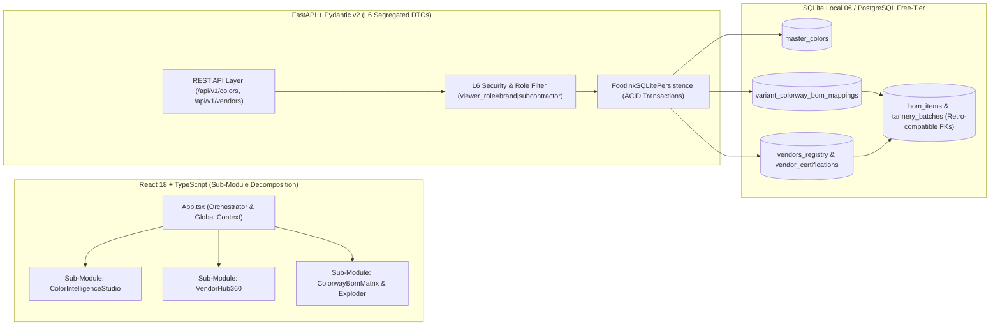
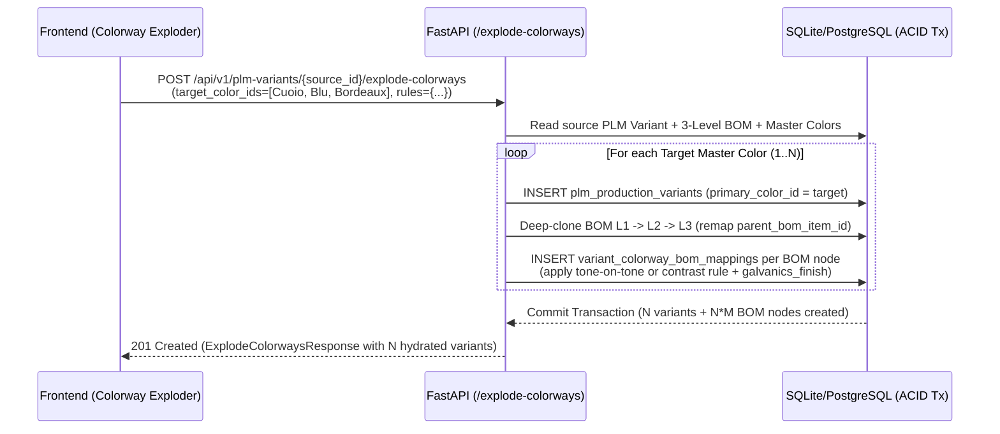

# Footlink Epoca II ("La Verticalizzazione") — Ottimizzazione Architetturale & Blueprint Ingegneristico Sprint 8

- **Documento ID:** `DOC-TECH-EPOCH2-SPRINT8-001`
- **Autore:** CTO (`footlink-cto`)
- **Stato:** Approvato per Esecuzione Tecnica — Sprint 8 ("La Ripartenza")
- **Task di Riferimento:** `FTL-CEO-017` / `FTL-TECH-022` (Color Intelligence Engine & Colorway BOM Matrix), `FTL-CEO-018` / `FTL-TECH-023` (Vendor Hub 360° & Albo Fornitori/Terzisti), Evoluzione `Portale_Founder_Control` v2.0
- **Riferimenti Normativi & Architetturali:** [Manifesto di Fondazione](../../Manifesto_Fondazione_Footlink.md), [ADR-002](../../adr/ADR-002-core-architecture-free-tier.md), [ADR-006](../../adr/ADR-006-bom-3-level-costing-segregation-and-vertical-specs.md), [ADR-007](../../adr/ADR-007-seasons-collections-hierarchy-and-dynamic-schema.md), [ADR-008](../../adr/ADR-008-district-paas-tannery-vault-and-production-orders.md), [ADR-010](../../adr/ADR-010-sprint-7-enterprise-plm-categories-hierarchy-and-bulk-import.md)
- **Data:** 25 Ottobre 2026
- **Spesa Infrastrutturale Autorizzata (FinOps L2):** `0,00 €` (Free-Tier First, Zero Vendor Lock-In)

---

## 1. Fotografia Tecnica fine Epoca I & Ottimizzazione per la Verticalizzazione

### 1.1 Analisi delle Metriche Attuali della Codebase (Chiusura Epoca I: Sprint 1–7)

Al termine dell'**Epoca I ("La Fondazione Orizzontale")**, la piattaforma Footlink ha completato il perimetro strutturale end-to-end (9 moduli applicativi integrati + Founder Control Center) mantenendo debito tecnico zero e prestazioni deterministiche:

| Metrica Ingegneristica | Valore Misurato (Fine Sprint 7) | Target KPI CTO (`Role_CTO_Footlink.md`) | Stato |
|---|---|---|---|
| **Linee di Codice Proprietarie (LOC)** | **`26.026` linee** (Backend Python FastAPI + Frontend React 18/TS + Control Center + Schema SQL) | Modularità & leggibilità alta | 🟢 Eccellente |
| **Dimensione Codebase Proprietaria** | **`3.19 MB`** di codice sorgente puro (esclusi `node_modules` e `.venv`) | Zero bloatware | 🟢 Eccellente |
| **Test Suite Backend (Pytest)** | **`26 / 26` test superati (`100% pass rate`)** su business logic 1:N, BOM L1-L3, DPP, PaaS, Bulk Import | Coverage > 80% su core logic | 🟢 Eccellente |
| **Performance Build Frontend (Vite 5 + TS)** | **`544 ms`** produzione (`tsc && vite build`) | < 2.000 ms | 🟢 Eccellente |
| **Database Engine Dual-Target** | **16 tabelle relazionali** (`Applicativo/database/schema.sql`) compatibili SQLite 0€ & PostgreSQL Free-Tier | Latenza query < 15ms locale / < 100ms cloud | 🟢 Eccellente |
| **Costo Infrastrutturale Vivo (FinOps L2)** | **`0,00 € / mese`** (zero librerie a pagamento, zero SaaS esterni) | `0,00 €` tassativo | 🟢 Conforme L2 |

#### Ripartizione Architetturale Attuale dei 3 Pilastri (`ADR-005`)
1. **`Applicativo/backend/` (`FastAPI` + `Pydantic v2` + `SQLite/SQLAlchemy 2.0`):**
   - `app/models.py` (`946` LOC): contratti di dominio tipizzati per 1 PIM ↔ N PLM, BOM a 3 livelli, Stagioni/Collezioni, Categorie gerarchiche, Lotti Conceria SHA-256, Commesse di Produzione e Import Massivo.
   - `app/database.py` (`2.806` LOC): gateway di persistenza unificato `FootlinkSQLitePersistence` con migrazioni non distruttive idempotenti (`init_schema()`) e calcoli algebrici di fabbisogno taglie/sfrido.
   - `app/main.py` (`1.500+` LOC): API RESTful OpenAPI 3.1 con segregazione dei costi L6 e generazione SVG nativa del QR Digital Product Passport ESPR.
2. **`Applicativo/frontend/` (`React 18` + `TypeScript Strict` + `Vite`):**
   - SPA reattiva organizzata su 9 viste funzionali, stato sincronizzato con le API REST e zero dipendenze UI pesanti (CSS enterprise custom ad alte prestazioni).
3. **`Portale_Founder_Control/` (`control_center.py` — `3.150` LOC):**
   - Cabina di regia del Founder scritta interamente con la libreria standard Python 3 (`http.server`, `json`, `urllib`), zero dipendenze esterne, lettura/scrittura real-time su `Azienda/tasks/*.json`, `Azienda/adr/*.md` e `Azienda/docs/**/*.md`.

---

### 1.2 Strategia di Ingegneria del Software per l'Epoca II ("La Verticalizzazione")

L'**Epoca II** non aggiunge dispersione orizzontale, ma **scava in profondità verticale** dentro i 9 moduli già consolidati per sostituire i flussi Excel/email delle PMI e dei Brand del lusso (Calzature, Pelletteria, Abbigliamento). Per scalare la complessità funzionale da `26.026` a oltre `40.000+` linee mantenendo il tempo di build Vite sotto `1 secondo` e la suite Pytest deterministica, adottiamo 4 pattern ingegneristici rigorosi:



1. **Pattern *Sub-Module Decomposition* (Frontend & Backend):**
   - Ogni nuova verticalizzazione viene incapsulata in sottosistemi coesi e disaccoppiati (es. dominio *Color Intelligence & Colorway Matrix* e dominio *Vendor Hub 360° & Where-Used Engine*), evitando componenti monolitici non manutenibili e preservando il tree-shaking nativo di Vite (`544ms`).
2. **Retro-Compatibilità Non Distruttiva del Database (`Additive Schema Evolution`):**
   - Tutte le estensioni su tabelle core esistenti (`bom_items`, `tannery_batches`, `plm_production_variants`) avvengono tramite chiavi esterne opzionali (`vendor_id NULL`, `master_color_id NULL`, `primary_color_id NULL`) affiancate ai campi testuali legacy (`supplier_name`, `tannery_name`, `colorway_name`).
   - Il metodo `init_schema()` in [`database.py`](file:///Users/a.ciminaritodsgroup.com/Projects/FootLink_v2/Applicativo/backend/app/database.py#L147-L190) esegue migrazioni `ALTER TABLE ... ADD COLUMN` idempotenti all'avvio, garantendo che i **26 test Pytest dell'Epoca I continuino a passare al 100% senza modifiche distruttive**.
3. **Validazione Pydantic v2 con DTO di Segregazione L6 By-Design:**
   - I dati industriali sensibili (costi unitari BOM `unit_cost_eur`, tariffe orarie/al paio di lavorazione `hourly_or_unit_rate_eur_l6`, condizioni di pagamento `payment_terms_l6`, esposizione economica `total_annual_exposure_eur_l6`) sono segregati a livello di serializzazione backend prima che il payload JSON lasci il server FastAPI quando `viewer_role == "subcontractor"`.
4. **Invariante FinOps L2 (`0,00 €`):**
   - Calcolo colorimetrico (`Delta-E` CIE76/CIE94), validazione esadecimale/Pantone, verifica crittografica `SHA-256` dei certificati fornitori e query relazionali *Where-Used* sono implementati interamente in Python nativo e SQL standard, con costo ricorrente pari a `0,00 €`.

---

### 1.3 Evoluzione del Founder Control Center v2.0 (`Portale_Founder_Control/control_center.py`)

Con oltre 55 task completati nell'Epoca I (Sprint 1–7) e l'apertura dei nuovi stream di verticalizzazione dell'Epoca II (Sprint 8+), la cabina di regia del Founder ([`control_center.py`](file:///Users/a.ciminaritodsgroup.com/Projects/FootLink_v2/Portale_Founder_Control/control_center.py)) evolve alla versione **v2.0 Multi-Epoca**:

- **Classificazione Deterministica dei Task per Epoca (`classify_task_epoch`):**
  - **Epoca II — La Verticalizzazione (`epoch_2`, default attivo):** include tutti i task appartenenti allo **Sprint 8+** o con numerazione di serie Epoca II (`FTL-CEO-016+`, `FTL-TECH-022+`, `FTL-PROD-014+`, `FTL-REV-008+`, `FTL-MKT-008+`, `FTL-GOV-008+`), oltre a qualsiasi task operativo ancora aperto (`todo`, `in_progress`, `review`, `blocked`).
  - **Archivio Storico Epoca I — La Fondazione (`epoch_1`):** raccoglie in sola consultazione storica tutti i task chiusi degli **Sprint 1–7**, preservando il 100% dell'audit trail, dei deliverable e delle decisioni C-Suite.
  - **Vista Globale (`all`):** aggrega l'intero grafo storico e corrente (`Epoca I + Epoca II`) per ispezioni trasversali.
- **Selettore Rapido in Top-Bar (`?epoch=epoch_2|epoch_1|all`):**
  - Barra di commutazione istantanea con contatori real-time dei task per ciascuna epoca, KPI ricalcolati dinamicamente sul perimetro selezionato e piena conservazione di ogni byte storico in `Azienda/tasks/`.

---

## 2. Blueprint Tecnico Verticalizzazione 1 (`FTL-CEO-017` / `FTL-TECH-022`): Color Intelligence Engine & Colorway BOM Matrix

### 2.1 Obiettivo Ingegneristico

Nel settore calzaturiero e pelletteria, un modello (1 PIM Item) si declina in $N$ varianti colore (PLM Variants), dove ciascun variante colore non applica un singolo colore piatto ma una **combinazione strutturata (Colorway Matrix)** sui diversi nodi della Distinta Base (Tomaia, Fodera, Suola/Fondo, Tacco, Minuteria Metallica con finitura galvanica, Filato/Cuciture). Inoltre, ogni colore su materiale fisico richiede l'approvazione **Lab-Dip** (campione bagno di tintura conceria/fornitore) con controllo strumentale della tolleranza spettrofotometrica **$\Delta E$ (Delta-E)**.

Il **Color Intelligence Engine** introduce:
1. L'anagrafica strutturata della **Cartella Colori Master & Stagionale** (`master_colors`).
2. La **Matrice Colorway ↔ Nodi BOM & Lab-Dip Tracking** (`variant_colorway_bom_mappings`).
3. Il motore atomico **Colorway BOM Exploder** (`/explode-colorways`) che genera in un solo clic $N$ varianti PLM complete di distinta base clonata e mappatura cromatica automatica.

---

### 2.2 Schema DDL Relazionale SQLite / PostgreSQL (`schema.sql`)

```sql
-- ============================================================================
-- Sprint 8 (Epoca II - Verticalizzazione 1): Color Intelligence Engine & Colorway BOM Matrix
-- Task Reference: FTL-CEO-017 / FTL-TECH-022
-- ============================================================================

-- 17. Master & Seasonal Color Palette (Cartella Colori Tecnica & Commerciale)
CREATE TABLE IF NOT EXISTS master_colors (
    id VARCHAR(64) PRIMARY KEY,
    color_code VARCHAR(64) NOT NULL UNIQUE,           -- es. COL-NERO-001, COL-CUOIO-TOSC-26
    technical_name_it VARCHAR(128) NOT NULL,          -- es. Nero Assoluto Conceria, Cuoio Toscano Anticato
    technical_name_en VARCHAR(128) NOT NULL,          -- es. Absolute Tannery Black, Antique Tuscan Tan
    commercial_family VARCHAR(64) NOT NULL            -- es. Neutri, Terre & Cuoio, Nero/Bianco, Pastelli, Metallizzati, Stagionali
         DEFAULT 'Neutri',
    hex_code CHAR(7) NOT NULL DEFAULT '#1A1A1A'       -- Formato rigoroso #RRGGBB per swatch UI e rendering
        CHECK (hex_code LIKE '#______'),
    pantone_tcx_code VARCHAR(64) NOT NULL DEFAULT '', -- es. PANTONE 19-4004 TCX (Tapestry Black)
    ral_code VARCHAR(32) NOT NULL DEFAULT '',         -- es. RAL 9005 (per verniciature tacchi, bordi, minuterie)
    finish_type VARCHAR(64) NOT NULL DEFAULT 'pieno_fiore_naturale'
        CHECK (finish_type IN (
            'pieno_fiore_naturale', 'scamosciato_suede', 'vernice_patent',
            'metallizzato_laminato', 'nabuk', 'stampa_rettile_cocco',
            'gomma_opaca', 'galvanica_metallica', 'tessuto_tinto_filo'
        )),
    applicable_domains_json TEXT NOT NULL             -- JSON array es. ["pellame", "suola", "minuterie", "filati", "fodera"]
        DEFAULT '["pellame", "fodera", "suola", "minuterie"]',
    season_id VARCHAR(64) NULL,                       -- NULL = Colore Continuativo (Carryover), valorizzato = Stagionale
    is_active BOOLEAN NOT NULL DEFAULT 1,
    created_at TIMESTAMP NOT NULL DEFAULT CURRENT_TIMESTAMP,
    FOREIGN KEY (season_id) REFERENCES seasons(season_id) ON DELETE SET NULL
);

-- 18. Variant Colorway BOM Mappings & Lab-Dip Approval Matrix
CREATE TABLE IF NOT EXISTS variant_colorway_bom_mappings (
    id VARCHAR(64) PRIMARY KEY,
    plm_variant_id VARCHAR(64) NOT NULL,
    bom_item_id VARCHAR(64) NOT NULL,                 -- Riferimento al nodo specifico della BOM (L1, L2 o L3)
    master_color_id VARCHAR(64) NOT NULL,             -- Colore assegnato a quel componente in questa variante
    part_role VARCHAR(64) NOT NULL DEFAULT 'tomaia_principale'
        CHECK (part_role IN (
            'tomaia_principale', 'riporto_secondario', 'fodera_interna',
            'sottopiede', 'suola_fondo', 'guardolo_intersuola',
            'tacco', 'minuteria_accessori', 'cuciture_filato', 'bordo_costola_tingibordo'
        )),
    galvanics_finish VARCHAR(64) NULL                 -- Specifico per hardware/minuterie: es. 'oro_chiaro_24k', 'palladio_lucido', 'rutenio_scuro', 'ottone_anticato'
        DEFAULT NULL,
    lab_dip_status VARCHAR(32) NOT NULL DEFAULT 'pending'
        CHECK (lab_dip_status IN ('pending', 'submitted', 'approved', 'rejected', 'master_standard')),
    delta_e_value REAL NULL                           -- Scostamento spettrofotometrico CIE Delta-E (target lusso <= 1.0)
        CHECK (delta_e_value IS NULL OR (delta_e_value >= 0.0 AND delta_e_value <= 25.0)),
    approved_by VARCHAR(128) NULL,                    -- Utente/Responsabile Qualità Colore che ha validato il Lab-Dip
    approved_at TIMESTAMP NULL,
    notes TEXT NOT NULL DEFAULT '',
    FOREIGN KEY (plm_variant_id) REFERENCES plm_production_variants(plm_variant_id) ON DELETE CASCADE,
    FOREIGN KEY (master_color_id) REFERENCES master_colors(id) ON DELETE RESTRICT,
    UNIQUE (plm_variant_id, bom_item_id)
);

CREATE INDEX IF NOT EXISTS idx_master_colors_season ON master_colors(season_id, is_active);
CREATE INDEX IF NOT EXISTS idx_master_colors_family ON master_colors(commercial_family, finish_type);
CREATE INDEX IF NOT EXISTS idx_colorway_matrix_variant ON variant_colorway_bom_mappings(plm_variant_id);
CREATE INDEX IF NOT EXISTS idx_colorway_matrix_color ON variant_colorway_bom_mappings(master_color_id);
CREATE INDEX IF NOT EXISTS idx_colorway_matrix_labdip ON variant_colorway_bom_mappings(lab_dip_status);
```

#### Migrazione Non Distruttiva su `bom_items` e `plm_production_variants`
In [`database.py`](file:///Users/a.ciminaritodsgroup.com/Projects/FootLink_v2/Applicativo/backend/app/database.py):
- `ALTER TABLE plm_production_variants ADD COLUMN primary_color_id VARCHAR(64) NULL REFERENCES master_colors(id) ON DELETE SET NULL`
- `ALTER TABLE bom_items ADD COLUMN master_color_id VARCHAR(64) NULL REFERENCES master_colors(id) ON DELETE SET NULL`

---

### 2.3 Contratti API REST FastAPI & Modelli Pydantic v2

#### A. Gestione Cartella Colori (`/api/v1/colors`)

| Metodo | Endpoint | Descrizione & Query Params |
|---|---|---|
| `GET` | `/api/v1/colors` | Restituisce la cartella colori con filtri opzionali: `?season_id=...`, `?commercial_family=...`, `?finish_type=...`, `?domain=pellame`, `?active_only=true`, `?search=...` |
| `POST` | `/api/v1/colors` | Crea un nuovo colore in `master_colors` validando il formato HEX (`^#[0-9A-Fa-f]{6}$`), i codici Pantone TCX / RAL e i domini applicabili. |
| `PUT` | `/api/v1/colors/{color_id}` | Aggiorna attributi cromatici, finitura, codici Pantone/RAL o stato di attivazione. |
| `DELETE` | `/api/v1/colors/{color_id}` | Disattiva (`soft-delete`) o rimuove il colore se non vincolato a varianti in produzione. |

**Payload Esempio `POST /api/v1/colors` (`MasterColorCreate`):**
```json
{
  "color_code": "COL-CUOIO-TOSC-26",
  "technical_name_it": "Cuoio Toscano Tamponato a Mano",
  "technical_name_en": "Hand-Burnished Tuscan Tan",
  "commercial_family": "Terre & Cuoio",
  "hex_code": "#8B4513",
  "pantone_tcx_code": "PANTONE 18-1142 TCX",
  "ral_code": "RAL 8023",
  "finish_type": "pieno_fiore_naturale",
  "applicable_domains": ["pellame", "fodera", "suola"],
  "season_id": "SEASON-PE26",
  "is_active": true
}
```

#### B. Matrice Abbinamenti Colore per Nodo BOM & Lab-Dip (`GET/PUT /api/v1/plm-variants/{variant_id}/colorway-matrix`)

- **`GET /api/v1/plm-variants/{variant_id}/colorway-matrix`**:
  - Restituisce l'intera struttura dei nodi BOM (L1, L2, L3) della variante `variant_id` arricchita con i dettagli del colore associato (`master_color_id`, `color_code`, `hex_code`, `pantone_tcx_code`, `part_role`, `galvanics_finish`) e lo stato qualità del bagno colore (`lab_dip_status`, `delta_e_value`, `approved_by`, `approved_at`).
  - Calcola inoltre l'indicatore sintetico **`colorway_readiness_pct`** (% di componenti BOM con `lab_dip_status IN ('approved', 'master_standard')` e `delta_e_value <= 1.2`).
- **`PUT /api/v1/plm-variants/{variant_id}/colorway-matrix`**:
  - Esegue un upsert atomico degli abbinamenti colore sui singoli `bom_item_id` della variante, sincronizzando anche `bom_items.master_color_id` e registrando l'eventuale approvazione Lab-Dip con timestamp UTC automatico quando `lab_dip_status` passa ad `approved`.

**Payload Esempio `PUT /api/v1/plm-variants/{variant_id}/colorway-matrix`:**
```json
{
  "primary_color_id": "MCOL-CUOIO-01",
  "mappings": [
    {
      "bom_item_id": "BOM-UPPER-001",
      "master_color_id": "MCOL-CUOIO-01",
      "part_role": "tomaia_principale",
      "galvanics_finish": null,
      "lab_dip_status": "approved",
      "delta_e_value": 0.42,
      "approved_by": "Resp. Qualità Pellami (Santa Croce)",
      "notes": "Lotto conceria conforme allo standard master Pantone 18-1142 TCX"
    },
    {
      "bom_item_id": "BOM-HDW-004",
      "master_color_id": "MCOL-ORO-24K",
      "part_role": "minuteria_accessori",
      "galvanics_finish": "oro_chiaro_24k",
      "lab_dip_status": "master_standard",
      "delta_e_value": 0.15,
      "approved_by": "Ufficio Stile & Industrializzazione",
      "notes": "Fibbia morsetto con bagno galvanico nichel-free"
    }
  ]
}
```

#### C. Generazione Atomica Multi-Colorway (`POST /api/v1/plm-variants/{variant_id}/explode-colorways`)

Questo endpoint elimina ore di data-entry manuale dell'ufficio prodotto durante lo sviluppo del campionario:
1. Prende come sorgente una variante PLM master (`variant_id`, es. il prototipo *Nero Assoluto*) con la sua BOM gerarchica a 3 livelli (L1/L2/L3).
2. Riceve una lista di `target_color_ids` dalla cartella colori (es. *Cuoio Toscano*, *Blu Navy Notte*, *Bordeaux Amaranto*, *Verde Bosco*) e un set di **regole di propagazione cromatica per componente** (`component_color_rules`).
3. In una **singola transazione ACID**:
   - Genera $N$ nuove varianti `plm_production_variants` con codice univoco deterministico (es. `{base_prefix}-{color_code_slug}`), clonando l'albero BOM L1→L2→L3 e preservando le relazioni `parent_bom_item_id`.
   - Applica automaticamente il colore target ai componenti `upper` (tomaia) e `heel` (tacco), mentre applica le regole configurate (es. *tono su tono* oppure *colore fisso contrasto/neutro* per fodera `lining`, suola `outsole` e finitura galvanica per `hardware`).
   - Popola la tabella `variant_colorway_bom_mappings` per ciascun nodo BOM delle $N$ varianti generate con stato iniziale `lab_dip_status = 'pending'` (o `'master_standard'` per i componenti continuativi) e aggiorna il nome commerciale del materiale nel nodo BOM includendo la dicitura del colore selezionato.



---

## 3. Blueprint Tecnico Verticalizzazione 2 (`FTL-CEO-018` / `FTL-TECH-023`): Albo Fornitori & Terzisti Centralizzato (Vendor Hub 360°)

### 3.1 Obiettivo Ingegneristico

Nella filiera moda italiana, i fornitori di materie prime (concerie, suolifici, tacchifici, tessiture, galvaniche/minuterie) e i laboratori terzisti (taglio, orlatura/giunteria, montaggio, finissaggio) erano finora referenziati come stringhe testuali libere (`supplier_name`, `tannery_name`, `subcontractor_name`) o voci anagrafiche generiche.

Il **Vendor Hub 360°** eleva l'Albo Fornitori e Terzisti a **entità relazionale di prima classe** con:
1. **Qualifica Fornitore & Vendor Rating multi-dimensionale** (`quality_score`, `otd_score` On-Time Delivery, `esg_score`, `overall_rating` ponderato).
2. **Scadenzario Certificazioni Crittografiche SHA-256** (`vendor_certifications` per LWG, ICEC, REACH, GRS, ISO 9001/14001, SA8000, DURC/Conformità Lavoro Distrettuale).
3. **Segregazione L6 By-Design dei Dati Contrattuali e Tariffari** (`payment_terms_l6`, `hourly_or_unit_rate_eur_l6`).
4. **Motore Relazionale *Where-Used* & Risk Exposure (`/where-used`)**: risponde istantaneamente alla domanda *"Se la Conceria X o il Suolificio Y subisce un ritardo o ha un certificato LWG in scadenza, quali modelli PIM, quali varianti PLM, quali nodi BOM L1/L2/L3 e quali lotti di produzione sono impattati, e qual è l'esposizione economica L6?"*.

---

### 3.2 Schema DDL Relazionale SQLite / PostgreSQL (`schema.sql`)

```sql
-- ============================================================================
-- Sprint 8 (Epoca II - Verticalizzazione 2): Vendor Hub 360° & Where-Used Engine
-- Task Reference: FTL-CEO-018 / FTL-TECH-023
-- ============================================================================

-- 19. Centralized Vendors & Subcontractors Registry (Albo Fornitori & Terzisti 360°)
CREATE TABLE IF NOT EXISTS vendors_registry (
    vendor_id VARCHAR(64) PRIMARY KEY,
    vendor_code VARCHAR(64) NOT NULL UNIQUE,          -- es. VND-CONC-ARZ-01, VND-SUOL-CIV-02, VND-ORL-FER-03
    company_name VARCHAR(255) NOT NULL,               -- Ragione sociale completa
    vat_number VARCHAR(64) NOT NULL UNIQUE,           -- Partita IVA / Codice Fiscale
    supply_chain_role VARCHAR(64) NOT NULL DEFAULT 'tannery'
        CHECK (supply_chain_role IN (
            'tannery', 'sole_maker', 'heel_maker', 'hardware_galvanics',
            'textile_lining', 'cutting_lab', 'stitching_uppers_lab',
            'lasting_assembly_lab', 'finishing_packaging'
        )),
    district_area VARCHAR(128) NOT NULL DEFAULT 'Fermo-Macerata', -- es. Santa Croce sull'Arno, Arzignano, Fermo-Macerata, Riviera del Brenta
    country_iso2 CHAR(2) NOT NULL DEFAULT 'IT',
    paas_tier VARCHAR(32) NOT NULL DEFAULT 'subcontractor_zero_eur'
        CHECK (paas_tier IN ('enterprise', 'pmi', 'subcontractor_zero_eur')),
    qualification_status VARCHAR(32) NOT NULL DEFAULT 'qualified'
        CHECK (qualification_status IN ('qualified', 'conditional_audit', 'onboarding', 'suspended', 'blacklisted')),
    quality_score REAL NOT NULL DEFAULT 92.0          -- Punteggio Qualità Conformità (0-100)
        CHECK (quality_score >= 0.0 AND quality_score <= 100.0),
    otd_score REAL NOT NULL DEFAULT 90.0              -- Punteggio On-Time Delivery (0-100)
        CHECK (otd_score >= 0.0 AND otd_score <= 100.0),
    esg_score REAL NOT NULL DEFAULT 94.0              -- Punteggio Sostenibilità & Tracciabilità ESPR (0-100)
        CHECK (esg_score >= 0.0 AND esg_score <= 100.0),
    overall_rating REAL NOT NULL DEFAULT 92.0         -- Media ponderata: 40% Quality + 35% OTD + 25% ESG
        CHECK (overall_rating >= 0.0 AND overall_rating <= 100.0),
    standard_lead_time_days INTEGER NOT NULL DEFAULT 14 CHECK (standard_lead_time_days >= 1),
    moq_description VARCHAR(255) NOT NULL DEFAULT 'Minimo 50 paia / 300 sqft per colore',
    payment_terms_l6 VARCHAR(128) NOT NULL DEFAULT 'RIBA 60gg DFFM', -- DATO SENSIBILE L6 (oscurato per subcontractor)
    hourly_or_unit_rate_eur_l6 REAL NOT NULL DEFAULT 18.50           -- DATO SENSIBILE L6: tariffa oraria/paio o quotazione base in EUR
        CHECK (hourly_or_unit_rate_eur_l6 >= 0.0),
    contact_email VARCHAR(255) NOT NULL DEFAULT 'qualita@fornitore-distretto.it',
    is_active BOOLEAN NOT NULL DEFAULT 1,
    created_at TIMESTAMP NOT NULL DEFAULT CURRENT_TIMESTAMP
);

-- 20. Vendor Certifications & Audit Scadenzario (con Impronta SHA-256)
CREATE TABLE IF NOT EXISTS vendor_certifications (
    cert_id VARCHAR(64) PRIMARY KEY,
    vendor_id VARCHAR(64) NOT NULL,
    cert_type VARCHAR(64) NOT NULL
        CHECK (cert_type IN (
            'LWG_GOLD', 'LWG_SILVER', 'ICEC_TS410', 'REACH_SVHC_FREE',
            'EUDR_DEFORESTATION_FREE', 'GRS_RECYCLED', 'OEKO_TEX_100',
            'ISO_14001', 'SA8000_ETHICAL_LABOR', 'DURC_REGULARITY'
        )),
    cert_code VARCHAR(128) NOT NULL,                  -- Numero identificativo ufficiale dell'ente certificatore
    issuing_body VARCHAR(128) NOT NULL,               -- es. Leather Working Group, ICEC, Bureau Veritas, SGS
    valid_from VARCHAR(32) NOT NULL,                  -- ISO Date YYYY-MM-DD
    valid_until VARCHAR(32) NOT NULL,                 -- ISO Date YYYY-MM-DD
    sha256_hash CHAR(64) NOT NULL,                    -- Impronta crittografica del PDF/dossier allegato
    status VARCHAR(32) NOT NULL DEFAULT 'valid'
        CHECK (status IN ('valid', 'expiring_soon', 'expired', 'revoked')),
    FOREIGN KEY (vendor_id) REFERENCES vendors_registry(vendor_id) ON DELETE CASCADE
);

CREATE INDEX IF NOT EXISTS idx_vendors_role_district ON vendors_registry(supply_chain_role, district_area, is_active);
CREATE INDEX IF NOT EXISTS idx_vendors_qualification ON vendors_registry(qualification_status, overall_rating);
CREATE INDEX IF NOT EXISTS idx_vendor_certs_vendor ON vendor_certifications(vendor_id, status);
```

#### Collegamento Relazionale Retro-Compatibile su `bom_items` e `tannery_batches`

Per garantire **zero breaking changes** sul codice esistente e sui 26 test Pytest dell'Epoca I, `bom_items` e `tannery_batches` mantengono i campi testuali `supplier_name` e `tannery_name`, aggiungendo le colonne relazionali opzionali con auto-risoluzione intelligente:

```sql
-- Migrazioni idempotenti in database.py -> init_schema():
ALTER TABLE bom_items ADD COLUMN vendor_id VARCHAR(64) NULL;
ALTER TABLE bom_items ADD COLUMN master_color_id VARCHAR(64) NULL;
ALTER TABLE tannery_batches ADD COLUMN vendor_id VARCHAR(64) NULL;
ALTER TABLE tannery_batches ADD COLUMN master_color_id VARCHAR(64) NULL;

CREATE INDEX IF NOT EXISTS idx_bom_items_vendor_id ON bom_items(vendor_id);
CREATE INDEX IF NOT EXISTS idx_bom_items_master_color_id ON bom_items(master_color_id);
CREATE INDEX IF NOT EXISTS idx_tannery_batches_vendor_id ON tannery_batches(vendor_id);
```

**Regola di Sincronizzazione Bidirezionale (`Auto-Link & Fallback`):**
- Quando un nodo `bom_items` o un lotto `tannery_batches` viene creato o aggiornato con `vendor_id`, il backend popola automaticamente `supplier_name` (o `tannery_name`) con `vendors_registry.company_name` se non specificato, e viceversa se viene fornito solo `supplier_name` il motore risolve automaticamente il `vendor_id` corrispondente in `vendors_registry` qualora esista un match univoco.

---

### 3.3 Contratti API REST FastAPI, Segregazione L6 & Query *Where-Used*

#### A. CRUD Albo Fornitori & Certificazioni con Segregazione L6 (`/api/v1/vendors`)

| Metodo | Endpoint | Segregazione L6 & Funzionalità |
|---|---|---|
| `GET` | `/api/v1/vendors?viewer_role=brand\|subcontractor` | Filtra per `supply_chain_role`, `district_area`, `qualification_status`. **Se `viewer_role=subcontractor`, i campi `payment_terms_l6` e `hourly_or_unit_rate_eur_l6` vengono rimossi/oscurati (`null`) nel payload di risposta.** |
| `POST` | `/api/v1/vendors` | Registra un nuovo fornitore/terzista calcolando automaticamente `overall_rating = round(0.40 * quality_score + 0.35 * otd_score + 0.25 * esg_score, 1)` e generando l'impronta `SHA-256` per le certificazioni iniziali. |
| `PUT` | `/api/v1/vendors/{vendor_id}` | Aggiorna anagrafica, rating, stato di qualifica o condizioni commerciali L6 (ricalcolando `overall_rating`). |
| `DELETE` | `/api/v1/vendors/{vendor_id}` | Disattiva o elimina il fornitore (preservando l'integrità referenziale sui componenti storici). |
| `POST` | `/api/v1/vendors/{vendor_id}/certifications` | Aggiunge una certificazione all'albo del fornitore con calcolo automatico `SHA-256` e stato di validità rispetto alla data odierna. |

#### B. Endpoint di Impatto Transazionale *Where-Used* (`GET /api/v1/vendors/{vendor_id}/where-used`)

L'endpoint `GET /api/v1/vendors/{vendor_id}/where-used?viewer_role=brand|subcontractor` esegue una query relazionale trasversale su 5 livelli della supply chain:
1. **Nodi BOM Impattati (`bom_items`):** individua tutte le righe BOM (L1, L2, L3) collegate tramite `bom_items.vendor_id = :vendor_id` oppure per match retro-compatibile `LOWER(bom_items.supplier_name) = LOWER(vendor.company_name)`.
2. **Varianti PLM Impattate (`plm_production_variants`):** risale a tutte le varianti tecniche che utilizzano almeno un componente di quel fornitore o che lo vedono assegnato come terzista in `subcontractor_assignments` / `production_order_phases`.
3. **Modelli Commerciali PIM (`pim_commercial_items`):** aggrega i modelli master a catalogo da cui dipendono le varianti PLM impattate.
4. **Lotti Conceria (`tannery_batches`):** elenca tutti i lotti pellame tracciati per quella conceria (`tannery_batches.vendor_id = :vendor_id` o `tannery_name`).
5. **Calcolo Esposizione Economica L6 (`financial_exposure_l6`):**
   - Per `viewer_role=brand`: calcola il costo unitario aggregato dei componenti forniti per ciascuna variante (`unit_consumption * (1 + waste_percentage/100) * unit_cost_eur`), il valore economico delle scorte in conceria e la **Stima di Esposizione Economica Stagionale in EUR (`estimated_seasonal_exposure_eur_l6`)**.
   - Per `viewer_role=subcontractor`: restituisce la tracciabilità tecnica dei lotti e dei componenti ma **azzera/oscura integralmente (`null`) tutti gli indicatori monetari L6**.

**Struttura Risposta JSON `GET /api/v1/vendors/{vendor_id}/where-used?viewer_role=brand`:**
```json
{
  "vendor_id": "VND-CONC-ARZ-01",
  "vendor_code": "VND-CONC-ARZ-01",
  "company_name": "Conceria Valle del Chiampo S.p.A.",
  "supply_chain_role": "tannery",
  "qualification_status": "qualified",
  "overall_rating": 95.2,
  "impact_summary": {
    "pim_models_count": 2,
    "plm_variants_count": 4,
    "bom_nodes_count": 6,
    "tannery_batches_count": 2,
    "active_production_orders_count": 1,
    "supply_chain_criticality": "HIGH"
  },
  "financial_exposure_l6": {
    "avg_bom_cost_contribution_per_pair_eur": 23.45,
    "estimated_seasonal_exposure_eur": 46900.0,
    "hourly_or_unit_rate_eur": 21.5,
    "payment_terms": "RIBA 60gg DFFM"
  },
  "impacted_pim_items": [
    {
      "pim_item_id": "PIM-LUX-880",
      "sku_code": "FTL-SS26-880",
      "model_name": "Mocassino Doppia Fibbia Cassetta",
      "season": "P/E 2026"
    }
  ],
  "impacted_plm_variants": [
    {
      "plm_variant_id": "PLM-VAR-880-01",
      "variant_code": "ART-880-VIT-NERO",
      "colorway_name": "Nero Assoluto",
      "lifecycle_status": "in_production",
      "bom_nodes_from_vendor": 2
    }
  ],
  "impacted_bom_nodes": [
    {
      "bom_item_id": "BOM-880-L1-UPPER",
      "plm_variant_id": "PLM-VAR-880-01",
      "variant_code": "ART-880-VIT-NERO",
      "level": 1,
      "component_type": "upper",
      "material_name": "Vitello Francese Box LWG Gold",
      "unit_of_measure": "sqft",
      "unit_consumption": 3.2,
      "unit_cost_eur_l6": 14.5
    }
  ],
  "impacted_tannery_batches": [
    {
      "batch_id": "BATCH-ARZ-2026-001",
      "batch_code": "LOT-VIT-NERO-26A",
      "leather_type": "Vitello Pieno Fiore",
      "lwg_rating": "Gold",
      "available_qty_sqft": 4200.0
    }
  ]
}
```

---

## 4. Strategia di Test Automation (Pytest) e Sicurezza L6

### 4.1 Invarianti di Sicurezza e Segregazione L6 (`ADR-006` Enforcement)

Per garantire che nessun dato finanziario o contrattuale sensibile del Brand/PMI trapeli verso account Terzisti (`0,00 €` Subcontractor Tier), l'architettura applica tre livelli di difesa:

1. **Sanitizzazione Deterministica nei Endpoint Vendor (`/api/v1/vendors` e `/where-used`):**
   - Una funzione di guardia centralizzata `_apply_vendor_l6_segregation(vendor_dict, viewer_role)` rimuove e imposta a `None` i campi `payment_terms_l6`, `hourly_or_unit_rate_eur_l6` e `financial_exposure_l6` ogni volta che `viewer_role != "brand"`.
2. **Protezione dei Costi BOM durante il Colorway Explosion (`/explode-colorways`):**
   - Le varianti generate dal motore di esplosione colore ereditano fedelmente i costi industriali L6 (`unit_cost_eur`, `standard_labor_cost_eur`) per la vista interna del Brand, ma tali campi restano rigorosamente filtrati quando la variante viene interrogata dal Portale Mobile Terzista (`viewer_role=subcontractor`) o dal Digital Product Passport pubblico.
3. **Integrità Crittografica dei Certificati Fornitore (`SHA-256`):**
   - Ogni certificato caricato in `vendor_certifications` calcola un digest `hashlib.sha256` immutabile a costo zero, impedendo alterazioni non autorizzate delle date di scadenza LWG/REACH/DURC.

---

### 4.2 Piano di Test Automatici Pytest per lo Sprint 8 (`test_sprint8_color_and_vendor_hub.py`)

In conformità con i KPI del ruolo CTO (copertura > 80% sulla business logic e 100% pass rate), il rilascio dello Sprint 8 sarà validato da una suite dedicata che estende i 26 test esistenti:

| ID Test Case | Target Endpoint / Modulo | Scenario di Verifica & Asserzioni |
|---|---|---|
| **`TEST-S8-01`** | `GET/POST/PUT /api/v1/colors` | Creazione di nuovi colori in `master_colors`, validazione codici HEX/Pantone TCX/RAL, filtro per `season_id`, `commercial_family` e `finish_type`. |
| **`TEST-S8-02`** | `GET/PUT /api/v1/plm-variants/{id}/colorway-matrix` | Assegnazione dei colori della palette ai singoli nodi BOM (tomaia, fodera, fondo, minuterie con galvanica), registrazione `delta_e_value = 0.38` e passaggio `lab_dip_status -> approved` con calcolo di `colorway_readiness_pct`. |
| **`TEST-S8-03`** | `POST /api/v1/plm-variants/{id}/explode-colorways` | Esplosione atomica di 1 variante prototipo in $N=3$ nuove varianti PLM a partire da 3 colori della cartella stagionale, verifica della clonazione profonda BOM L1→L2→L3 e della creazione automatica dei record in `variant_colorway_bom_mappings`. |
| **`TEST-S8-04`** | `GET/POST/PUT /api/v1/vendors` (Vista Brand vs Terzista L6) | Creazione fornitore con `payment_terms_l6` e `hourly_or_unit_rate_eur_l6`, verifica calcolo `overall_rating` e certificati `SHA-256`. Verifica che con `?viewer_role=subcontractor` tutti i campi `_l6` siano oscurati (`None`). |
| **`TEST-S8-05`** | `GET /api/v1/vendors/{id}/where-used` | Collegamento di un `vendor_id` a nodi `bom_items` e `tannery_batches`; verifica che la query *Where-Used* restituisca i modelli PIM, le varianti PLM, i nodi BOM e i lotti conceria impattati, oscurando `financial_exposure_l6` per `viewer_role=subcontractor`. |
| **`TEST-S8-06`** | Regressione Completa Epoca I (`test_api.py` + `test_sprint7.py`) | Verifica che tutti i 26 test degli Sprint 1–7 continuino a passare al 100% grazie alla retro-compatibilità totale delle migrazioni `vendor_id` e `master_color_id`. |

---

*Firmato digitalmente:*
**CTO (`footlink-cto`)** — Chief Technology Officer, Footlink
*In esecuzione del mandato del Founder per SPRINT 8 - LA RIPARTENZA (Epoca II: La Verticalizzazione)*
