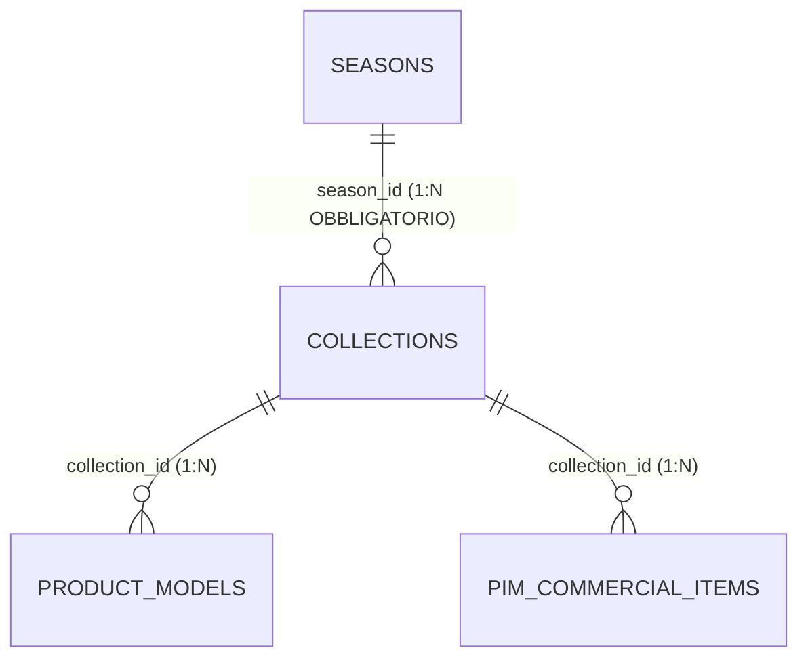
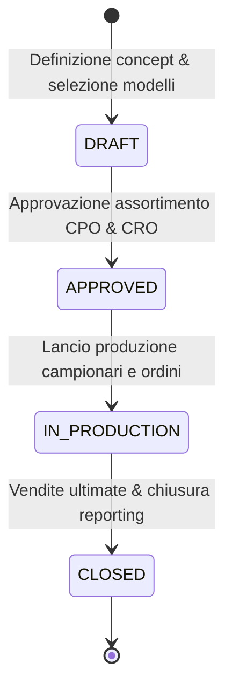

# Entità di Dominio: Collezioni (Collections)

> **Standard Ufficiale di Specificazione di Dominio Footlink — Living Specification**  
> Questa specifica definisce l'entità **Collezione di Merchandising** (`Collection`), il raggruppamento commerciale di stile, posizionamento e canale di vendita che articola una Stagione in insiemi coerenti di offerta al mercato (formalizzato in [ADR-007](../adr/ADR-007-flexible-data-model-seasons-collections-domain-registries.md) e [ADR-010](../adr/ADR-010-product-hierarchies-merchandising-classifiers-and-bom-cloning.md)).

---

## 1. Identità & Metadati Canonici

| Campo | Valore / Definizione |
| :--- | :--- |
| **Nome Entità (Singolare / Plurale)** | `Collezione` (`Collection`) / `Collezioni` (`Collections`) |
| **Sigla / Prefisso Codice** | `COL-` (es. `COL-MAIN-PE26`, `COL-RUNWAY-PE26`, `COL-CAPSULE-01`) |
| **Dominio Funzionale Primario** | Merchandising, Brand Strategy & Retail Assortment |
| **C-Level Owner Primario** | `CPO` (Chief Product Officer) & `CMO` (Chief Marketing Officer) |
| **C-Level Owner Commerciale** | `CRO` (Revenue, Canali di Vendita & Segmentazione Mercato) |
| **Stato di Governance** | `ATTIVA` (Ufficiale da Sprint 5) |
| **Ultima Revisione** | `2026-10-28` |
| **Task / ADR di Riferimento** | [`FTL-GOV-005`](../tasks/FTL-GOV-005.json), [`ADR-007`](../adr/ADR-007-flexible-data-model-seasons-collections-domain-registries.md), [`ADR-010`](../adr/ADR-010-product-hierarchies-merchandising-classifiers-and-bom-cloning.md) |

---

## 2. Definizione di Business & Scopo Operativo

### 2.1 Che cos'è nel mondo reale della moda e del lusso
All'interno di una medesima Stagione (es. *P/E 2026*), un brand calzaturiero o di moda non lancia i propri prodotti in modo indifferenziato: l'offerta viene suddivisa in **Collezioni distinte per vocazione di vendita e target di clientela**:
1. **Main Collection (Volume / Core):** Il cuore commerciale della produzione (calzature classiche, mocassini da lavoro, sneaker iconiche) destinato a tutti i negozi e rivenditori globali.
2. **Fashion Runway / Sfilata:** I modelli d'avanguardia stilistica presentati in passerella per creare il desiderio del brand (alta visibilità mediatica, volumi ridotti, margini elevati).
3. **Capsule Collection / Limited Edition Drop:** Serie numerate realizzate spesso in collaborazione con designer, artisti o influencer, con finestre di vendita fulminee (drop settimanali) e confezionamento dedicato.
4. **Resort / Cruise / Pre-Collection:** Collezioni ponte per anticipare le tendenze tra una stagione principale e l'altra.

### 2.2 Quale problema risolve e cosa previene
- **Segmenta i canali commerciali (B2B vs B2C D2C):** Consente di abilitare determinati modelli solo per i negozi monomarca (boutique dirette) escludendoli dal canale wholesale generalista, o viceversa.
- **Governa la piramide di collezione (Merchandising Mix):** Permette al CPO e al CRO di verificare che il catalogo sia bilanciato (es. 60% Core Volume, 25% Trend, 15% Capsule).
- **Traccia i budget di campionario per linea:** Evita che i costi di sviluppo dei modelli da sfilata vadano a erodere la marginalità delle linee continuative di maggior volume.

---

## 3. Cardinalità & Diagramma delle Relazioni (Mermaid)

### 3.1 Vincoli di Integrità Referenziale
- **Padre:** `SEASONS` con FK `season_id` obbligatoria. Una collezione appartiene sempre e soltanto a una singola stagione.
- **Figli:** `PIM_COMMERCIAL_ITEMS` referenziano `collection_id`. Un prodotto PIM appartiene a una specifica collezione all'interno della stagione.
- **Politica di Cancellazione:** `CASCADE` se la collezione non ha prodotti PIM collegati; `RESTRICT` se vi sono prodotti PIM assegnati.

---

## 4. Dizionario Dati & Attributi di Dominio

### 4.1 Attributi Obbligatori (Core)
| Nome Campo | Tipo Dato | Descrizione & Esempio | Vincoli & Validazione |
| :--- | :--- | :--- | :--- |
| `collection_id` | `VARCHAR(64)` | Identificativo univoco di sistema (es. `col_main_pe26_01`) | PK Univoca |
| `season_id` | `VARCHAR(64)` | FK della Stagione padre | Not Null, FK Indicizzata |
| `code` | `VARCHAR(64)` | Codice identificativo (es. `COL-MAIN-PE26`, `COL-CAPSULE-01`) | Not Null, Min 2 car, Unique per Stagione |
| `name` | `VARCHAR(255)` | Nome esteso (es. *Main Collection Uomo*, *Runway Limited Edition*) | Not Null, Min 2 car |
| `target_market` | `VARCHAR(128)` | Segmento di mercato / canale (es. *Global Luxury B2B*, *D2C Exclusive*) | Not Null |
| `status` | `ENUM` | `draft`, `approved`, `in_production`, `closed` | Default `draft` |
| `created_at` | `DATETIME` | Data e ora di creazione UTC | ISO-8601 |

### 4.2 Attributi Opzionali & Metadati
| Nome Campo | Tipo Dato | Descrizione & Esempio |
| :--- | :--- | :--- |
| `description` | `TEXT` | Obiettivi commerciali, target di clientela e note editoriali |
| `products_count` | `INTEGER` | Contatore dinamico dei prodotti PIM inclusi nella collezione |
| `budget_eur_l6` | `FLOAT` | Budget di spesa/sviluppo stanziato (**Riservato L6 Founder/CRO**) |

---

## 5. Ciclo di Vita & Macchina a Stati

### 5.1 Regole di Transizione
1. **Da `DRAFT` a `APPROVED`:** Richiede che tutti i prodotti PIM inclusi abbiano superato il *Data Quality Gate* minimo (> 70%) e che i prezzi all'ingrosso siano stati valorizzati.
2. **Da `APPROVED` a `IN_PRODUCTION`:** Convalida dell'ufficio commerciale per sbloccare l'emissione dei lanci di produzione verso le varianti PLM.

---

## 6. Regole di Business & Guardrail di Conformità

1. **Integrità Stagione/Collezione:** Non è ammesso collegare a un prodotto PIM una collezione la cui `season_id` differisce dalla `season_id` del prodotto stesso. Il sistema rifiuta la transazione con errore 400.
2. **Condivisione con Laboratori Terzisti:** Il nome della collezione può essere mostrato sulle bolle di lavorazione dei terzisti façonisti solo a fini logistici identificativi (es. *Cartellino Linea Main*), senza mai esporre i dati di budget o di fatturato (Compliance L6).

---

## 7. Mappatura Tecnica Applicativa

### 7.1 Backend (Python FastAPI)
- **Modelli Pydantic:** [`Applicativo/backend/app/models.py`](file:///Users/a.ciminaritodsgroup.com/Projects/FootLink_v2/Applicativo/backend/app/models.py)
  - `CollectionCreate`, `Collection`, `CollectionStatus` (`DRAFT`, `APPROVED`, `IN_PRODUCTION`, `CLOSED`)
- **Tabella Database:** `collections` (PostgreSQL / SQLite)
- **Endpoint API REST:** [`Applicativo/backend/app/main.py`](file:///Users/a.ciminaritodsgroup.com/Projects/FootLink_v2/Applicativo/backend/app/main.py)
  - `GET /api/v1/seasons/{season_id}/collections` — Lista collezioni per una stagione
  - `POST /api/v1/seasons/{season_id}/collections` — Creazione nuova collezione
  - `GET /api/v1/collections/{collection_id}` — Dettaglio collezione con elenco SKU
  - `PUT /api/v1/collections/{collection_id}` — Modifica parametri e transizione stato

### 7.2 Frontend (React SPA)
- **Componente di Gestione:** `SeasonsCollectionsManager.tsx` e selettore contestuale in `PimCatalogManager.tsx`.

---

## 8. Changelog & Registro Revisioni

| Data | Versione | Task / PR | Autore | Descrizione Sintetica |
| :--- | :--- | :--- | :--- | :--- |
| `2026-10-19` | `v1.0` | `FTL-GOV-005` / `ADR-007` | CTO & CPO | Definizione entità relazionale Collections |
| `2026-10-20` | `v1.1` | `FTL-PROD-010` / `ADR-010` | CPO & CMO | Integrazione con classificatori merceologici e piramide merchandising |
| `2026-10-28` | `v1.2` | Direttiva Founder | Founder & C-Suite | Formalizzazione living specification standard in `Azienda/entita/` |
