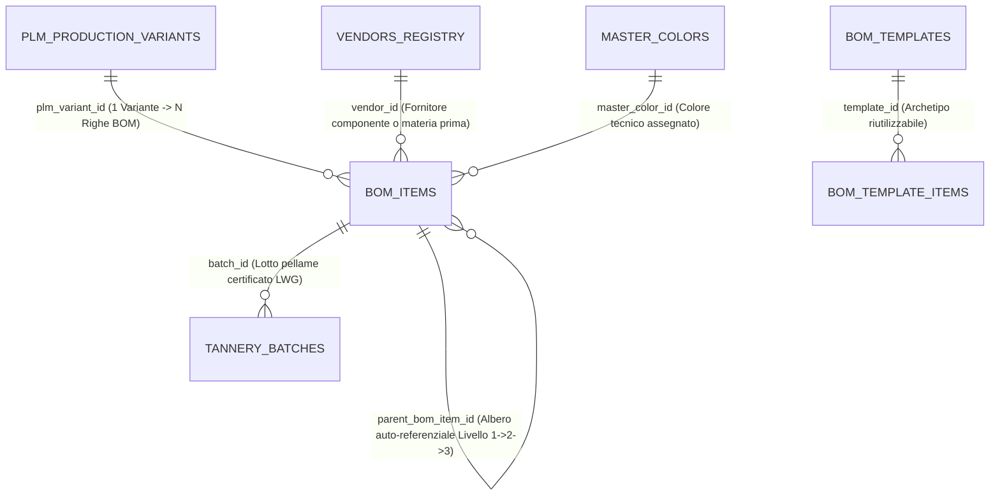
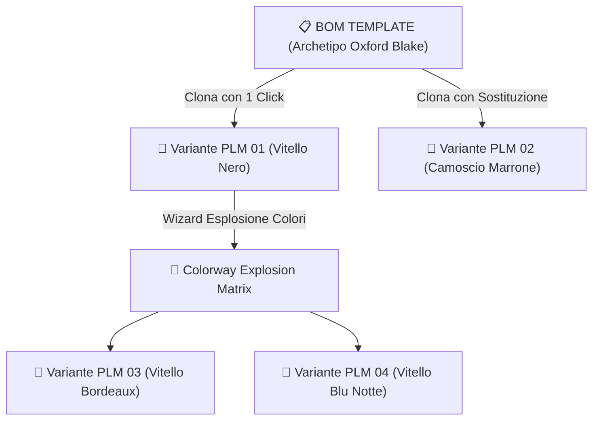

# Entità di Dominio: Distinte Basi (Bill of Materials — BOM)

> **Standard Ufficiale di Specificazione di Dominio Footlink — Living Specification**  
> Questa specifica definisce l'entità **Distinta Base Multi-Livello (BOM a 3 Livelli)** (`BomItem`), i **Template di Distinta Archetipica** (`BomTemplate`) e il **Motore di Esplosione Colori & Materiali** (`ColorwayBomMatrix`), il cuore ingegneristico che consente di fabbricare calzature e pelletterie di alta manifattura Made in Italy.

---

## 1. Identità & Metadati Canonici

| Campo | Valore / Definizione |
| :--- | :--- |
| **Nome Entità (Singolare / Plurale)** | `Riga Distinta Base` (`BomItem`) / `Distinte Basi` (`Bill of Materials` / `BOM`) |
| **Entità Correlata (Template)** | `Modello di Distinta Base` (`BomTemplate` — Archetipo riutilizzabile) |
| **Sigla / Prefisso Codici** | `BOM-` (es. `BOM-LINE-001`, `BOM-LINE-002`) • Template: `BOM-TPL-` |
| **Dominio Funzionale Primario** | PLM Industriale, Ingegneria di Modelleria & Costing di Fabbrica |
| **C-Level Owner Primario** | `CPO` (Chief Product Officer — Architettura Tecnica di Prodotto) |
| **C-Level Owner Tecnico** | `CTO` (Chief Technology Officer — Struttura ad Albero & Esplosione Ricorsiva) |
| **C-Level Owner FinOps & Costi** | `CRO` (Costo Industriale Unitario, Calcolo Fabbisogni & Segregazione L6) |
| **Stato di Governance** | `ATTIVA` (Fondamento tecnico di fabbrica da Sprint 1, evoluta in Sprint 8) |
| **Ultima Revisione** | `2026-10-28` |
| **Task / ADR di Riferimento** | [`ADR-003`](../adr/ADR-003-domain-model-1-to-n-pim-plm.md), [`ADR-008`](../adr/ADR-008-production-orders-tannery-traceability-subcontractor-lifecycle.md), [`ADR-010`](../adr/ADR-010-product-hierarchies-merchandising-classifiers-and-bom-cloning.md), [`PRD-001`](../docs/prd/PRD-001-mvp-pim-plm.md), [`PRD-009`](../docs/prd/PRD-009-sprint-8-verticalization-intelligent-color-and-vendor-hub.md) |

---

## 2. Definizione di Business & Scopo Operativo

### 2.1 La Complessità della Calzatura e Pelletteria Made in Italy
Una scarpa o una borsa di lusso non è un assemblaggio banale: è un manufatto composto da 30 a oltre 70 componenti elementari di natura eterogenea:
- **Pellami & Fodere:** Pellame nobile per la tomaia (vitello pieno fiore, camoscio, nappa), fodera interna traspirante, rinforzi sintetici o in tela salpa.
- **Struttura & Fondo:** Soletta di montaggio in cuoio con cambrione metallico d'acciaio, contrafforte tallone e puntale termoplastico, suola in gomma o cuoio con guardolo cucito a mano, tacco in cuoio rigenerato o ABS.
- **Minuterie & Accessori:** Occhielli in ottone trattato galvanico, cerniere lampo, lacci in cotone cerato, fibbie metalliche.
- **Confezionamento & Packaging:** Scatola rigida in cartone certificato FSC, sacchetto antipolvere (*dustbag*) in cotone biologico, etichetta bar-code e libretto di istruzioni circolare con QR code DPP.

### 2.2 La Struttura Gerarchica a 3 Livelli di Footlink
Per evitare distinte base piatte illeggibili da 80 righe disordinate, Footlink implementa una **BOM Gerarchica a 3 Livelli**:
1. **Livello 1 — Macro-Gruppo Funzionale:** Raggruppa le macro-sezioni anatomiche della calzatura (*Tomaia, Fodera, Fondo/Suola, Minuterie, Packaging*).
2. **Livello 2 — Sotto-Gruppo / Componente Tecnico:** Il pezzo specifico ingegnerizzato dai modellisti (*Mascherina, Gambetti, Linguetta, Sottopiede di montaggio, Battistrada, Guardolo*).
3. **Livello 3 — Materiale Elementare / Materia Prima di Filiera:** L'effettiva materia prima impiegata, con il suo fornitore o conceria assegnata (*Vitello Pieno Fiore Conceria del Chienti*, *Gomma Naturale Vibram*, *Filo Cucirini Tre Stelle*), il consumo unitario per paio, la percentuale di scarto di taglio e il costo unitario.

---

## 3. Cardinalità & Diagramma delle Relazioni (Mermaid)

### 3.1 Vincoli di Integrità Referenziale
- **Appartenenza:** Ogni riga BOM appartiene obbligatoriamente a una `PlmProductionVariant` (`plm_variant_id` Not Null).
- **Gerarchia Ricorsiva:**
  - Se `level == 1`, `parent_bom_item_id` è `NULL`.
  - Se `level > 1`, `parent_bom_item_id` deve referenziare un `BomItem` esistente appartenente alla **stessa** variante PLM con `level == (this.level - 1)`.
- **Politica di Cancellazione:** `CASCADE`. L'eliminazione di un nodo di Livello 1 elimina a cascata tutti i suoi sotto-componenti di Livello 2 e i materiali di Livello 3.

---

## 4. Dizionario Dati & Attributi di Dominio

### 4.1 Attributi di Riga Distinta Base (`BomItem`)
| Nome Campo | Tipo Dato | Descrizione & Esempio | Vincoli & Validazione |
| :--- | :--- | :--- | :--- |
| `bom_item_id` | `VARCHAR(64)` | Identificativo univoco di riga distinta (es. `bom_line_82a1`) | PK Univoca |
| `level` | `INTEGER` | Livello di profondità nell'albero gerarchico | `1`, `2` o `3` |
| `parent_bom_item_id`| `VARCHAR(64)` | ID del nodo genitore (obbligatorio se `level > 1`) | FK verso `bom_items` |
| `component_type` | `ENUM` | Tipo componente (`upper_leather`, `lining`, `insole`, `outsole`, `hardware`, `packaging`, `reinforcement`) | Not Null |
| `material_name` | `VARCHAR(255)` | Denominazione del materiale (es. *Vitello pieno fiore conciato al vegetale*) | Not Null, Min 2 car |
| `supplier_name` | `VARCHAR(255)` | Ragione sociale del fornitore/conceria | Testuale leggibile |
| `vendor_id` | `VARCHAR(64)` | FK verso l'anagrafica certificata fornitore (`vendors_registry`) | Da Sprint 8 |
| `master_color_id` | `VARCHAR(64)` | FK verso il colore master di cartella (`master_colors`) | Da Sprint 8 |
| `origin_country_iso2`| `VARCHAR(2)` | Nazione di origine del materiale (es. `IT`, `FR`, `DE`) | ISO 3166-1 alpha-2 |
| `unit_of_measure` | `VARCHAR(32)` | Unità di misura (es. `sqft`, `m2`, `dm2`, `pair`, `pcs`, `meter`, `kg`) | Not Null |
| `unit_consumption` | `FLOAT` | Consumo netto per paio / unità finita (es. `1.85` mq o `1` paio) | $> 0.0$ |
| `waste_percentage` | `FLOAT` | Percentuale di scarto fisiologico di taglio (es. `8.0`%) | Range $0.0$ – $100.0$% |
| `recycled_content_pct`| `FLOAT` | Quota di materiale riciclato certificato (per calcolo DPP ESPR) | Range $0.0$ – $100.0$% |
| `unit_cost_eur` | `FLOAT` | Costo unitario di acquisto materia prima | **STRETTAMENTE RISERVATO L6** |
| `total_cost_eur` | `FLOAT` | Costo esteso calcolato: `unit_consumption * (1 + waste/100) * unit_cost` | **STRETTAMENTE RISERVATO L6** |
| `certification_ref` | `VARCHAR(128)` | Sigla certificazione ambientale (es. `LWG Gold Cert #882`, `GRS`, `FSC`) | Rilevante DPP |
| `espr_compliance_flag`| `BOOLEAN` | Conformità ai requisiti europei di eco-design e sostanze vietate | Default `true` |

---

## 5. Motore di Template & Clonazione Atomica

### 5.1 Archetipi Costruttivi (`BomTemplate`)
Footlink consente di salvare una BOM collaudata come **Template Archetipico** (es. *Sneaker Cassetta Cucita*, *Mocassino Tubolare da Guida*, *Stivaletto Goodyear con Guardolo*):
- Quando un modellista apre un nuovo modello, applica il template in 2 secondi.
- Tutti i 40 nodi di struttura (fodere, contrafforti, solette, colle a base d'acqua) vengono generati automaticamente, lasciando all'operatore solo la selezione del pellame di tomaia e del colore.
- **Riduzione del Data Entry:** Riduce i tempi di creazione scheda tecnica da oltre 45 minuti a **meno di 90 secondi** (-96% di effort).

---

## 6. Regole di Business & Guardrail di Conformità

### 6.1 Regola L6 — Segregazione Assoluta dei Costi BOM ai Terzisti a 0 €
I campi `unit_cost_eur` e `total_cost_eur` sono soggetti al massimo livello di protezione:
- Vengono **azzerati o rimossi dal payload JSON** prima che qualsiasi vista o endpoint API venga esposta ai laboratori terzisti façonisti (`subcontractor_zero_eur`).
- Il terzista riceve la distinta di montaggio con consumi, materiali e codici colore per il taglio, ma **non conosce mai il costo di acquisto del pellame né il costo complessivo di assemblaggio**.

### 6.2 Calcolo Fabbisogni per Scala Taglie (Sviluppo Taglie)
Il consumo di tomaia (`sqft` o `dm2`) non è identico tra una taglia 39 e una taglia 46:
- Footlink integra il calcolo automatico dello sviluppo taglie con coefficienti incrementali percentuali (+3.5% per punto francese calzatura) per emettere gli ordini d'acquisto pellami alle concerie senza sfridi o ammanchi di magazzino.

---

## 7. Mappatura Tecnica Applicativa

### 7.1 Backend (Python FastAPI)
- **Modelli Pydantic:** [`Applicativo/backend/app/models.py`](file:///Users/a.ciminaritodsgroup.com/Projects/FootLink_v2/Applicativo/backend/app/models.py)
  - `BomItem`, `BomTreeNode`, `BomHierarchySummary`, `BomTemplate`, `BomTemplateCreate`, `BomItemMoveRequest`, `ColorwayBomMappingRow`, `BomRequirementsCalculationRequest`
- **Tabelle Database:** `bom_items`, `bom_templates`, `bom_template_items`, `colorway_bom_mappings`
- **Endpoint API REST:** [`Applicativo/backend/app/main.py`](file:///Users/a.ciminaritodsgroup.com/Projects/FootLink_v2/Applicativo/backend/app/main.py)
  - `GET /api/v1/plm/variants/{variant_id}/bom` — Albero gerarchico a 3 livelli con totali
  - `POST /api/v1/plm/variants/{variant_id}/bom/items` — Aggiunta riga distinta
  - `PUT /api/v1/plm/variants/{variant_id}/bom/items/{item_id}` — Modifica consumo o fornitore
  - `DELETE /api/v1/plm/variants/{variant_id}/bom/items/{item_id}` — Rimozione con cascade
  - `POST /api/v1/plm/variants/{variant_id}/bom/templates` — Estrazione nuovo template da variante
  - `POST /api/v1/plm/variants/{variant_id}/bom/calculate_requirements` — Calcolo fabbisogni per ordine

### 7.2 Frontend (React SPA)
- **Componenti:** `PlmProductsManager.tsx` (BOM Tree a 3 livelli, drag-and-drop nodi, indicatori di certificazione LWG) e `ColorwayMatrixModal.tsx` (Matrice di declinazione colore).

---

## 8. Changelog & Registro Revisioni

| Data | Versione | Task / PR | Autore | Descrizione Sintetica |
| :--- | :--- | :--- | :--- | :--- |
| `2026-10-18` | `v1.0` | `FTL-TECH-001` / `ADR-003` | CTO & CPO | Architettura iniziale della distinta base a 3 livelli |
| `2026-10-20` | `v1.1` | `FTL-TECH-012` / `ADR-010` | CTO & CPO | Introduzione BomTemplate, Deep Clone e calcolo fabbisogni taglie |
| `2026-10-26` | `v1.2` | `FTL-PROD-012` / `ADR-011` | CPO & CTO | Colorway Explosion Wizard e integrazione master colors Sprint 8 |
| `2026-10-28` | `v1.3` | Direttiva Founder | Founder & C-Suite | Formalizzazione living specification standard in `Azienda/entita/` |
