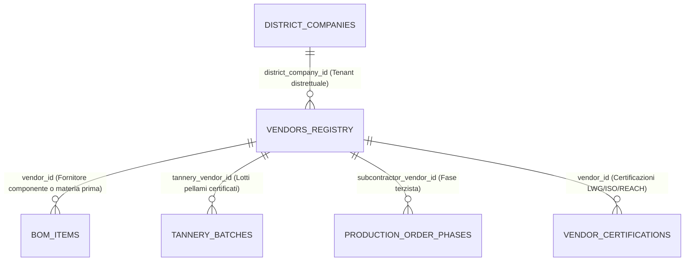
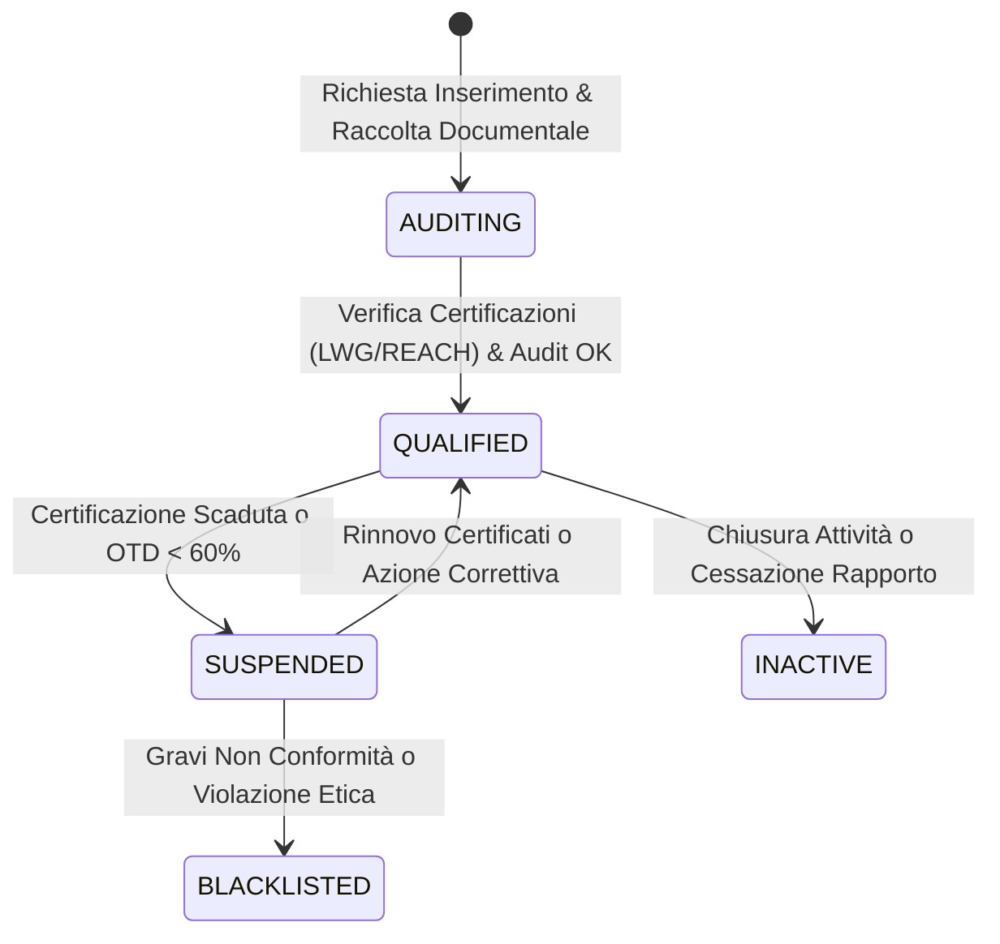

# Entità di Dominio: Fornitori & Vendor Hub (Suppliers, Tanneries, Subcontractors)

> **Standard Ufficiale di Specificazione di Dominio Footlink — Living Specification**  
> Questa specifica formalizza l'entità **Fornitore di Filiera** (`VendorRecord`), che unifica in un'unica cabina di regia a 360° (**Vendor Hub**) le concerie, i produttori di materie prime, i suolifici, i minutieri e i **laboratori terzisti façonisti gratuiti a 0 €** del distretto manifatturiero (formalizzato in [ADR-004](../adr/ADR-004-network-pricing-and-finops.md), [ADR-008](../adr/ADR-008-production-orders-tannery-traceability-subcontractor-lifecycle.md), [ADR-011](../adr/ADR-011-epoch-2-verticalization-governance-and-modular-depth.md) e [PRD-009](../docs/prd/PRD-009-sprint-8-verticalization-intelligent-color-and-vendor-hub.md)).

---

## 1. Identità & Metadati Canonici

| Campo | Valore / Definizione |
| :--- | :--- |
| **Nome Entità (Singolare / Plurale)** | `Fornitore` (`Vendor` / `Supplier`) / `Fornitori` (`Vendors` / `Vendor Hub`) |
| **Sigla / Prefisso Codici** | `VND-` (es. `VND-TAN-CHIENTI-01`, `VND-SUB-MONTEGRANARO-02`, `VND-ACC-RIVIERA-03`) |
| **Dominio Funzionale Primario** | Supply Chain Distrettuale, Vendor Hub 360°, Tracciabilità & Conformità L6 |
| **C-Level Owner Primario** | `CRO` (Chief Revenue Officer — Pricing Network & Condizioni Commerciali) |
| **C-Level Owner Operativo** | `CPO` (Qualifica Fornitori, Performance OTD & Conformità Materiali) |
| **C-Level Owner Dati & Sicurezza**| `CTO` & `CGO` (Segregazione Multi-Tenant L6 & Sicurezza Dati Terzisti a 0 €) |
| **Stato di Governance** | `ATTIVA` (Ufficiale da Sprint 6, integrata nel Vendor Hub 360° in Sprint 8) |
| **Ultima Revisione** | `2026-10-28` |
| **Task / ADR di Riferimento** | [`ADR-004`](../adr/ADR-004-network-pricing-and-finops.md), [`ADR-008`](../adr/ADR-008-production-orders-tannery-traceability-subcontractor-lifecycle.md), [`ADR-011`](../adr/ADR-011-epoch-2-verticalization-governance-and-modular-depth.md), [`PRD-009`](../docs/prd/PRD-009-sprint-8-verticalization-intelligent-color-and-vendor-hub.md), [`FTL-REV-007`](../tasks/FTL-REV-007.json) |

---

## 2. Definizione di Business & Scopo Operativo

### 2.1 La Filiera Distrettuale Made in Italy
La produzione di calzature e pelletterie nel lusso non avviene all'interno di un'unica fabbrica chiusa, ma è orchestrata all'interno di un **distretto manifatturiero a rete** (Fermo-Macerata, Riviera del Brenta, Scandicci, San Mauro Pascoli).  
In Footlink, l'entità Fornitore abbraccia tre macro-tipologie operative distinte per vocazione di business e profilo di sicurezza:

1. **Concerie & Produttori Materie Prime (`tannery` / `raw_material`):**
   - Forniscono i pellami nobili, i tessuti e i fondi.
   - Sono vincolate al modulo **Tannery Vault**: registrazione lotti pellame, certificazioni ambientali (`LWG Gold/Silver/Bronze`), dichiarazioni di conformità chimica `REACH` e tracciabilità del paese di macellazione/allevamento per il Passaporto Digitale UE (DPP).
2. **Laboratori Terzisti Façonisti (`subcontractor` / `assembly_lab`):**
   - Eseguono specifiche fasi di lavorazione per conto del brand o calzaturificio (es. *taglio manuale o CAD, giunteria e cucitura tomaia, montaggio su forma, finissaggio, scatolatura*).
   - Accedono alla piattaforma tramite il modello virale **"Terzista a 0 €"** (nessun costo SaaS, licenza gratuita), visualizzando esclusivamente le schede tecniche dei lotti a loro affidati con interfaccia semplificata a 3 click.
3. **Fornitori Accessori & Componenti (`components` / `packaging`):**
   - Forniscono fibbie, bottoni, cerniere lampo, suole in gomma o cuoio, scatole e sacchetti antipolvere.

### 2.2 Quale problema risolve e cosa previene
- **Analisi di Impatto a 360° ("Where-Used Impact"):** Se un fornitore o una conceria subisce un ritardo grave, ritira una partita di pellame o vede scadere una certificazione ambientale, il sistema individua istantaneamente con un click tutti i modelli PIM, le varianti PLM, le righe BOM e gli ordini di produzione a rischio (*Vendor Where-Used Impact Drawer*).
- **Risolve la conformità ESPR / DPP a monte:** Impedisce che vengano chiusi ordini di produzione se il fornitore dei materiali non possiede certificazioni chimiche o ambientali valide e non scadute.
- **Protegge la proprietà industriale:** Segrega ermeticamente i costi orari, i listini negoziati e le note di audit interno del fornitore (Regola L6).

---

## 3. Cardinalità & Diagramma delle Relazioni (Mermaid)

### 3.1 Vincoli di Integrità Referenziale
- **Tenant Distrettuale:** Il fornitore può essere collegato tramite `district_company_id` all'anagrafica aziendale del network distrettuale, consentendo l'auto-riconoscimento via Partita IVA.
- **Politica di Cancellazione:** `RESTRICT`. Non è consentito cancellare un fornitore che compare in righe BOM attive o in ordini di produzione storici. Si procede invece con la disattivazione (`is_active: false`) o la qualifica a `suspended`.

---

## 4. Dizionario Dati & Attributi di Dominio

### 4.1 Attributi Anagrafici & Operativi (`VendorRecord`)
| Nome Campo | Tipo Dato | Descrizione & Esempio | Vincoli & Validazione |
| :--- | :--- | :--- | :--- |
| `vendor_id` | `VARCHAR(64)` | Identificativo univoco di sistema (es. `vnd_chienti_01`) | PK Univoca |
| `vendor_code` | `VARCHAR(64)` | Codice fornitore aziendale (es. `VND-TAN-001`) | Not Null, Min 2 car, Unique |
| `company_name` | `VARCHAR(255)` | Ragione sociale completa (es. *Conceria del Chienti S.p.A.*) | Not Null, Min 2 car |
| `vat_number` | `VARCHAR(32)` | Partita IVA / Tax ID (es. `IT01234567890`) | Not Null |
| `supply_chain_role`| `ENUM` | `tannery`, `subcontractor`, `components`, `packaging`, `raw_material` | Ruolo nella filiera |
| `district_area` | `VARCHAR(128)` | Distretto geografico (es. *Fermo-Macerata*, *Riviera del Brenta*, *Scandicci*) | Not Null |
| `city_address` | `VARCHAR(255)` | Sede operativa e stabilimento produttivo | Indirizzo completo |
| `country_iso2` | `VARCHAR(2)` | Nazione sede legale (es. `IT`, `FR`, `DE`) | ISO 3166-1 alpha-2 |
| `paas_tier` | `ENUM` | `brand_tenant` (€59/mese), `subcontractor_zero_eur` (€0/mese) | Da `ADR-004` |
| `qualification_status`| `ENUM` | `qualified`, `auditing`, `suspended`, `blacklisted` | Stato qualifica |
| `quality_score` | `FLOAT` | Punteggio qualità conformità forniture (0.0 – 100.0%) | Rating interno |
| `otd_score` | `FLOAT` | Punteggio On-Time Delivery puntualità consegne (0.0 – 100.0%) | Rating logistico |
| `esg_score` | `FLOAT` | Punteggio sostenibilità ambientale e sociale (0.0 – 100.0%) | Rating ESG |
| `standard_lead_time_days`| `INTEGER` | Giorni lavorativi standard di approvvigionamento | $\ge 0$ |
| `moq_description` | `VARCHAR(128)` | Lotto minimo d'ordine (Min Order Quantity, es. *50 mq*, *100 paia*) | Testuale |
| `is_active` | `BOOLEAN` | Stato operativo | Default `true` |
| `created_at` | `DATETIME` | Data e ora di creazione UTC | ISO-8601 |

### 4.2 Campi Riservati FinOps & Compliance L6 (Strettamente Protetti)
| Nome Campo | Tipo Dato | Descrizione Funzionale | Livello di Accesso |
| :--- | :--- | :--- | :--- |
| `payment_terms_l6` | `VARCHAR(128)` | Condizioni di pagamento negoziate (es. *Ri.Ba. 90 gg d.f.f.m.*) | **Solo Founder & CRO (L6)** |
| `hourly_or_unit_rate_eur_l6` | `FLOAT` | Tariffa oraria o a paio negoziata (€/h o €/paio) | **Solo Founder & CRO (L6)** |
| `negotiated_price_list_l6` | `JSONB` | Listino prezzi riservato per materiale o codice fase | **Solo Founder & CRO (L6)** |
| `internal_audit_notes_l6` | `TEXT` | Note riservate di audit ispettivo, difettosità e affidabilità | **Solo Founder & CRO (L6)** |

---

## 5. Ciclo di Vita & Macchina a Stati

---

## 6. Regole di Business & Guardrail di Conformità

### 6.1 Regola L6 — Segregazione Finanziaria Fornitore/Terzista
- I laboratori terzisti (`subcontractor_zero_eur`) autenticati sulla piattaforma non possono in alcun caso accedere ai campi contrassegnati con suffisso `_l6` di altri fornitori o terzisti concorrenti nel medesimo distretto.
- La violazione della segregazione L6 comporterebbe responsabilità contrattuali gravi e violazione della confidenzialità industriale.

### 6.2 Guardrail di Validazione BOM per Certificazioni Scadute
- Il sistema esegue un controllo automatico di conformità: se un fornitore ha certificazioni ambientali (`LWG`, `FSC`, `GRS`) scadute da più di 15 giorni e lo stato di qualifica è `suspended`, la piattaforma impedisce l'approvazione finale della distinta base e notifica il CPO.

---

## 7. Mappatura Tecnica Applicativa

### 7.1 Backend (Python FastAPI)
- **Modelli Pydantic:** [`Applicativo/backend/app/models.py`](file:///Users/a.ciminaritodsgroup.com/Projects/FootLink_v2/Applicativo/backend/app/models.py)
  - `VendorRecord`, `VendorCreate`, `VendorUpdate`, `VendorCertification`, `VendorWhereUsedResponse`, `VendorImpactSummary`, `VendorFinancialExposureL6`
- **Tabelle Database:** `vendors_registry`, `vendor_certifications`, `tannery_batches`
- **Endpoint API REST:** [`Applicativo/backend/app/main.py`](file:///Users/a.ciminaritodsgroup.com/Projects/FootLink_v2/Applicativo/backend/app/main.py)
  - `GET /api/v1/vendors/` — Lista anagrafica fornitori con filtri per ruolo e distretto
  - `POST /api/v1/vendors/` — Registrazione nuovo fornitore
  - `GET /api/v1/vendors/{vendor_id}` — Dettaglio completo 360°
  - `PUT /api/v1/vendors/{vendor_id}` — Aggiornamento parametri
  - `GET /api/v1/vendors/{vendor_id}/where_used` — Analisi impatto su modelli PIM, varianti PLM e BOM
  - `POST /api/v1/vendors/{vendor_id}/certifications` — Aggiunta certificazione ambientale

### 7.2 Frontend (React SPA)
- **Componenti:** `VendorHubManager.tsx` (Pannello 360° Fornitori, rating OTD/ESG, Where-Used Drawer) e `SubcontractorPortal.tsx` (Portale mobile-friendly terzisti façonisti a 0 €).

---

## 8. Changelog & Registro Revisioni

| Data | Versione | Task / PR | Autore | Descrizione Sintetica |
| :--- | :--- | :--- | :--- | :--- |
| `2026-10-19` | `v1.0` | `FTL-REV-001` / `ADR-004` | CRO & CTO | Modello Ruolo Terzisti 0 € e anagrafica laboratori |
| `2026-10-26` | `v1.1` | `FTL-REV-007` / `ADR-011` | CRO & CPO | Architettura Vendor Hub 360°, Where-Used Impact e segregazione L6 |
| `2026-10-28` | `v1.2` | Direttiva Founder | Founder & C-Suite | Formalizzazione living specification standard in `Azienda/entita/` |
