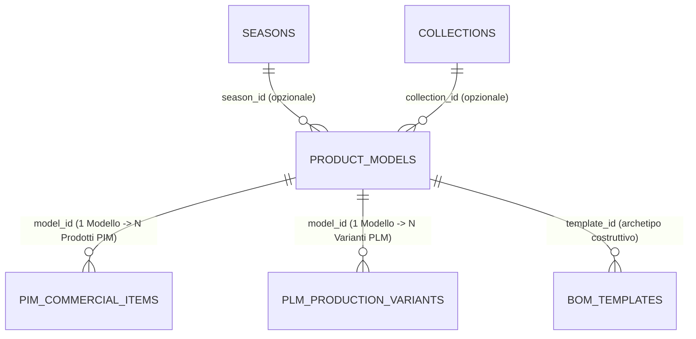
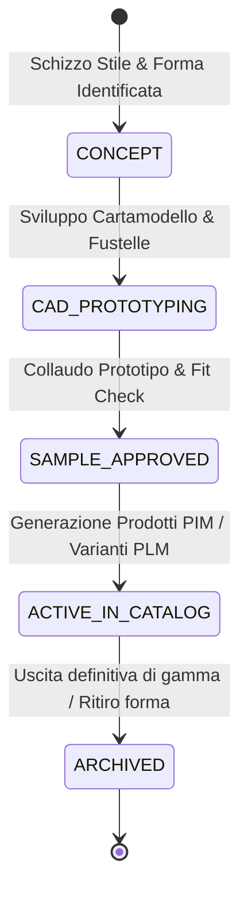

# Entità di Dominio: Modelli (Product Models)

> **Standard Ufficiale di Specificazione di Dominio Footlink — Living Specification**  
> Questa specifica definisce l'entità **Modello di Stile / Calzatura / Pelletteria** (`ProductModel`), l'archetipo formale e geometrico che governa la genesi di ogni collezione prima della declinazione in materiali, colori e varianti industriali.

---

## 1. Identità & Metadati Canonici

| Campo | Valore / Definizione |
| :--- | :--- |
| **Nome Entità (Singolare / Plurale)** | `Modello` (`Product Model`) / `Modelli` (`Product Models`) |
| **Sigla / Prefisso Codice** | `MOD-` (es. `MOD-OXFORD-01`, `MOD-DERBY-02`, `MOD-SNEAKER-03`) |
| **Dominio Funzionale Primario** | PLM Industriale & Ufficio Stile / Modelleria |
| **C-Level Owner Primario** | `CPO` (Chief Product Officer — Design, Vestibilità & Fit di Gamma) |
| **C-Level Owner Tecnico** | `CTO` (Chief Technology Officer — Modello Relazionale & Query Gerarchiche) |
| **Stato di Governance** | `ATTIVA` (Ufficiale in Sprint 7 / Epoca II) |
| **Ultima Revisione** | `2026-10-28` |
| **Task / ADR di Riferimento** | [`FTL-CEO-021`](../tasks/FTL-CEO-021.json), [`ADR-010`](../adr/ADR-010-product-hierarchies-merchandising-classifiers-and-bom-cloning.md) |

---

## 2. Definizione di Business & Scopo Operativo

### 2.1 Che cos'è nel mondo reale manifatturiero (Made in Italy)
Nei calzaturifici e nei laboratori di pelletteria di eccellenza (distretti di Fermo, Civitanova Marche, Riviera del Brenta, Scandicci), il **Modello** rappresenta la concezione geometrica e stilistica pura di un prodotto:
1. **La Forma (Last):** Il solido geometrico su cui la calzatura viene sagomata e montata (definisce calzata, proporzioni del collo piede, punta tonda o affusolata).
2. **La Tipologia di Costruzione:** Il metodo artigianale o industriale di unione tra tomaia, sottopiede e suola (es. *Blake, Goodyear, Ago, Tubolare, Strobel, Vulcanizzata*).
3. **Le Linee di Taglio & CAD:** Il disegno tecnico 2D/3D da cui si ricavano i cartamodelli e le fustelle per il taglio.
4. **Altezza Tacco / Fondo:** Parametro strutturale millimetrico che vincola la postura della cambratura.

Un Modello non ha ancora un colore commerciale definitivo (non è "blu notte" o "nero lucido") e non ha ancora un pellame assegnato: è la **matrice di stile e ingegneria** da cui gemmeranno decine di articoli commerciali PIM e distinte basi PLM.

### 2.2 Quale problema risolve e cosa previene
- **Previene la proliferazione caotica di schede tecniche duplicate:** Se un brand produce una sneaker in 12 colorazioni diverse, senza l'entità Modello i modellisti ricopiano 12 volte la forma, la curva tacco e il cartamodello CAD.
- **Risolve l'analisi delle performance di vestibilità (Fit & Return Rate):** Se i resi e-commerce aumentano per problemi di calzata, l'analisi aggregata per `model_id` individua immediatamente se il difetto risiede nella forma o nella costruzione, a prescindere dal pellame o colore venduto.
- **Abilita la clonazione BOM intelligente:** Permette di istanziare un'intera cartella colori applicando il medesimo pattern su materiali diversi con 1 click.

---

## 3. Cardinalità & Diagramma delle Relazioni (Mermaid)

### 3.1 Vincoli di Integrità Referenziale
- **Padre:** Un Modello può essere associato a una `Stagione` e/o a una `Collezione`, ma può anche esistere come **Modello Continuativo / Heritage** permanente trasversale agli anni.
- **Figli:** `PIM_COMMERCIAL_ITEMS` (articoli vendibili) e `PLM_PRODUCTION_VARIANTS` (varianti industriali) mantengono una foreign key `model_id` indicizzata.
- **Politica di Cancellazione:** `RESTRICT`. Non è consentito eliminare un Modello se vi sono Prodotti PIM o Varianti PLM attive ad esso collegate.

---

## 4. Dizionario Dati & Attributi di Dominio

### 4.1 Attributi Obbligatori (Core)
| Nome Campo | Tipo Dato | Descrizione & Esempio | Vincoli & Validazione |
| :--- | :--- | :--- | :--- |
| `model_id` | `VARCHAR(64)` | Identificativo univoco di sistema (es. `mod_89f02d41`) | PK Univoca |
| `model_code` | `VARCHAR(64)` | Codice modello naturale (es. `MOD-OXFORD-01`) | Not Null, Min 2 car, Unique |
| `name` | `VARCHAR(255)` | Nome descrittivo dello stile (es. *Oxford Classic Cap-Toe*) | Not Null, Min 2 car |
| `category` | `ENUM` | Macro-settore merceologico (`footwear`, `leather_goods`, `apparel`) | Not Null, Default `footwear` |
| `target_gender` | `VARCHAR(32)` | Genere target (`men`, `women`, `unisex`, `kids`) | Not Null, Default `unisex` |
| `last_code` | `VARCHAR(64)` | Codice / nome della forma di modelleria (es. *Forma Firenze 202*) | Not Null |
| `sole_construction`| `VARCHAR(64)` | Metodo costruttivo (es. *Blake, Goodyear, Strobel, Cassetta*) | Not Null, Default `Blake` |
| `heel_height_mm` | `FLOAT` | Altezza del fondo o tacco in millimetri (es. `25.0`) | $\ge 0.0$ |
| `default_size_range`| `VARCHAR(64)`| Scala taglie predefinita (es. `39-46`, `35-41`) | Not Null |
| `is_active` | `BOOLEAN` | Stato di disponibilità per l'ufficio stile | Default `true` |
| `created_at` | `DATETIME` | Data e ora di creazione UTC | ISO-8601 |

### 4.2 Attributi Opzionali & Documentazione Tecnica
| Nome Campo | Tipo Dato | Descrizione & Esempio |
| :--- | :--- | :--- |
| `season_id` | `VARCHAR(64)` | FK opzionale verso la Stagione di prima introduzione |
| `collection_id` | `VARCHAR(64)` | FK opzionale verso la Collezione di lancio |
| `description` | `TEXT` | Note editoriali, ispirazione di stile e dettagli costruttivi |
| `cad_drawing_ref` | `VARCHAR(255)` | Riferimento al disegno tecnico CAD (file DXF, PDF modelleria) |
| `metadata` | `JSONB` | Dizionario dinamico per attributi specifici di distretto |

---

## 5. Ciclo di Vita & Macchina a Stati

### 5.1 Regole di Transizione
1. **Da `CONCEPT` a `CAD_PROTOTYPING`:** Richiede l'inserimento del codice forma (`last_code`) e della costruzione suola.
2. **Da `SAMPLE_APPROVED` a `ACTIVE_IN_CATALOG`:** Abilita l'ufficio commerciale e i product manager a istanziare gli articoli vendibili PIM collegati.

---

## 6. Regole di Business & Guardrail di Conformità

1. **Integrità Geometrica di Forma:** Se un modello cambia forma (`last_code`), non deve essere sovrascritto: deve essere generata una revisione o un nuovo modello, altrimenti le schede di calzata storiche per il DPP risulterebbero corrotte.
2. **Eredità nei Prodotti PIM:** Quando un prodotto commerciale PIM viene collegato a un modello, eredita automaticamente:
   - Genere target (`target_gender`)
   - Costruzione della suola (`sole_construction`)
   - Altezza fondo (`heel_height_mm`)
   - Istruzioni di riparabilità base per il Passaporto Digitale UE (DPP).

---

## 7. Mappatura Tecnica Applicativa

### 7.1 Backend (Python FastAPI)
- **Modelli Pydantic:** [`Applicativo/backend/app/models.py`](file:///Users/a.ciminaritodsgroup.com/Projects/FootLink_v2/Applicativo/backend/app/models.py)
  - `ProductModelCreate`, `ProductModelUpdate`, `ProductModel`, `ProductModelWithProducts`, `AttachProductRequest`, `DetachProductRequest`
- **Tabella Database:** `product_models` (PostgreSQL / SQLite)
- **Endpoint API REST:** [`Applicativo/backend/app/main.py`](file:///Users/a.ciminaritodsgroup.com/Projects/FootLink_v2/Applicativo/backend/app/main.py)
  - `GET /api/v1/models/` — Lista con conteggio prodotti/varianti allegati
  - `POST /api/v1/models/` — Creazione nuovo modello di stile
  - `GET /api/v1/models/{model_id}` — Scheda di dettaglio completa
  - `PUT /api/v1/models/{model_id}` — Modifica parametri tecnici
  - `POST /api/v1/models/{model_id}/attach_product` — Assegnazione SKU commerciale
  - `POST /api/v1/models/{model_id}/detach_product` — Dissociazione SKU

### 7.2 Frontend (React SPA)
- **Componente di Gestione:** Modulo Modelli all'interno di `PlmProductsManager.tsx` e `PimCatalogManager.tsx`.
- **Visualizzazione nel Founder Control Center:** Consultabile e modificabile in tempo reale nell'area **Entità di Dominio** (`Azienda/entita/MODELLI.md`).

---

## 8. Changelog & Registro Revisioni

| Data | Versione | Task / PR | Autore | Descrizione Sintetica |
| :--- | :--- | :--- | :--- | :--- |
| `2026-10-20` | `v1.0` | `FTL-CEO-021` | CPO & CTO | Creazione architettura Modelli gerarchici 1 Modello ↔ N PIM/PLM |
| `2026-10-28` | `v1.1` | Direttiva Founder | Founder & C-Suite | Formalizzazione living specification standard in `Azienda/entita/` |
