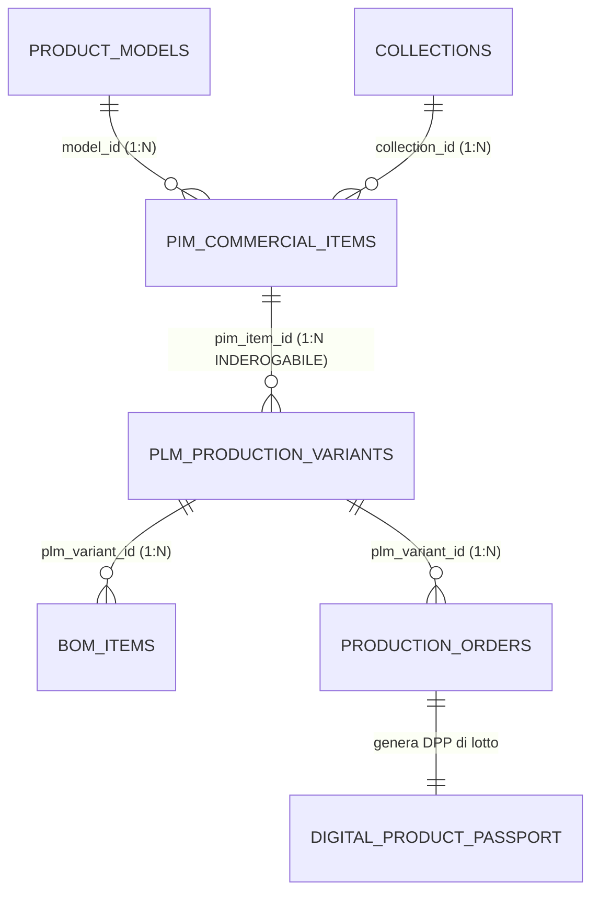
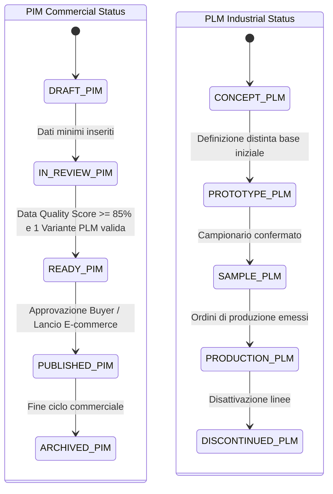

# Entità di Dominio: Prodotti (PIM Commercial Items & PLM Production Variants)

> **Standard Ufficiale di Specificazione di Dominio Footlink — Living Specification**  
> Questa specifica formalizza il pilastro architetturale fondativo di Footlink: il **Ponte di Cardinalità `1 Articolo PIM (Vendita / Commerciale) ↔ N Varianti PLM (Produzione / Industriale)`** (approvato in [ADR-003](../adr/ADR-003-domain-model-1-to-n-pim-plm.md)).

---

## 1. Identità & Metadati Canonici

| Campo | Valore / Definizione |
| :--- | :--- |
| **Nome Entità (Commerciale / PIM)** | `Articolo Commerciale PIM` (`PimCommercialItem` / SKU Catalogo) |
| **Nome Entità (Industriale / PLM)** | `Variante di Produzione PLM` (`PlmProductionVariant` / Esecuzione di Fabbrica) |
| **Sigla / Prefisso Codici** | PIM: `PIM-` (es. `PIM-SNEAKER-001`) • PLM: `PLM-` (es. `PLM-SNK-001-A`, `PLM-SNK-001-B`) |
| **Dominio Funzionale Primario** | Integrazione B2B Commerciale (PIM) ↔ Ingegneria di Fabbrica (PLM) |
| **C-Level Owner Primario** | `CPO` (Chief Product Officer — Architettura di Prodotto & Ponte 1:N) |
| **C-Level Owner Vendite** | `CMO` & `CRO` (Prezzi B2B/B2C, Canali Retail, Syndication Feed) |
| **C-Level Owner Manifattura**| `CTO` & Direzione Produzione (Distinta Base, Cicli Tecnici, Terzisti) |
| **Stato di Governance** | `ATTIVA` (Pietra miliare dell'intero sistema Footlink) |
| **Ultima Revisione** | `2026-10-28` |
| **Task / ADR di Riferimento** | [`ADR-003`](../adr/ADR-003-domain-model-1-to-n-pim-plm.md), [`ADR-010`](../adr/ADR-010-product-hierarchies-merchandising-classifiers-and-bom-cloning.md), [`PRD-001`](../docs/prd/PRD-001-mvp-pim-plm.md), [`PRD-007`](../docs/prd/PRD-007-plm-products-pim-catalog-and-tannery-vault-evolution.md) |

---

## 2. Definizione di Business & Scopo Operativo

### 2.1 Il Problema Reale della Manifattura Moda Made in Italy
Nei software gestionali tradizionali (ERP rigidi) vige l'illusione del legame rigido `1:1`: a un codice a catalogo deve corrispondere un'unica distinta base e un unico fornitore.  
Nel mondo reale calzaturiero e pellettiero:
- Uno stivaletto o un mocassino identico nell'aspetto commerciale (stesso prezzo, stesso colore a catalogo per i buyer) viene spesso fabbricato in due laboratori differenti (**second sourcing** per saturazione capacità produttiva).
- Un lotto di riassortimento (*carryover*) utilizza un pellame con certificazione `LWG Gold` da una seconda conceria perché la prima ha esaurito la partita di vitello pieno fiore.
- Se si costringe l'azienda a creare due codici prodotto a catalogo, i buyer si confondono, l'e-commerce duplica gli articoli e i resoconti commerciali diventano illeggibili.
- Se si sovrascrive la distinta base sul medesimo codice, si distrugge la tracciabilità storica di lotto richiesta dal **Regolamento Europeo ESPR (Passaporto Digitale del Prodotto - DPP)**.

### 2.2 La Soluzione Footlink: Il Ponte 1:N
Footlink separa chirurgicamente:
1. **L'Articolo Commerciale PIM (`1`):** L'identità di mercato unica. Possiede il codice EAN/GTIN, il prezzo retail, le immagini da showroom, le descrizioni multilingua e l'involucro del Passaporto DPP pubblico.
2. **Le Varianti Industriali PLM (`N`):** Le effettive esecuzioni di fabbrica collegate al padre PIM. Ciascuna variante PLM possiede la propria **Distinta Base (BOM)** a 3 livelli, i propri fornitori e concerie, i propri consumi reali e assegna le fasi di lavorazione ai laboratori terzisti.

---

## 3. Cardinalità & Diagramma delle Relazioni (Mermaid)

### 3.1 Vincoli di Integrità Referenziale
- **Vincolo di Pubblicazione PIM:** Un articolo commerciale `PimCommercialItem` non può essere portato nello stato `PUBLISHED` se non ha **almeno 1** `PlmProductionVariant` valida e attiva.
- **Relazione FK Obbligatoria:** La variante `PlmProductionVariant` ha `pim_item_id` Not Null.
- **Politica di Cancellazione:** `CASCADE` controllato (se si elimina un PIM in bozza, si eliminano le varianti collegate se non hanno ordini di produzione emessi). Se esistono ordini di produzione o lotti storici, scatta il vincolo `RESTRICT`.

---

## 4. Dizionario Dati & Attributi di Dominio

### 4.1 Attributi dell'Articolo Commerciale PIM (`PimCommercialItem`)
| Nome Campo | Tipo Dato | Descrizione & Esempio | Vincoli & Validazione |
| :--- | :--- | :--- | :--- |
| `pim_item_id` | `VARCHAR(64)` | Identificativo univoco di sistema | PK Univoca |
| `item_code` | `VARCHAR(64)` | Codice SKU commerciale (es. `SKU-LOAFER-BLK-01`) | Not Null, Unique per Brand |
| `model_id` | `VARCHAR(64)` | FK al Modello geometrico padre (`ProductModel`) | Opzionale / Consigliato |
| `name` | `VARCHAR(255)` | Nome commerciale (es. *Mocassino Firenze Vitello Spazzolato*) | Not Null, Min 2 car |
| `category` | `VARCHAR(64)` | Macro-settore merceologico (`footwear`, `leather_goods`, `apparel`) | Not Null |
| `category_id` | `VARCHAR(64)` | FK alla gerarchia tassonomica merceologica a 4 livelli | Da `ADR-010` |
| `season_id` / `season` | `VARCHAR(64)` | Stagione di vendita (es. `PE26`) | Collegato ad anagrafica |
| `collection_id` | `VARCHAR(64)` | Collezione di merchandising (es. `COL-MAIN-PE26`) | Collegato ad anagrafica |
| `brand_line` | `VARCHAR(64)` | Linea di marchio (es. *Main Line, Studio, Heritage*) | Da `ADR-010` |
| `carryover_status` | `ENUM` | `carryover`, `seasonal_core`, `seasonal_trend`, `capsule_drop` | Classificatore merchandising |
| `target_occasion` | `ENUM` | `business_formal`, `smart_casual`, `evening_gala`, `urban_active` | Merchandising |
| `price_tier` | `ENUM` | `entry_luxury`, `core_luxury`, `high_luxury`, `bespoke` | Posizionamento prezzo |
| `wholesale_price_eur` | `FLOAT` | Prezzo all'ingrosso B2B in Euro | Segregato L6 per terzisti |
| `retail_price_eur` | `FLOAT` | Prezzo al pubblico consigliato (MSRP) in Euro | Pubblico |
| `hs_customs_code` | `VARCHAR(16)` | Codice doganale armonizzato (es. `6403.59.95`) | Obbligatorio per export |
| `gtin_ean` | `VARCHAR(14)` | Barcode barcode internazionale EAN-13 | 13 o 14 cifre |
| `publishing_status` | `ENUM` | `DRAFT`, `IN_REVIEW`, `READY_FOR_PUBLISH`, `PUBLISHED`, `ARCHIVED` | Macchina a stati PIM |
| `data_quality_score` | `FLOAT` | Punteggio calcolato di completezza dati (0.0 – 100.0%) | Gate per pubblicazione |
| `espr_dpp_ready` | `BOOLEAN` | Flag di conformità ai requisiti minimi DPP UE | Calcolato |

### 4.2 Attributi della Variante Industriale PLM (`PlmProductionVariant`)
| Nome Campo | Tipo Dato | Descrizione & Esempio | Vincoli & Validazione |
| :--- | :--- | :--- | :--- |
| `plm_variant_id` | `VARCHAR(64)` | Identificativo univoco di fabbrica | PK Univoca |
| `pim_item_id` | `VARCHAR(64)` | FK verso l'articolo commerciale PIM padre | Not Null, FK Indicizzata |
| `variant_code` | `VARCHAR(64)` | Codice tecnico variante (es. `VAR-IT-FERMO-01`) | Not Null |
| `colorway_name` | `VARCHAR(64)` | Nome cartella colore (es. *Nero Ossidiana*, *Testa di Moro*) | Not Null |
| `size_range` | `VARCHAR(64)` | Scala taglie specifica (es. `39-46` mezze taglie) | Not Null |
| `lifecycle_status` | `ENUM` | `CONCEPT`, `PROTOTYPE`, `SAMPLE`, `INDUSTRIALIZATION`, `PRODUCTION`, `DISCONTINUED` | Ciclo industriale |
| `target_factory_id` | `VARCHAR(64)` | Calzaturificio primario o laboratorio di montaggio | FK a `vendors_registry` |
| `industrial_cost_eur` | `FLOAT` | Costo industriale totale aggregato (BOM + Manodopera) | **STRETTAMENTE RISERVATO L6** |
| `bom_items` | `LIST[BOM]` | Albero della Distinta Base multi-livello | Vedi specifica BOM |
| `subcontractor_assignments`| `LIST` | Fasi esterne assegnate a laboratori terzisti a 0 € | Fasi e avanzamenti |

---

## 5. Ciclo di Vita & Macchine a Stati

---

## 6. Regole di Business & Guardrail di Conformità

### 6.1 Regola L6 — Segregazione Costi Industriali e Prezzi di Vendita
- I **laboratori terzisti gratuiti a 0 €** (façonisti del taglio, giunteria o montaggio) vedono unicamente:
  - Il codice della variante PLM a loro assegnata.
  - La scheda tecnica dei materiali da lavorare e le istruzioni di montaggio.
  - Il bottone di avanzamento fase.
- I terzisti **NON vedono mai**:
  - Il prezzo all'ingrosso B2B né il prezzo retail B2C.
  - I costi orari degli altri terzisti né il costo complessivo di produzione del brand.
  - La lista degli altri clienti o fornitori terzi.

### 6.2 Regola ESPR — Determinismo del Passaporto Digitale UE (DPP)
- Il Passaporto Digitale del Prodotto mostrato al consumatore via QR code fonde in tempo reale:
  - I dati di marketing, manutenzione e circolarità dal **PIM padre**;
  - L'origine geografica esatta dei materiali, la conceria certificata e la tracciabilità del lotto dalla **Variante PLM effettivamente impiegata nella fabbricazione di quello specifico paio di scarpe**.

---

## 7. Mappatura Tecnica Applicativa

### 7.1 Backend (Python FastAPI)
- **Modelli Pydantic:** [`Applicativo/backend/app/models.py`](file:///Users/a.ciminaritodsgroup.com/Projects/FootLink_v2/Applicativo/backend/app/models.py)
  - `PimCommercialItemCreate`, `PimCommercialItem`, `PlmProductionVariantCreate`, `PlmProductionVariant`, `VariantDeepCloneRequest`
- **Tabelle Database:** `pim_commercial_items`, `plm_production_variants`
- **Endpoint API REST:** [`Applicativo/backend/app/main.py`](file:///Users/a.ciminaritodsgroup.com/Projects/FootLink_v2/Applicativo/backend/app/main.py)
  - `GET /api/v1/pim/items` — Catalogo commerciale con filtri stagionali e status
  - `POST /api/v1/pim/items` — Creazione nuovo articolo commerciale PIM
  - `GET /api/v1/plm/variants` — Lista varianti industriali
  - `POST /api/v1/plm/variants` — Creazione variante tecnica legata a un PIM
  - `POST /api/v1/plm/variants/{variant_id}/clone` — Deep Clone atomico con sostituzione materiali BOM
  - `GET /api/v1/pim/items/{pim_id}/dpp` — Generazione aggregata Passaporto Digitale

### 7.2 Frontend (React SPA)
- **Componenti:** `PimCatalogManager.tsx` (Catalogo Commerciale, Prezzi, Syndication) e `PlmProductsManager.tsx` (Schede Tecniche, Varianti, Integrazione Fabbrica).

---

## 8. Changelog & Registro Revisioni

| Data | Versione | Task / PR | Autore | Descrizione Sintetica |
| :--- | :--- | :--- | :--- | :--- |
| `2026-10-18` | `v1.0` | `FTL-PROD-001` / `ADR-003` | CPO & CTO | Formulazione e implementazione canonica del ponte 1:N |
| `2026-10-20` | `v1.1` | `FTL-PROD-010` / `ADR-010` | CPO, CRO, CMO | Introduzione classificatori merchandising (Carryover, Tier) |
| `2026-10-28` | `v1.2` | Direttiva Founder | Founder & C-Suite | Formalizzazione living specification standard in `Azienda/entita/` |
