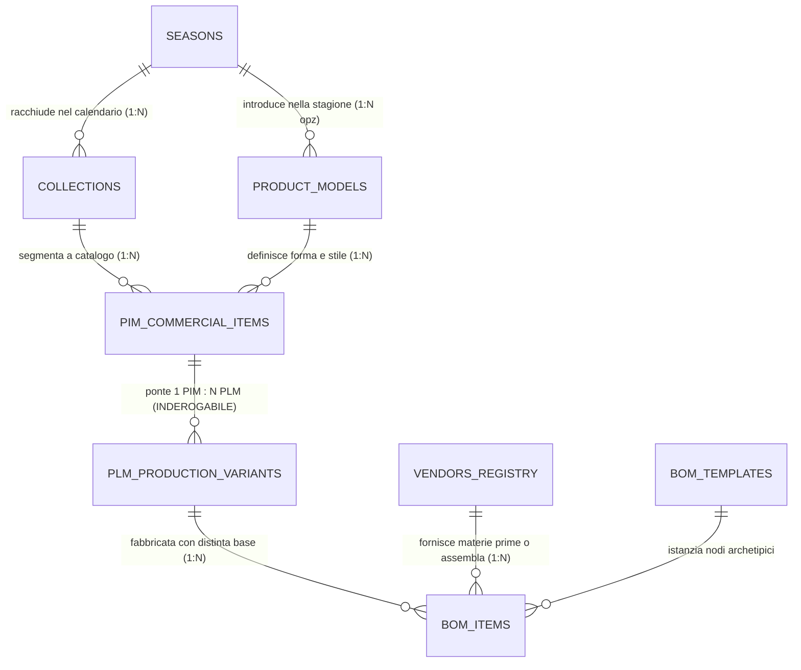

# Catalogo Master Entità di Dominio — Footlink

> **Patrimonio Costituzionale & Specifiche Fondative di Dominio**  
> Questo catalogo racchiude la mappa concettuale, ontologica e applicativa delle **principali entità del sistema Footlink**, formalizzate in formato testuale Markdown.  
> Esse costituiscono le **Living Specifications** inderogabili che guidano lo sviluppo della piattaforma PLM+PIM e devono essere **sempre mantenute aggiornate dopo ogni ciclo di sprint o modifica di codice**.

---

## 🏛️ 1. Mappa Ontologica del Dominio Manifatturiero Footlink

Footlink modella fedelmente i flussi della manifattura di eccellenza Made in Italy (calzature e pelletteria) attraverso una gerarchia relazionale organica:

---

## 📋 2. Registro Ufficiale delle Entità

| Prefisso | Entità (Italiano / Inglese) | File Markdown | Dominio Primario | C-Level Owner | Ruolo Chiave nel Sistema |
| :---: | :--- | :--- | :---: | :---: | :--- |
| `MOD-` | [**Modelli** (`Product Models`)](./MODELLI.md) | [`MODELLI.md`](./MODELLI.md) | PLM & Ufficio Stile | **CPO** | Archetipo formale, forma (*last*), costruzione suola, linee CAD. |
| `PRD-` | [**Prodotti** (`PIM Items & PLM Variants`)](./PRODOTTI.md) | [`PRODOTTI.md`](./PRODOTTI.md) | Ponte PIM ↔ PLM | **CPO / CTO** | Cardinalità cardine `1 Articolo Commerciale PIM : N Varianti PLM`. |
| `SEA-` | [**Stagioni** (`Fashion Seasons`)](./STAGIONI.md) | [`STAGIONI.md`](./STAGIONI.md) | Merchandising & Calendario | **CPO / CMO** | Contenitore temporale (P/E, A/I, Continuativo), scadenze e sell-in. |
| `COL-` | [**Collezioni** (`Collections`)](./COLLEZIONI.md) | [`COLLEZIONI.md`](./COLLEZIONI.md) | Brand & Mercato | **CMO / CRO** | Raggruppamento commerciale (Main, Runway, Capsule, Drop) e canali. |
| `BOM-` | [**Distinte Basi** (`Bill of Materials`)](./DISTINTE_BASI.md) | [`DISTINTE_BASI.md`](./DISTINTE_BASI.md) | Ingegneria & Costing | **CPO / CTO** | Struttura ad albero a 3 livelli, template, scarti, costing riservato L6. |
| `VND-` | [**Fornitori & Vendor Hub** (`Vendors & Subcontractors`)](./FORNITORI.md) | [`FORNITORI.md`](./FORNITORI.md) | Supply Chain & Filiera | **CRO / CPO** | Concerie, façonisti gratuiti a 0 €, certificazioni LWG e Where-Used 360°. |
| — | [**Template Standard Entità**](./TEMPLATE_ENTITA.md) | [`TEMPLATE_ENTITA.md`](./TEMPLATE_ENTITA.md) | Governance & Architettura | **CGO / CTO** | Schema standard da seguire per la creazione di ogni nuova entità. |

---

## ⚖️ 3. Regole Costituzionali di Governance & Allineamento Continuo

Come stabilito dalla direttiva esecutiva del Founder, queste specifiche non sono documentazione morta, ma **governano l'evoluzione del codice**:

1. **Regola della Living Specification (CTO & CPO):**  
   Nessuna modifica a uno schema database (SQLAlchemy/PostgreSQL/SQLite), a un modello Pydantic (`Applicativo/backend/app/models.py`) o a un endpoint API (`main.py`) può considerarsi completa se non è accompagnata dall'aggiornamento della corrispondente scheda in `Azienda/entita/`.
2. **Gatekeeping Obbligatorio del CGO:**  
   Il Chief Governance Officer (**CGO**) verificherà a ogni sprint review che le schede entità siano allineate al codice sorgente. Se vi sono divergenze tra codice e schede entità, il task operativo non può essere marcato come `done`.
3. **Registro Changelog Obbligatorio:**  
   Ogni modifica a un'entità deve riportare in coda al file la riga di Changelog con: Data, Versione, Task di riferimento, C-Level autore e sintesi della variazione.
4. **Accessibilità & Modifica dal Founder Control Center:**  
   Tutte le schede entità sono visualizzabili in anteprima live e modificabili direttamente dall'interfaccia web del **Founder Control Center** (`http://127.0.0.1:8080`), consentendo al Founder di affinare definizioni, attributi e regole con salvataggio atomico e sincronizzazione in tempo reale.
