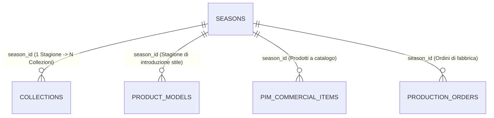
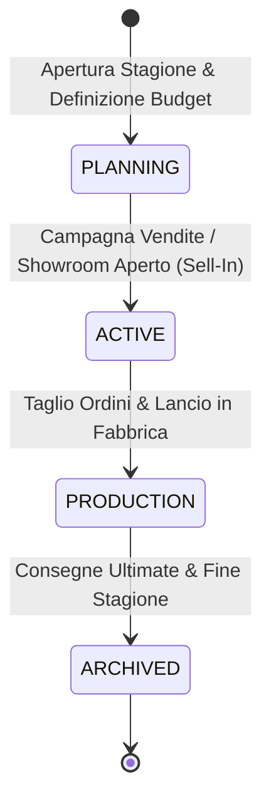

# Entità di Dominio: Stagioni (Fashion Seasons)

> **Standard Ufficiale di Specificazione di Dominio Footlink — Living Specification**  
> Questa specifica definisce l'entità **Stagione Moda** (`Season`), il contenitore temporale e di calendario che governa il ciclo vitale e la cadenza di lancio di prodotti, collezioni e produzioni nel settore fashion e calzaturiero Made in Italy (formalizzato in [ADR-007](../adr/ADR-007-flexible-data-model-seasons-collections-domain-registries.md)).

---

## 1. Identità & Metadati Canonici

| Campo | Valore / Definizione |
| :--- | :--- |
| **Nome Entità (Singolare / Plurale)** | `Stagione` (`Season`) / `Stagioni` (`Seasons`) |
| **Sigla / Prefisso Codice** | `SEA-` o codici convenzionali moda (es. `PE26`, `P/E 2026`, `AI26-27`, `CONTINUATIVO`) |
| **Dominio Funzionale Primario** | Merchandising, Pianificazione Commerciale & Calendario Industriale |
| **C-Level Owner Primario** | `CPO` (Chief Product Officer — Sviluppo Campionari) & `CMO` (Lanci e Campagne) |
| **C-Level Owner Esecutivo**| `CRO` (Pianificazione Budget Vendite) & `CTO` (Filtri Globali di Piattaforma) |
| **Stato di Governance** | `ATTIVA` (Ufficiale da Sprint 5) |
| **Ultima Revisione** | `2026-10-28` |
| **Task / ADR di Riferimento** | [`FTL-GOV-005`](../tasks/FTL-GOV-005.json), [`FTL-TECH-006`](../tasks/FTL-TECH-006.json), [`ADR-007`](../adr/ADR-007-flexible-data-model-seasons-collections-domain-registries.md) |

---

## 2. Definizione di Business & Scopo Operativo

### 2.1 Che cos'è nel mondo reale della moda e delle calzature
La moda vive secondo una scansione temporale ritmata da stagioni canoniche:
1. **Primavera / Estate (P/E o S/S - Spring/Summer):** Presentazione ai buyer a Giugno/Settembre dell'anno precedente, produzione in inverno, consegne nei negozi tra Gennaio e Aprile.
2. **Autunno / Inverno (A/I o F/W - Fall/Winter):** Presentazione a Gennaio/Febbraio (Micam, Pitti, Milano Fashion Week), produzione in primavera/estate, consegne tra Luglio e Ottobre.
3. **Continuativo / Evergreen (No-Season / All-Year):** Modelli iconici senza scadenza stagionale che vengono riassortiti a cadenza costante.

Una Stagione definisce i confini temporali di budget, validità dei listini prezzi, finestre di raccolta ordini (sell-in) e finestre di consegna nei negozi (sell-out).

### 2.2 Quale problema risolve e cosa previene
- **Evita la contaminazione di dati storici:** Separa chiaramente i campionari dell'anno in corso dagli archivi storici e dalle collezioni future in fase di prototipazione.
- **Abilita i filtri di contesto globali:** Permette a brand manager, modellisti e uffici vendite di commutare l'intera piattaforma su una stagione specifica (es. "Lavora solo su P/E 2026") visualizzando unicamente i modelli e i costi di pertinenza.
- **Governa il roll-out del Passaporto Digitale:** Assicura che le nuove normative ESPR UE vengano attivate obbligatoriamente a partire dalle stagioni target previste dalla Commissione Europea.

---

## 3. Cardinalità & Diagramma delle Relazioni (Mermaid)

### 3.1 Vincoli di Integrità Referenziale
- **Padre di `Collezioni`:** 1 Stagione racchiude N Collezioni (`1:N`). Una collezione non può esistere senza una stagione di appartenenza (`season_id` obbligatoria in `COLLECTIONS`).
- **Politica di Cancellazione:** `RESTRICT`. Non è possibile cancellare una stagione che contiene collezioni o prodotti associati. È invece supportata l'archiviazione (`status: archived`).

---

## 4. Dizionario Dati & Attributi di Dominio

### 4.1 Attributi Obbligatori (Core)
| Nome Campo | Tipo Dato | Descrizione & Esempio | Vincoli & Validazione |
| :--- | :--- | :--- | :--- |
| `season_id` | `VARCHAR(64)` | Identificativo univoco di sistema (es. `sea_pe2026_01`) | PK Univoca |
| `code` | `VARCHAR(64)` | Codice convenzionale moda (es. `PE26`, `P/E 2026`, `AI26-27`) | Not Null, Min 2 car, Unique |
| `name` | `VARCHAR(255)` | Denominazione estesa (es. *Primavera Estate 2026*) | Not Null, Min 2 car |
| `year` | `INTEGER` | Anno solare di riferimento commerciale (es. `2026`) | Range `2020` – `2050` |
| `status` | `ENUM` | Stato del ciclo stagionale (vedi Sezione 5) | Default `active` |
| `created_at` | `DATETIME` | Data e ora di creazione UTC | ISO-8601 |

### 4.2 Attributi Opzionali di Calendario Industriale
| Nome Campo | Tipo Dato | Descrizione & Esempio |
| :--- | :--- | :--- |
| `start_date` | `DATE (YYYY-MM-DD)` | Data di apertura ufficiale della stagione (campagna vendite) |
| `end_date` | `DATE (YYYY-MM-DD)` | Data di chiusura ufficiale o transizione ad archivio |
| `description` | `TEXT` | Obiettivi strategici, moodboard di stagione e direttive commerciali |
| `linked_products_count`| `INTEGER` | Contatore calcolato dei prodotti PIM associati alla stagione |

---

## 5. Ciclo di Vita & Macchina a Stati

### 5.1 Regole delle Transizioni di Stato
| Da Stato | A Stato | Descrizione Operativa |
| :--- | :--- | :--- |
| `PLANNING` | `ACTIVE` | I modelli e le collezioni sono consolidati; i buyer possono inserire pre-ordini. |
| `ACTIVE` | `PRODUCTION` | I listini prezzi sono congelati; la produzione nei calzaturifici è avviata. |
| `PRODUCTION` | `ARCHIVED` | Tutti gli ordini sono evasi; i dati diventano storici di consultazione. |

---

## 6. Regole di Business & Guardrail di Conformità

1. **Stagione Speciale "Continuativo" (`EVERGREEN`):** La piattaforma prevede obbligatoriamente una stagione tecnica permanente non archiviabile per i prodotti continuativi e le linee iconiche carryover che scavalcano le collezioni annuali.
2. **Congelamento Prezzi in Produzione:** Quando una stagione passa allo stato `PRODUCTION`, i prezzi all'ingrosso concordati nei contratti con i buyer non possono essere modificati senza autorizzazione esecutiva Founder/CRO (Escalation L3).

---

## 7. Mappatura Tecnica Applicativa

### 7.1 Backend (Python FastAPI)
- **Modelli Pydantic:** [`Applicativo/backend/app/models.py`](file:///Users/a.ciminaritodsgroup.com/Projects/FootLink_v2/Applicativo/backend/app/models.py)
  - `SeasonCreate`, `Season`, `SeasonStatus` (`PLANNING`, `ACTIVE`, `PRODUCTION`, `ARCHIVED`)
- **Tabella Database:** `seasons` (PostgreSQL / SQLite)
- **Endpoint API REST:** [`Applicativo/backend/app/main.py`](file:///Users/a.ciminaritodsgroup.com/Projects/FootLink_v2/Applicativo/backend/app/main.py)
  - `GET /api/v1/seasons/` — Lista stagioni con collezioni e contatori di prodotti
  - `POST /api/v1/seasons/` — Creazione stagione con collezioni iniziali opzionali
  - `GET /api/v1/seasons/{season_id}` — Dettaglio stagione e albero collezioni
  - `PUT /api/v1/seasons/{season_id}` — Modifica date e cambio stato

### 7.2 Frontend (React SPA)
- **Componente di Gestione:** `SeasonsCollectionsManager.tsx` (Pannello Gestione Stagioni & Collezioni).

---

## 8. Changelog & Registro Revisioni

| Data | Versione | Task / PR | Autore | Descrizione Sintetica |
| :--- | :--- | :--- | :--- | :--- |
| `2026-10-19` | `v1.0` | `FTL-GOV-005` / `ADR-007` | CTO & CPO | Creazione entità relazionale Seasons & Collections |
| `2026-10-28` | `v1.1` | Direttiva Founder | Founder & C-Suite | Formalizzazione living specification standard in `Azienda/entita/` |
