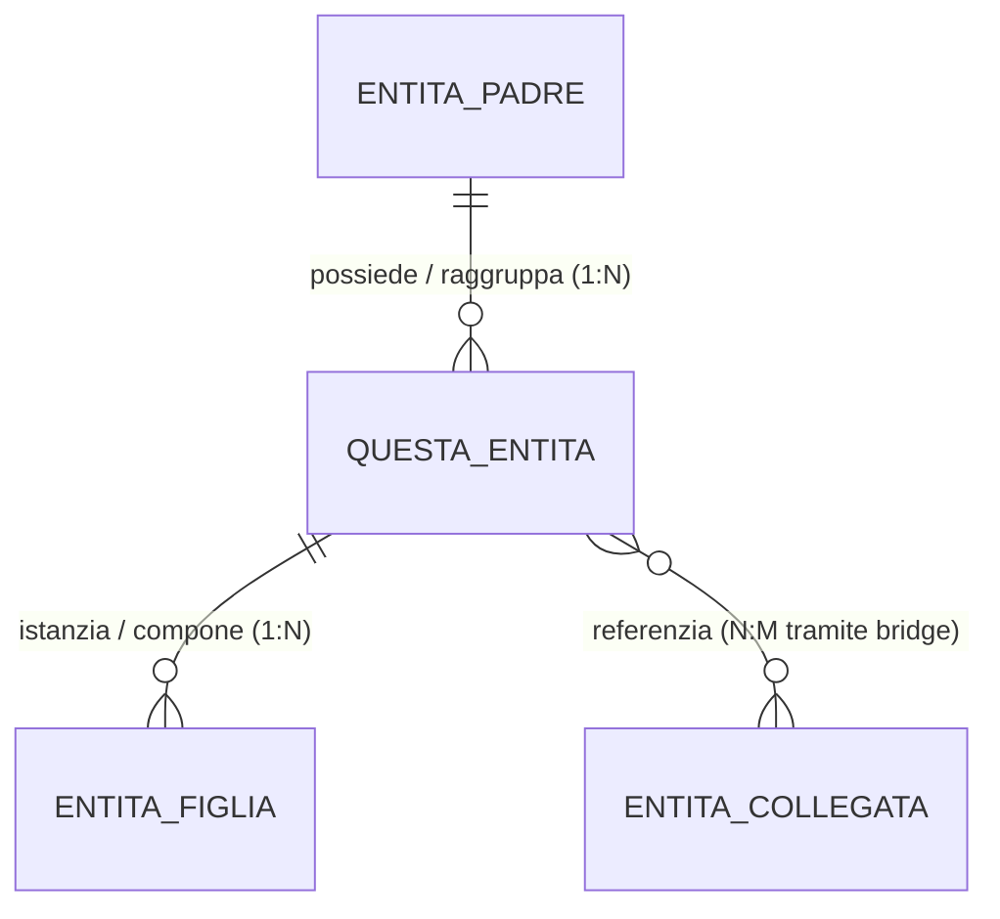
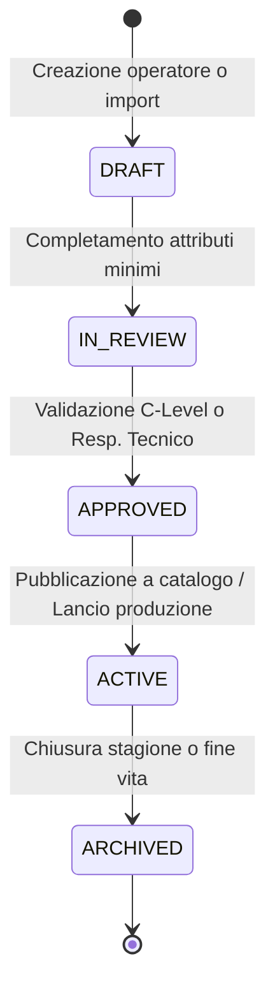

# Template Standard Entità di Dominio — Footlink

> **Standard Ufficiale di Specificazione di Dominio Footlink (v1.0)**  
> Questo template costituisce la struttura inderogabile per descrivere, documentare e governare ciascuna entità primaria della piattaforma PLM+PIM. Ogni scheda entità vive come file testuale Markdown all'interno di `Azienda/entita/`, guida lo sviluppo applicativo ed è vincolata a essere mantenuta sincronizzata a ogni ciclo di modifica o release.

---

## 1. Identità & Metadati Canonici

| Campo | Valore / Definizione |
| :--- | :--- |
| **Nome Entità (Singolare / Plurale)** | `[Nome Singolare]` / `[Nome Plurale]` |
| **Sigla / Prefisso Codice** | `[SIGLA-]` (es. `MOD-`, `PRD-`, `SEA-`, `COL-`, `BOM-`, `VND-`) |
| **Dominio Funzionale Primario** | PLM Industriale / PIM Commerciale / Merchandising / Supply Chain / Governance |
| **C-Level Owner Primario** | `[CPO / CTO / CRO / CMO / CGO]` (Responsabile della coerenza di business) |
| **C-Level Owner Tecnico** | `CTO` (Responsabile della persistenza e delle API) |
| **Stato di Governance** | `PROPOSTA` \| `ATTIVA` \| `SOTTO_REVISIONE` \| `DEPRECATA` |
| **Ultima Revisione** | `YYYY-MM-DD` |
| **Task / ADR di Riferimento** | `[FTL-XXX-YYY]` / `[ADR-ZZZ]` |

---

## 2. Definizione di Business & Scopo Operativo

### 2.1 Che cos'è nel mondo reale manifatturiero (Made in Italy)
*Descrivere in modo chiaro, concreto e senza astrazioni generiche cosa rappresenta l'entità nei calzaturifici, nelle pelletterie, nei brand di moda e nei laboratori terzisti.*

### 2.2 Quale problema risolve e cosa previene
- *Perché questa entità esiste separatamente dalle altre.*
- *Quali ambiguità, duplicazioni o errori di fabbrica/commerciali evita.*

---

## 3. Cardinalità & Diagramma delle Relazioni (Mermaid)

### 3.1 Vincoli di Integrità Referenziale
- **Padre obbligatorio / opzionale:** *Definire se l'entità può esistere orfana o se richiede FK obbligatoria.*
- **Politica di cancellazione (ON DELETE):** `RESTRICT` / `CASCADE` / `SET NULL` / `SOFT DELETE`.
- **Relazioni verso la filiera terzisti:** *Indicare se e come l'entità si proietta verso i terzisti façonisti a 0 €.*

---

## 4. Dizionario Dati & Attributi di Dominio

### 4.1 Attributi Obbligatori (Core)
| Nome Campo | Tipo Dato | Descrizione & Esempio | Vincoli & Validazione |
| :--- | :--- | :--- | :--- |
| `id` | `VARCHAR(64)` | Identificativo univoco di sistema (UUID o slug naturale) | PK univoca |
| `code` | `VARCHAR(64)` | Codice leggibile per operatori (es. `COD-001`) | Not Null, Unique per Tenant |
| `name` | `VARCHAR(255)` | Denominazione estesa dell'entità | Min length 2 car |
| `created_at` | `DATETIME` | Data e ora di creazione UTC (ISO-8601) | Auto-popolato |
| `updated_at` | `DATETIME` | Data e ora dell'ultimo salvataggio UTC | Auto-aggiornato |

### 4.2 Attributi Specifici di Settore & Merceologia
| Nome Campo | Tipo Dato | Valori Ammessi (Enum) / Formato | Descrizione Funzionale |
| :--- | :--- | :--- | :--- |
| `campo_settoriale_1` | `ENUM` / `STR` | `valore_a`, `valore_b` | Spiegazione del significato di business |
| `campo_settoriale_2` | `FLOAT` / `INT` | Range min / max, UdM (es. mm, mq, €) | Parametro tecnico o quantitativo |

### 4.3 Attributi Dinamici & Flessibilità Distrettuale (`metadata_json`)
*Specificare quali campi possono essere estesi dinamicamente dal Founder tramite il Data Model Studio senza alterare il DDL relazionale.*

---

## 5. Ciclo di Vita & Macchina a Stati

### 5.1 Regole di Transizione di Stato
| Da Stato | A Stato | Condizione / Gate di Validazione | Ruolo Autorizzato |
| :--- | :--- | :--- | :--- |
| `DRAFT` | `IN_REVIEW` | Compilazione di tutti i campi obbligatori | Operatore / Designer |
| `IN_REVIEW` | `APPROVED` | Verifica conformità tecnica e assenza conflitti | CPO / CGO |
| `APPROVED` | `ACTIVE` | Approvazione del piano di lancio o ordine | Founder / CEO |

---

## 6. Regole di Business & Guardrail di Conformità

### 6.1 Regole di Sicurezza, FinOps & Segregazione L6
- **Segregazione Costi Industriali (L6):** *I dati economici riservati (costi orari, prezzi d'acquisto pellami) sono mascherati a terzisti esterni?*
- **Accesso Terzisti a 0 €:** *Come interagisce il laboratorio façonista con questa entità senza costi di licenza SaaS?*

### 6.2 Passaporto Digitale del Prodotto (ESPR / DPP UE)
- *Quali attributi di questa entità confluiscono obbligatoriamente nel Passaporto Digitale UE.*
- *Requisiti di tracciabilità, certificazioni di filiera (`LWG`, `REACH`, `FSC`) e impronta ambientale.*

### 6.3 Data Quality & Gates di Validazione
- *Punteggio minimo di completezza (Data Quality Score) per consentire l'utilizzo nei processi a valle.*

---

## 7. Mappatura Tecnica Applicativa

### 7.1 Backend (Python FastAPI & SQLAlchemy)
- **Modello Pydantic Schemas:** `Applicativo/backend/app/models.py` (`NomeEntitaCreate`, `NomeEntita`)
- **Modello ORM Relazionale:** `Applicativo/backend/app/orm_models.py` o `database.py` (Tabella: `nome_tabella_db`)
- **Controller / Endpoint REST:** `Applicativo/backend/app/main.py`
  - `GET /api/v1/entita/` (Lista con filtri e paginazione)
  - `GET /api/v1/entita/{id}` (Dettaglio entità e relazioni)
  - `POST /api/v1/entita/` (Creazione con validazione schema)
  - `PUT /api/v1/entita/{id}` (Aggiornamento atomico)
  - `DELETE /api/v1/entita/{id}` (Archiviazione o soft-delete)

### 7.2 Frontend (React TypeScript)
- **Componente di Gestione:** `Applicativo/frontend/src/components/...`
- **Tipi TypeScript:** Interfaccia corrispondente a schema Pydantic.
- **Interazione Utente:** Tabella interattiva, modal di creazione/modifica rapida, visualizzatore gerarchico.

---

## 8. Changelog & Registro Revisioni

| Data | Versione | Task / PR | Autore (C-Level) | Sintesi della Modifica |
| :--- | :--- | :--- | :--- | :--- |
| `YYYY-MM-DD` | `v1.0` | `FTL-XXX-YYY` | `CPO / CTO` | Definizione iniziale della specifica entità |
