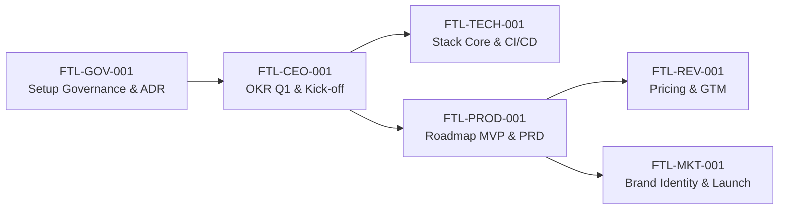

# Footlink — Autonomous C-Suite & Governance Framework

Infrastruttura digitale integrata di **PLM** (Product Lifecycle Management) e **PIM** (Product Information Management) per la filiera moda e calzaturiera.

Questo repository contiene il manifesto fondativo, le specifiche operative e le istruzioni di ruolo per la C-Suite autonoma orchestrata tramite **OpenClaw**.

---

## 📚 Documentazione Core

| Documento | Ruolo / Scopo | Descrizione |
|---|---|---|
| [📜 Manifesto di Fondazione](./Manifesto_Fondazione_Footlink.md) | **Costituzione & Governance** | Visione, pilastri tecnologici, principi operativi per agenti AI e matrice di escalation (L0–L6). |
| [👤 Role: CEO](./Role_CEO_Footlink.md) | **Chief Executive Officer** | Visione strategica, orchestrazione C-Suite, relazioni stakeholder e OKR. |
| [🏛️ Role: CGO](./Role_CGO_Footlink.md) | **Chief Governance Officer** | Task Object Schema, Decision Records (ADR), monitoraggio processi e soglie di escalation. |
| [🛠️ Role: CTO](./Role_CTO_Footlink.md) | **Chief Technology Officer** | Architettura tecnologica, standard di codice, infrastruttura task agenti e sicurezza. |
| [📦 Role: CPO](./Role_CPO_Footlink.md) | **Chief Product Officer** | Scope funzionale PLM/PIM, framework prioritizzazione RICE e user experience PMI-first. |
| [💰 Role: CRO](./Role_CRO_Footlink.md) | **Chief Revenue Officer** | Modello di pricing, strategia go-to-market, ICP, sales playbook e partnership. |
| [📢 Role: CMO](./Role_CMO_Footlink.md) | **Chief Marketing Officer** | Brand identity, demand generation, canali strategici e messaging per segmento. |

---

## 🔄 Catena di Bootstrap Task (Primo Sprint)

---

## ⚙️ Standard Operativi
- **Piattaforma Agenti:** [OpenClaw](https://openclaw.ai)
- **Task Schema:** Schema JSON v1.0 definito in `Role_CGO_Footlink.md`
- **Convenzione Commit:** Conventional Commits (`feat:`, `fix:`, `docs:`, `chore:`)
