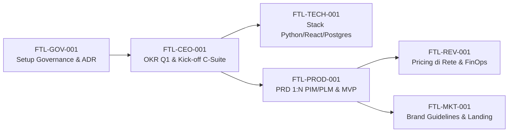

# Footlink — Autonomous C-Suite & Governance Framework

Infrastruttura digitale integrata di **PLM** (Product Lifecycle Management) e **PIM** (Product Information Management) per la filiera **calzaturiera, della pelletteria e dell'abbigliamento**.

Questo repository contiene il manifesto fondativo, le specifiche operative e le istruzioni di ruolo per la C-Suite autonoma (CEO, CGO, CTO, CPO, CRO, CMO) orchestrata tramite **OpenClaw** con supervisione del Founder.

---

## 📚 Documentazione Core (Tutti i Ruoli Approvati v1.0)

| Documento | Ruolo / Ambito | Stato | Descrizione |
|---|---|:---:|---|
| [📜 Manifesto di Fondazione](./Manifesto_Fondazione_Footlink.md) | **Costituzione & Governance** | 🟢 Approvato v1.0 | Visione, principi operativi agenti AI, zero spesa autonoma, AI Quota policy e matrice escalation (L0–L6). |
| [👤 Role: CEO](./Role_CEO_Footlink.md) | **Chief Executive Officer** | 🟢 Approvato v1.0 | Visione, coordinamento C-Suite, arbitraggio blocchi (< 24h), supervisione FinOps e interfaccia Founder. |
| [🏛️ Role: CGO](./Role_CGO_Footlink.md) | **Chief Governance Officer** | 🟢 Approvato v1.0 | Task Object Schema JSON v1.0, stato `paused_ai_quota`, template ADR e soglie automatiche di escalation. |
| [🛠️ Role: CTO](./Role_CTO_Footlink.md) | **Chief Technology Officer** | 🟢 Approvato v1.0 | Architettura Python + React + PostgreSQL, free-tier hosting, standard di codice e report Cost-to-Serve. |
| [📦 Role: CPO](./Role_CPO_Footlink.md) | **Chief Product Officer** | 🟢 Approvato v1.0 | Modello dati **1 PIM (Vendita) ↔ N PLM (Produzione)**, schede tecniche, BOM, DPP e scoring RICE. |
| [💰 Role: CRO](./Role_CRO_Footlink.md) | **Chief Revenue Officer** | 🟢 Approvato v1.0 | Modello a rete (Terzisti a costo zero, PMI SaaS, Brand Enterprise) e FinOps Unit Economics (Margine > 75%). |
| [📢 Role: CMO](./Role_CMO_Footlink.md) | **Chief Marketing Officer** | 🟢 Approvato v1.0 | Brand identity, marketing organico B2B nei distretti (LinkedIn, SEO, fiere), zero ads e controllo uscite L5. |

---

## 🏗️ Principi Architetturali e di Business Fondamentali

1. **Il Ponte PIM ↔ PLM (1 : N):** 1 articolo commerciale PIM rivolto alla **vendita** può essere associato a **uno o più articoli PLM** rivolti alla **produzione** (multi-sourcing, lotti diversi, laboratori differenti).
2. **Effetto Rete a Costo Zero:** I laboratori terzisti accedono e collaborano **a costo zero**, rendendo virale l'adozione per le PMI produttive e i Brand.
3. **Gestione FinOps Rigorosa:** Monitoraggio continuo del *Cost-to-Serve* (consumo computazionale e quote AI per cliente) per garantire un margine lordo SaaS costantemente superiore al 75%.
4. **Zero Spesa Monetaria Autonoma:** Nessun agente AI ha facoltà di spesa monetaria reale (> €0) né di firma contrattuale; tutte le spese e gli accordi sono riservati al Founder (Livello L2).
5. **AI Quota & Circuit Breaker:** In caso di esaurimento crediti o rate-limit del piano Google AI Pro, l'operatività va in pausa ordinata (`paused_ai_quota`) fino al ciclo successivo senza creare disservizi.

---

## 🔄 Catena di Bootstrap Task (Primo Sprint)

---

## ⚙️ Standard Operativi
- **Piattaforma Agenti:** [OpenClaw](https://openclaw.ai)
- **Task Schema:** Schema JSON v1.0 definito in `Role_CGO_Footlink.md`
- **Convenzione Commit:** Conventional Commits (`feat:`, `fix:`, `docs:`, `chore:`)
