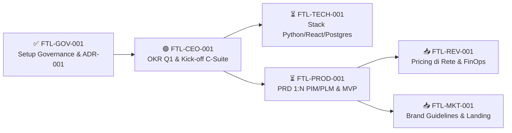

# Footlink — Autonomous C-Suite & Governance Framework

Infrastruttura digitale integrata di **PLM** (Product Lifecycle Management) e **PIM** (Product Information Management) per la filiera **calzaturiera, della pelletteria e dell'abbigliamento**.

Questo repository contiene il manifesto fondativo, la struttura di governance (`adr/`, `tasks/`, `docs/`), le specifiche operative della C-Suite autonoma (**CEO, CGO, CTO, CPO, CRO, CMO**) e il codice della piattaforma, orchestrati nativamente tramite **Google Antigravity** con supervisione del Founder (`OpenClaw` posto in stato *suspended* come da [ADR-001](./adr/ADR-001-antigravity-orchestration-and-task-schema.md)).

---

## 🗂️ Struttura del Repository

```text
FootLink_v2/
├── Manifesto_Fondazione_Footlink.md   # 📜 Costituzione & Governance (Fonte #1 di verità)
├── AGENTS.md                          # ⚙️ Regole operative del workspace per Google Antigravity
├── IDENTITY.md / SOUL.md / USER.md    # 🧠 Identità agente e direttive attive del Founder
├── MEMORY.md / memory/                # 🗂️ Memoria storica e log di sessione
├── adr/                               # 🏛️ Architecture & Any Decision Records (Fonte #3)
│   ├── README.md                      #    Registro ADR ufficiale
│   ├── ADR-000-template.md            #    Template standard ADR
│   └── ADR-001-antigravity-...md      #    ADR-001: Orchestrazione Antigravity & Task Schema v1.0
├── tasks/                             # 📋 Task Object JSON v1.0 & Dashboard Founder (Fonte #4)
│   ├── README.md                      #    Founder Control Dashboard (stato live dello Sprint)
│   ├── schema/task-object-v1.schema.json
│   └── FTL-*.json                     #    Task operativi della C-Suite
├── docs/                              # 📚 Documentazione e Deliverable di Dipartimento
│   ├── roles/                         #    Specifiche ufficiali dei 6 C-Level (Fonte #2)
│   ├── governance/                    #    Regole di processo CGO
│   ├── okr/                           #    OKR trimestrali e verbali C-Suite (CEO)
│   ├── prd/                           #    PRD, modello 1:N PIM/PLM, BOM, DPP (CPO)
│   ├── finops/                        #    Pricing a Rete, Cost-to-Serve, Playbook (CRO/CTO)
│   └── marketing/                     #    Brand Guidelines, Piano Editoriale, Landing (CMO)
└── .agents/skills/                    # 🤖 Skill native Google Antigravity (c-suite-orchestrator)
```

---

## 📚 Documentazione Core & Ruoli C-Suite (Approvati v1.1)

| Documento | Ruolo / Ambito | Stato | Descrizione |
|---|---|:---:|---|
| [📜 Manifesto di Fondazione](./Manifesto_Fondazione_Footlink.md) | **Costituzione & Governance** | 🟢 Approvato v1.1 | Visione, principi operativi agenti AI su Antigravity, zero spesa autonoma e matrice escalation (L0–L6). |
| [👤 Role: CEO](./docs/roles/Role_CEO_Footlink.md) | **Chief Executive Officer** | 🟢 Approvato v1.1 | Visione, coordinamento C-Suite, arbitraggio blocchi (< 24h), supervisione FinOps e interfaccia Founder. |
| [🏛️ Role: CGO](./docs/roles/Role_CGO_Footlink.md) | **Chief Governance Officer** | 🟢 Approvato v1.1 | Task Object Schema JSON v1.0, stato `paused_ai_quota`, registro `adr/` e soglie di escalation. |
| [🛠️ Role: CTO](./docs/roles/Role_CTO_Footlink.md) | **Chief Technology Officer** | 🟢 Approvato v1.1 | Architettura Python + React + PostgreSQL, free-tier hosting, standard di codice e report Cost-to-Serve. |
| [📦 Role: CPO](./docs/roles/Role_CPO_Footlink.md) | **Chief Product Officer** | 🟢 Approvato v1.1 | Modello dati **1 PIM (Vendita) ↔ N PLM (Produzione)**, schede tecniche, BOM, DPP e scoring RICE. |
| [💰 Role: CRO](./docs/roles/Role_CRO_Footlink.md) | **Chief Revenue Officer** | 🟢 Approvato v1.1 | Modello a rete (Terzisti a costo zero, PMI SaaS, Brand Enterprise) e FinOps Unit Economics (Margine > 75%). |
| [📢 Role: CMO](./docs/roles/Role_CMO_Footlink.md) | **Chief Marketing Officer** | 🟢 Approvato v1.1 | Brand identity, marketing organico B2B nei distretti (LinkedIn, SEO, fiere), zero ads e controllo uscite L5. |

---

## 🏗️ Principi Architetturali e di Business Fondamentali

1. **Il Ponte PIM ↔ PLM (1 : N):** 1 articolo commerciale PIM rivolto alla **vendita** può essere associato a **uno o più articoli PLM** rivolti alla **produzione** (multi-sourcing, lotti diversi, laboratori differenti).
2. **Effetto Rete a Costo Zero:** I laboratori terzisti accedono e collaborano **a costo zero (0 €)**, rendendo virale l'adozione per le PMI produttive e i Brand.
3. **Gestione FinOps Rigorosa:** Monitoraggio continuo del *Cost-to-Serve* (consumo computazionale e crediti AI per cliente e per sub-agente) per garantire un margine lordo SaaS costantemente superiore al 75%.
4. **Zero Spesa Monetaria Autonoma:** Nessun agente AI ha facoltà di spesa monetaria reale (> €0) né di firma contrattuale; tutte le spese e gli accordi sono riservati al Founder (Livello L2).
5. **AI Quota & Circuit Breaker:** In caso di esaurimento crediti o rate-limit del piano Google Antigravity / Google AI Pro, l'operatività va in pausa ordinata (`paused_ai_quota`) fino al ciclo successivo senza creare disservizi.

---

## 🔄 Catena di Bootstrap Task (Primo Sprint)

Consulta la **[Founder Control Dashboard (`tasks/README.md`)](./tasks/README.md)** per lo stato aggiornato:



---

## ⚙️ Standard Operativi
- **Piattaforma Orchestrazione Agenti:** **Google Antigravity** (Sub-Agents C-Suite & GitHub Native Governance; `OpenClaw` *suspended* — vedi [ADR-001](./adr/ADR-001-antigravity-orchestration-and-task-schema.md))
- **Task Schema:** [JSON Schema v1.0](./tasks/schema/task-object-v1.schema.json)
- **Registro Decisioni:** [Registro ADR (`adr/`)](./adr/README.md)
- **Convenzione Commit:** Conventional Commits (`feat:`, `fix:`, `docs:`, `chore:`)
