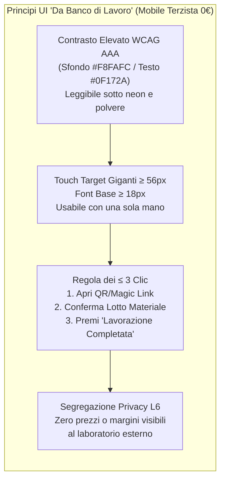

# Footlink — Brand Guidelines & Design System v1.0

- **Documento ID:** `MKT-BRAND-001`
- **Task di Riferimento:** [`FTL-MKT-001`](../../tasks/FTL-MKT-001.json)
- **Autore:** CMO (`footlink-cmo`)
- **Allineamento Strategico:** [`Manifesto_Fondazione_Footlink.md`](../../Manifesto_Fondazione_Footlink.md), [`OKR-2026-Q4-2027-Q1`](../okr/OKR-2026-Q4-2027-Q1.md), [`PRD-001`](../prd/PRD-001-mvp-pim-plm.md), [`ADR-003`](../../adr/ADR-003-domain-model-1-to-n-pim-plm.md)
- **Perimetro Merceologico:** Calzature, Pelletteria, Abbigliamento (Distretti Manifatturieri Italiani)
- **Vincolo FinOps & Governance:** Zero Paid Ads (`0 €`); Qualsiasi modifica futura a logo/palette richiede `ADR` approvato dal Founder; Qualsiasi pubblicazione esterna richiede **Escalation Livello L5 (Approvazione Founder)**.

---

## 1. Posizionamento Strategico & Manifesto di Brand

### 1.1 Category Design & Payoff Ufficiale
Footlink non è l'ennesimo gestionale legacy calato dall'alto né un tool astratto da Silicon Valley. È **l'infrastruttura digitale di filiera** nata per connettere i reparti produttivi dei distretti italiani (PLM) con i canali di vendita globali e la conformità europea (PIM + DPP).

- **Tagline Primaria (Payoff):** *"Dalla Fabbrica alla Vendita in un unico Link."*
- **Sub-headline Tecnica:** *"Il primo sistema operativo integrato `1 Articolo PIM ↔ N Articoli PLM` per calzature, pelletteria e abbigliamento. Schede tecniche, distinte base e Passaporto Digitale UE connessi in tempo reale. Con i tuoi laboratori terzisti sempre a 0 €."*
- **Posizionamento Competitivo:**
  - *Contro il caos analogico (Excel + PDF + WhatsApp):* Elimina gli errori di versione sulle distinte base (BOM), i lotti non tracciati e i ritardi di trascrizione sui cataloghi B2B/e-commerce.
  - *Contro i colossi Enterprise (Centric, Kubix Link, Lectra):* Implementazione in giorni anziché mesi, costo accessibile per le PMI manifatturiere e zero barriere d'ingresso per i façonisti grazie al flusso mobile **"Zero-Training Terzista (≤ 3 clic)"**.

### 1.2 Manifesto di Marca per la Manifattura Italiana
> **"Il saper fare artigiano merita un'infrastruttura all'altezza delle sue mani."**
>
> Nei distretti di Fermo e Macerata, tra le concerie e le pelletterie di Santa Croce e Firenze, lungo la Riviera del Brenta, nei laboratori tessili del Veneto, della Lombardia e della Puglia, nascono i prodotti più ammirati al mondo. Eppure, chi taglia un vitello pregiato, chi orla una tomaia a regola d'arte o chi monta una borsa d'alta gamma è ancora costretto a rincorrere fogli Excel fuori sincrono, bolle stropicciate e foto scambiate su WhatsApp.
>
> **Footlink nasce per spezzare l'isolamento dei dati di fabbrica.**
> Crediamo che la tecnologia debba adattarsi al banco di lavoro, e non il contrario. Per questo abbiamo unito in un solo ponte nativo il mondo del prodotto (**PLM**) e il mondo del mercato (**PIM**), rendendo l'accesso gratuito per sempre a tutti i laboratori terzisti della filiera. Perché una catena è forte e trasparente solo quando ogni suo anello è connesso.

---

## 2. Identità Visiva: Logo, Palette Colori e Tipografia

### 2.1 Concetto del Logotipo
Il marchio **FOOTLINK** fonde il rigore ingegneristico dei dati con la matericità delle cuciture manifatturiere:
- **Pittogramma ("Il Nodo di Giunteria Digitale"):** Due anelli geometrici intrecciati a 45° con angoli smussati tecnici (`border-radius: 6px`), dove il primo anello rappresenta il **Codice Commerciale Unico (`1 PIM`)** e il secondo anello multi-traccia rappresenta le **Esecuzioni Produttive e i Lotti di Fabbrica (`N PLM`)**, uniti da un punto di ribattitura color *Cuoio Toscano*.
- **Wordmark:** Carattere geometrico ad alta leggibilità (`Plus Jakarta Sans ExtraBold`, tracking `-0.03em`), con `"Foot"` in *Blu Officina* e `"link"` evidenziato dal connettore grafico.

### 2.2 Palette Colori Istituzionale & UI ("Artigianato Industriale + Tech")
La palette cromatica evita i colori fluo tipici del SaaS consumer e adotta toni radicati nella materia prima (cuoio naturale, ferro di trancia, carta modello) affiancati da indicatori semantici ad **altissimo contrasto (WCAG AAA)** pensati per la lettura sotto i neon dei reparti di taglio, giunteria e montaggio.

| Ruolo Colore | Nome Identitario | HEX | RGB | Variabile CSS | Utilizzo Principale (Brand & UI) |
|--------------|------------------|-----|-----|---------------|----------------------------------|
| **Primary Brand** | **Blu Officina Profondo** | `#0F172A` | `15, 23, 42` | `--fl-navy-900` | Header, testo primario, navigazione PLM/PIM, autorevolezza tecnica |
| **Accent Craft** | **Cuoio Toscano Vivo** | `#C25E00` | `194, 94, 0` | `--fl-leather-600` | Call-to-Action primarie, nodo logo, badge artigianalità e distretti |
| **Accent Tech** | **Blu Connessione 1:N** | `#0284C7` | `2, 132, 199` | `--fl-link-600` | Relazioni `1 PIM ↔ N PLM`, link ipertestuali, badge QR Code DPP UE |
| **Network / Success** | **Verde Via Libera Reparto** | `#15803D` | `21, 128, 61` | `--fl-factory-green` | Bottone gigante conferma Terzista, stato `QC_PASSED`, conformità ESPR 100% |
| **Warning / Alert** | **Ambra Sfrido / Attenzione** | `#B45309` | `180, 83, 9` | `--fl-amber-warn` | Campi DPP mancanti, scostamento consumi BOM, lotti in scadenza |
| **Danger / Error** | **Rosso Fermo Linea** | `#B91C1C` | `185, 28, 28` | `--fl-red-stop` | Difettosità campionatura, certificato REACH/LWG scaduto, blocco pubblicazione |
| **Neutral Surface** | **Carta Modello / Avorio Tecnico** | `#F8FAFC` | `248, 250, 252` | `--fl-surface-50` | Sfondo applicazione e landing page (riduce il riverbero visivo su tablet) |
| **Border / Grid** | **Grigio Fustella** | `#CBD5E1` | `203, 213, 225` | `--fl-border-300` | Griglie Distinta Base (BOM), separatori tabelle taglie e schede tecniche |

### 2.3 Sistema Tipografico (100% Google Fonts Open-Source — Costo 0 €)
1. **Titoli & Brand Display — `Plus Jakarta Sans` (Weights: 600, 700, 800):**
   - Solido, contemporaneo, progettato per trasmettere precisione industriale nei titoli H1–H3 della Landing Page e nelle testate delle Schede Modello.
2. **Interfaccia Operativa & Corpo Testo — `Inter` (Weights: 400, 500, 600):**
   - Massima leggibilità su schermi Android/iOS economici e monitor di fabbrica, con cifre tabulari (`font-variant-numeric: tabular-nums`) attive di default per allineare consumi, prezzi e scale taglie.
3. **Codici Tecnici, SKU, Lotti e Hash DPP — `JetBrains Mono` (Weights: 500, 700):**
   - Obbligatorio per tutti gli identificativi tecnici (`FL-SHOE-2027-001`, `PLM-CHELSEA-01A`, `LOT-2027-55`, codici forma `FRM-884`, unità di misura `PQ`, `MQ`, `MT`). Distingue nettamente lo zero `0` dalla lettera `O` e l'uno `1` dalla `I` maiuscola, azzerando gli errori di lettura in magazzino pelli.

### 2.4 Iconografia Tecnica di Settore
Set iconografico basato su **Lucide Icons** (open-source MIT, stroke `2px`), integrato da pittogrammi vettoriali dedicati alle fasi manifatturiere:
- **Calzatura:** Forma (`Last`), Trancia/Taglio Tomaia, Giunteria/Orlatura, Suola/Fondo, Montaggio.
- **Pelletteria:** Pellame intero (Piedi Quadri), Spaccatura/Scarnitura, Galvanica/Metalleria, Tingibordo.
- **Abbigliamento:** Rocca filato/Pezza tessuto, Cartamodello CAD/Punti di Misura (POM), Lavaggio/Tintoria.
- **Compliance & Rete:** Scudo Passaporto Digitale UE (`ESPR/DPP`), QR Code dinamico di lotto, Badge `0 € Terzista Verificato`.

---

## 3. Tono di Voce & Messaging Framework Multi-Target

### 3.1 I 4 Principi del Tono di Voce Footlink
1. **Parla come un Direttore di Produzione, non come una Big Tech:**
   - ✅ *Sì:* "Scheda modello", "Distinta base (BOM)", "Consumo in Piedi Quadri (PQ) e sfrido", "Tomaificio e montaggio", "Bolla con QR Code", "Lotto conceria certificato LWG".
   - ❌ *No:* "Paradigma olistico omnicanale", "Digital twin disruptivo", "Sinergia cloud-native", "Empowerment dell'ecosistema".
2. **Pragmatico e Misurabile:** Ogni frase deve rispondere alla domanda del titolare di PMI: *"Quante ore di telefonate e quanti errori di produzione mi fa risparmiare questa settimana?"*
3. **Rassicurante per il Terzista:** Il laboratorio esterno teme che il software serva a "controllarlo" o a fargli pagare un canone. Il messaggio per i terzisti deve ribadire subito: **Gratis per sempre (0 €), 3 clic sullo smartphone, zero burocrazia, riservatezza totale.**
4. **Autorevole sulla Normativa Europea (DPP / ESPR):** Nei confronti dei Brand Moda e degli Export Manager, Footlink si esprime con rigore normativo sul Regolamento UE 2024/1781 (Ecodesign / Digital Product Passport), trasformando un obbligo di legge complesso in un automatismo nativo.

### 3.2 Matrice di Messaging Differenziata per Segmento (ICP)

| Dimensione | 1. Laboratori Terzisti / Façonisti (Tomaifici, Suolifici, Pelletterie, Confezioni) | 2. PMI Produttive (Calzaturifici, Pelletterie e Maglifici con marchio o Private Label) | 3. Brand Moda & Committenti Capofila (Uffici Stile, Operations, Sustainability) |
|------------|------------------------------------------------------------------------------------|----------------------------------------------------------------------------------------|---------------------------------------------------------------------------------|
| **Dolore Primario (Pain)** | *"Ricevo schede PDF diverse su WhatsApp ed email, rischio di tagliare la pelle col cartamodello vecchio e perdo ore al telefono per confermare le bolle."* | *"Abbiamo 50 file Excel che non parlano tra loro: quando cambia un accessorio o un fornitore in fabbrica, il catalogo commerciale e i costi sono già sbagliati."* | *"Gestiamo più stabilimenti e decine di terzisti per gli stessi SKU: raccogliere i lotti e le certificazioni LWG/REACH per il Passaporto Digitale UE (DPP) è un incubo manuale."* |
| **Promessa Core (Value Prop)** | **"Lavora senza errori, dal tuo telefono, a 0 € per sempre."** | **"Un'unica verità dalla distinta base in fabbrica al catalogo di vendita."** | **"Tracciabilità di lotto end-to-end e Passaporto Digitale UE (DPP) generato in automatico."** |
| **Elevator Pitch (30 sec)** | *"Con Footlink non devi installare nulla né pagare abbonamenti. Inquadri il QR code sulla bolla con lo smartphone, vedi l'ultima versione approvata della scheda modello, confermi il lotto di pelle e segni 'Pronto per Consegna' in 3 tocchi e meno di 5 minuti."* | *"Footlink collega in automatico l'ufficio tecnico e il commerciale grazie al motore `1 Articolo PIM ↔ N Articoli PLM`. Crei la scheda tecnica e la BOM multi-livello con consumi e sfridi, inviti gratis i tuoi terzisti e hai il catalogo B2B/B2C sempre allineato."* | *"Footlink risolve il dual-sourcing e la conformità ESPR: colleghi un singolo SKU commerciale a tutte le varianti produttive dei tuoi façonisti (`1:N`), raccogli i certificati di lotto alla fonte e pubblichi il QR Code del Passaporto Digitale UE con qualità dati al 100%."* |
| **Proof Point Tecnico (`PRD-001`)** | Piano `FREE_FOREVER_0_EUR` bloccato a livello architetturale; accesso Magic Link; UX mobile in **≤ 3 clic e < 5 minuti**. | BOM a 3 livelli con calcolo consumi (`PQ/MQ/MT`) e `% sfrido`; clonazione ed ereditarietà varianti produttive `1:N`. | Mappatura nativa dei **10 blocchi ESPR / DPP UE**, segregazione costi B2B (L6) e vista differenziata Consumatore vs Dogane. |
| **Call to Action (CTA)** | *"Attiva il tuo Laboratorio Gratis (0 €)"* | *"Richiedi l'Accesso Pilota per la tua Fabbrica"* | *"Prenota una Demo Architetturale DPP & 1:N"* |

---

## 4. Linee Guida UI/UX Co-Progettate per i Laboratori ("Zero-Friction Factory UI")

In stretta sinergia con il CPO (`PRD-001` Sezione 5), ogni interfaccia di Footlink — a partire dalla Landing Page fino al portale mobile del terzista — rispetta i criteri di ergonomia industriale:

1. **Ergonomia "One-Handed Reparto":** Nella vista mobile Terzista (`viewport 360px–430px`), i pulsanti d'azione principali sono posizionati nella metà inferiore dello schermo (zona del pollice), hanno altezza minima di `56px` (`padding: 16px 24px`) e utilizzano etichette verbali esplicite (*"CONFERMA GIUNTERIA COMPLETATA — 120 PAIA"*).
2. **Chiarezza Visiva `1 PIM ↔ N PLM` su Desktop:** Nelle schermate per modellisti e uffici prodotto PMI/Brand, la relazione `1:N` è sempre rappresentata da una **Split-Bar superiore**: a sinistra il badge blu dell'Articolo Commerciale unico (`PIM SKU`), a destra i tab intercambiabili delle varianti industriali di fabbrica (`PLM Linea A`, `PLM Linea B`) con semaforo di completamento DPP (`0–100%`).
3. **Zero Rumore Decorativo:** Vietati caroselli animati pesanti, popup intrusivi o illustrazioni astratte. Ogni elemento grafico deve mostrare dati reali di calzature, pelletteria o abbigliamento (tabelle taglie, consumi in piedi quadri, certificati LWG/OEKO-TEX, anteprima QR Code Passaporto Digitale).

---

## 5. Governance del Brand & Gate di Escalation

- **Escalation Livello L5 (Comunicazione Pubblica):** Nessuna pagina web, post social, comunicato stampa o materiale presente in questo documento può essere reso pubblico in rete senza l'approvazione esplicita del **Founder** tramite la *Founder Control Dashboard*.
- **Escalation Livello L2 (Zero Spesa Autonoma):** Tutti gli asset tipografici, iconografici e di hosting della Landing Page utilizzano esclusivamente risorse open-source e piani **Free-Tier a costo 0 €**.
